

# 2026 IT ARENA

**센서 기반 자율주행 경주 · GIST-ISAAC-Robotics**

ROS 2 Jazzy · Gazebo Harmonic · NVIDIA Jetson · ESP32

[성공 시연](#성공-시뮬레이션-영상) · [차량 설계](#차량-설계) · [회로도](#전장과-제어-구조) · [최종 소스](#최종-버전과-재현) · [경기 기록](#결과와-개발-기록)

<a href="docs/hardware/PACKAGING_FINAL_2026_11_13.md">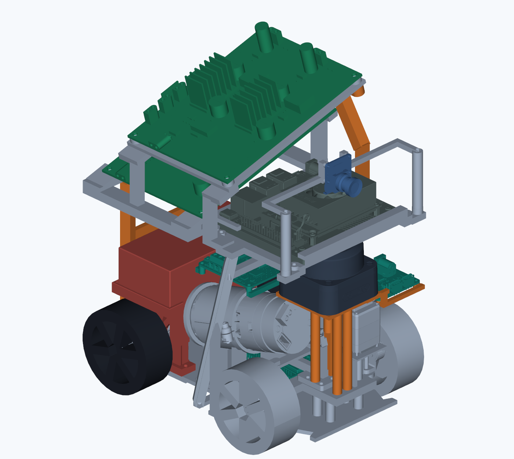</a>

*11/13 패키징 CAD 렌더 · 실물 사진이 아닙니다.*

카메라·2D LiDAR·IMU·모터축 엔코더를 사용해 코스를 인식하고, 지역 경로 추종과 독립 보호층으로 차량을 제어하는 자율주행 경주 프로젝트입니다. 코스 변경 대응, 다중 차량 주행, 전장·기구 설계와 실물 이관까지의 개발 자료를 보존합니다.

> **대회 종료 · 2026-11-14** 
> 경기 시작 시 사용 가능한 MCU와 연결된 Jetson 운용 장치가 없어 차량은 주행하지 못했습니다. 아래 영상은 개발 중 성공한 **시뮬레이션 기록**입니다. 보존할 대회용 최종 기준은 **Jetson + ESP32**이며, UNO Q 대체안은 현장에서 사용하지 못했습니다. [경기 결과와 후기](docs/reports/COMPETITION_RESULT_2026_11_14.md)

## 성공 시뮬레이션 영상

코스별 빠른 성공 기록과 이후 조건을 반영한 성공 기록을 나누어 선정합니다. 코스·차량·센서·연산 조건이 다른 랩타임을 하나의 순위로 비교하지 않습니다. 영상의 소스 버전은 보존된 ESP32 최종 소스와 다를 수 있습니다.

**썸네일을 누르면 개별 MP4로 이동합니다.** 1080p · 30 fps · 무음 · 1.0배속. 저장된 실제 시뮬레이션 자세를 낮은 추적 시점으로 재렌더했습니다. 새 주행이나 실차 촬영이 아닙니다.

### 코스별 속도 대표

<table>
<tr>
<td width="50%" valign="top"><a href="artifacts/videos/2026-11-15/a_curved_course_r15_solo_lap.mp4">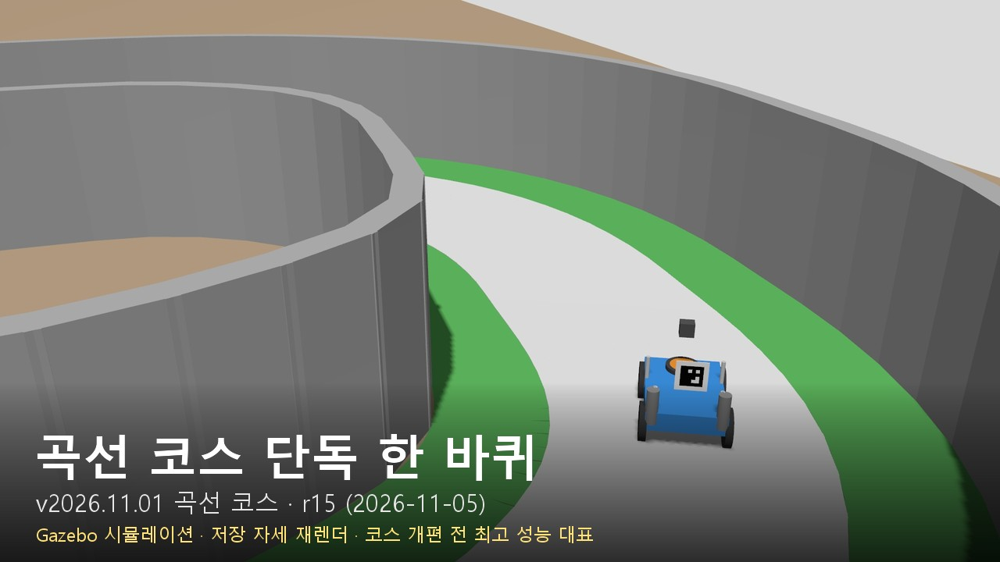</a> <b>곡선 코스 · 개편 전</b> r15 · 첫 초록 표본→결승 <b>31.850 sim s</b> <a href="artifacts/videos/2026-11-15/a_curved_course_r15_solo_lap.mp4">▶ 영상 보기</a> · <a href="artifacts/validation/2026-11-05/solo_straight_closed_loop_v1/README.md">원 시험 기록</a></td>
<td width="50%" valign="top"><a href="artifacts/videos/2026-11-15/b_right_angle_course_r25_solo_lap.mp4">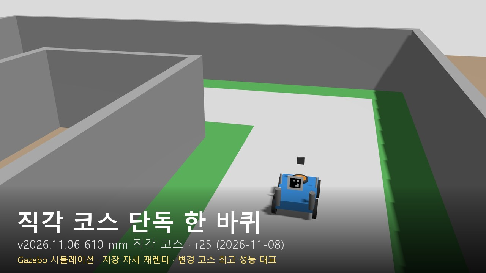</a> <b>직각 코스 · 개편 후</b> r25 · RGB 출발 기록→목표 도달 <b>29.228 sim s</b> <a href="artifacts/videos/2026-11-15/b_right_angle_course_r25_solo_lap.mp4">▶ 영상 보기</a> · <a href="artifacts/validation/2026-11-08/solo_gap_envelope_connected_v3/README.md">원 시험 기록</a></td>
</tr>
</table>

### 추가 조건을 반영한 완주

<table>
<tr>
<td width="50%" valign="top"><a href="artifacts/videos/2026-11-15/c_right_angle_late_dev_r475_solo_lap.mp4">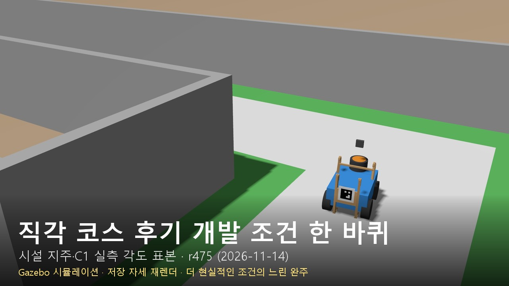</a> <b>시설물·센서 표본 반영</b> r475 · GREEN→랩 검출 <b>49.882 sim s</b> 시설 지주 3개 · C1 실측 각도 표본 <a href="artifacts/videos/2026-11-15/c_right_angle_late_dev_r475_solo_lap.mp4">▶ 영상 보기</a> · <a href="artifacts/validation/2026-11-14/solo_full_lap_r475_v1/RESULT.md">원 시험 기록</a></td>
<td width="50%" valign="top"><a href="artifacts/videos/2026-11-15/f_sensor_noise_delay_traffic_r38.mp4">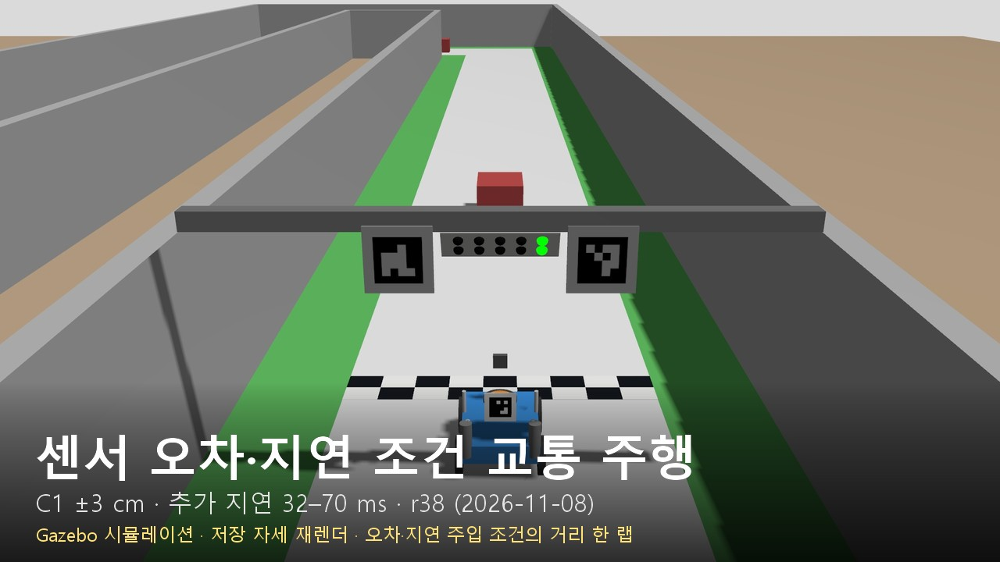</a> <b>센서 오차·지연 + 앞차 2대</b> r38 · 60초 평가창에서 <b>48.09 m · 거리 한 바퀴</b> C1 ±3 cm · 추가 지연 32–70 ms <a href="artifacts/videos/2026-11-15/f_sensor_noise_delay_traffic_r38.mp4">▶ 영상 보기</a> · <a href="artifacts/validation/2026-11-08/masked_motion_speed_v1/README.md">원 시험 기록</a></td>
</tr>
</table>

### 기능별 시연

<table>
<tr>
<td width="50%" valign="top"><a href="artifacts/videos/2026-11-15/d1_overtake_medium_lead_r15.mp4">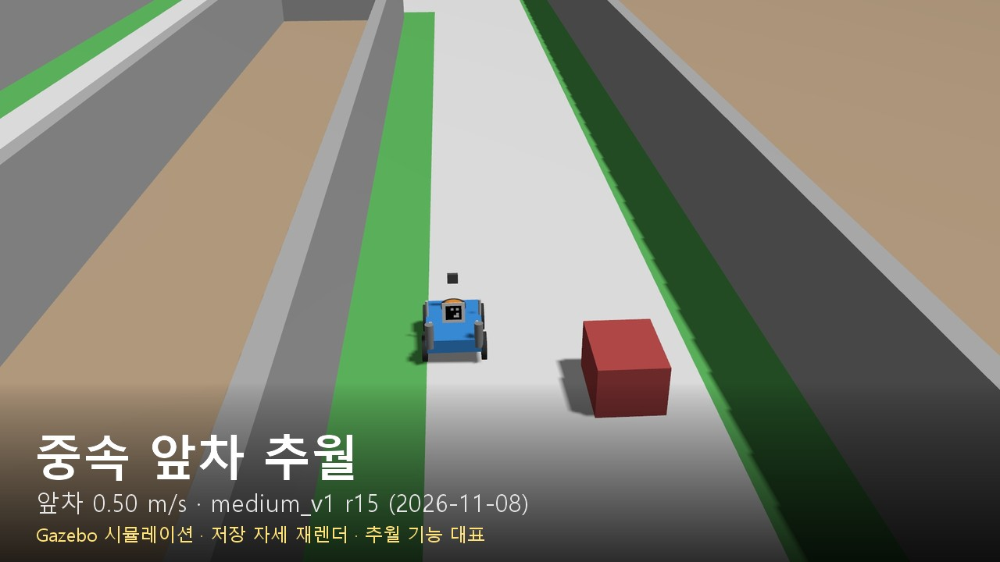</a> <b>이동차 추월·복귀</b> r15 medium_v1 · 앞차 <b>0.50 m/s</b> <a href="artifacts/videos/2026-11-15/d1_overtake_medium_lead_r15.mp4">▶ 영상 보기</a> · <a href="artifacts/validation/2026-11-08/medium_pass_connected_v1/README.md">원 시험 기록</a></td>
<td width="50%" valign="top"><a href="artifacts/videos/2026-11-15/d2_bypass_stopped_car_r18.mp4">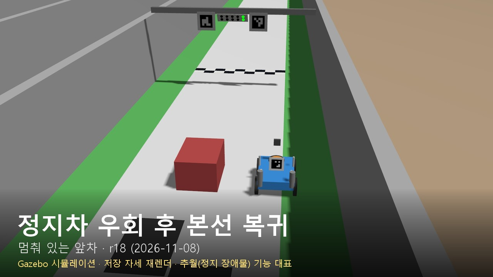</a> <b>정지차 우회·복귀</b> r18 · 정지 상대 완전 통과 후 본선 복귀 <a href="artifacts/videos/2026-11-15/d2_bypass_stopped_car_r18.mp4">▶ 영상 보기</a> · <a href="artifacts/validation/2026-11-08/rear_face_motion_connected_v1/README.md">원 시험 기록</a></td>
</tr>
<tr>
<td width="50%" valign="top"><a href="artifacts/videos/2026-11-15/e1_signal_red_green_start_r475.mp4">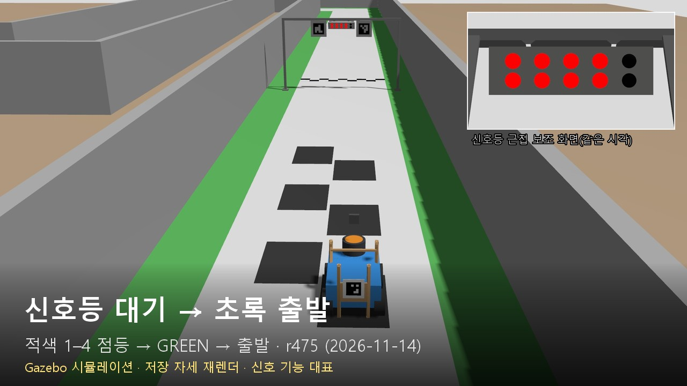</a> <b>신호 대기 → 출발</b> r475 · 적색 순차 점등과 GREEN 출발 <a href="artifacts/videos/2026-11-15/e1_signal_red_green_start_r475.mp4">▶ 영상 보기</a> · <a href="artifacts/validation/2026-11-14/solo_full_lap_r475_v1/RESULT.md">원 시험 기록</a></td>
<td width="50%" valign="top"><a href="artifacts/videos/2026-11-15/e2_stop_restart_r40.mp4">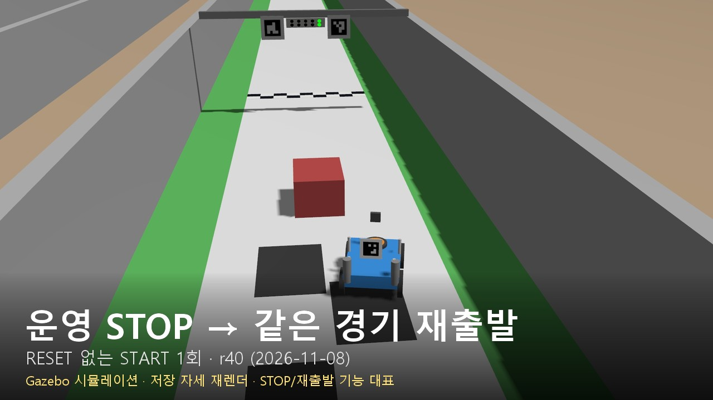</a> <b>정지 → 같은 경기 재출발</b> r40 · RESET 없는 STOP / START <a href="artifacts/videos/2026-11-15/e2_stop_restart_r40.mp4">▶ 영상 보기</a> · <a href="artifacts/validation/2026-11-08/entry_width_transition_v1/README.md">원 시험 기록</a></td>
</tr>
</table>

주입한 센서 지연은 **시뮬레이션 시험 조건**이며 Jetson에서 측정한 연산 지연이 아닙니다. 추월·오차 조건 영상은 해당 기능의 사전 수용 기준 통과를 따릅니다. 별도 공통 추종 평가의 미충족 항목과 두 바퀴 잔디 사용 등은 원 보고서에 보존합니다.

[영상 전체 목록·조건·재렌더 한계](artifacts/videos/2026-11-15/README.md) · [선정 근거와 검증](docs/reports/SIMULATION_RECORDINGS_2026_11_15.md) · [파일 해시 색인](artifacts/videos/2026-11-15/recordings_index.json)

## 차량 설계

<table>
<tr>
<td width="50%">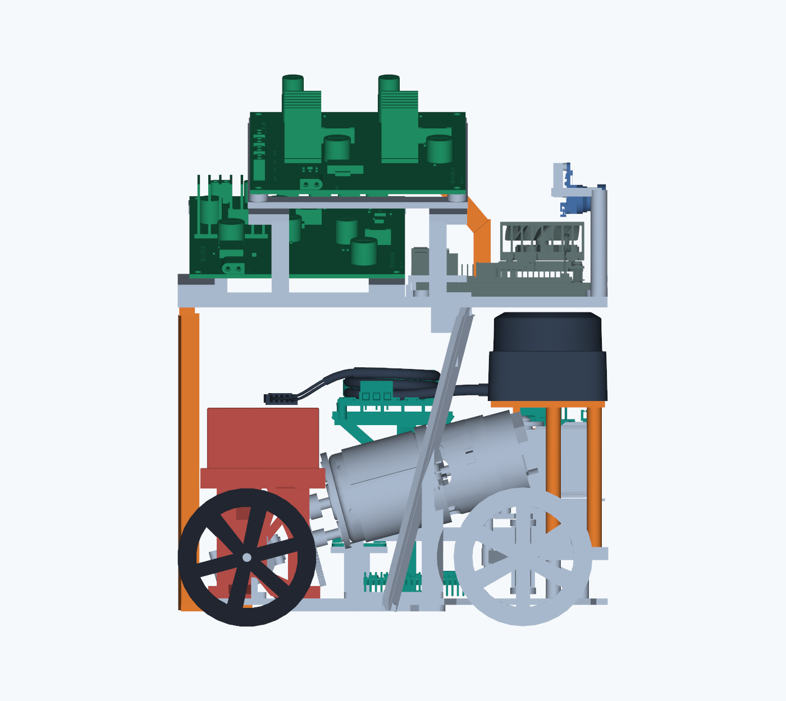 <b>측면 · 층별 패키징</b></td>
<td width="50%">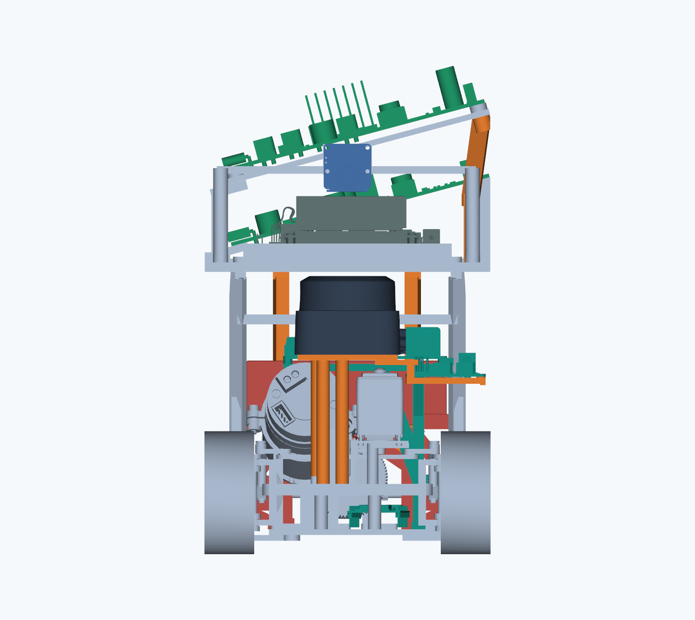 <b>정면 · 조향과 센서 배치</b></td>
</tr>
</table>

위 그림은 11/13 확정 패키징의 설계 검토 렌더입니다. 일부 센서는 대체 CAD 형상이며 실제 조립·배선·센서 교정을 증명하지 않습니다. 11/14 수신한 제작 기준 STEP과의 차이도 별도 보존했습니다.

| 설계 자료 | 확인할 내용 |
|---|---|
| [확정 패키징](docs/hardware/PACKAGING_FINAL_2026_11_13.md) · [11/14 제작 기준 대조](docs/hardware/PACKAGING_CAD_COMPARE_2026_11_14.md) | 원본 해시, 기구 치수, 센서 가림, 제작 변경 |
| [조향 설계](docs/hardware/STEERING_FUSION_2026_11_13.md) · [장착 후 수동 3점 기록](docs/hardware/MOUNTED_SERVO_SETUP_2026_11_14.md) | CAD 조향 관계와 실제 서보 위치 측정 |
| [층별 배선 배치](docs/hardware/WIRING_LAYERS_2026_11_13.md) | 전원보드·제어보드·센서 배치와 하네스 경로 |

## 전장과 제어 구조

[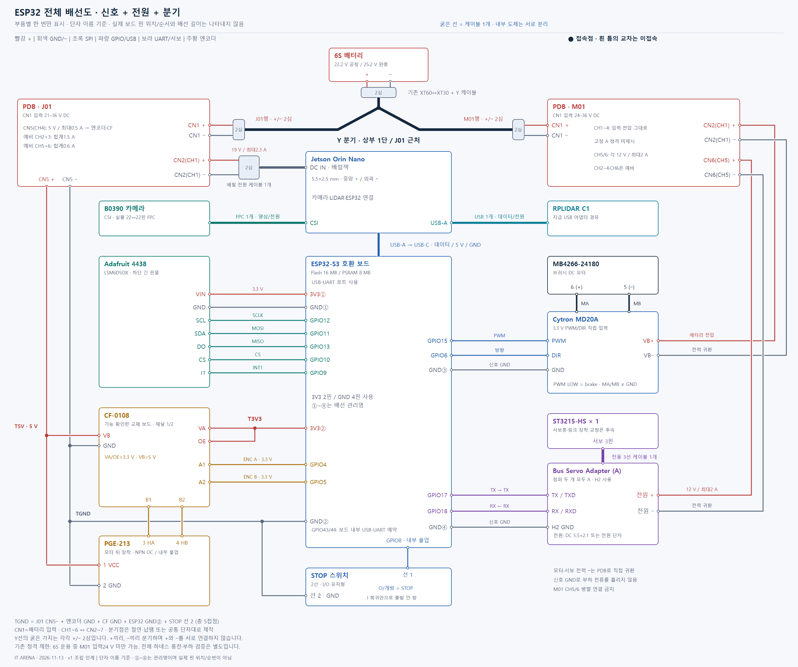](docs/hardware/schematics/esp32_gpio_all_v1.png)

**ESP32 기준 보존 회로도** — 그림을 누르면 원본 크기로 볼 수 있습니다. [핀별 연결표](docs/hardware/schematics/esp32_gpio_pin_table_v1.md) · [설계 설명](docs/hardware/ESP32_GPIO_WIRING_2026_11_11.md) · [승인 전장 기준](docs/hardware/APPROVED_ELECTRICAL_LAYOUT.md). 설계도와 실제 조립·통전 검증 상태는 해당 문서에서 구분합니다.

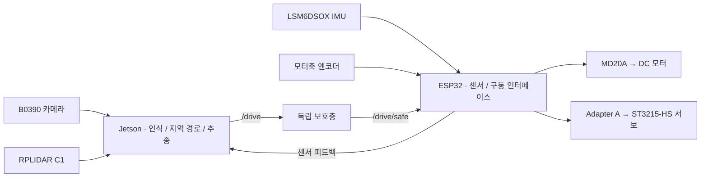

제어기는 센서 입력으로 주행을 판단합니다. 지도·Gazebo 정답 위치·심판 신호는 제어 입력으로 사용하지 않으며, 평가·영상 촬영용 정보와 분리합니다. [주행 알고리즘](docs/autonomy/LOCAL_PURE_PURSUIT_2026_09_21.md) · [구동 계약](docs/hardware/ACTUATION_CONTRACT_2026_09_22.md)

## 최종 버전과 재현

| 구분 | 보존 기준 |
|---|---|
| **대회용 최종 · ESP32** | [고정 소스·구성·복원 설명](docs/releases/FINAL_ESP32_2026_11_14.md) · [소스 ZIP](artifacts/validation/2026-11-14/runtime_update_handover_r533_v1/selected_v2/runtime_handover_sources.zip). 실차 설치·주행 완료 릴리스는 아닙니다. |
| **성공 영상의 실행 버전** | [영상별 원 시험·소스·설정·조건](docs/reports/SIMULATION_RECORDINGS_2026_11_15.md)을 함께 기록합니다. 최종 소스에 과거 성공을 소급하지 않습니다. |
| **후속 연구와 미사용 대체안** | [시뮬레이션 작업 색인](docs/reports/SIMULATION_WORK_INDEX_2026_11_14.md) · [UNO Q 준비](docs/hardware/UNO_Q_DEPLOYMENT_2026_11_14.md). 현재 `main`에는 이 자료들도 함께 있습니다. |

개발 환경은 **WSL2 Ubuntu 24.04 / ROS 2 Jazzy / Gazebo Harmonic**입니다. [설치·실행·검증 명령](docs/simulation/ARCHIVED_RUNBOOK_2026_11_15.md), [코스 개편 전 보관 릴리스](docs/releases/PRE_TRACK_REDESIGN_2026_11_05.md), [공식 코스 입력 감사](docs/track/OFFICIAL_V2026_11_06_AUDIT.md)에서 각 시점의 재현 조건을 확인할 수 있습니다.

## 결과와 개발 기록

| 기록 | 내용 |
|---|---|
| [경기 결과·후기](docs/reports/COMPETITION_RESULT_2026_11_14.md) | 실제 경기 무주행 결과. 세부 후기는 추후 추가 |
| [ESP32 통신 단절·발열 사건](docs/hardware/ESP32_FAILURE_REVIEW_2026_11_15.md) | 마지막 응답·출력·엔코더·재접속 증거, 회수하지 못한 로그와 원인 미확정 범위 |
| [시뮬레이션 이력](docs/reports/SIMULATION_WORK_INDEX_2026_11_14.md) | 성공·실패·중단·미실행 기록을 당시 조건 그대로 보존 |
| [산출물 목록](docs/reports/ARTIFACT_CATALOG_2026_11_14.md) | 공개 자료와 로컬 원시 로그·대용량 파일의 경계 |
| [문서 안내](docs/README.md) · [활동 기록](docs/activity/) | 설계·의사결정·실험 근거를 찾는 경로 |

저장소 구성

| 경로 | 역할 |
|---|---|
| `src/arena_autonomy/` | 인식·운동 보정·지역 경로·추종·독립 보호층 |
| `src/arena_vehicle_interface/` | 센서·구동 인터페이스, MCU 계약과 계측 |
| `src/arena_bringup/`, `src/arena_description/`, `src/arena_gazebo/` | 실행 구성, 차량 모델, 시뮬레이션 |
| `scripts/`, `tests/`, `config/` | 생성·분석 도구, 검사, 시험 설정 |
| `docs/` | 설계·결정·결과·활동 기록 |
| `assets/`, `artifacts/`, `outputs/` | 공식 입력, 검증 근거, 영상·도면·설계 산출물 |

[현재 보존 현황](docs/PROJECT_CONTEXT.md) · [종료 후 보류 과제](docs/DEVELOPMENT_PLAN.md) · [주최 측 공식 저장소](https://github.com/MOSW626/istech-it-arena)
