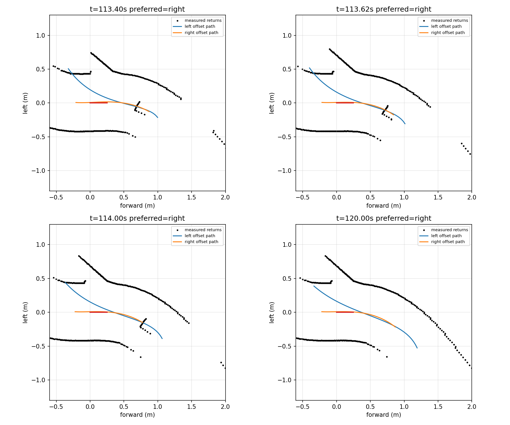

# 교통 run1 경계 정체의 분리와 다음 비교

2026-10-27. [현재 스캔 복원](boundary_diagnosis_v1/report.json)에서 다음을 확인했다. 기준0.65 m나0.12 m를 즉시 낮추지 않는다.

| 시각 | 우측 관측 길이 | 좌측 관측 길이 | 좌측 앵커 y거리 | 근거리 양측 경로 일치 |
|---|---:|---:|---:|---|
|113.40 s|.684 m|1.365 m|.620 m|기존 비교 통과|
|113.62 s|.627 m|1.480 m|.595 m|기존 비교 통과|
|114.00 s|.576 m|1.581 m|.567 m|기존 비교 통과|
|120.00 s|.633 m|1.800 m|.566 m|기존 비교 통과|

선호 우측 경계는 현재 차체 근처에서 정상 거리에 있으나 길이0.65 m에 못 미쳤다. 좌측 경계는 길지만 앵커 거리의 `.425±.12 m` 조건에 들지 않았다. 두 조건이 동시에 막혀 경로 기억도 만료됐다. 회랑 후보 역시 긴 반대 벽의 앵커 조건에서 종료했다. 센서 무반환이나 독립 보호층의 고장으로 해석하지 않는다.

양측 경로 일치는 가까운 공통 부분의80백분위 거리 기준이다. 일부 초반/먼 구간까지 같은 경로임을 보장하지 않는다. 그림에서 좌측 경로의 초반 편차도 있으므로, 일치 플래그 하나만으로 긴 좌측 전체 경로를 주행에 채택하면 안 된다.

## 다음 후보를 비교하는 범위

1. 기존 짧은 우측 경로에서 실제로 확인한 prefix만 사용할 수 있는지 비교한다. 긴 반대 경로 전체로 갈아타거나 관측 끝을 연장하지 않는다.
2. 속도에 필요한 제동·재관측 길이와 현재 경로 지지를 함께 확인하는 저속 후보를 별도로 설계한다. 양쪽의 실제 관측을 대조하고 모든 원시 점유점을 유지한다. 먼저 저장 입력에서만 비교한다.
3. 앞차/짧은 물체·서로 다른 벽·불일치 분기·점유/미관측·역방향·중복/만료 스캔을 반례로 검사한다. 과거 양측/안쪽0.65 m 실패는 보존한다.
4. 위 근거 없이 `.65→.57` 또는 `.12→.15`처럼 이번 수치만 넘기는 변경은 하지 않는다. 독립 보호층과 STOP·센서/물성은 그대로다.

진단 스크립트는 보고서·그림 저장 후 콘솔 요약에서 NumPy bool의 JSON 변환 오류로 exit1이었다. 보고서 파일과 그림은 저장되었으며 원시 주행/소스/판정에는 영향이 없다. 종료코드를 성공으로 바꾸거나 같은 분석을 재실행하지 않았다.

## 짧은 관측 구간의 1차 비교

`scripts/probe_short_boundary_prefix.py`는 주행에 연결하지 않은 비교 도구다. 가까운 짧은 벽에서 만든 기존 경로를 유지하고, 길게 보이는 반대 경로와 연속적으로 일치하는 구간의 끝에서 자른다. 반대 벽 쪽 경로로 교체하거나 관측 끝을 연장하지 않는다. 첫 양측 지지까지의 편측 구간은 차체 길이 이내, 공동 지지는 기존 비교와 같은0.25 m 이상이라는 시험 가정을 사용한다. 벽의 정체를 확정하지 않으며 모든 점유점은 유지한다.

관련12검사와 [4시점 비교 v1](prefix_shadow_v1/report.json)을 마쳤다. 113.40초는 원래 충분한 경계라 후보 대상이 아니다. 113.62/114/120초는 기하 지지가 나왔고, 기존 점유 여유와0.35 m/s 이하 제동 계산 뒤 엄격한 현재 광선 이동영역 검사를 추가했다. 113.62초만1,000/1,000표본 지지가 나왔으며,114/120초에는1,088표본 중18개가 지지되지 않았다. 이 추가 검사는 현재 G1의 `bounded_local_v4` 정책과 별도의 진단이므로 그 실패를 곧바로 기존 보호층 실패라고 부르지 않는다.

이는 저장 입력의 한 순간 비교다. 아직 시간 확인·중복/만료·재획득·독립 보호 노드·실제 차량 주행에 연결하지 않았다. 긴 물체의 측면이 벽과 같은 기하를 보이는 경우는 정체를 구별할 수 없으므로, 기하 지지를 물체 제거 허가로 사용하지 않는다. 후속에서는 현재 속도의 제동 예산과 미지지18점의 실제 좌표를 확인한 뒤 연결 범위를 결정한다.

[후속 v2](prefix_shadow_v2/report.json)에서는 낮은 목표 명령뿐 아니라 현재 속도의 제동 예산도 확인했다. 114/120초의 미지지18점은 차량 기준 x≈−.080~−.068 m, y≈−.07508~−.07502 m로, 현재 차체 뒤쪽 오른쪽 옆면에서 약0.02~0.08 mm 바깥이다. 센서 기준 각도는 약−151.8~−149.7°로 후방 마스크 경계다. 전방 무반환으로 해석하지 않는다. 두 시점은 이미 정지했으며 현재속도 제동 예산.06 m가 경로 예산.751/.844 m보다 작았다.

이 추가 엄격 검사만을 새 필수 정책으로 삼지 않는다. 기존 GUARD에는 이미 작은 후방 마스크 이동과 실제 무반환을 구분하는 절차가 있으므로, 다음 저장 입력 재생에서는 기하 제안만 기존 시간 확인·점유·통과 선택기에 넣어 대조한다. 해당 비교 프로세스 밖의 기본 코드/설정·출력 연결은 바꾸지 않는다. 미지지점을 유효 반환이나 자유 공간으로 채우지도 않는다.

후속 [정책 재생](prefix_replay_v1/report.json)에서5,833판단 중319명령이 변했고, 첫114.12초의0.35 m/s 후보가 기존 시간 확인과 GUARD 검사를 통과했다. 이는 정지한 원래 입력의 개루프 비교다. 이를 바탕으로 [기본 false 선택형 연결](../short_prefix_connection_v1/README.md)을 구현했으며, 이후 회귀·실제 주행 결과는 그 문서에서 이어간다.
