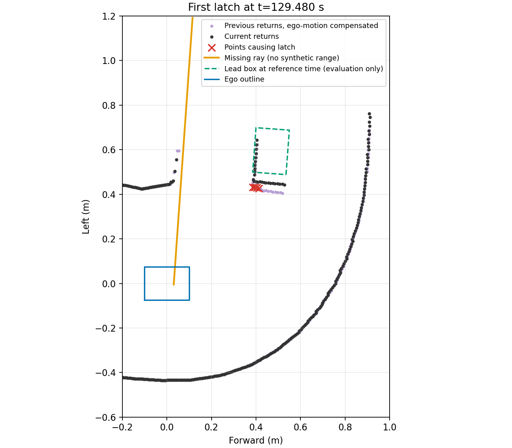
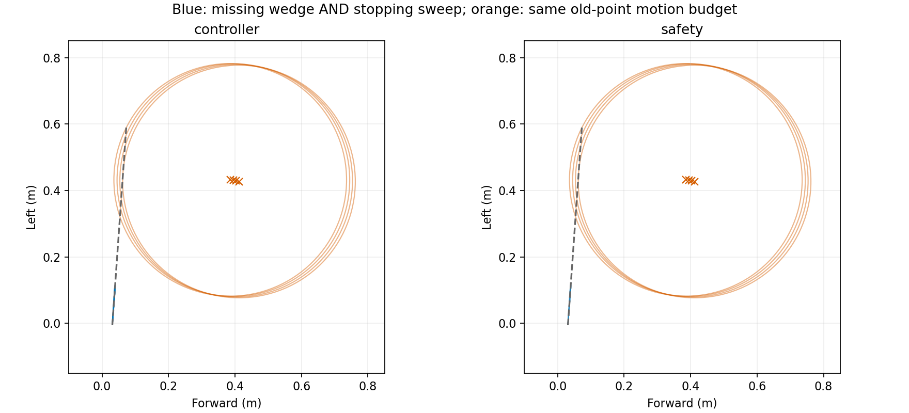

# 교통 43.173 m 정체: 소실 장애물 래치 분석

2026-10-27. [짧은 관측 경로 연결 run1](../short_prefix_connection_v1/README.md)은 43.173 m까지 진행했지만 전체 랩과 최종 앞차 거리 판정에 실패했다. 아래는 그 실패의 사후 분석이다. 실패 원본·입력·당시 소스는 수정하지 않았다.

## 확인한 원인

제어기와 독립 보호층의 최초 래치는 시뮬레이션 시각129.480 s에서 같은 네 점을 근거로 발생했다. 원인은 `previous_point_in_missing_sweep`이며 현재 무반환은 원시 광선373번, 약+88.56° 한 개다. 해당 광선의 취득 자세를 현재 차체로 옮긴 방향은 약+86°였다.

| 이전 반환의 원시 광선 | 취득 시각의 앞차 경계까지 | 가장 가까운 정적 벽까지 |
|---:|---:|---:|
| 321 | 2.75 mm | 384.2 mm |
| 322 | 3.71 mm | 375.6 mm |
| 323 | 4.57 mm | 367.0 mm |
| 324 | 1.31 mm | 357.5 mm |

이는 **앞차에서 나온 반환**으로 해석할 근거다. 취득 시각의 평가용 차체/actor 자세를 보간해 원시 광선을 비교했으며, 이 정답을 제어기나 새로운 판단 입력에 넣지 않았다. 보간과 충돌 형상 근사의 한계는 남는다. 자차 운동 추정과 평가 자세의 차이는 전후+10.62 mm, 좌우−0.10 mm, yaw+0.0021°였다.

이전 점과 현재 반환의 최근접 거리는26.2–28.8 mm로, 기존20 mm 재관측 기준을 넘었다. 1초 뒤에는341.5–363.0 mm까지 벌어졌다. 앞차가 이동하므로 옛 좌표 자체를 고정 표면처럼 다시 찾는 것은 맞지 않는다. 정적 배경 정합은 약0.7 mm 이동을 추정했지만 이 네 점을 재관측으로 연결하지는 못했다.

주황색은 실제 거리를 생성하지 않은 무반환 방향, 붉은 표시는 래치 근거 점이다. 보라색과 검정색은 이전/현재 반환이다. 녹색 앞차 윤곽은 그림의 해석을 위한 평가 정답이며, 회전식 스캔 동안 상대차도 이동하므로 기준 시각의 윤곽과 모든 점이 정확히 겹치지는 않는다.

근거: [diagnosis_v1.json](diagnosis_v1.json), [분석 코드](diagnose.py), `diagnose.log/.exit`. 한 번 실행해exit0, 입력/코드8개 해시 일치를 확인했다. 제어기와 보호층에서 별도로 기록한 근거를 대조했다. 보호층은 요청 조향을 검사 전에 이미 반영하고 있었으므로 조향값 초기화 버그로 보지 않는다.

## 먼저 비교할 수정 방향

현행 소실 검사는 이전 점의 가능한 이동을 `0.03 m + 2 m/s × 이전 기준 시각 이후 경과 시간`으로 넓힌 뒤, 결측 방향 근처인지와 제동 차체 근처인지를 따로 검사한다. **두 영역 각각과 가까운 것이, 같은 위치에서 두 영역의 교집합에 도달할 수 있다는 뜻은 아니다.** 이 논리적 차이를 먼저 저장 입력에서 비교한다.

- 새 비교는 `결측 각도 셀 ∩ 현재/직전 조향의 제동 차체 외곽`까지 이전 점의 거리를 구한다. 이전 점의 이동 예산·제동식·현재 점 점유·시간 만료·STOP은 유지한다.
- 각도 셀은 무반환을 자유 공간으로 만드는 값이 아니다. 결측 셀 안에 알려진 장애물이 있으면서 동시에 자차 제동 영역을 위협할 수 있는지를 검사한다.
- 이동하는 앞차를 특정 ID로 추적하거나, 비슷한 점을 같은 강체로 가정하여 다른 장애물을 삭제하지 않는다. 범용 물체 추적 도입 전에 이번 기하 오판정을 분리한다.
- `.02 m` 기존 차체 여유에 샘플 사이 이동/회전의 최대 변위도 더한 외곽을 쓴다. `2 m/s` 상대 이동 가정 자체나 실제 센서 오차의 타당성은 별도 한계다.
- 운영 코드에는 아직 연결하지 않았다. 저장 입력에서 명령이 달라져도 새 주행·안전의 증거로 확대하지 않는다.

초기 기하 테스트는16통과/1실패였다. 실패는 광선 원점y=−.005 m인데 시험 점을y=0에 두고 거리가0이라고 기대한 시험 구성 오류였다. 원점을 반영한 대조를 수행하며, 원래 로그는 `joint_tests_v1.*`에 보존한다. 얇은 다각형의 합집합 연산에서 발생한GEOS 경고는 불필요한 합집합 생성 대신 각 교집합까지 거리의 최솟값으로 독립 검산하도록 변경했다.

## 교집합 비교 결과와 채택하지 않은 이유

기하17검사와 기존 고장·소실 계약23검사를 통과했다. 실제 첫 래치에서 네 점과 교집합의 거리는469.1–485.6 mm로, 기존 기준 시각 사이의 이동 예산350 mm보다 컸다. 제어기와 보호층의 서로 다른 조향 입력 모두 같은 결론이었다. [첫 입력 결과](joint_first_v1.json).

파랑은 결측 각도 셀과 제동 외곽의 교집합, 주황 원은 이전 점의 기존 이동 예산이다. 원과 파란 영역이 만나지 않는다. 이는 제한된 기하 모델의 결과이며 무반환이 실제로 비었다는 뜻이 아니다.

[저장 입력 비교](joint_replay_v1/report.json)는159초까지7,759호출·교집합1,475호출, **래치0이지만 주행 명령 변화도0**이었다. 계산 추가 비용은PC 벽시계 중앙8.27 ms/p9510.40 ms/최대14.46 ms, 전체 판단 최대46.77 ms였다. 새 주행과 독립 ROS 보호층 전체의 재생은 아니다. 시험 당시 소스·입력 해시는 보존했으며 테스트 주석 한 줄 변경만 사본/diff로 별도 기록했다.

[남은 정지 원인](joint_remaining_v1.json)은 별개였다. 측방 창에 결측이 생기자 이전에144회까지 확인했던 왼쪽 통과 상태가 해제되고GUARD로 돌아갔다. 현재 보이는 옆차는 없지만 과거 `rear` 소실 기록이 남았고, 커브에서 왼쪽으로 더 접근한다는 판정이 진행을 막았다.

| 시각 | 후보의 결과 |
|---:|---|
|129.32 s|RELEASED·진행, 전방 전체 반환 유효|
|129.48 s|소실 래치는 사라졌으나 음수 모터축 피드백으로 정지 유지|
|129.60 s|측방 창 확인이 끊겨GUARD·재출발 확인 대기|
|129.80 s|왼쪽 예측 추가 접근22.49 mm·진입 기준 대비19.62 mm로 거절|
|131.00 s|왼쪽 예측 추가 접근5.15 mm·진입 기준 대비10.18 mm로 거절|

회전식 취득 시각도 별도 한계다. 기준 시각이 아니라 **네 점의 실제 취득 시각**에서 이동 예산을 계산하면456.4–457.6 mm로 커진다. 교집합까지 남는 차이는12.7–28.0 mm뿐이다. 또한 무반환 광선 취득 이후 상대 물체가 이동하는 문제는 이 첫 비교에 포함하지 않았다. 기준 시각의 기하만으로 원래 동적 불확실성을 해결했다고 주장할 수 없다.

따라서 **이 비교는 운영 코드에 채택하지 않았다.** 래치 삭제만으로 주행은 달라지지 않았고, 상대 물체 시각과 측방 통과 상태의 관측 계약을 함께 다뤄야 한다. 거리 임계값·1 cm 접근 한계를 숫자만 낮추거나 과거 물체를 시간 만료로 지우지 않는다. 기존실행 결과는43.173 m 실패로 유지한다.

## 재개 지점

1. 좁은 결측 때의 `passed → GUARD` 전환과 현재 점유·실제 이동 영역을 함께 비교한다. 현재 차량이 없다고 가정하거나 관측 실패를 자유 공간으로 바꾸지 않는다.
2. 새 소실 판정은 기준 시각뿐 아니라 점별 취득 시각과 상대 물체 이동을 명시한다. 관측된 움직이는 표면의 대응 가설을 쓴다면 복수 물체·진짜 가림 반례와 잔여 위험을 별도로 남긴다.
3. 이 불완전한 기하 후보를 먼저 연결해서 같은 전체 랩을 반복하지 않는다. 계획상 독립적인 공식 출발/M5 물리 연결을 진행하면서 이 결합 문제를 후속 구현 대상으로 유지한다.

## 통과 이력과 현재 이동 영역의 분리 진단

[계획](PASS_CONTINUITY_PLAN.md)에 따라 [저장 입력](pass_continuity_v1/report.json)을132초까지 한 번 재생했다. 이전 미완성 교집합 가정을 진단 내부에 함께 적용하고, 과거 통과 확인을 유지하는 동안에는 작은 조향에서도 현재 이동 영역을 검사하도록 바꾼 격리 사본이다. 운영 파일은 수정하지 않았고 소스/입력 해시 불변을 확인했다.

6,409판단·191 reset에서 명령 변화39건이 있었지만 **129.3초 이후 목표 정체 구간의 변화는0**이었다. 변화36건은 속도 감소,3건은 증가이며 첫 변화는31.12초의0.35→0 m/s였다. 명령 차이 자체를 개선으로 보지 않는다. PC 판단 비용 중앙12.87 ms·최대54.34 ms였고 실제 주행이나 Jetson 비용은 아니다.

129.8초에는 통과 이력을 유지했지만 실제 이동 영역1,350표본 중316개가 미관측이라 거절했다. 이후 유효 기본 경로가 소실되어 기존 규칙대로 통과 상태가 다시 해제됐다.132초 GUARD 곡선 후보는1,392표본 중317개 미관측, 차체 밖 최대22.58 mm로 기존 후방 가장자리 후보 범위를 넘었다. `passed` 유지 하나로 해결되는 상태가 아니다. [시각별 원본](pass_continuity_v1/samples.json)의 `selector_guard_candidate.region`과 `selector_sides`를 근거로 하며 다른 영역 집계를 혼용하지 않는다.

이 후보 역시 운영에 채택하지 않았다. 다음은 옛 반환과 결측 광선의 실제 취득 시각을 분리한 [시각 진단](../../2026-10-28/timed_latch_v1/)과, 현재 이동 영역의 미관측 원인 분류다. 기존20 mm 재관측/10 mm 접근 기준·독립 보호·원래 실패는 유지한다.
