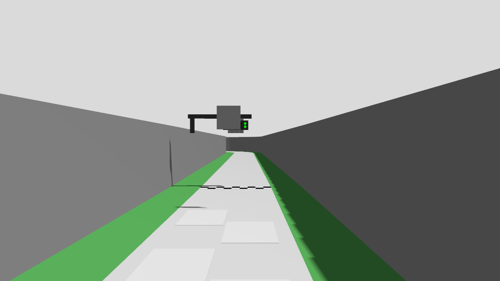

# 공식 가로 신호와 단독 물리 모델 출발

2026-10-27. M5 밀집 출발 전에 **같은 G1 제어기·독립 보호층·가상 MCU가 실제 RGB 출발 허가로 움직이는지** 분리한다. 이번에는 상대차 없는 그리드3 출발·진행1 m·명시STOP만 검사한다. 다중 차량 출발·전체 랩·실차 시험이 아니다.

## 형상과 가정

- 공식 v2026.10.24의 신호 위치와 왼쪽부터 빨강4세트·초록1세트를 사용한다. 각 세트의 광원2개, 직경15 mm, 세로 중심 간격20 mm/가로30 mm는 제작 설명의 여백 해석이다.
- 회의록의40 cm를 광원쌍 중심으로 해석한 **시험 가정**이다. 실제 설치 기준점은 미확정이다. 판/벽 위 지지대도 시험 형상이며 새로운 낮은 기둥을 도로에 세우지 않는다.
- 카메라는 뒤쪽x=−.075 m, z=.30 m, 수평으로 둔다. 구매 B0183의 해상도·명목60 Hz·시야각은 유지한다. 최종 기구 채택이 아니다.
- 공식 원본/production 월드·차량 설정은 수정하지 않는다. 시험 월드의 신호 링크만 바꾸고 `simulation.launch.py` 사본의 월드 경로·카메라 위치/자세만 대체한다. `fixture/simulation.diff`에 두 설정 차이를 남긴다.

## 실행·판정

기존 `validate_basic_autonomy.py`의 입력 감사·차체 진행·충돌·독립 보호·가상MCU/STOP·정상 종료 판정을 재사용한다. 공식 신호에는 노랑이 없으므로 시험 프로세스의 신호 상태 목록 요구만 빨강/초록으로 바꾸며 `run1_evaluator.diff`로 보존한다. 다른 판정선을 변경하지 않는다. 전체회귀를 통과한 현재 제어 소스의G1/v4·corner-distance·per-ray·회랑·짧은경로·통과/GUARD를 쓴다. 앞선 교집합 기하 후보는 연결하지 않는다.

신호 발생기는 RGB가 도착하고 시험자의 명시ARM이 완료된 뒤 **초록만1초 → 소등1초 → 빨강1/2/3열 각1초 → 빨강4열1.6초 → 초록 유지**를 실행한다. 실제 재질 서비스 응답을 기록하며 전기적 동시 소등 복제는 아니다. 처음 초록만 보이는 동안 출발하지 않고, 빨강 배열을 확인한 다음 초록에서 움직여야 한다. 제어기는 상태 토픽이나 각본을 받지 않고 RGB·촬영시각으로만 판단한다. 운영 모드는legacy이며 B3 개입/재ARM 절차까지 검증한 것으로 쓰지 않는다.

기존 진행 목표1 m·최대35시뮬레이션초·실행1500실제초·STOP180실제초를 사용한다. 느린PC 벽시계 한도와 센서 TTL을 구분하며 후자는 그대로 둔다. 실행당 한 번만 시도하며 실패는 원인과 근거를 보존한다. 소스 사본/해시, 실제 launch, 색상 서비스 응답, 판단/자세/구동과 종료 결과를 남긴다.

위 조건으로 run1을1회 실행했다. 정적 시야·배열 검사만으로 실제 영상 검출이나 차량 출발이 된 것으로 기록하지 않는다.

## run1 결과: 출발 실패와 시험 장면 결함

[보고서](run1/report.json)·[적용 설정/소스](run1/trial_overlay.json)·[실행 로그](run1_trial.log)를 보존했다. exit1이며35시뮬레이션초까지 `WAIT_GREEN` / `waiting_red4`, 진행0 m·양수 속도 명령0회다. 초록 적용까지10개 광원의 모든 재질 서비스 응답을 받았으나 빨강 배열을 확인하지 못했다. 마지막 영상 상태는351결과 수락·stale 거절0·worker fault 없음이다. 이를 연산 지연이나 주행 제어기의 출발 불능으로 단정하지 않는다.

저장 영상에서 신호 앞의 큰 판이 빨강을 가리는 것을 확인했다. [사후 중심 광선 분석](run1_scene_review.json)에서 공식 `aruco_45` 판은 **빨강8광원 모두의 중심 시선과 교차**했고 초록2광원에는 교차하지 않았다. 판은(9.9613,5.7798,0.4 m), 시험 신호는(9.966,6.4665,0.4 m)에 있다. 광원의 전체 가시 면적을 정량화한 분석은 아니지만 영상의 빨강 가림과 일치한다.

이는 **공식 XY 위치에 광원쌍 중심40 cm라는 미확정 가정을 결합한 시험 배치의 문제**다. 실제 설치에도 같은 문제가 있다고 확정하거나 공식 마커를 옮길 근거로 쓰지 않는다. 광원이 화면 안에 들어오는지만 확인한 사전 검사는 앞쪽 마커판 가림을 검사하지 못했다.

별도로 시험 준비 코드가 월드/scene/centerline만 복사하고 `aruco/aruco_id{0,20,30,45}.png`를 누락했다. 따라서 마커판이 회색으로 렌더링되고8개 자산 오류 로그가 발생했다. 공식 원본의 텍스처 누락이 아니라 **이번 시험본 생성 결함**이다. SDF 문법 검사만으로 이미지 존재를 검증하지 못했다. 실행 당시 소스·월드·결과는 수정하지 않았다.

| 확인 항목 | 결과 |
|---|---|
| 주행/신호 | 실패,0 m·양수 명령0·조기 출발 없음 |
| 센서/MCU | C1 순차500점/10 Hz 감사·MCU 명시ARM ACK 확인 |
| 명시STOP | ACK·`ESTOP_LATCHED/software_stop`,239개 자세 구간·최대 간격3 ms·정지 확인 통과 |
| 프로세스 종료 |14/14 정상 종료·강제 종료 없음·잔존0·Gazebo stop ACK |
| 실행 전체의 오류 없는 종료 판정 | `shutdown_clean=false`. 종료 후 오류0이지만 **실행 중 텍스처 오류8건**을 포함한 감사가 실패했다. 앞선 `live_run2`의 SIGKILL 종료 지연과 원인이 다름 |
| 소스·재생 | 소스 불변. 기록에는header/footer와reset1,787회만 있고 판단 호출0이므로 재생exit1(`missing footer or no decision calls`). footer 누락이나 판단 불일치가 아니라 재생할 주행 판단이 없는 결과 |

## 정리와 다음 재개 순서

사용자의 정리 요청에 따라 새 실행을 시작하지 않았다. 원본/기본 임시3등·실물 배치·공식 마커 좌표는 그대로다.

1. 다음 버전의 시험본 생성기에서 모든 참조 이미지 복사·존재/해시 검사를 포함한다. scene의 상속된 임시3등 `lamp_poses`도 실제 시험 형상과 맞춰 별도 메타데이터로 기록한다. run1 원본을 고쳐 덮어쓰지 않는다.
2. 40 cm 기준점이 미확정임을 유지하고, 공식 왼쪽 설치 설명·마커판·6그리드 시야를 함께 대조해 충돌하지 않는 **명시적 시험 설치안**을 정한다. 카메라 투영뿐 아니라 판/벽/차량 가림을 점검한다. 빨강이 가려진 채 초록만 보이는 출발 정책은 별도의 설계 항목이다.
3. 정상 렌더링·빨강/초록 시야를 정지 영상에서 확인한 뒤 같은 구성의 단독 물리 출발을 다시 연결한다. 이후에2대/M5로 확장하며 이번0 m를 M5 영구 교착이나 실차 실패로 해석하지 않는다.
