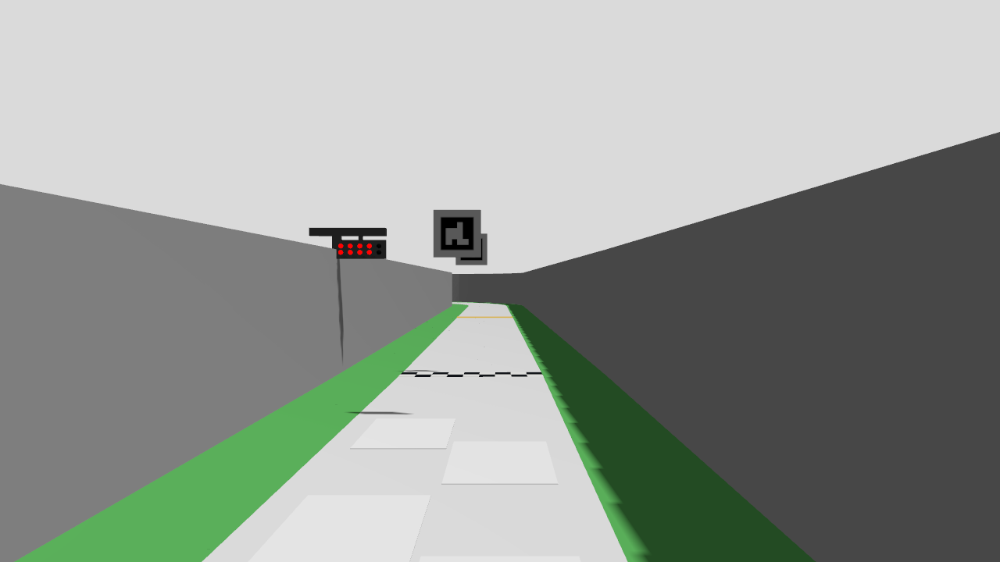
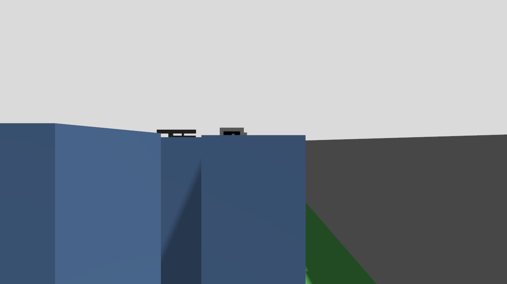
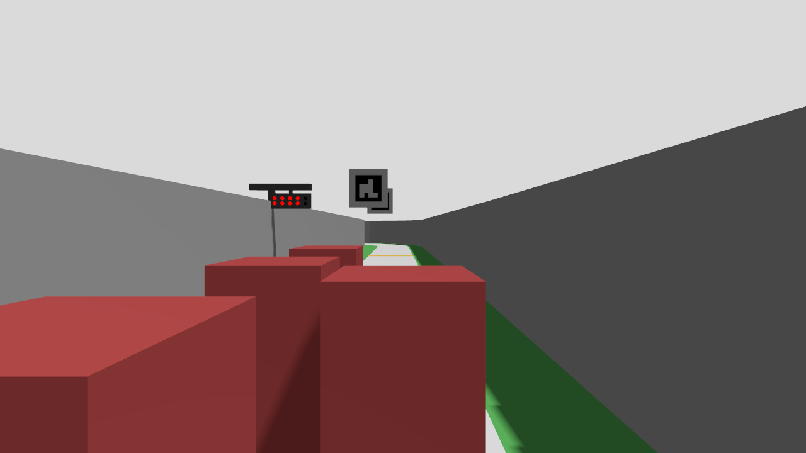

# 공식 출발 시험본 v2: 자산 보존과 왼쪽 설치 대조

2026-10-27 재개. [v1 실패](../official_departure_v1/README.md)를 덮어쓰지 않는다. 제어기·보호층·속도·물성·STOP은 그대로 두고, 시험본의 누락 자산과 시설 배치를 먼저 확인한다. 공식 원본·기본 런타임은 변경하지 않는다.

## 실행 전 정한 변경

- 공식 문서의 **출발선 좌측** 설명을 시험 좌표로 구체화해 배열 중심을 원본 XY에서 진행 방향 기준 왼쪽0.35 m로 옮긴다. 이 수치는 확정 설치 치수가 아니다. 높이40 cm도 광원쌍 중심이라는 기존 시험 가정이며 실제 기준점은 미확정이다. 신호만 옮기고 공식 마커·도로·벽은 보존한다.
- 가로 빨강4세트·초록1세트와 세트당15 mm 광원2개,20 mm 세로/30 mm 가로 피치는 유지한다. 벽 위 지지 구조는 팀 임시 형상이다. C1 높이의 도로 기둥은 추가하지 않는다.
- 원본 월드가 참조하는 PNG4개와STL2개를 같은 상대 경로로 복사하고 해시를 대조한다. 상속된 임시3등 `lamp_poses`를 제거하고 실제 시험용10광원의 좌표를 기록한다.
- 카메라는 뒤쪽x=−.075 m/z=.30 m·수평, B0183의1280×720/75°다. 실제 마운트 채택이나 상대차 가림 해결을 뜻하지 않는다.
- 정적 검사에서6그리드의 영상/검출ROI와 광원당9개 시선을 모든 상자 시각 형상과 대조한다. 원래 v1의ID45 가림도 음성 대조로 재검출한다. 연속 가시면적·렌즈 왜곡·차체 기울기·상대차 가림은 별도 한계다.

정적 검사→정지 빨강/초록 촬영과 실제 픽셀 검출→단독 물리 출발 순서다. 신호를 못 보는 장면에서 제어기 임계값을 먼저 낮추지 않는다. 단독 출발에서는 v1과 동일한 초록만 먼저 제시하는 대조와 정상 순차 점등 뒤1 m 진행·명시STOP·정상 종료를 확인한다. 앞선 교통43.173 m의 미해결 관측/측방 계약 수정안은 연결하지 않는다. 이 단계는M5 밀집 출발이나 전체 랩이 아니다.

## 정적·실제 렌더링 확인

준비·6그리드 기하·SDF 문법 검사는 각각exit0이다. PNG4개/STL2개의 해시가 원본과 같고, 신호 외 기하도 유지했다.6그리드 모두 상부ROI 포함·90개 광원 시선표본에 가림 없음, 반대로 v1의ID45는 빨강8광원을 가리는 것으로 재검출했다. [사전 검사](preflight.json).

빨강/초록 각각 실제 Gazebo 정지 촬영을 수행해6그리드+전체 시점에서 각3프레임을 얻었다. 두 실행은 오류·강제 종료·잔존 없이 완료됐다. [빨강](render_red4/capture/report.json), [초록](render_green/capture/report.json). 같은 정지 이미지를0.1초 간격으로 반복한 [픽셀 비교](pixel_check.json)는6그리드 모두 빨강4열 확인→초록3프레임 확인, 초록만 제시한 대조의 출발0이었다. 위아래 광원쌍도 모두2개로 구별했다. 제어기 소스·임계값은 변경하지 않았다.

이는 정지 렌더링·픽셀 검출 결과다. 실제 점등 전환/주행·상대차 가림의 성공으로 확대하지 않는다. 뒤쪽30 cm 배치도 최종 기구 채택이 아니다.

## 단독 물리 출발 run1

[실행 보고서](run1/report.json)와 [시험 구성](run1/trial_overlay.json): **통과**, 초록 후1.03989 m 진행·최고 지면 속도1.04578 m/s, 조기 출발/벽 충돌 표본0이다. 초록만 먼저 보여준 음성 대조에서는 출발하지 않았고, 소등→빨강1–4세트→초록의 실제 재질 전환 뒤 출발했다. 신호 제어 상태는 평가 전용이며 제어기는 RGB만 사용한다. 기본 경기 출발 모드 채택이나 밀집 출발 성공은 아니다.

명시 `software_stop` 뒤 안정 정지와 MCU 래치를 확인했다. 정지 요청 이후 이동량은0.42996 m, 안정 정지까지1.474초였으므로 즉시 정지했다는 의미는 아니다. 자식14/14 정상 종료·실행 중/종료 중 오류0·강제 정리 없음·잔존0, 입력84개 해시 불변이다. [판단 기록 재생](run1/follow_trace_replay_summary.json)은166호출 모두 동일했다. 기존 v1의0 m 실패와 높은 설치 모델의 종료 실패는 그대로 보존한다.

다음은 [사전 등록한 2대 출발 장면](TWO_CAR_PLAN.md)이다. 초기 약3 cm 간격의 실제 진행·접촉·노면과 원래 교통 평가 기준을 분리해 기록한다. 단독 run1의 성과를 다차량/실차 증명으로 사용하지 않는다.

## 2대 제한 출발

자차 그리드3·앞왼쪽 상대 그리드0 근처, 상대 높이25 cm, 초록 후0.5초 정지 뒤0.35 m/s로 이동하는12초 장면이다. 준비 도구의 잘못된 import는 첫 실행에서 실패했으며 `two_car_prepare.log`에 보존하고 실제 정의 모듈로 고친 뒤 준비했다. [경로 사전 검사](two_car_preflight.json)는404표본 통과, 공식 슬롯 대비 actor 위치 오차0.103 mm였다.

- [원래 교통 판정](two_car_run1/report.json): **실패(exit1)**. 초기 간격이150 mm보다 작고 자차가 옆줄 차량 뒤에 계속 머물지 않아 `sampled_gap`·`swept_gap`·`ego_stays_behind`가 실패했다. 다른 진행/정체/최종 간격 조건과 실행 무결성은 통과했다.
- [사전 등록한 M5 제한 관찰](two_car_run1/m5_departure.json): **통과**. 진행3.39965 m, 최소 표본 간격30.0936 mm·보수적 swept 하한30.0926 mm, 접촉/겹침0·바퀴 중심의 도로 밖 표본0이다. 기존150 mm 판정을 덮어쓰거나 제어기 여유를 줄인 결과가 아니다.
- 조기 출발0·센서 전용 입력/독립 보호층·STOP·자식14/14 정상 종료·오류0·입력 불변을 확인했다. [판단 재생](two_car_run1/follow_trace_replay_summary.json)은637호출 모두 동일했다. 이 실행은 별도 사진을 저장하지 않았으므로 단독 사진을2대 장면으로 대체하지 않는다.

## 상대차 높이에 따른 가림과 다음 장면

[정적 시선 진단](grid_visibility.json)은2/3/5대 공식 슬롯 배치에서 높이25 cm 상자와40 cm 상자를 비교했다.25 cm에서는 광원 완전 가림이 없지만40 cm에서는 일부 위치의 빨강/초록 광원이 가려졌다. 불투명 직육면체·광원당9개 시선의 정지 계산이며 실제 차량 외형·픽셀 검출/주행의 증명이 아니다. 자신의 카메라 앞은 기구로 가리지 않는다는 가정도 있다.

다음은 동일25 cm 가정에서 자차 바로 앞 그리드4를 추가하는3대 물리 출발이다. 필요 조건이 확인되면5대까지 연결한다.40 cm 가림은 별도 실제 렌더링과 출발 정책 검토 대상으로 남긴다.25 cm 결과로 허용 최대높이 차량의 신호 시야를 보장하지 않는다.

## 3대 run1: 신호 발생기 통신 실패

[원본 실행](dense3_run1/report.json)은 `green not observed in time`으로 실패했다. 빨강4세트까지 응답을 받았으나 초록 전환 중 `trial_lamp_3_1`을 끄는 요청의 ACK가 없었다. `simulation.log`에는 Gazebo의 `NodeShared::RecvSrvRequest() error sending response: Host unreachable`와 CLI의 `Service call timed out`이 남았다. 이것만으로 CPU/GPU 과부하나 네트워크의 근본 원인을 확정하지 않는다.

초록 기준 시각과 주행 판단 호출이 없어 진행/간격 평가·판단 재생은 성립하지 않았다. 신호 발생기 exit1 때문에 전체 종료 감사도 실패(13/14 정상)했지만 강제 정리·잔존 프로세스는 없었다. 예외 경로가 정상 STOP 단계 전에 빠져 **명시 STOP 검증도 미수행**이다. 이를 정지 통과나3대 출발 실패의 제어기 증거로 쓰지 않는다.

후속은 개별 `gz service` 프로세스를 매 요청 띄우던 방식 대신 지속되는 Gazebo Transport 클라이언트 하나를 사용하는 시험용 `signal_driver_v2.py`다.3초 ACK 한도와 점등 순서는 유지하고 자동 재전송하지 않는다. 부분 적용 뒤 응답 유실을 성공으로 간주하지 않는다. 격리 평가기 사본 `run_dense_v2.py`는 신호 실패를 기록한 뒤 기존 명시 STOP 절차로 들어가도록 하며 원래 실패 판정은 유지한다. 제작 차량/제어기/보호 기준을 변경하지 않는다.

### 3대 run2: 지속 연결 후속

[native 클라이언트](native/README.md)의 빌드·성공/거절/서비스 실패/미등록/잘못된 요청 대조를 확인한 뒤 동일3대 배치로 한 번 수행했다. [원래 보고서](dense3_run2/report.json)는150 mm 간격/뒤에 머무름 조건으로 실패이며 실행 무결성은 통과다. [M5 제한 관찰](dense3_run2/m5_departure.json)은 **통과**,3.39965 m 진행·3개 차량 쌍 모두 완전한 자세 기록과 양수 swept 하계·접촉/겹침0·바퀴 중심 이탈0이다. 자차–슬롯0 최소 약30.09 mm, 자차–슬롯4 약299.83 mm이며 상대 두 대 사이 swept 하계는94.30 mm였다.

신호70개 요청이 응답했고 각 단계의 최장 응답은12.6–105.1 ms였다.3초 한도·제어기/물성 변경 없이 이번 실행에서 통신 실패가 재현되지 않았다. STOP·14/14 정상 종료·잔존0·소스 불변,650/650판단 동일 재생을 확인했다. 앞선 run1 실패는 소급 수정하지 않으며, 신호 실패 시 STOP으로 가는 격리 예외 경로는 이번 정상 실행에서 발동하지 않았다. 다음5대도 같은 구성의 제한 시험이며 결과 전 통과로 간주하지 않는다.

## 높은 상대차의 실제 정지 영상

높이40 cm의 불투명 상자4대를 놓고 같은 슬롯3에서 카메라 광학 중심20/25/30/35/37.5/39 cm를 비교했다. [빨강 촬영](tall_red4/capture/report.json)·[초록 촬영](tall_green/capture/report.json)은 각각7시점×3프레임·정상 종료로 완료됐다. [픽셀 진단](tall_pixels.json)에서는 여섯 높이 모두 빨강 구성요소를 얻지 못해 `waiting_red4`였다. 초록만 입력한 대조도 출발하지 않았다. 픽셀 진단 exit0은 계산 완료이며 출발 성공을 뜻하지 않는다.

이는 해당 최대높이 상자 배치의 시야 문제다. 단순 카메라 상향만으로 해결됐다고 할 수 없으며, 실제 차량 형상/시설 설치와 가림 뒤 초록 노출의 정책은 남는다. 이 한계를 이유로25 cm 출발 장면의 결과를 지우거나, 반대로 그 결과로 모든 높이의 출발을 보장하지 않는다.

## 5대 run1: 빨간 차체가 출발 인식을 차단

[원래 실행](dense5_run1/report.json)·[별도 M5](dense5_run1/m5_departure.json) 모두 **실패**, 진행0 m다. 신호 발생기는 초록까지 정상 전환했지만 자차는 `WAIT_GREEN`의 `red_unclassified`/`waiting_red4` 상태에 남았고 경로 판단 호출0이었다. 따라서 이 실행은 경로 선택기의 밀집 주행 성능을 평가하지 못했다. 신호 발생 기록의 `green_observed=true`는 자차의 픽셀 출발 확인이 아니다. 주행 판단 표본이 없어 `controller_mode_matches`도 실패했으며 이를 모드 오설정 확정으로 해석하지 않는다.

모든10개 차량 쌍에서 자세 기록이 완전하고 양수 swept 하한·겹침/접촉0이었다. 가장 가까운 상대차 쌍은 슬롯1–4, 표본29.03 mm/swept26.26 mm다. 이 값은 실물 권장 여유가 아니다. 명시STOP·14/14 정상 종료·오류0·잔존0·소스 불변을 확인했다. 판단 호출이 없어 재생은 생략했다. C1 ±30 mm 후속 주행도 보류했다.

동일 상대차 초기 자세와 빨간 재질로 [빨강 정지 촬영](dense_pixels_red4/capture/report.json)과 [초록 정지 촬영](dense_pixels_green/capture/report.json)을 수행했다. 두 촬영은7시점×3프레임·정상 종료·소스 불변이다. ego 본체/동역학은 제외한 진단이며 슬롯3이 실패 차량 시점이다.

[픽셀 원인 대조](dense_pixel_baseline.json): 빨강8광원은 x≈436–473/y315·323에서 기존 배열 검사에 통과한다. 반면 차체의 빨간 조각 `(354,408,184,9)`와 `(466,391,107,4)`가 상부58% ROI에 포함되어 `unclassified=true`를 만든다. 기존 검출기는 이때 전체 배열 기억을 폐기한다. 신호의 기하 가림과 구별되는 **배열 밖 빨간 물체에 대한 검출기 제약**이다. 상대차 색상을 바꾸지 않고 [지역 배열 후보 계획](RED_CLUTTER_PLAN.md)에 따라 기존 모드와 비교한다. 높은40 cm 차체의 실제 가림은 별도 미해결로 유지한다.

## 선택형 지역 신호 후보와5대 후속

`official_4red_local_candidate`는 영상에서 확인한 빨강4열과 옆 초록 예상 영역으로 창을 만들고, 창 밖의 **광원 형태가 아닌 미분류 빨강**만 제외한다. 광원처럼 보이는 추가 빨강·창을 침범하는 빨강·남은 빨강과 초록 동시 점등·프레임 공백/역행·확인 전 초록은 계속 거절한다. 원래 `official_4red_candidate`와 기본 임시3등은 그대로다. 빨강 전체를 못 본 출발이나 높은 차체 가림의 해결은 아니다.

최초 후보의 관련102검사와 [정지 영상 비교](dense_pixel_candidates.json)를 보존했다. 주행 전 제외 범위를 미분류 성분으로 좁혀 광원 형태의 추가 빨강을 계속 거절하는 반례를 추가했다. [최종 정지 비교](dense_pixel_candidates_v2.json)는 원래 모드 미출발·새 후보 출발, 초록만 입력한 대조 둘 다 미출발이다. 신호 처리 중앙값은PC의6프레임 비교에서 기존3.23 ms/후보4.12 ms였다. Jetson 지연이나 분포 전체의 측정이 아니다. 최초 후보 소스는 보고서 해시와 일치하는 사본 (`local_signal_probe_v1_sources.zip`, 로컬 보존)에 보존했다.

전체 회귀는6,054통과·5실패·19건 건너뜀이었다.5실패는 새 모듈의 런타임 소스 목록 누락2건과 새 출처 계약을 기존 검사 사슬에 추가하지 않은3건이었다. 해당 목록만 수정한 뒤 **실패5건과 출처 검사 총29건을 재검증해 통과**했다. 전체를 다시 실행한 결과와 구별한다. 분리 영상 프로세스의 실제spawn·세대 변경·모드 불일치 검사도 앞 전체 회귀에서 통과했다. 빌드·정적launch 검사를 거쳐 아래 주행으로 연결했다.

[5대 지역 후보 run1](dense5_local_run1/report.json)은 원래150 mm/뒤에 머무름 조건으로 **실패(exit1)**, [사전 등록한 M5 관찰](dense5_local_run1/m5_departure.json)은 **통과**다. 같은25 cm 빨간 상대차·배치·일정에서3.17968 m 진행·조기 출발0·모든10쌍의 완전한 간격 기록과 양수 swept 하한·접촉/겹침0·바퀴 중심 이탈0을 확인했다. 최소 상대차 쌍은슬롯1–4의 표본29.02 mm/swept26.26 mm다.

명시STOP 이후 이동26.86 mm·안정 정지까지0.860초, 자식14/14 정상 종료·오류0·잔존0·소스 불변이다. [판단 재생](dense5_local_run1/follow_trace_replay_summary.json)은676/676 일치했다. 실패한5대 원본을 덮어쓰지 않았고 상대차 색상도 바꾸지 않았다. 기본 활성화·실차 가능 여유·밀집 전체 랩을 입증한 결과가 아니다. 다음은 사전 등록한 추가 C1 균등 오차±30 mm 한 조건의 대조다.

## 추가 거리 오차 ±30 mm: 5대 제한 출발

[오차 실행 원본](dense5_local_uniform30_run1/report.json)은 기존 150 mm 간격·뒤에 머무름 조건으로 **실패(exit 1)**, [별도 M5 관찰](dense5_local_uniform30_run1/m5_departure.json)은 **통과**다. 같은 지역 신호 후보·배치·상대차 색상·일정에서 3.15968 m 진행했다. 조기 출발·접촉·겹침·표본상 바퀴 중심 이탈은 없고, 모든 10개 차량 쌍의 자세 기록과 양수 swept 하한을 확인했다. 가장 가까운 상대차 슬롯1–4의 간격은 표본 약29.02 mm/swept 하한26.26 mm다. 원래 판정선을 바꾸지 않았다.

추가 오차는 독립 균등 분포 ±0.03 m, seed 22이며 C1 실측 오차 분포를 재현한 것은 아니다. 취득212스캔·수신209스캔의 대응, 비영 오차, 실행 프로파일 불변을 검사했다. 최대 절대 오차29.9999 mm·RMS17.3580 mm, 오차로 무효화된 표본0이다. 지연·버스트·동시 IMU 오차·여러 seed의 내성을 증명하지 않는다.

명시 STOP 뒤 이동5.78 mm·안정 정지까지0.719초, 자식14/14 정상 종료·오류0·잔존0·소스 불변을 확인했다. [판단 재생](dense5_local_uniform30_run1/follow_trace_replay_summary.json)은666/666 일치했다. 명목 실행과 이번 한 조건은 제한 출발 비교를 마쳤다는 의미이며, 밀집 전체 랩·최대높이 가림·실물 안전을 뜻하지 않는다.

다음 주행 개발은 [43.173 m 정체의 통과 이력/현재 이동 영역 비교](../obstacle_latch_v1/PASS_CONTINUITY_PLAN.md)로 돌아간다. 신호 후보는 명시 선택형으로 유지하고, 실제 시설 배치와 빨강 전체를 보지 못한 출발은 별도 미해결로 남긴다.
