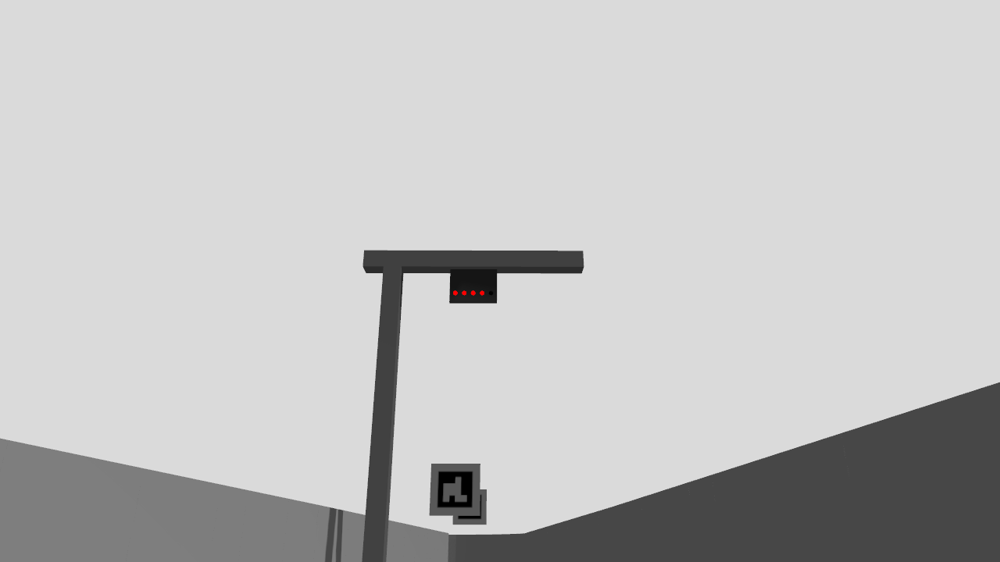

# 공식 신호등 방향 재확인과 팀 시험본 정정

2026-10-27 사용자 지적에 따라 공식 main `d8107de6ccff14ae17db7fb08732b55fed82b5b4`의 Markdown 18파일과 신호 관련 #3/#5 본문·댓글을 다시 읽었다. [조회 원문·해시·검색 위치](official_audit.json)를 보존했다. 공개 게시/댓글은 하지 않았다.

## 확인한 공식 설명

- [제작자 #3 사양](https://github.com/MOSW626/istech-it-arena/issues/3#issuecomment-6077787556)과 [track README §6](https://github.com/MOSW626/istech-it-arena/blob/d8107de6ccff14ae17db7fb08732b55fed82b5b4/track/README.md#6-시뮬--실전-차이-개발-시-반드시-감안)은 **왼쪽부터 빨강4세트·초록1세트**를 명시한다. 각 세트에는 위아래 광원이 있다. 세로로 이어진 다섯 세트가 의도된 실물 배열이라는 근거는 없다.
- [10/6 회의록 §5-3](https://github.com/MOSW626/istech-it-arena/blob/d8107de6ccff14ae17db7fb08732b55fed82b5b4/meetings/2026-10-06%20%EB%AF%B8%ED%8C%85.md)은 **신호등 높이40 cm 제작 예정**이라고 한다. [후속 제작/설치 질의](https://github.com/MOSW626/istech-it-arena/issues/3#issuecomment-6084019922)에는 발광면 지름의 기준·발광면 중심 높이·그리드 거리·방향의 확인 요청이 남아 있다. 40 cm가 전체 높이인지 광원 중심인지 확정하지 않는다.
- 공개 모델은 여전히 갠트리1.2 m·광원 중심1.08 m·단일 구체5개다. 실물의 광원쌍/설치 형상을 충실히 재현한 모델로 쓰지 않는다.

## 사진이 이상했던 이유

공식 가로보의 0.75 m 장축과 빨강→초록 배열이 도로 **진행 방향**과 거의 평행했다. 따라서 실제로 수직으로 세워진 배열이 아니라, 차량 카메라에서 깊이 방향으로 겹쳐 세로처럼 투영된다. 기둥은 도로 왼쪽 약0.275 m에 있는데 가로보는 도로 방향으로 놓여 있어 서로 붙지 않는다. 이는 원본 좌표의 문제이며 우리가 붙인 카메라/임시 장식 때문에 새로 생긴 문제가 아니다.

이 방향에 맞춰 연결된 세로 성분을 인식하는 알고리즘을 우선 개발하려던 판단은 정정한다. `camera_mount_preparation_v1`의 세로 투영·성분 실패·시제품 결과는 당시 모델의 진단으로 보존하고, 실물 가로 배열의 요구조건으로 승계하지 않는다. 새 검출기 연결은 보류한다.

## 팀 시험본에서 바꾼 것

`prepare.py`는 기존 정지 촬영본에서 **가로보와 램프 배열을 도로 횡방향으로 돌려** 빨강이 왼쪽, 초록이 오른쪽이 되게 한다. 기둥은 그대로 두면 가로보와 연결된다. 광원이 공중에 뜨지 않도록 가로보에서 내려오는 작은 판을 추가했다. 이 판은 팀 시각화/시험용 가정이며 공식 CAD 복원이 아니다.

원인 비교를 위해 이번 방향 대조에서는 기존 임시 높이(가로보1.2 m·광원1.08 m),15 mm 단일 광원,30 mm 피치,카메라·상대차 배치를 그대로 유지한다. 높이40 cm 해석/두 광원 구조/실제 설치는 별도 후속이다. 공식 ZIP·배포 원본·현재 주행 중인 임시3등 월드는 변경하지 않았다.

기하 검사에서 뒤쪽 .20/.30 m 카메라 모두6그리드에서 광원 전체 화면 포함·빨강→초록 좌우 순서를 확인했다. 기둥–가로보–판 연결도 좌표로 확인했다.

## 정지 촬영과 기존 검출기 대조

`horizontal_red4`와 `horizontal_green`을 각각 Gazebo에서 촬영했다. 각 장면의 전체/차량 시점3개에서 새 시각3프레임씩 수신했고, 촬영 완료·원본 불변·정상 종료·잔존 프로세스 없음이 모두 확인됐다. [빨강 촬영](horizontal_red4/capture/report.json), [초록 촬영](horizontal_green/capture/report.json).

| 뒤쪽 카메라 높이 | 빨강 연결 성분 | 기존 가로4열 확인 | 초록만 반복 | 빨강4→초록 반복 |
|---|---|---|---|---|
| .20 m | 4개, 폭5–6 px | 확인 | 출발하지 않음 | 출발 상태로 전환 |
| .30 m | 4개 | 확인 | 출발하지 않음 | 출발 상태로 전환 |

검출기 코드는 변경하지 않았다. [픽셀 대조](pixel_analysis.json)는 각 정지 프레임을 인위적인 시각으로 반복한 분류 비교다. 실제 점등 전환·노출·차량 출발이나 가림 뒤 재획득 검증이 아니다. 기하 수정만으로 기존 검출기의 정지 사진 실패가 사라졌으므로, 세로 연결 성분 시제품을 우선 연결할 근거는 없어졌다.

다음 영상 시험은 이 가로 배열을 기준으로 하되, 기존1.2 m 높이에 맞춘 카메라 피치를 최종 장착값으로 채택하지 않는다. 40 cm 제작 계획의 높이 기준과 앞차 가림을 별도 대조한다.

Windows 기본 Python에는 NumPy가 없어 준비 실행이 import 단계에서 실패했으며 파일을 만들지 않았다. 기존 WSL `/usr/bin/python3`로 실행해 두 장면을 만들었다. 환경 설치·물성/보호 변경은 하지 않았다.

## 실제 재질 전환과 검출기 보완

`live_sequence.py`는 두 카메라 10 Hz에서 먼저 초록만 보이는 음성 대조를 둔 뒤 소등→빨강1/2/3/4→초록→소등을 실행했다. 검출기에는 RGB와 촬영 시각만 입력한다. 각 재질 서비스 응답 뒤 단계 시간을 재므로 서비스 지연을 포함하며, 공식 신호 발생기의 정확한 동시 소등·전기 타이밍 복제는 아니다. 차량 구동 명령도 없다.

- [live_run1](live_run1/report.json): 양쪽144프레임·최대 간격0.1초·빨강4 확인, 그러나 초록 출발 미검출로 실패했다. 빨강을 개별 소등하는 중간 프레임에서 기존 검출기가 확인한 배열을 폐기했다. 원래 검출기·시험 소스는 [수정 전 사본](before_extinction_fix.zip)에 보존했다.
- 보완: 이미 확인한 빨강 배열의 일부만 남은 경우, 기존0.8초 유효시간 안에서 배열만 기억한다. 남은 빨강으로 시간/확인 횟수를 갱신하지 않고, 빨강이 하나라도 인식되면 초록 확인을 진행하지 않는다. 엉뚱한 위치·형상의 빨강, 만료, 프레임 단절은 기존 확인을 폐기한다. 초록3개 서로 다른 프레임 조건은 유지한다.
- 첫 회귀는191통과·2실패였다. 위치 반례가 기존 등 간격과 겹쳤던 시험 오류를 고쳤다. 동시에 과대 광원이 합쳐져 윤곽 검사에서 탈락하면 이를 소등처럼 취급하는 결함을 확인했다. 의미 있는 면적의 미분류 빨강도 별도로 거절하도록 수정했다. [수정 뒤 관련197검사](extinction_related_v2.log)는 모두 통과했다. 부분/전체 빨강에 다른 빨강 물체가 겹치는 경우와 작은 픽셀 잡음도 포함한다.
- [live_run2](live_run2/report.json): 양쪽144프레임·최대 간격0.1초, 조기 출발0, 초록 단계8.8초에 각1회 출발 상태 전환을 확인했다. **영상 관문은 통과했지만 전체 실행은 실패**다. Gazebo가 서버 종료 응답 뒤에도 남아 SIGINT/TERM 후 SIGKILL되었고, `shutdown.clean=false`다. 소스 불변·잔존0은 별도로 확인했다. 종료 성공이 나올 때까지 동일 실행을 반복하지 않았다.

이 보완은 선택형 `official_4red_candidate`에만 적용되며 기본 임시3등을 바꾸지 않는다. 짧은 부분 가림도 같은 패턴 기억에 포함되므로 실제 설치·다른 녹색 물체·가림 재획득은 추가 검증 대상이다. 상부ROI에 큰 빨간 물체가 나타나면 보수적으로 대기하는 한계도 있으며, 신호만 추적하는 영역 제한은 아직 없다. 두 광원쌍의 실제 렌더링, 40 cm 설치, 차량/운영 허가 연결, 실물 시각 출발은 여전히 미완료다.

## 설치 높이 불확실성의 영향

[높이 민감도](height_sensitivity.json)는 광원 중심 .28/.40/1.08 m, 카메라 5배치, 상대차 높이 .12/.25/.40 m의45조합×6그리드를 비교했다. .28/.40 m는 높이40 cm 계획의 기준점 불명확성을 보기 위한 가정이며, .28 m를 실제 광원 중심으로 추정했다는 뜻은 아니다. 20×15 cm 상자5대와 광원당9개 선분의 정지 핀홀 계산이다.

| 광원 중심 가정 | 카메라 | .25 m 상대차에서 화면·기존 ROI 포함이며 표본 가림 없는 칸 | .40 m 상대차의 같은 조건 |
|---|---|---:|---:|
| .28 m | 전방 .145 m·수평 | 2/6 | 2/6 |
| .28 m | 뒤쪽 .20 m·수평 | 2/6 | 2/6 |
| .28 m | 뒤쪽 .30 m·수평 | 6/6 | 2/6 |
| .40 m | 전방 .145 m·수평 | 2/6 | 2/6 |
| .40 m | 뒤쪽 .20 m·수평 | 4/6 | 2/6 |
| .40 m | 뒤쪽 .30 m·수평 | 6/6 | 2/6 |

낮은 가로 신호에서는 수평 카메라도 신호 전체가 영상에 들어온다. 하지만 앞차 가림이 주된 한계로 바뀐다. 뒤쪽 .30 m는 .25 m 상자 대비 유리했고, .40 m 상자가 앞을 막는 경우는 높이 변경만으로 해결되지 않았다. 위쪽10° 기울임은 낮은 신호를 기존 상부58% ROI 아래로 밀어내는 경우가 있었다. 따라서 이전1.2 m 모델로 정한 큰 상향 피치를 유지할 근거가 없으며, 최종 배치는 신호 사진/설치와 실제 마커 접근을 함께 보고 정한다. 이 표는 픽셀 검출·연속 광원 면적·실물 가림 성공률이 아니다.
