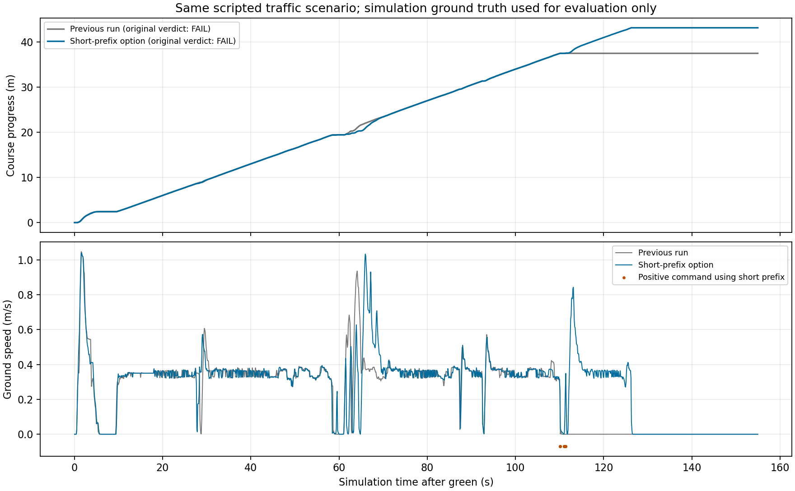

# 짧은 관측 경로의 선택형 연결

2026-10-27. 기본값은 `false`다. 새 폐루프1회에서 이전 정체를 지나43.173 m까지 진행했으나 소실 장애물 래치로 다시 정지해 전체 랩은 실패했다.

## 문제와 변경

[교통 전체 랩 run1](../g1_traffic_lap_v1/README.md)은 37.514 m에서 정체했다. 전방 센서가 모두 끊긴 것이 아니라, 추종하는 쪽의 관측 벽이 기존 0.65 m 길이 조건을 못 채우고 반대쪽 벽은 기존 차체–벽 거리 조건을 벗어난 경우다. 직전의 [경계 분석](../g1_traffic_lap_v1/BOUNDARY_NEXT_DESIGN.md)과 저장 입력을 출발점으로 삼았다.

새 후보는 짧은 쪽에서 이미 만든 경로를 반대쪽 관측 경로와 비교하고, 두 경로가 가까운 **첫 연속 구간의 끝에서 자른다**. 반대 경로의 먼 끝으로 연장하거나 지도에서 다음 커브를 가져오지 않는다. 양측 경로의 일치가 벽의 정체나 전체 자유 공간을 보증하지는 않으므로 모든 측정 장애물과 현재·직전 조향의 점유 검사를 그대로 수행한다.

- 기존 회랑 제안이 `long_outer_reference_unavailable`일 때만 검사한다.
- 원래 쪽의 차체 기준 경로 위치·벽 거리 조건, 반대쪽 0.65 m 관측, 연속 공통 구간 0.25 m와 5표본 이상·순방향 순서가 필요하다. 공통 구간 전의 편측 구간은 차체 길이 이내다.
- 후보 속도는 최대 0.35 m/s다. 현재 속도와 후보 속도 중 큰 값으로 반응·제동 예산을 구해 남은 관측 경로 안에 들어가는지 확인한다. 기존 모형의 2 m/s² 감속·0.10 s 여유와 0.06 m 여유를 사용한 계산이며 실물 제동 보증이 아니다.
- 서로 다른 스캔의 시간 확인·운동 변환·점유·GUARD/통과 선택기를 거친다. 정상 벽 기억을 새로 갱신하는 근거로 쓰지 않는다.
- `G1 + corner_distance_candidate + per_ray_candidate + corridor_fallback` 및 기록이 있는 시뮬레이션에서만 명시적으로 켠다. 최근 관측·R0+·구형 M3와 결합하지 않는다. `/drive` → 독립 보호층 → `/drive/safe`는 유지한다.

정지 예산의 현재 속도는 기존 모터축 엔코더 기반 추정값이다. 제동 중 바퀴가 잠기고 차체가 미끄러지는 차이는 이 변경으로 해결하지 않았으며, 평가용 차체 정답 속도를 제어기에 넣지 않는다. 새 후보의 저속 제한과 별개로 남는 실물/동역학 검증 항목이다.

## 저장 입력에서 먼저 확인한 범위

실제 연결 전의 [정책 비교](../g1_traffic_lap_v1/prefix_replay_v1/report.json)는 최초부터 120.5 s까지 5,833판단·191리셋을 재생했다. 319판단의 속도/조향이 달라졌으며 최초 114.12 s에 0 → 0.35 m/s 후보가 나왔다. 첫 후보는 기존 GUARD의 관측 검사·시간 확인을 통과했다. 뒤의 입력은 여전히 정지해 있던 원래 실행의 기록이므로, 이 결과는 **차량이 실제로 그 경로를 따라 진행했다는 증거가 아니다**. 별도 ROS 보호 노드도 이 개루프 비교에서 실행하지 않았다.

## 검증과 출처

- [변경 전 파일 해시](before.json)·[수정 전 파일](before.zip)에 실제 수정 전 바이트를 보존했다. [후속 소스 계약](../../../../config/tests/short_boundary_prefix_r0_sha256.json)은 이전 계약을 바꾸지 않고 6개 변경 경로를 연결한다. 소스 출처 기록은 안전 승인과 다르다. 전체 실행 소스 압축과 호출별 재생·원시 센서/구동 로그는 기존 정책에 따라 로컬 보존한다.
- 첫 관련 검사는 165통과·1실패였다. 잘못된 좌표계 시험을 만들면서 스캔과 광선의 frame을 다르게 넣어 입력 생성자가 먼저 거부했다. 생성 단계와 관측기 단계의 거부를 혼동한 시험을 수정했다. 원래 실패 로그는 `related_v1.log`에 남겼다.
- [수정된 관련 검사](related_v2.log)는253개 모두 통과했다. 옵션 OFF 전체7,789판단은 모두 동일했고 입력도 불변이다(`off_replay_v1.json`, 로컬 상세 재생).
- [옵션 ON](enabled_replay_v1.json)은5,833판단 중319명령이 달라졌으며 앞선 정책 비교와 전부 일치했다. 첫 변경114.12초·기존 GUARD 승인이다. 호스트의 호출 시간은 중앙값12.50 ms·95백분위21.13 ms·최대39.15 ms였으며, ROS 전송·독립 보호 노드·Jetson 처리율을 포함한 수치가 아니다. 관련24파일은 실행 중 불변이었다.
- [전체 회귀](full_regression_v1.log)는5,982통과·19건 건너뜀, `arena_autonomy`·`arena_bringup` 빌드는 성공했다. 실행 직전975파일 해시 불변·잔존 시험 프로세스 없음도 확인했다.
- [고정된 새 실행](run1_trial.sh)을 한 번 완료했다. report와 실제 `follow_config` 헤더 모두 옵션 활성화를 확인했다. 실행 후975파일 불변,7,790판단 동일 재생이다.

## 실제 주행 결과

[원래 판정](run1_course/report.json)은 `passed=false`, `run_valid=true`다. `final_gap`·`full_lap`은 실패했고, 정지/재개·재개 후 진행·표본/스윕 차간격·비접촉·바퀴 노면 관문은 통과했다. 진행43.17349 m는 코스 길이46.633 m에 미달한다. 이전37.51423 m 정체를 넘었지만 완주는 아니다.

[분기 진단](run1_diagnostics.json)에서 짧은 경로 제안74호출 중23호출이 선택됐고 모두 양수 명령이었다. 이후129.997–158.555초에28.558초 정지했다. 제어기에는 `parallel_hold_baseline_unavailable`, 보호층에는 `known_obstacle_latched`가 남았다. STOP 안정 확인·정지 최대속도0.00052 m/s, 정상 종료·잔존0,바퀴 중심78,592표본 이탈0을 별도로 확인했다. 단일 시행이며 반복성·실물 안전을 보증하지 않는다.

다음 분석은 최초 래치가 어떤 측정 점에서 생겼는지, 실제 움직이는 차량의 반환인지 정적 벽인지, 이후에도 유효한 위협인지 구분하는 것이다. 현재 노면/간격 판정을 낮추거나 래치를 지우고 재시도하지 않는다.

## 실행 조건과 해석

관련 검사·저장 입력 대조·빌드·전체 회귀 뒤 원래 run1과 같은 센서·물성·actor 각본·속도 상한·노면/STOP 판정에서 새 옵션만 켰다. 이전37.514 m 정체 실패와 Gazebo 강제 종료가 필요했던 신호 영상 시험은 그대로 보존한다.

앞차는0.35 m/s·4–9초 정지 후 재개, 추가 옆차는 왼쪽 잔디 방향0.32 m에 있고15초 뒤 정지하는 기존 각본이다. 상대차는 평가기가 움직이는 상자이며 자율 차량이 아니다. 이 비교의150 mm 간격 판정은 해당 각본의 원래 비교선으로 보존하며, 모든 실제 병렬 주행에15 cm를 요구한다는 팀 방침으로 확대하지 않는다. 도로 안 나란한 주행·동시 출발·임의 상대 움직임은 별도다.
