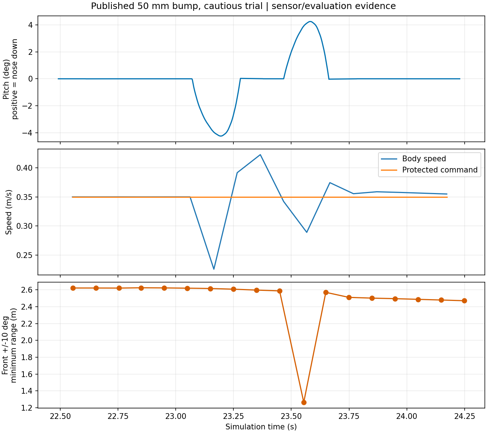
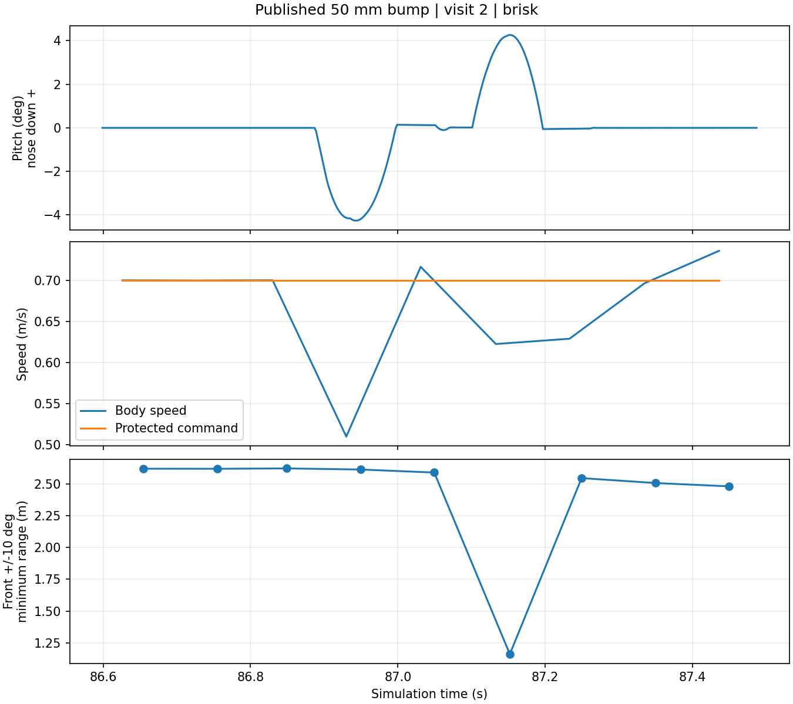

# 공개 50 mm 방지턱 저속 동적 시험

## 실행 전 고정 조건

2026-10-28 준비·run1 완료. 기존 교통 전체 랩 43.173 m 정체는 해결된 것으로 취급하지 않는다.

- 공식 `v2026.10.24`의 450×50×10 mm 공개 시각 모델과 기존 20구간 코사인 충돌 근사를 유지한다. 미확정 100/150 mm 대안으로 교체하지 않는다.
- [공식 신호 v2 시험 월드](../../2026-10-27/official_departure_v2/fixture/manifest.json)의 가로 신호·뒤쪽 30 cm 카메라를 그대로 쓴다. 설치·카메라는 가정이다. 단독 차량이며 상대차는 없다.
- 그리드 3에서 공식 영상 신호로 출발하고 약 5.19 m 앞 방지턱을 지나 총 6.2 m까지 진행한다. 최대 시뮬레이션 60초/실제 1,800초, 정지 확인은 기존 180초 한도다.
- G1·v4·짧은 경계·GUARD 곡선 후보를 유지하되 `cautious` 프로필 상한 0.35 m/s를 명시한다. 1 m/s 시험으로 표기하지 않는다. LiDAR 순차 10 Hz·평면 운동 보정·단일 모터축 엔코더·가상 MCU·독립 보호층·STOP을 유지한다.
- 평가기 사본에서 공식 빨강/초록 신호, 저속 프로필, 방지턱 ON의 진입 조건만 허용한다. 기존 STOP·진행·충돌·종료 판정을 낮추지 않는다. 실행 전 diff와 소스 ZIP을 보존한다.
- 평가용 차체 3D 자세와 IMU 전체 축, 순차 스캔, 방지턱 주변 RGB를 추가 저장한다. 정답 자세/방지턱 위치는 평가와 사진 저장에만 사용하며 대회 제어기에 입력하지 않는다. 현재 제어기에는 방지턱 인식·전용 감속 로직이 없다.

## 판정과 한계

기존 평가 통과 여부와 실제 네 바퀴의 방지턱 전후 통과 여부를 함께 기록한다. 진행 거리만으로 방지턱 통과라고 판단하지 않는다. 바퀴 중심의 종·횡 위치와 반경/폭을 대조하고, 차체 pitch/roll·IMU·스캔 수신과 보호 정지/회복을 별도로 분석한다. 자세·진동의 실물 허용치를 가정해 만들어 통과시키지 않는다.

통과하더라도 단순 차체 상자의 지상고·무서스펜션·접촉 모델에서 한 번의 저속 결과다. 실제 하부 부품 간섭, 재질/접착, 진동/노출·C1 반사율, 고속 통과나 교통·전체 랩·5랩의 검증은 아니다. 실패 시 원시 자료를 보존하고 원인 변화 없이 반복하지 않는다.

실행: `run.py --output .../run1 --prepare-only`로 사본과 해시를 준비한 뒤 동일 출력으로 `run.py --output .../run1`을 실행한다. 단순 실행은 GPT-6 Luna가 맡고 GPT가 설계·분석·검토한다.

## run1 결과와 다음 대조 조건

[run1](run1/report.json)은 6.23934 m·조기 출발/접촉0·기존 판정 통과다. [바퀴 통과](run1/bump_analysis.json)는 네 바퀴 모두 약 23.0–23.74초에 방지턱을 지났고 최대 절대 pitch 4.249°·roll 0.003°를 기록했다. 명시 STOP 뒤 이동 19.59 mm·0.762초 후 안정 정지, 자식14/14 정상 종료·잔존0·965판단 동일 재생·소스425파일 불변이다. 실행 전 어댑터6검사가 통과했다.

[센서 분석](run1/sensor_analysis.json): 명령은 0.35 m/s지만 방지턱 근처 실제 속도는 0.226–0.423 m/s로 변했다. 전방 ±10° 최소 반환은 한 스캔에서 약 2.6→1.264 m로 짧아졌다. 해당 광선의 취득 시각 23.554초에 앞 숙임 약3.916°로, 바닥 반환과 일치하는 변화다. GPU LiDAR는 표적 신원을 반환하지 않으므로 지면으로 직접 분류한 결과는 아니다. 구간 보호 이유는 모두 `clear`, IMU 최대 수신 간격4 ms·스캔100 ms다.

모의 IMU의 순간 z 가속도는 최대133.34 m/s²였다. 강체 바퀴·20구간 충돌·물리 적분에서 생긴 값이며 실제 충격이나 실물 IMU 포화값으로 해석하지 않는다. 센서·차체의 실물 진동/내구성은 이 시험으로 판단할 수 없다.

다음 run2는 **명시 `brisk` 0.70 m/s 상한** 한 조건을 대조한다. 동일 월드·차량·물성·6.2 m·보호/STOP·종료 조건을 유지한다. 형상/판정 완화 없이 속도에 따른 통과·바닥 반환·정지 여부를 확인하며, 실패하면 반복하거나 자동 고속화하지 않는다. run1 당시 소스는 ZIP에 보존했고 run2는 별도 사본/해시로 준비한다.

## run2와 전체 코스 연결

[run2](run2/report.json)는7개 어댑터 검사·별도 소스 보존 뒤 6.21935 m·네 바퀴 통과·기본 판정 통과다. 최대 절대 pitch4.264°·roll0.004°, 방지턱 구간 실제 속도0.498–0.747 m/s, 전방 최소 반환1.272 m였다. STOP 뒤 이동80.16 mm·0.878초 안정 정지, 자식14/14 정상 종료·잔존0·525판단 동일 재생·소스 불변이다. 모의 IMU 순간 z 최대261.62 m/s²는 현 강체/접촉 근사의 결과로 기록하며 실물 충격의 예측으로 쓰지 않는다.

다음 **course1**은 같은 `brisk`·공식 신호·카메라·방지턱 ON을 유지한 단독 전체 1랩이다. `--scope course`로 기존 평가기의 기본 목표 `lap_length + 2 m = 48.6329 m`와 전체 랩/마커 판정을 그대로 사용한다. 최대300시뮬레이션초/실제3,600초, STOP확인180초다. 기본값이나 소실 래치/통과 선택기를 변경하지 않는다. 방지턱·높은 카메라·공식 출발을 연결한 단독 결과이며 교통 랩 성공과 구분한다. 실패하면 당시 증거를 보존하고 같은 조건으로 자동 반복하지 않는다.

센서 분석의 끝 표본에서 광선 취득 시각이 자세 분석 구간 밖이면 이후 버전은 pitch를 `null`로 둔다. run1/run2의 마지막 한 표본은 당시 `np.interp` 끝값이 기록되어 있으므로 자세 대조에 쓰지 않는다. 최소 반환을 만든 중앙 통과 표본은 구간 안이며 위 결론은 변하지 않는다. 당시 분석 파일/소스는 보존했다.

## course1 실제 2랩 결과

위 준비 설명은 1랩이었지만 실제 실행에서 `--laps`를 생략해 평가기 기본 2랩이 적용됐다. [실행 중 발견·지속 판단](course1_scope_audit.md)을 보존한다. 실행 도중 소스/목표를 바꾸지 않았으며 실제 결과는 **2랩 목표 95.2658 m에 95.3056 m 진행**이다. [원본 보고서](course1/report.json)는 본래 판정 통과·코스 ID0/20/30/45 관측·접촉0·명시 STOP·14/14 정상 종료를 기록했다. 429개 준비 소스 해시가 실행 중 유지됐다. 교통 차량이 없는 단독 결과다.

[방문별 사후 분석](course1/bump_visits.json)은 다른 도로의 같은 종방향 좌표를 섞지 않고 실제 방지턱 근처 두 방문을 분리했다. 분리·우회·역방향·기록 공백의 5검사를 먼저 통과했고 원시 자료는 바꾸지 않았다.

| 항목 | 첫 방문 | 두 번째 방문 |
|---|---:|---:|
| 네 바퀴 기하 통과 | 확인 | 확인 |
| 최대 절대 pitch | 4.275° | 4.266° |
| 최대 절대 roll | 0.0033° | 0.0046° |
| 근처 표본의 실제 차체 속도 | 0.500–0.722 m/s | 0.510–0.736 m/s |
| 전방 ±10° 최소 반환 | 1.943 m | 1.160 m |
| 해당 광선 시각의 앞 숙임 | 2.183° | 4.266° |
| 근처 보호 상태 | `clear` | `clear` |

10 Hz 스캔과 짧은 피치 변화의 상대 시점이 달라 최솟값도 달랐다. 같은 방지턱을 같은 상한으로 지났다는 이유로 같은 깊이/거리 변화가 항상 잡히는 것은 아니다. 표적 신원은 기록되지 않으므로 지면으로 직접 분류한 결과는 아니다. 모의 IMU z 최대194.19/55.20 m/s²도 강체 접촉·표본 시점의 값이며 실제 충격 예측으로 쓰지 않는다.

**정지의 한계:** 종료 직전 실제 속도 약0.700 m/s에서 명시 STOP 뒤 차체 변위287.82 mm, 1.302초 뒤 기존 안정 정지 판정을 충족했다. 기존 판정에는 정지거리 상한이 없으므로 `passed`를 짧은 제동거리의 합격으로 해석하지 않는다. 약0.30–0.40초에는 모터축 평균 속도 표본이0이어도 차체는 약0.58 m/s로 움직였다. 앞선 run2는 비슷한 초기속도에서80.16 mm였으므로 287.82 mm를 고정 제동거리로 채택하지도 않는다. 접촉력/좌우 바퀴 원시 진단을 이번에 저장하지 않아 노면·하중·차동별 원인 확정은 하지 않는다. [기존 관측 한계](../../../../docs/autonomy/MOTOR_MOTION_OBSERVABILITY_2026_10_13.md)와 같은 종류의 한계로 보존한다.

후속 어댑터는 `--laps`와 목표 거리를 모두 명시하며 준비 메타데이터/실제 보고서를 대조한다. 초기 10개 계약 검사와 실제 `main` 경유 인수 검사 등을 합쳐 관련20검사를 통과했다. 기존 course1 준비/실행 소스 ZIP을 새 어댑터로 덮어쓰지 않았다. 이번 결과는 5랩·2 m/s·밀집 전체 코스·실차 성공이 아니다.

## 기존 정지 자료와 감속식의 후속 대조

[정지 비교](stop_comparison.json)는 새 주행 없이 세 종료 기록을 대조했다. 같은 약0.70 m/s여도 run2는 변위80.2 mm·누적 이동88.3 mm, course1은287.8 mm·296.5 mm였다. 시작 좌표·주행/토크 이력이 다르므로 원인을 노면 또는 PI 하나로 확정하지 않는다. 최대 자세 표본 간격은 두 경우 모두3 ms이며 원시 입력 해시를 유지했다.

현행 `braking_speed`는 감속2 m/s²와 지연 `scan_age + 0.10 s`, 추가60 mm를 가정한다. 약0.70 m/s에서 이 식의 필요 거리는 스캔 나이0일 때253 mm,0.1초일 때323 mm다. course1 실제 STOP 누적296.5 mm는 앞 값보다 길고 뒤 값보다 짧다. 따라서 **감속항2 m/s²만으로 실제 제동을 보장할 수 없지만, 이 기록만으로 전체 보호식이 항상 부족하다고 단정할 수도 없다.** STOP 직전 마지막 계획기의 스캔 나이0.198초는 요청 시각의 정확한 보호층 입력이 아니며, 그 값으로 합격 처리하지 않는다.

속도 제곱을 실제 누적 이동의 두 배로 나눈 등가 감속은 run2 약2.79, course1 약0.83 m/s²다. 지연/비균일 제동을 함께 담은 사후 지표로 실제 파라미터가 아니다. 후속 고속화 전 같은 위치·출력 의미·구동 이력의 제한 제동 대조가 필요하다. 이번에 감속·토크·마찰·보호 한도를 변경하지 않았다.
