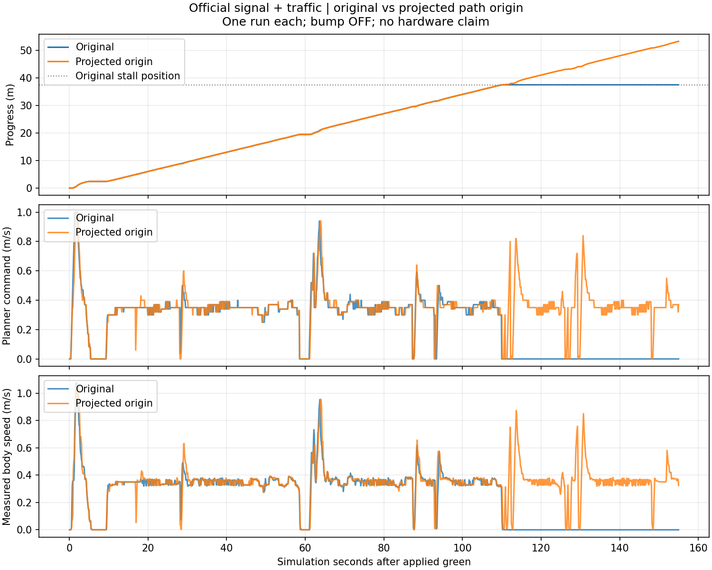

# 공식 신호 통합37.47 m 정체와 경로 길이 원점

2026-10-28. 원래 주행 실패는 [공식 통합 결과](../official_traffic_v1/README.md)에 보존했다. 이 문서는 사후 비교·계산 후보·후속 연결 검증을 기록한다. 사용자 일시 중단 이후 10/28 수동 요청으로 재개했다.

## 확인한 원인

두 실행의 진행37–38 m 구간은 모두 오른쪽 벽 선택·`fully_observed`였다. ID30도 실제 검출됐다. 기존 완주 입력에서는 같은37.47 m 근처에 일시 정지가 있었으나 회복했고, 공식 신호/고정 카메라 입력에서는44.861초 정체했다. 따라서ID30누락이나 무반환으로 설명되지 않는다. 신호/카메라와 실행 위상의 변화가 정확히 어떤 궤적 차이를 만들었는지까지는 분리하지 않았다.

기록을 복원한 [기하 대조](geometry.json)에서 새 정지 입력의 선호 경계는약0.591 m로 기존0.65 m 요구보다 짧았다. 반대쪽 경로는길지만 현재 위치와의 기준 거리 조건을 만족하지 못해 일반 회랑은 거절했다. 이때 짧은 선호 경로와 반대쪽 경로의 공동 구간을 쓰는 보완도 `insufficient_contiguous_common_prefix`로 거절했다.

이 보완은 공동 지지가 시작되기 전 경로 길이를20 cm 이내로 요구한다.119초 입력에서는20.1240 cm였다. 그런데 이 길이의 원점을 차량에 가장 가까운 **경로 꼭짓점**에 두었으며, 그 꼭짓점이 경로 선분상의 실제 최근접점보다10.6479 mm 뒤에 있었다. 같은 경로에서 원점을 투영점으로 계산하면 해당 길이는19.0592 cm다. 공동 지지 약60.37 cm·8 cm 경로 일치·20 cm 상한 자체는 변하지 않는다. 실제 경로 원점과 가장 가까운 이산 표본을 혼동해 길이가 길거나 짧게 평가될 수 있는 문제다.

## 제한 계산 후보

[`origin_candidate.py`](origin_candidate.py)는 기존 최근접 꼭짓점에 인접한 두 선분 안에서 투영 원점을 찾고 그 arc 차이만 반영한다. 멀리 떨어진 다른 경로 가지로 원점을 옮기지 않으며 센서점·경로 끝·공동 지지 길이·시간/점유/보호 기준은 바꾸지 않는다. 실제 새 거리가20 cm를 넘는 경우는 계속 거절해야 한다. 운영 소스·기본값에는 연결하지 않았다.

[계산 확인](origin_check.json): 직선 표본 위상7개와 양 끝점2개에서 투영 거리를 확인했다. 보존한 두 실행의12장면 중 기존 보완이 거절된공식119/120/130초3장면은기하 후보를 생성했다. 다른9장면의지지 여부는같았다. 이 결과는 현재 기하만의 비교다. 상태를 잇는전체 재생·두 fresh 관측 확인·독립 보호층·실제 재출발을 확인한 결과가 아니다.

## 재개 순서

1. 이 후보를 운영 수정 없이 공식 실패의전체 저장 입력에 적용한다. 최초 출력 변화·정체 구간 진행 후보·원래 입력/소스 보존을 확인한다. 기본 옵션OFF와 기존 완주도 필요한 범위에서 대조한다.
2. 최근접 꼭짓점이 앞에 있어 기존 방식이 길이를 짧게 세는 반대 사례,20 cm 초과·경로 분리·짧은 공동 지지·전방 장애물·시간 단절을 확인한다. 원점 계산 개선을 단순 한도 완화로 바꾸지 않는다.
3. 결과가 적절하면 운영 소스에 제한 이관·출처 보존·관련 회귀·빌드를 진행하고 같은 공식 통합1회를 새 출력으로 비교한다. 현재는운영 미연결이며 새 주행 미실행이다.
4. [도로 내 왼쪽 피추월](../onroad_candidate_v1/README.md)은3.8796 m 진행·접촉0·STOP/종료를 확인했지만 기존 간격/최초 앞차 거리 기준은 실패다. 오른쪽 실제 비교는 아직 실행하지 않았다. 이 항목과 방지턱/다랩 계획을 삭제하지 않는다.

이번 수동 작업에는 오래된10/26예약의 날짜/종료 제한을 적용하지 않았다. 직전 중단은 사용자의 명시적 일시 중단 요청이었다. 이후 수동 재개에 따라 아래 후속 검증을 진행한다.

## 10/28 재개 후 전체 입력 비교와 연결

`trace_candidate_v1/summary.json`에서 공식 실패의 7,791판단을 상태를 유지하며 재계산했다. 2,267명령이 달라졌고 최초 차이는118.42초의0→0.35 m/s다.118–162.6초 구간2,230판단 중2,211회가 진행 명령이었다. 기록된 차량은 움직이지 않으므로 실제 재출발·완주 증명이 아니다. 입력/운영 소스는 비교 동안 동일했으며 당시 함수와 계산 후보는 `trace_candidate_v1/source_snapshot.zip`에 보존했다.

표본 위상·회전·거리 과대/과소평가·20 cm 초과·공동 지지 단절·짧은 공동 구간·전방 장애물·시간/프레임/역주행/고속 조건 등34검사가 통과했다(`origin_tests_v2.log`). 선택형 짧은 경로 함수에 동일 원점 계산을 이관했고, 현재 유효 선분이 없는 경우는 별도 거절한다. 기존20 cm 숫자를 늘린 변경이 아니다. `before_origin_fix.zip`과 후속 `short_prefix_origin_r1_sha256.json`이 원본/변경을 연결한다. 보존 도구는 앞으로 바뀐 운영 소스가 아닌 이 이전 함수에 고정했다.

후속 실행은 `../official_traffic_v1/run2_trial.sh`: 기존 run1과 같은155초·seed0·공식 신호·30 cm 카메라·앞차 정지/재개·잔디 쪽 옆차·방지턱OFF다. 변경은 경로 원점 계산이며, 실제 진행·정체·접촉·노면·STOP·정상 종료·동일 재생을 원래 판정과 함께 회수한다. 실행 전 회귀/빌드를 끝내며 동일 실패를 성공할 때까지 반복하지 않는다. 도로 안 오른쪽 시험과 다랩은 이 비교 뒤 이어간다.

사용자는 불확실성만으로 멈추는 빈도를 줄이고 완주를 우선하도록 재확인했다. 보호 조건 자체의 변경을 금지하는 것으로 해석하지 않으며 후속 정책은 [ADR0027](../../../../docs/decisions/0027-completion-first-policy-and-placement.md)에 기록했다. 이 실행의 기존 수치/실패는 원인 대조용으로 보존한다.

운영 이관 후 관련164검사가 통과했다(`integration_tests_v3.log`). 첫 두 호출은 ROS Python 경로를 덮어써 `xacro`를 못 찾은 수집 오류였으며, ROS 경로를 보존하는 `check_integration.sh`로 바로잡았다. 제어기 실패로 해석하지 않으며 기존 오류 로그도 보존했다.

### 정지 명령의 위치

[`stop_layers_v2.json`](stop_layers_v2.json)은 기존 세 실행의 `/drive`와 `/drive/safe` 수신 값을 비교한다. 공식 실패의119–162.5초 표본430개는 모두 계획기부터0명령이었고 독립 보호 사유는모두 `clear`였다. 전체 수신 표본1,533개 중계획기0은521개, 계획기양수/보호0은2개였다. 토픽 수신 시차가 있으므로 후자의2개를곧바로 보호층 오판으로 단정하지 않는다. 장기 정체의주원인은 경로 거절이며 독립 보호층의 장애물 정지가 아니다.

임시 신호 완주 표본1,533개는 계획기0이98개, 도로 안 왼쪽117개는25개였다. 실제 정지시간은 자세 기반 보고서가 기준이며 이 표본 집계를 물리 정지시간으로 대신하지 않는다. 초기 `stop_layers.json`의 연속 구간 계산은중간 양수 표본을끊지 못하는 경우를수정하여v2로분리했다. 수신값 분류 수는동일하다.

## 실제 공식 교통 비교 완료

후속 run2는53.2722 m·전체1랩·원래 주행/간격 gate·STOP·14/14정상 종료·7,808판단 동일 재생을 통과했다. 이전37.474 m 영구 정체가 해소됐다. [실제 결과의 기준 보고서](../official_traffic_v1/README.md#경로-원점-수정-후-run2--같은-조건의-교통1랩-통과), [기계 요약](../official_traffic_v1/run2_course_summary.json).

기존20 cm 상한을 늘리지 않고 길이 원점을 바로잡은 결과다. 이전보다다른경로/위험조건 전체를 해결한 것은 아니며 한 번씩의 비교다. 원래실패·그 당시소스는그대로보존한다. 사용자후속요청에따라 다음은 [회전 중 잔여 오차 비교](../motion_uncertainty_v1/README.md)이며, 도로내오른쪽·방지턱교통/5랩은남아있다.
