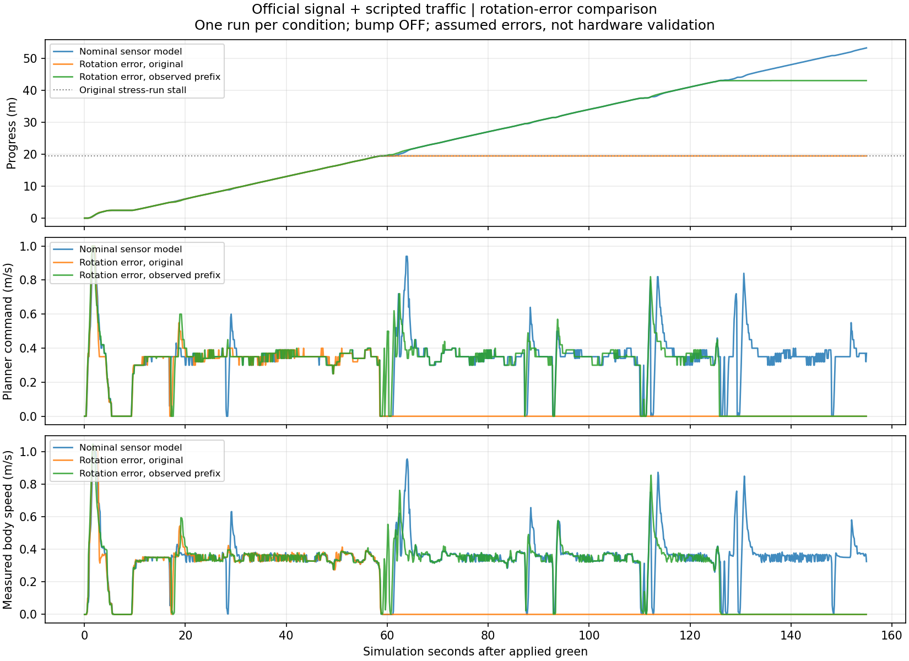
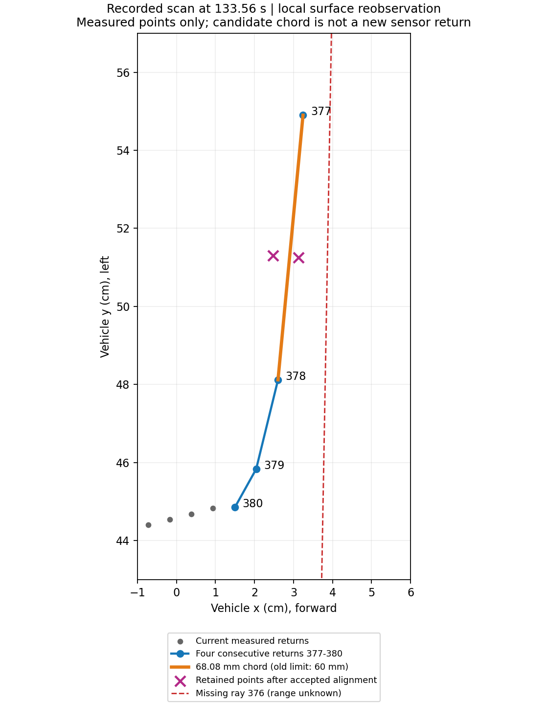

# 회전 오차를 더한 공식 교통 폐루프 비교

공식 신호/고정 카메라·교통1랩을 통과한 `official_traffic_v1/run2_course`와 같은155초·seed0·앞차 정지/재개·잔디 쪽 옆차·방지턱OFF를 사용한다. 속도·노면·차량 물성·보호층/STOP·간격 판정은 동일하다.

실측 전 시험 가정으로 다음 센서 모델만 변경한다.

- 물리 LiDAR 센서의 yaw를−0.5°로 놓고 제어기의 장착 보정은0으로 유지한다. 작은 장착/각도 영점 불일치다. 실제 하드웨어의 배치를 바꾸는 결정은 아니다.
- Gazebo IMU의 gyro 세 축 Gaussian 표준편차를0.001→0.02 rad/s로, z축 mean을0→+1°/s로 바꾼다. 제어기의 bias 보정은0으로 유지한다.
- 센서 생성부터 실제 ROS 입력 콜백의 마스크·범위/변화율 검사·운동 보정·제어기·독립 보호층을 통과한다. 센서 정답 오차를 제어기에 알려 주지 않는다.

실제 `runtime_vehicle.sdf`와 판단 헤더의 미보정 설정을 검증한다. 수정은 LiDAR의 센서 pose1개와 gyro noise4값뿐이며 충돌/차체 기구·가속도 센서·카메라·트랙을 변경하지 않는다. 값은 LSM6DSOX/C1 제조사 정확도나 실물 진동의 재현 사양이 아니다.

저장 입력의 각도 변경과 물리 센서 배치 오차는 동일한 광선/가림을 만들지 않으므로 동일 재생 비교라고 하지 않는다. 광선별 각도 잡음·가변RPM·LiDAR 추가 거리 오차·방지턱 복합 조건은 이번 범위가 아니다. 저장 입력에서1.28초였던 정지가 실제로는 자세 고정 때문에 이어지는지, 또는 관측/동역학으로 회복되는지 확인한다.

## 첫 주행 결과

`contracts_v1.log`의 9검사 이후 `run1_trial.sh`로 한 번 실행했다. [주행 요약](run1_course_summary.json)의 `run_valid=true`, 원래 판정은 **실패**다. 원시 입력·당시 전체 소스·실패는 보존한다.

| 항목 | 실제 결과 |
|---|---|
| 진행 | 19.45737 m, 전체 랩 실패 |
| 원래 실패 항목 | `final_gap`, `full_lap` |
| 실제 런타임 설정 | 기존 공식 신호/차량 계약 및 추가 센서 오차 6항목 통과 |
| 판단 재생 | 7,791/7,791 동일, 원시 입력·소스 불변 |
| STOP·종료 | 정체 상태에서 STOP 확인, 14/14 정상 종료, 잔류 프로세스 없음 |
| 주의 | 정체 후 STOP의 작은 이동량을 달리던 차량의 제동 성능으로 해석하지 않음 |

설정 파일뿐 아니라 실제 수신 gyro도 대조했다. 평가용 차체 속도/회전율로 거의 정지한 구간을 고르고, 제어기가 채택한 중복 없는 z축 표본만 집계했다. 정답은 평가 구간 선택에만 사용했으며 제어기에 입력하지 않았다.

| 조건 | 거의 정지 구간 표본 수 | 평균(rad/s) | 표준편차(rad/s) |
|---|---:|---:|---:|
| [명목 완주](../motion_uncertainty_v1/baseline_received_gyro_v1.json) | 1,855 | 0.0000345 | 0.0010007 |
| [오차 주행](run1_received_gyro_v1.json) | 25,357 | 0.0172145 | 0.0199581 |

이 수신 통계는 SDF의 +1°/s·0.02 rad/s 설정이 실제 입력에도 반영됐다는 근거다. 원시 3축 전체나 실물 잡음 측정은 아니며, 제어기의 영점 보정값은 0으로 유지됐다.

## 정체 원인과 보완 작업

[주행 진단](run1_failure_diagnosis.json)에서 약 66.3초부터 정지했다. 원래 무오차 주행에서 잠시 정체했다 회복한 19.46 m 부근이다. 이번 주행에는 소실 장애물 래치가 없었고, 전방 관측은 온전했다. 독립 보호층은 `clear`였으며 계획기가 경계 경로를 확정하지 못했다.

[기하 재계산](run1_geometry_v1.json)에서 바깥 경계는 약 1.57–1.80 m 관측됐으나 선호 경계의 독립 경로는 `wall_segment_short`였다. 회랑 후보는 안쪽 실제점으로 약 0.577–0.606 m까지 함께 지지됐지만, 기존 0.65 m 조건을 만족하지 못해 `inner_surface_support_unavailable`로 거절했다. 저장 입력의 133초 정합/소실 기억 문제와는 다른 원인이다.

보완은 기존 0.65 m 기준을 전역으로 낮추는 방식이 아니다. `short_boundary_prefix_enabled`를 명시한 경우에만 기존 거리·법선·연결·코너 조건을 만족하는 안쪽 지지의 첫 구간을 남긴다. 공통 지지는 최소 0.25 m이며 바깥 경계의 기존 길이/앵커 조건은 유지한다. 실제 투영 원점부터 관측 끝까지의 길이 안에 차체·측정 여유·정지 예산이 들어가야 하고, 최대 0.35 m/s·서로 다른 스캔 확인·모든 점유점·독립 보호층을 그대로 사용한다. 짧은 안쪽 면을 벽으로 확정하거나 기본 경계 기억을 갱신하지 않는다.

`inner_prefix_checks_v1.log`는 121통과·1실패였다. 새 frame 반례에서 장면 이름만 바꾸고 광선 이름을 그대로 둔 fixture 오류였으며, 두 값을 같은 잘못된 이름으로 맞춘 뒤 `inner_prefix_checks_v2.log`의 **122검사가 통과**했다. 운영 frame 검사를 완화하지 않았다.

## 전체 저장 입력 비교와 새 주행

`compare_inner_prefix.sh`는 두 입력의 기존/새 제어기와 독립 보호 상태를 각각 처음부터 재생했다. 기존 분기는 새 안쪽 지지 함수만 비활성화했고, 기록된 전체 판단이 계산 시간 진단값을 제외하고 모두 일치했다. 양수 명령은 독립 보호층을 거친 결과다.

| 저장 입력 | 기존 판단 일치 | 정지→양수 | 양수→정지 | 새 양수 명령 |
|---|---:|---:|---:|---:|
| [회전 오차 run1](inner_replay_stress_v1/summary.json) | 7,791/7,791 | 4,803 | 0 | 7,489 |
| [명목 완주 run2](inner_replay_nominal_v1/summary.json) | 7,808/7,808 | 98 | 0 | 7,315 |

두 비교 모두 입력·소스 불변을 확인했다. 원래 전방 간격/역방향/입력 대기의 사유는 유지됐으며, 차이는 기존 경계 미확정 상태에서 짧은 회랑을 선택한 부분이다. 저장 입력은 원래 정체 자세를 유지하므로 4,803회 진행이 실제 완주나 연속 자유 공간을 증명하지 않는다.

동일 센서 오차·속도·물성·155초 조건의 `run2_trial.sh`를1회 실행했다. `run1` 실패·입력·소스는 그대로 보존한다. 별도 수치 정합 후보는 연결하지 않았다.

## 두 번째 주행과 중단 지점

[`run2_course_summary.json`](run2_course_summary.json)은 `run_valid=true`·`passed=false`다. 기존19.457 m 정체를 지나 **43.03354 m**까지 진행했으나 `final_gap`·`full_lap`에 실패했다. 나머지11개 원래 관문은 통과했고 접촉/벽충돌·표본 바퀴 중심 이탈0, 명시STOP·14/14정상 종료·잔류0을 확인했다. **7,792/7,792판단 동일 재생**, 실제 센서 오차/신호 계약·소스/입력 불변도 확인했다. `run2_exit.txt`는 trial1·wheel/replay/summary0이며, 실행 실패를 후처리 성공으로 덮지 않는다. 이번 STOP도 이미 정체한 뒤라 주행 중 제동거리 검증으로 쓰지 않는다.

후반133.56초에는 `previous_point_in_missing_sweep`로 장애물 기억이 생겼다. [마감 진단](run2_hold_audit.json)의 첫 정지 명령 표본133.607초에서 무반환은1광선·약0.72°였고, 두 과거 점이 재확인되지 않았다. 당시 점군 전체 정합은 승인됐으므로 이를 미연결 수치 수렴 후보의 문제와 같다고 단정하지 않는다. 최근 반환까지 거리는 약32 mm였으며, 현재 반환이 가깝다는 사실만으로 같은 물체의 점이라고 확정하지 않는다. 이후 재관측/옛 위치 확인은 `inactive_or_ended`가 됐고 계획기와 독립 보호층의 `known_obstacle_latched`가 종료 때까지 남았다. 명령0·표본 차체 속도0.01 m/s 미만·표본 간격0.15초 이하의 후반 정체는133.911–162.681초, **28.770초**였다. 연속 실차 정지 측정이 아닌 시뮬레이션 표본 진단이다.

파랑은 명목 완주, 주황은 오차 추가 후19.457 m 정체, 초록은 보완 후43.034 m 정체다. [그래프 원본 수치/해시](rotation_comparison.json)를 보존했다. 그래프는 녹색 점등 이후의 저장 궤적 표본이므로 명목의 마지막 표본53.252 m와 더 촘촘한 평가 자세의 최종53.272 m가 다르다. 원래 판정 수치를 바꾸지 않는다.

**다음 재개:** 새 주행을 반복하기 전에 `run2`의133.56초 최초 기억과 후속 재확인 구간을 저장 입력으로 분리한다. 실제 표면의 재관측 실패, 수치 정합, 정지 후 고정 시야에서 해제되지 않는 정책을 구별하고, 가까운 실제 장애물은 유지하면서 관측 근거가 있는 제한 진행/재확인 방식을 검토한다. 기존11검사 수치 후보를 원인 확인 없이 연결하지 않는다. 그다음 오른쪽 피추월·방지턱 교통·다랩으로 이어간다. 사용자의 정리 요청에 따라 이번에는 새 수정·새 주행을 시작하지 않았다.

## 후속 재개 — 표면 재관측 간격과 개선율 분리

사용자 재개 요청 뒤 `inspect_run2_reobservation.py`로 [최초 기억과 후속 스캔](run2_reobservation_v1.json)을 복원했다. 원시 입력 해시는 보존했고 평가용 정답은 사용하지 않았다. 전체 제어기의 재생이 아닌, 당시 센서 입력과 같은 두 점으로 재관측 상태기만 분리한 결과다.

- 133.56초 두 점은 현재 연속 반환377–378 사이에 투영됐고 선분 수직 거리는2.26/4.25 mm였다. 실제 현 길이68.08 mm가 기존60 mm 제한을 넘어 재관측되지 않았다. 두 점의 최근 반환 거리는31.74/31.81 mm였다.
- 133.62초에는 두 점 모두9 mm 안팎의 현재 반환으로 재관측됐지만 아직1회 확인이었다.
- 133.72초 정합은 잔차5.15→3.20 mm·약7.05 mm 이동으로 수렴했다. 잔차 비율 약0.6205가 기존0.6 조건을 충족하지 못해 `weak_improvement`였다. 이전의 미세 해 진동과 다른 거절이다.
- 133.82초에도 개선율이 부족했고133.92초에 마지막 승인 기준시각으로부터0.3초가 지나 재관측 이력이 만료됐다. 시간을 늘리거나0.6 개선율만 낮추는 수정은 하지 않았다.

비교 후보 `surface_reobservation.supported_surface`는 기존60 mm 현의 성공은 유지하되, 최대120 mm 현에는 실제 연속 반환 **네 점**·각 인접 방향차20° 이하·선 적합 잔차5 mm 이하·역전 없는 투영 순서를 요구한다. 옛 점은 실제 현의 양 끝 사이·수직10 mm 이내·최근 반환40 mm 이내에 있어야 한다. 모두 시험 가정이며 현재 점군에 표면을 추가하거나 결측 사이를 잇지 않는다. 네 점의 같은 국소 형상은 물체 신원이나 움직이지 않는 벽임을 증명하지 않는다.

파란 점은 현재377–380번 반환, 보라색은 승인된 정합 뒤 옛 두 점이다. 주황은 연속된 두 유효 반환 사이68.08 mm 현이며 빨간 점선의376번 무반환을 연결한 선이 아니다. 그림은 설명용이고 제어기에는 새로운 센서 점을 넣지 않는다. [입력 해시](surface_witness_v2.json)를 함께 보존한다.

분리 시제품 대조에서는133.56초가 첫 확인,133.62초가 두 번째 확인으로 바뀌었다([결과](surface_candidate_probe_v1.json)). 이 결과만으로 실제 제어기의 해제나 주행을 주장하지 않는다. 명시 선택형 `RecoveryPolicy`의 재관측에만 연결했으며 기본 `SurfaceAnchorTrial`과 기본 부분 관측은 그대로다. 서로 다른 두 스캔·모든 위협점·정합 승인·해제 후 현재 입력 재검사를 유지한다. 관련136검사를 통과했다. 첫 검사 시도는 ROS 패키지 경로가 누락돼 수집에 실패했고 `surface_candidate_tests_v1.log`로 보존했다. 파일로 고정한 bash 환경에서 `surface_candidate_tests_v2.log`가 통과했으며 무시한 실행 실패가 아니다.

전체 저장 입력과 독립 보호 상태의 대조를 마쳤다. `compare_surface_reobservation.py`는 세 제어기를 별도로 복원한다. 기록 분기는 원래 전체 출력을 확인하며, 비교 두 분기는 같은 최신 짧은 안쪽 경로 코드에서 표면 재관측 함수만 달리한다. 명목 입력의 기록 분기만 당시 없던 짧은 안쪽 보완을 끈다. 따라서 명목의 아래5호출은 표면 재관측의 추가 변화이고, 앞 절의 안쪽 보완98호출과 구분된다.

| 고정 입력 | 원래 전체 출력 일치 | 보호 후 정지→양수 | 양수→정지 | 후보 양수 명령 |
|---|---:|---:|---:|---:|
| [오차 run2](surface_replay_stress_v1/summary.json) | 7,792/7,792 | 1,483 | 0 | 7,403 |
| [명목 공식 run2](surface_replay_nominal_v1/summary.json) | 7,808/7,808 | 5 | 0 | 7,320 |

모두 입력·소스 불변이며 정지 후 고정 입력에 대한 결과다. 1,483회 양수 명령은 실제 이동·완주 증명이 아니다. 가까운 장애물 정지·역방향·기존 입력 대기 사유는 유지됐다.

후속 배포/소스 검사에서는 새 모듈과 짧은 안쪽 보완을 과거 소스 사슬에 연결하지 않은 실패21건이 나왔다(`surface_packaging_v1.log`,28통과). 원래 실패 run1의 ZIP을 기준으로 `rotation_reobservation_r1_sha256.json`을 추가해 이전 바이트와 현재 바이트를 대조했다. 두 번째 검사에서는 별도 목록을 가진 코너 테스트1건이 남았고(v2,89통과), 같은 사슬을 참조하는 코너·밀집정지·물리step 목록까지 연결한 v3의 **141검사가 통과**했다. 기존 계약/실패 로그를 수정하거나 출처 검사를 삭제하지 않았다. `arena_autonomy` 빌드 및 설치 import도 통과했다.

같은155초·속도·물성·센서 오차의 `run3_trial.sh`를1회 시작했다. 기존 run1/2와 독립 이름·소스로 보존하며 결과는 아직 확정하지 않았다.

## 세 번째 주행 — 입력 변화에 남은 정합 거절

[`run3_course_summary.json`](run3_course_summary.json)은 유효 실행이지만43.05354 m에서 `final_gap`·`full_lap` 실패다. 접촉/벽충돌·바퀴 중심 이탈0, STOP·14/14정상 종료·잔류0,7,790/7,790판단 동일 재생·실제 센서/신호 계약·소스/입력 불변을 확인했다. `run3_exit.txt`의 trial=1을 그대로 보존한다. [재관측 감사](run3_reobservation_audit.json)의 해제0회·133.920–162.699초 정체28.779초가 남았다. 감사 Python은 유효 JSON을 생성했지만 바깥 실행 래퍼는 PowerShell의 `$rc` 선확장 때문에 빈 `exit` 인수로 실패했다. 원시 로그를 남기며 Python 결과와 셸 종료 코드를 구분한다.

새 주행의 첫 기억은133.60초,2개 결측 광선과1개 과거 점이다. run2의68 mm 현 내부 사례와 달리 실제 반환 끝에서21.87 mm 떨어져 있어 긴 현 후보로 재확인되지 않았다.133.62초에는6.14 mm 가까운 실제 반환으로1회 확인됐지만,133.72초의 정합 잔차4.806→3.800 mm(약21%개선)가40%개선 조건을 넘지 못했다. 거절된 정합을 진단에만 적용하면 현재 반환까지5.51 mm이나 운영 상태에는 적용되지 않았다. 이후 같은 거절과 만료로 기억이 남았다. [센서 입력 추출/기하](../rotation_reobservation_review_v1/run3/summary.json), [기하 대조](../rotation_reobservation_review_v1/run3/geometry.json).

따라서 기존 run2 입력 개선을 오차 폐루프 해결로 확대하지 않는다. 다음은 단순 거리·수명 연장 대신 작은 정합에서 상대 개선율의 타당성·절대 잔차·분할 표본 일관성을 비교한다. 추가 회전 오차 주행은 원인과 후보 근거가 갖춰진 후 결정한다. 명목 센서의 오른쪽 피추월은 별도 계획 범위로 진행한다.

## 네 번째 주행 — 1랩 완료와 남은 기존 간격 실패

작은 정합의 [분리/전체 저장 입력 대조와 명시 연결](../rotation_reobservation_review_v1/README.md)을 마친 뒤 같은155초·센서 오차·속도·물성으로 run4를 실행했다. 결과는 **유효 실행·53.2522 m·1랩 완료**, 종합 `passed=false`다. 원본 [보고서](run4_course/report.json)와 [요약](run4_course_summary.json)을 보존한다.

- 기존19.457 m·43 m 장기 정체를 지나갔다. 앞차 정지 구간HOLD3.335초, 재개0.550초, 재개 후50.8124 m다.2.5초 이상 저속인 표본 구간은 초반의3.942초 한 구간이며 후반 장기 정체는 없다. 최고 표본 차체 속도1.028 m/s는 명령상한1 m/s와 구별한다.
- 종합 실패는 추가 옆차의 `sampled_gap`·`swept_gap` 두 항목이다. 최소149.9407 mm·연속 구간 하한149.8672 mm로 원래150 mm 비교선에 미달했다. 주 앞차·완주·노면·재출발 관문은 모두 통과했다. 기준을 사후 낮추거나 이를 종합 통과로 고쳐 쓰지 않는다. 다만 완주 우선의 현재 팀 정책에서 이 차이를 해결할 때까지 모든 후속 통합을 중단하는 관문으로 삼지도 않는다.
- 벽/actor 접촉 이벤트0·평가 구간 바퀴 중심 이탈0이다. 별도 전체 자세 감사81,327표본에서도 이탈0이며 접촉 이벤트 침묵만으로 실물 무접촉을 보장하지 않는다. 같은 입력/조건의 반복성이나 모든 오차 내성이 입증된 것은 아니다.
- 명시 MCU STOP·밀집 자세 정지 확인,0.736초 대기·11.841 mm 추가 이동·14/14자식 정상 종료·잔류0이다.7,804/7,804판단 동일 재생·신호70응답·실제 센서 오차·입력/소스 불변을 확인했다. `run4_exit.txt`의 trial1과 후처리0은 그대로 남긴다.
- 정상STOP 뒤 actor 수신 마감은 실제 시각163.870→163.920초까지 두 상대차를 회수해 고정한 자차 끝163.911초를 덮었다. 실제72 ms 동안96회 spin한 결과이며 누락을 외삽하지 않았다. 기존 방지턱 run1의 자료 부족 실패를 소급 변경하지 않는다.

**원인 해석의 한계:** [실제 재관측 분기 감사](../rotation_reobservation_review_v1/run4_audit.json)에서 계획기의 적합7회 중 기존 승인5회·개선율 거절2회이며 **새 작은 정합 승인0회**다.134.02/134.72초에 기존 조건으로 두 번의 재관측이 성립했다. 기록된 적합 최대17.17 ms는 계획기의 해당 함수만이며 독립 보호/전체 파이프라인 비용은 아니다. run3 저장 입력에서 새 분기가 재관측을 회복한 사실과, run4의 달라진 실제 입력에서 기본 승인으로 완주한 사실을 분리한다. 이번1랩을 새 분기 단독의 인과 효과나 센서 교정 완료라고 부르지 않는다.

다음은 최신 전체 회귀와 정상 수신 마감이 포함된 방지턱 교통 통합이다. 같은 회전 오차 시험을 통과 숫자만 얻기 위해 반복하지 않는다. 다랩 준비를 병행하며 실제 RPM 변동·광선별 각도 오차·작은 IMU 잡음 평활·실물 교정은 남아 있다.
