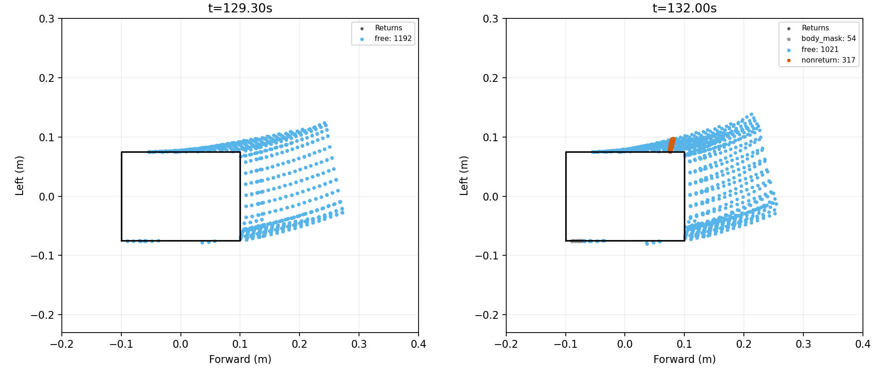

# 소실 래치의 점별 시각과 현재 이동 영역 진단

2026-10-28. [43.173 m 정체](../../2026-10-27/obstacle_latch_v1/README.md)의 후속 저장 입력 분석이다. 운영 코드·센서·판정선을 바꾸거나 새 주행을 수행하지 않았다.

## 점별 시각 분리

옛 반환을 취득한 시각 → 무반환 광선을 취득한 시각 → 현재 판단 시각으로 상대 이동 예산을 분리한다. 결측 시각의 가능 위치가 현재 감속 외곽까지 이동할 가능성을 포함하도록 차체 외곽을 팽창한다. 같은2 m/s 상대 이동 가정과3 cm 반경을 사용하며, 실물 속도 상한·오차 분포·미래 물체 운동의 안전 보장은 아니다. 원형 팽창을 포함하는 사각 외곽이라 불확실성을 줄이는 방향으로 근사하지 않는다.

[첫 래치](first.json)의 옛 반환321–324번은129.26620–129.26680초, 결측373번은129.37660초, 현재 판단은129.48000초다. 이전 기준 시각만 쓴 반경350.0 mm 대신, 점별→결측 반경249.6–250.8 mm와 결측→현재 이동206.8 mm로 나눴다. 팽창한 교집합까지 거리344.76–368.60 mm가 앞 반경보다 커 네 점 모두 가능 위치 교집합에서 제외됐다. 이전 정적 교집합 결과와 결론은 같지만 시간 처리가 다르다.

이것은 이 네 점의 제한 가정하 기하 결과다. 미관측 공간이 실제로 비었다거나, 래치를 없애면 전체 주행이 개선된다는 뜻이 아니다. 인접 유효 광선 사이의 작은 물체·미래 접근·모터축 운동 추정 오차·복수 물체의 신원은 해결하지 않았다. 운영에 연결하기 전 전체 이전 점, 시각 누락·역행, 실제 장애물 반례와 독립 보호층을 함께 검토해야 한다.

## 검사

첫24검사 중23개가 통과하고, 제동 외곽의6 cm 전방 버퍼를 누락한 반례 시험점 기대값1개가 실패했다. 원래 코드와로그는 `test_timed_missing_sweep_probe.before.py`, `tests.log`에 보존했다. 반례점을 실제 외곽에 맞춘 뒤 동일24검사가 통과했다(`tests2.log`). 기하 구현이나 보호 기준을 낮춘 수정은 아니다. `probe_first.py`도exit0, 소스 불변과 센서점 순서/취득 시각 대응을 확인했다. 시험 당시 소스 (`source.zip`, 로컬 보존).

## 현재 이동 영역의 원인 분류

[분류 결과](region.json)는 저장된129.3초/132초의 이동 영역을 같은 센서 입력으로 재구성하고, 전체 광선을 직접 비교한 분류와 운영 `depth_support`의 지지 여부가 일치함을 확인했다.129.3초는1,192표본 전부 관측됐다.132초는1,021표본 관측·차체 마스크54표본·무반환 이웃317표본이며, 후자의 광선 ID는357–361이다.317은317개의 무반환 광선이 아니라 좁은 띠를 검사한 여러 차체 표본의 수다. 인접성/거리 여유/계산 불일치가 원인은 아니었다.

주황색은 왼쪽 앞모서리의 무반환 띠다. 현재 경로의 좁은 측방 결측 정책은 허용하지만 실제 이동 영역 검사는 다시 거절한다. 원래 후방1 mm 예외는 이 위치에 적용되지 않는다. 그 한계값만 늘리거나317개를 자유 공간으로 표시하지 않는다.

## 전체 이전 점을 검사한 후속 결과

[정책 사본 재생](policy_replay_v1/report.json)은132초까지6,409판단·191 reset을 처리했고 **명령 변화0, 래치126호출**이었다. 첫 네 점은 제외됐지만129.500초의 다른 옛 점2개가 여전히 가능한 위협이었다. 현재 좌표는 대략 `(0.061,0.594)`/`(0.053,0.595)` m, 최근접 반환 거리는41.06/40.25 mm다. 이 근거를 지우지 않았다. 따라서 첫129.480초 계산만 보고 래치 문제를 해결했다고 하지 않는다.

점 순서/시각과 실제 근접점 소실·현재 근접 반환·넓은 공백·시간 누적·reset을 포함한 시각/정책14검사가 통과했다. 저장 재생의 PC 비용 중앙13.06 ms·최대41.73 ms, 소스·입력 불변이다. 독립 ROS 보호층의 실제 실행은 하지 않았다.

[동일 경로 결합 계획](CANDIDATE_PLAN.md)의 `probe_same_path_gap.py`는 같은스캔·판단시각·조향·더작거나같은 이동 외곽에서만 기존 좁은 측방 결측 정책을 재사용하는 진단함수다. 정상제한사례와 입력/조향변경·범위초과·근접반환·추가정면공백·넓은공백·NaN의13검사를 통과했다. **선택기 연결·통합 재생·주행은 미실시**이며 이 함수만으로 정체를 해결하지 못한다.

## 다음 재개

운영 후보는 미채택으로 남긴다. 현재 가능한 위협2개를 단순 임계값 완화/만료로 삭제하지 않는다. 후속은 물체의 이동 대응 또는 기하·관측 계약의 추가 근거가 필요하다. 같은전체랩을 반복하지 않고 현행계획의 독립 항목인 공개 방지턱 저속 동적통과를 준비한다. 이 전환은 교통전체랩 완료가 아니라 미해결상태를 보존한 병행이다.
