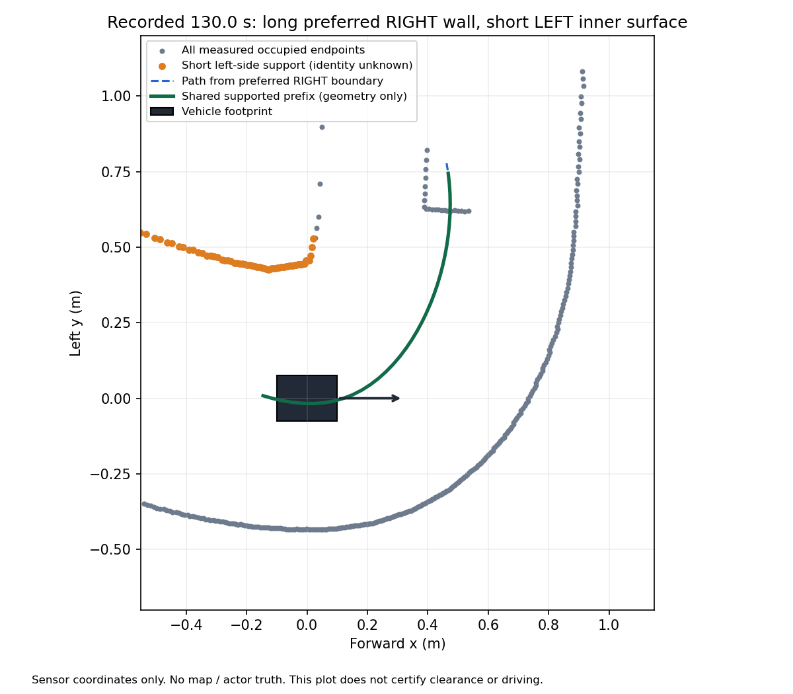

# 교통 정체 후 코너 경계 재획득의 역할 대조

2026-10-28. 통과 후 후방 결측 연결 실행에서 이전8.659 m 정체는 넘었지만43.054 m에서28.858 s 정지하여 전체 랩/앞차 간격은 실패했다. STOP·정상 종료·7,791판단 동일 재생·998파일 불변까지 회수했다. 이 폴더는 후반 고정 입력 분석에서 시작한 후속 비교이며 새 주행 결과가 아니다.

## 현재 근거

선행 실행의125–136.76 s 고정 사본589판단 중 부분 관측 판정은 모두 허용되었고 소실 래치/배경 앵커는 없었다.129.76 s부터 `follow_boundary_unconfirmed`가 평행 선택기의 `baseline_not_normal`로 이어졌다. 오른쪽 선호 벽 자체는 긴 관측 경로를 만들었지만, 왼쪽 안쪽 벽이 짧아 기본 경계 재획득이 실패했다. 기존 회랑은 선호 방향을 안쪽으로 간주하여 짧은 왼쪽을 긴 바깥 기준으로 검사했다.

이 한계와 `corridor_roles.py` 후보는 [10/17 분석](../../../../docs/autonomy/G1_OBSERVATION_ENVELOPE_2026_10_16.md#108-경계-기억-불일치와-선호-벽코너-역할-분리)에 이미 있다. 당시3,001판단 대조에서 기하는 개선되어도 뒤의 관측 검사 때문에 명령 변화는0이었고 운영에 연결하지 않았다. 이번에는 새 관측 정책과 교통 선택기에서 유효한지 다시 확인한다. 과거 결과를 성공으로 소급하지 않는다.

그림은 현재 센서 좌표의 실제 반환점과 오른쪽 선호 벽에서 얻은 경로다. 짧은 왼쪽 점군은 경로의 기하 지지에만 사용하며 벽이라고 인증하지 않는다. 경로 앞쪽에 있는 다른 점군도 점유 검사에 그대로 남긴다. 지도나 정답 차량 위치를 사용한 그림이 아니다.

## 비교 범위와 수용 조건

- 원래 전체 실행의 정확 재생·소스 불변·STOP/종료 회수 후 저장 입력을 처음부터 공급한다. 후반 사본만으로 제어기 상태의 전체 재생을 주장하지 않는다.
- 독립 평가 프로세스에서 회랑 기하 함수만 기존 `role_aware_evidence`로 바꾸고 예외 시에도 복구한다. 운영 파일·기본 옵션·경계 기억은 바꾸지 않는다.
- 선호 벽/분기 명령은 유지한다. 추가 후보는 현재 선호 벽에서 만든 긴 경로·앵커·형상 일치와 반대쪽 실제 짧은 면의 기하 지지를 요구한다.
- 원래 전체 점유·시간 확인·부분 관측·속도/제동·독립 보호를 그대로 통과해야 한다. 미관측을 자유 공간으로 채우지 않는다.
- 입력 정답 자세/지도/actor 위치는 제어기에 넣지 않는다. 저장 입력의 양수 명령은 폐루프 주행이나 안전 증명이 아니다.

분기·좌우 대칭·현재 선호 경로 불일치·신선도·STOP·점유 반례와 실제 기록에서 효과가 확인된 뒤에만 별도의 기본 OFF 연결을 판단한다. 같은 실패를 원인 변화 없이 재실행하지 않는다.

## 정적 대조

기존 역할/관측기와 새 시간·분기·첫 반환/점유 반례를 함께 실행하여76건 통과했다(`temporal_tests_v2.log`). 첫 실행의1건 실패는 시험 장면의epoch만 바꾸고 광선epoch를 맞추지 않은 평가기 구성 오류였으며 `temporal_tests.log`에 보존했다. 원래 장면 불일치 거절은 유지하고 시험 자료의 두epoch를 함께 바꿨다. 운영 코드 수정은 없다.

## 역할 구분만으로는 최종 명령 변화 없음

전체7,791판단을 처음부터 대조한 [결과](comparison/report.json)는 입력/소스 불변·함수 복구를 확인했지만 명령 변화0이었다. 후반1,213호출의 원본/후보/독립 보호 양수 명령도 모두0이었다. 회랑 후보 자체는 성립했으나 경로 재획득 대기 중 과거 통과 상태가 취소되어 GUARD로 돌아갔다. 예를 들어131 s에는 새로운 경로가 확인되었는데도 왼쪽 방향 추가 접근 약20.14 mm가 원래1 cm GUARD 조건을 넘어 거절됐다. 이것을 기하 후보의 주행 성공으로 쓰지 않는다.

[거절 뒤 영역 진단](guard_region.json)에서는131 s의1,487질의 중422개가 미관측이고 뒤쪽 마스크52개가 남았다. 미관측의 차체 밖 최대 거리는14.11 mm로 기존 후반1 mm 후보는 거절했다. 다만 이미 연결된 같은경로·같은시각·같은조향 부분 관측 후보는 통과했다. 따라서 현재 관측이 모두 자유롭다는 이유로 횡접근 제한을 없앨 근거는 아니다. 역할 구분만 운영에 연결하는 작업은 보류한다.

## 미연결 후속 가설: 완료 이력과 현재 진행 허가 분리

`passage_history_candidate.py`는 완료된 통과 이력만 별도로 보관하는 대조용 클래스다. 경로 재획득 대기에는 기존0출력과GUARD 상태를 유지한다. 선호 벽이 같은 새 fresh 유효 경로에서만 이력을 기존 `retained_passage` 검사로 전달하고,0.35 m/s 상한과 현재 실제 이동 영역 검사를 모두 적용한다. 미완료 통과는 만들지 않으며 새 위협·선호 벽 변경·시계/epoch 단절·만료·입력 고장은 복원 근거로 쓰지 않는다. 제어기/보호층의 현재 관측을 복사하거나 미관측 수를 지우지 않는다.

이력은 과거의 사실이지 현재 옆차 부재 증명이 아니다. 경로 부재 동안 재접근하여 사각에 숨는 물체와 제한 무반환 위험은 남으며 새 실물 안전 주장이나GUARD 간격 완화는 없다. 상태/현재 영역 주입14반례를 통과했다(`history_tests.log`). 전체 저장 입력의 역할+이력 대조를 먼저 수행하며 운영 연결·새 주행은 아직 하지 않았다.

첫 [이력 대조](history_comparison/report.json)도 후반 양수0이었다. 명령 변화5건은115.42 s부터의0속도 조향 차이뿐이었다.129.72 s의 경계 대기에서 보관한 이력이129.74 s의 모터 환산−0.05 m/s 표본에서 다시 지워졌기 때문이다. 유한 역방향 표본은 기존 선택기에서 전진을 금지하지만 센서 시계 단절로 취급하지 않는 값이다. 후보v1이 일반 고장과 이를 구별하지 못한 설계 누락을 보존한다.

`passage_history_candidate_v2.py`는 유한 역방향 동안 계속0출력을 유지하면서, 동일 시간 계열의 완료 이력만 보관한다. 시계/epoch 단절을 동반한 역방향이나 입력 고장은 이력을 지운다. 추가 반례를 포함한16건이 통과했으며(`history_tests_v2.log`) 별도 `history_comparison_v2`에서 같은 전체 입력을 대조한다. 이는 실제 차체가 뒤로 움직이지 않았다고 가정하거나 음수 피드백을0으로 바꾸는 구현이 아니다.

v2 전체 비교는 입력/소스/함수 복구를 확인했고 후반1,213회 중 원본0→후보와 독립 보호 각1,100회 양수였다. 전체 명령 변화1,110건 중10건은0속도의 조향 변화다. PC 오프라인 판단 비용 중앙14.17/p99 67.60/최대143.99 ms이며50 Hz 마감 통과가 아니다. [v2 결과](history_comparison_v2/report.json). 이를 근거로 [기본 OFF 연결과 실제 실행 준비](../traffic_path_recovery_connection_v1/README.md)를 진행한다. 비교용v1/v2와 원래 실패는 보존한다.
