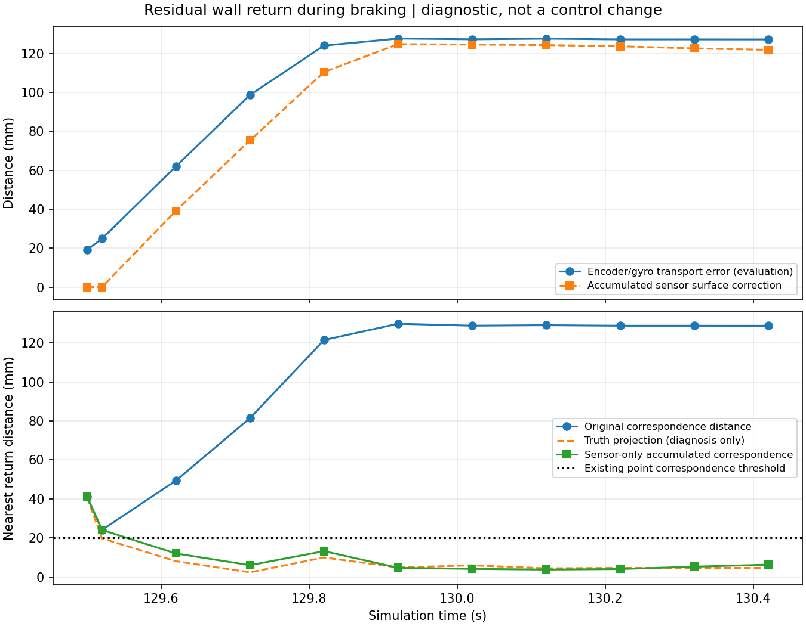

# 점별 시각 후보에 남은 벽 반환과 제동 중 이동 오차

2026-10-28. [시각 정책 사본](../timed_latch_v1/README.md)에 남은 129.500초 래치의 두 점을 평가용 정답으로 귀속했다. 제어기 입력·기본값·원래 실패 결과는 바꾸지 않았다.

| 이전 원시 광선 | 취득 시각 | 정적 벽 충돌 형상까지 | 앞차 경계까지 |
|---:|---:|---:|---:|
|374|129.276800초|2.35 mm|347.46 mm|
|375|129.277000초|0 mm|355.05 mm|

첫 래치의 네 점은 앞차였지만, 시각 후보에 끝까지 남은 두 점은 **벽 반환으로 해석할 근거**가 있다. 평가용 취득 자세 보간과 충돌 형상 근사의 한계가 있으며 이것을 운영 물체 분류기로 쓰지 않는다. [귀속·기하 결과](report.json), [분석 소스](diagnose.py).

## 후속 관측과 이동 추정의 차이

같은 저장 입력에서 옛 점을 모터축/gyro로 이동시킨 좌표와, 실제 취득 자세로 옮긴 평가 좌표를 대조했다. 센서 거리 자체는 변경하지 않았다.

| 판단 시각 | 옛 점의 이동 추정 위치 오차 | 운영 점군의 최근접 거리 | 실제 자세로 투영한 최근접 거리 |
|---:|---:|---:|---:|
|129.50초|19.07 mm|40.25–41.06 mm|40.22–40.86 mm|
|129.62초|62.00 mm|42.16–49.42 mm|8.10–10.18 mm|
|129.72초|98.67 mm|73.90–81.43 mm|2.28–2.42 mm|
|129.92초|127.63 mm|122.24–129.77 mm|4.91–6.99 mm|

제동 동안 모터축 이동과 차체 이동이 벌어져 옛 점의 위치 대응을 악화시켰다. 전방 모터축 속도만으로 실제 차체 감속/미끄러짐을 모두 알 수 없다는 기존 한계와 일치한다. 단순 거리 오차 허용치를 넓혀 해결했다고 할 문제가 아니다. [시각별 좌표·거리 대조](motion_audit.json).

최초 정지 직후의 가까운 점이 이미 수 cm 떨어졌던 원인까지 모두 이동 오차로 돌리지는 않는다. 129.500초에는 평가 정답으로 투영해도 약 4 cm 떨어져 있으며, 회전식 스캔의 표본/가림 차이가 별도로 남는다. 반면 그 뒤 벽이 다시 보이는 동안 생긴 약 12 cm의 대응 실패는 이동 추정 오차로 분리할 수 있다.

`reobservations.json`의 첫 진단은 기존 대응 기준상 두 점 모두 재관측되지 않는 결과다. 다만 그 파일의 `current_unknown_count`는 존재하지 않는 `no_return` 상태명을 검사한 잘못된 집계이므로 사용하지 않는다. 원본을 보존하고 `motion_audit.json`의 `unknown_rays`로 대조했으며 실제 1–3개 결측이 있다. 거리·시각 계산에는 이 집계가 사용되지 않았다.

## 후속 방향

래치를 시간만 지나면 지우거나 대응 거리 20 mm를 임의로 늘리지 않는다. 현재 스캔과 직전 스캔 사이의 제한 표면 정합을 계속 누적해 과거 점의 재관측 대응에만 적용할 수 있는지 저장 입력에서 먼저 비교한다. 여러 물체가 함께 움직이거나 정적 배경이 부족한 반례, 정합 실패·시간 공백, 실제 장애물 소실을 함께 본다. 제어 위치/속도나 원시 점군을 정답으로 보정하지 않으며, 비교가 유효하더라도 독립 보호층 연결·폐루프 효과는 별도다.

현재 결과는 원인 진단이며 운영 수정·새 교통 주행은 없다. 43.173 m 전체 랩 실패를 유지한다.

## 센서 정합 누적의 첫 비교

[직전 스캔끼리 누적](chain_probe.json)은 첫 비교 129.52초에서 `weak_improvement`로 거절되어 연결이 끊겼다. 그 실패를 무시하거나 거절된 이동값을 적용하지 않았다. [마지막 유효 기준 유지 사본](anchor_chain_probe.json)은 실패 스캔으로 기준을 갈아 끼우지 않고 기존 0.3초 시각 범위 안에서 다시 관측된 다음 스캔과 비교했다. 129.62초부터 두 점이 8.37–12.06 mm 이내에 대응했고, 129.72초에 연속 두 새 스캔에서 대응했다. 약 0.22초 후의 재관측이다.

이 비교에는 센서점·모터축/gyro만 사용했다. 평가 정답으로 보정하지 않았고 기존 정합/20 mm 대응 기준도 바꾸지 않았다. 129.92초의 누적 전후 보정은 약−124.7 mm다. 한 번의 정합 최대6 cm 한도를 늘린 것이 아니라 여러 승인된 짧은 대응을 이어 붙인 결과다.

그러나 **정적 배경 가정, 누적 오차, 여러 움직이는 물체의 모호성**은 남는다. 첫 두 점의 대응이 좋아졌다고 래치를 운영에서 해제하지 않는다. 실제 전체 위협점 집합/새 위협을 확인하고, 거절·시각 공백·실제 숨은 장애물 반례를 갖춘 진단 객체로 정리한 다음 저장 입력 전체에 대조해야 한다. 현재는 격리된 사본 비교이며 명령 변화나 새 주행을 수행하지 않았다.

[진단 객체](../../../../scripts/probe_surface_anchor.py)는 속도/조향이나 운영 허가를 반환하지 않는다. 같은 스캔 중복 확인, 거절된 기준 교체, 시간 역행/공백, 누적1초 한도, NaN, 운동 이력 부재, 독립 물체 소실을 검사한다. 기존 표면 정합 검사와 합쳐23검사를 통과했다. 저장 입력55호출에서 같은129.72초의 재관측을 확인했고 소스 불변이다. [객체 결과/소스](object_probe.json).

첫23검사 중 움직이는 배경 반례1건은 두 번째 비영 이동의 기존 정합이 표본 끝점에서 `few_surface_matches`로 거절되어 예상과 달랐다. 원래시험/로그를 보존했다. 움직인 뒤 같은 위치에 머무는 배경으로 반례를 구체화하면 연속 대응이 승인된다. **서로 다른 물체들이 함께 움직이는 장면을 이 정합만으로 정적 배경과 구별할 수 없음**을 보여주는 한계 시험이며, 이23검사를 안전 해제 증명으로 쓰지 않는다. 최초 셸 종료코드 기록은PowerShell의 `$?` 확장으로 pytest 실패와 다르게0이 남았으므로 `anchor_tests.log`의1실패를 기준으로 한다. 후속직접실행 `anchor_tests2.exit`는 실제pytest종료0이다.

## 전체 저장 입력의 단계별 비교

[회복 정책 사본](recovery_policy.py)은 전체 위협 근거가 기록된 경우만 재관측을 시도한다. 최대8쌍으로 잘린 근거는 해제 대상으로 쓰지 않는다. 연속 두 새스캔에서 재관측되어도 현재 스캔을 래치 없는 사본으로 다시 검사하고, 새 위협이나 다른 공백 제한이 있으면 원래 정지를 유지한다. 실제 소실점·전체 결측·잘린근거·원래두스캔해제·reset의5검사가 통과했다.

- [회복만 연결한 재생](recovery_replay_v1/report.json): 132초까지6,409판단·191reset·래치11호출·재관측해제1회, **명령변화0**. 중앙 비용12.78 ms·최대41.37 ms. 측방 선택기가 여전히 정지를 유지했다.
- [통과 이력·같은 경로 공백과 결합](combined_replay_v1/report.json): 같은6,409판단에서명령변화129건, 목표정체구간변화90건·기존과같은양수6건을포함해목표구간양수96건. 같은경로공백후보승인90회·재관측해제1회다. 중앙14.29 ms·최대105.36 ms이며 50 Hz 처리시간을 보장하지 않는다. 소스/저장입력 불변이다.

선택기17검사는 현재미관측·다시나타난옆차·전방STOP·경로소실과 기존동일경로13반례를 포함한다. 처음 보조함수 이름 `setup`이 pytest의 오래된 모듈setup으로 호출돼4오류가 난 로그를 보존했고, `make_setup`으로 바꾼 뒤17통과했다. 운영 선택기는 편집하지 않았다.

이제 원인을 바꾸지 않은 전체랩 반복 대신, **결합 후보의 보호층 계약·반례·계산비용**을 확인할 근거가 생겼다. 저장 입력은 정지 뒤 실제 차량이 움직이지 않은 경로이므로 새양수명령이 이후에도 안전/완주한다는 증명은 아니다. 운영 기본값·ROS보호층·새교통주행에는 아직 연결하지 않았다.

## 독립 보호 함수 대조 준비

[보호 객체](safety_shadow.py)와 [재생 진입점](replay_safety.py)을 별도로 준비했다. 같은 저장 입력의 센서·운동 이력을 독립 복사하고, 결합 후보의 속도/조향만 실제 `LidarSafety.control` 함수에 전달한다. 기존 정책과 회복 후보의 보호 객체는 서로 별개이며 계획기의 재관측 승인·래치 상태를 공유하지 않는다. 계획기 reset 이벤트도 보호 노드 reset으로 전달하지 않는다.

이 기록에는 독립 보호 노드의 실제 수신/타이머 이력이 없으므로, **계획 판단 시각에 입력이 함께 도착했다고 가정한 함수 비교**다. ROS 전달 지연·실제 보호 콜백 순서·폐루프 주행 검증으로 쓰지 않는다. 명령 0 유지, 명령보다 큰 출력 금지, 오래된 입력·반대 방향·가까운 점유·큰 결측·시계 역행을 먼저 확인한다. 시험 결과는 생성 후 별도로 기록한다.

## 독립 보호 함수 대조

[safety_replay_v1/report.json](safety_replay_v1/report.json):6,409계획 판단/191계획 reset에서 보호 객체를 별도로 유지했다. 목표129.3–132 s의 양수 요청96개 중 기존 보호 통과6개, 재관측 후보 통과96개·래치 재관측 해제1회다. 양쪽 모두0명령572개를 보존했고17고장/경계 검사가 통과했다. 소스와 입력 SHA가 유지됐다.

계획기 기록 시각에 같은 시각 수신을 가정한 함수 비교다. 실제 ROS 보호 타이머 전체 이력·전송 지연·폐루프는 검증하지 않았다. cProfile 대상136호출에서 GUARD가 관측 영역을 거듭 계산하는 비용이 컸다. 계측된 계획 최대126.95 ms는50 Hz 성능 합격이 아니다. 실행 연결 시 기본OFF를 유지하고 동등 계산 재사용부터 검토한다.
