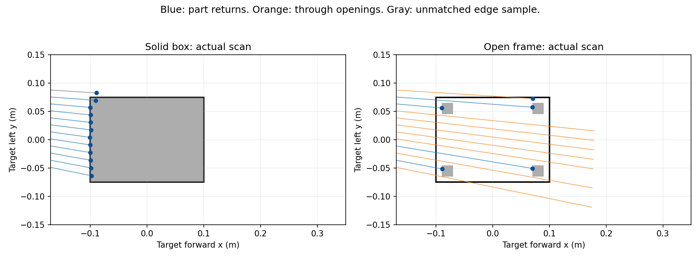

# G2 개방형 상대차 대표 형상 비교

2026-10-29. 상자 표적의 결과를 울퉁불퉁한 실차까지 확대하지 않기 위한 제한 비교다. 실제 팀 CAD가 아닌 **개방된 한 층과 기둥 네 개를 가진 시험용 형상**이다. 기존 주행/보호 코드는 바꾸지 않는다.

## 형상과 검증 경계

- 전체 수평 외형20×15 cm, 높이14 cm. 바닥판0–2 cm, 네 기둥2–12 cm, 상판12–14 cm다. 9.5 cm C1 스캔면에는20×20 mm 기둥 네 개만 걸린다. 500광선/순차10 Hz의 실제 렌더링 반환을 사용한다.
- 상판·바닥판이20×15 cm 전체를 차지하므로 평가용 사각형 footprint는 전체 투영 외형과 일치한다. 기둥 반환의 볼록껍질로 충돌 외형을 축소하지 않는다. 기둥보다 바닥/상판이 전후좌우10 mm 돌출하며 라이다 높이에서는 그 돌출 부분이 안 보인다.
- 모든 부품에 동일한 collision/visual과 별도의 contact sensor를 달았다. [형상 검사5개](tests.log)와 [격리 접촉 시험](contact_probe1/report.json)에서6부품 모두 실제 접촉 메시지를 확인했다. 이것은 접촉 센서 연결 확인이며 주행 통과 증명이 아니다.
- 일반적인 낮은 차·돌출 바퀴 전체·모든 색/재질·동적 차체를 대표하지 않는다. 실제 라이다 반사율/작은 물체 검출률도 Gazebo와 다를 수 있다.

## run1 등록(실행 전)

- 오른쪽 가장자리(−149 mm), 자차 전방1.2 m에 고정 표적1대. 공식 시작 직선의 중심선 출발이다. [사전 검사](preflight.json)는 도로 안 배치·초기1 m 차체 간격·앞쪽7.29 m 직선·신호 가림 없음을 확인했다.
- 기존 오른쪽 상자 run1과 같은 G2 제어/보호/모터/노면, 속도 상한0.35 m/s,12초 창, v2 공식 신호 시험본·뒤쪽30 cm 카메라·방지턱OFF다. 새로운10/29신호 가림 문제를 이 시험에 섞지 않는다.
- G2 v2의 통과 방향·주행 창 안 중앙 복귀/1초 유지·접촉/겹침0·접지면 세 해석 모두 도로 밖 바퀴≤2·STOP·정상 종료·전체 판단 동일 재생을 그대로 적용한다. 구형 G1의 뒤에 머무름/차체 도로 내 실패는 원본으로 보존한다.
- 제어기·독립 보호층에는 센서만 입력하며 actor 자세·지도·접촉은 평가기만 읽는다. `run.py`는 평가 actor SDF만 `shape.py`로 교체한다. 수평 외형·판정선·제어기 여유를 줄이지 않는다.
- `run1_trial.sh`로1회 실행한다. 실패하면 저장 입력을 분석하고 자동 반복하지 않는다. GPT가 설계/구현/분석, GPT-6 Luna가 실행/대기/회수한다.

원래 상자 좌우의 결과와 왼쪽 노면 경계 민감도는 [G2 동역학 진단](../g2_dynamics_review_v1/README.md)에 따로 보존한다. 이번 형상 비교로 그 문제가 해결되었다고 하지 않는다.

## run1 결과: 표적 통과, 복귀 실패

[G2 평가](run1_g2_evaluation.json)는 표적 통과4.571 s·최소 차체 간격160.03 mm·접촉/차체 중첩0·도로 밖 최대 두 바퀴·STOP·정상 종료·637판단 동일 재생을 확인했다. 주행 창 진행은1.66482 m, 종료 횡편이164.5 mm로 중앙 복귀와 STOP 시 중앙 범위 판정은 실패했다. 하네스·소스 보존·형상 감사는 통과했다. 실패를 시뮬레이터 실행 오류나 우회 전체 성공으로 바꾸지 않는다.

[주행 진단](run1_dynamics.json)의 초록 후6–11.9 s에서는 제어/보호 후 속도 모두0.35 m/s, 보호 이유 `clear`였지만 차체 속도 중앙값은0.000100 m/s였다. 좌/우 후륜 중앙값21.53/0.0024 rad/s로 이번에도 편측 헛돎이 나타났다. 오른쪽 상자 통과와의 차이를 형상 인식 실패만으로 설명할 수 없으며 접지 민감도는 미해결이다. 중앙에 돌아오지 못했으므로 실패를 보존하고 같은 주행을 자동 반복하지 않는다.

[저장 실제 스캔 대조](run1_scan_audit.json)는 출발 전5.002 s의 정지 관측을 사용했다. 전체20×15 cm 외형을 향하는12광선 중 상자는11개가 면에 대응했고 경계1개는4 mm 진단 허용오차 밖이었다. 개방형은기둥 반환4개·빈 층을 지나간8개로 나타났다. 센서가 개방형을 단단한 상자처럼 보고 통과한 것은 아니다. 이4 mm는 그림의 대응 분류에만 사용하며 제어/보호 여유를 바꾸지 않는다. 실제 라이다 반사/작은 기둥 검출률 검증도 아니다.

이번 한 조건에서는 드문 기둥 반환만으로 통과했지만, 낮은 돌출부나 모든 상대차를 탐지한다고 확대하지 않는다. 다음은 별개로 남은 중앙 정지차의 경로 추종 차이를 분석한다.
