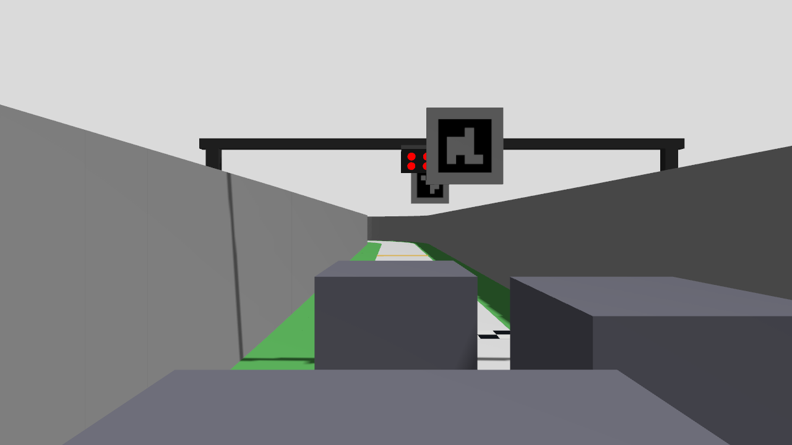
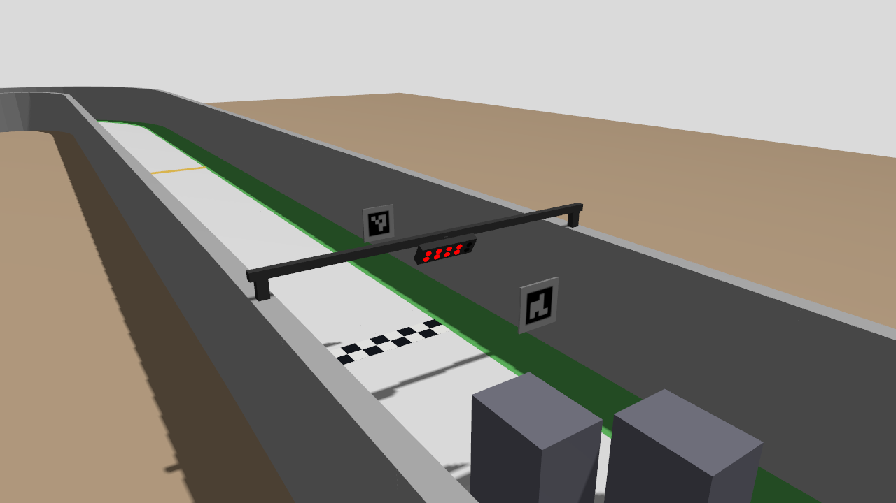

# 10/29 제작측 신호등 설명의 팀 시험본 제한 갱신

2026-10-29. [제작측 #3 댓글](https://github.com/MOSW626/istech-it-arena/issues/3#issuecomment-6477451048)(2026-10-28 18:38 UTC)의 수치를 새 팀 파생 시험본에 넣고, 배치·대표 시야·정지 빨강/초록 픽셀만 제한 확인했다. 실제 시설 설치·조립 완료나 새 공식 릴리스가 아니다. 공식 main `d8107de`/`v2026.10.24` 원본, [v2 신호 시험본](../../2026-10-27/official_departure_v2/README.md), 5랩 성공 소스는 수정하지 않았다. 공개 게시/댓글은 하지 않았다.

## 확인한 원문과 해석

GitHub API로 댓글 본문과 첨부 이미지2장을 내려받아 [원문](upstream/comment_6477451048.json)·[측면도](upstream/attachment1_91075ecf.png)·[정면 사시도](upstream/attachment2_b93f97fe.png)로 보존했다(SHA-256은 `prepare.py`의 manifest 기록).

| 항목 | 제작측 값 | 이 시험본의 적용 |
|---|---|---|
| 광원 | 지름15 mm 원형10개, 2행×5열 | 두께2 mm 원판(발광 재질). 열 간격30 mm·행 간격20 mm는 10/9 댓글의 세트 간15 mm·상하5 mm에서 계산 |
| 높이 | 모듈 하단397 mm, 발광 배열 중심 약419 mm | 하우징 최저점0.397 m, 배열 중심0.419 m로 정확히 맞춤 |
| 기울기 | 바닥에 대해60° | 발광면이 바닥과60°, 법선은 그리드 쪽으로 수평 아래30° |
| 위치 | 선두 차량 그리드라인에서 전방300 mm | 공식 그리드 중 가장 앞선 index2 칸의 앞쪽 도색 경계에서 수평300 mm 앞에 배열 중심 |
| 설계 가정 | 카메라 가장 앞·높이 약100 mm·시야각60° 이상 | 참고 계산만 하고 팀 장착값으로 채택하지 않음 |

**도면 해석(가정 포함):** 측면도에서 발광면 선분의 픽셀 기울기는 약59–60°이고, 위쪽이 그리드 쪽으로 나와 있어 광원이 아래쪽 그리드를 향한다고 읽었다. 측면도의 구조물 상단은 하단에서 약67 mm 위로, 10/9 STL의 전체 높이465 mm와 맞는다. 정면 사시도는 가로보 중앙에 모듈이 매달린 형태여서 **모듈 가로 중심을 두 그리드 열의 가운데(도로 중앙 부근)** 로 가정했다. 기존 공식 문구의 "출발선 좌측"과 v2의 왼쪽0.35 m 이동은 이번 설명과 맞지 않을 수 있어 사용하지 않았다. 그리드라인 기준점, 가로 위치, 가로보·지지대(벽 위 지지) 형상은 모두 미확정 팀 가정이다. 공식 ArUco ID0/ID45 판과 그리드는 그대로 둔다.

## 정적 시야 점검

[사전 검사](preflight.json)는 비신호 기하·자산 해시 불변과 하단/중심/기울기를 확인했다. 6그리드 × 카메라2종 × 상대 상자(없음/25 cm/40 cm)에서 광원별 9개 면 표본의 시선 가림을 계산했다. [요약](preflight_summary.json). 핀홀·상자 근사이며 연속 가시면적·렌즈 왜곡·실물 LED 확산은 다루지 않는다.

| 카메라(B0183 1280×720/수평75°) | 상대 25 cm 상자 | 상대 40 cm 상자 |
|---|---|---|
| 기존 5랩 시험의 뒤쪽 x=−75 mm·z=300 mm 수평 | 선두 index2만 10광원 모두 보임. 나머지5칸은 **ID45 판**이 6–8광원을 가림 | index2만 보임. index0/1/3/4는 상대차+ID45로 전부 가림, index5는 ID45가 6광원 가림 |
| 현재 차량 설정의 앞쪽 x=55 mm·z=145 mm 수평 | index2/5는 배열이 **수직 화각 밖**(올려본각35.7°/25.4° > 반화각23.3°). 나머지는 상대차·ID45 가림 | 같은 화각 문제 + 전부 가림 |

ID45(`grid_entry`)는 공식 월드에서 선두 그리드 경계 바로 위 도로 중앙, 판 높이0.35–0.45 m에 있다. 새 설명대로 신호가 그 300 mm 앞 도로 중앙에 있으면 뒤쪽 그리드의 시선과 겹친다. 제작측 설계 가정(가장 앞·100 mm) 위치에서 배열까지의 올려본각은 선두칸43.4°, 뒤쪽 칸11.8–30.9°였다. 시야각60°만으로는 선두칸에서 위쪽 기울임이 필요하며, 제작측도 카메라 각도 수정 가능성을 언급했다.

## 정지 촬영과 기존 검출기

`views.py`가 6칸 모두 20×15×25 cm 상자를 놓고 뒤쪽30 cm 카메라6개+전체 시점으로 빨강4/초록 정지 장면을 만들었다. 공식 ID45 보존(`official`)과, 신호 기하만 분리하려고 ID45를 뺀 진단 변형(`no_id45`)을 각각 촬영했다. 4회 모두 촬영 완료·소스 불변·정상 종료·잔존0이었다(촬영 실행은 Claude Haiku 5.5 보조). [ID45 보존 빨강](render_official_red4/capture/report.json), [초록](render_official_green/capture/report.json), [ID45 제거 빨강](render_no_id45_red4/capture/report.json), [초록](render_no_id45_green/capture/report.json).

[픽셀 대조](pixel_check.json)는 같은 정지 프레임을0.1초 간격으로 반복했다. 검출기 코드와 임계값은 바꾸지 않았다.

| 변형 | 기존 `OfficialStartSignal` | 5랩의 `LocalOfficialStartSignal` | 초록만 먼저 제시 |
|---|---|---|---|
| ID45 보존 | index2만 빨강4 확인→초록 확인. 0/5칸 `red_partial_or_ambiguous`, 1칸 `red_unclassified`, 3/4칸 `waiting_red4` | 같음 | 6칸 모두 출발0 |
| ID45 제거(진단) | 6/6칸 빨강4 확인→초록 확인 | 6/6 | 6칸 모두 출발0 |

## 판단과 남은 범위

- 기울어진 15 mm 원판·하단397 mm 배치 자체는 25 cm 상대차가 있는 6칸에서 기존 검출기로 빨강4→초록을 구별했다. **뒤쪽30 cm 수평 카메라와 이 시험본의 XY 가정(신호 가로 중심=도로 중앙)에서는** ID45 보존/제거 대조가 뒤쪽5칸의 출발 실패를 공식 ID45 판과 신호의 상대 위치로 분리했다. 이것이 설치 배치(신호 가로 위치·ID45 위치·그리드라인 기준점) 확인이 필요한 이유다. 다만 실패 원인 전체가 시설 배치라는 뜻은 아니다. 현재 차량 설정의 앞쪽 x=55 mm·z=145 mm 수평 카메라는 index2/5에서 배열이 수직 화각 밖이며, 이 **카메라 자체의 화각 부족은 ID45와 별도로 남는다**. 가로 위치 가정이 바뀌면 이 분리도 다시 확인해야 한다. 40 cm 상대차의 가림은 이전 결과와 같이 남는다.
- 정지 프레임 반복이므로 실제 점등 전환·노출·주행 출발·가림 뒤 재획득은 확인하지 않았다. 원판 렌더링은 실물 LED 확산/밝기와 다르다. ID45 제거 변형은 진단용 반사실이며 실제 시설 제안이 아니다.
- 숫자 탐색을 더 하지 않고 G2 시험으로 넘어간다. 기존5랩 시험본은 그대로 유지한다. 시설 측에는 실제 설치 후 사진과 함께 신호 가로 위치·ID45 판 위치·그리드라인 기준점을 확인한다([전달 목록](../../../../docs/HARDWARE_AND_RULE_QUESTIONS.md)). 큰 카메라/기구 변경은 채택하지 않았다.

## 파일

`prepare.py`(시험본·manifest), `preflight.py`(정적 시야), `views.py`·`capture.sh`(정지 촬영), `check_pixels.py`(검출기 대조). 각 `*.exit`/`*.log`를 함께 보존한다. 첫 `views.py` 시도는 ROS 환경 없이 실행해 import에서 끝났으며 파일을 만들지 않았다([기록](views_attempt1_no_ros_env.log)).
