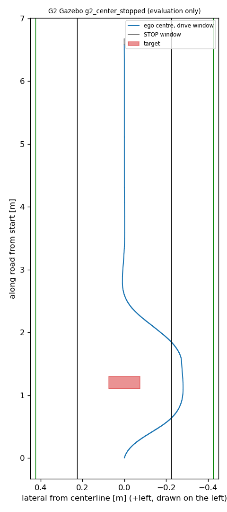

# G2 중앙 표적 Gazebo 1회

2026-10-30. 제한 시뮬레이션의 새 가정 검증이다. 경기 기본값·실차 위험 수용이 아니며 반복성을 말하지 않는다. 조건은 [실행 전 등록](DRIVE_PLAN.md), 연결은 [연결 보고서](../g2_corridor_connection_v1/README.md), 후보의 근거와 한계는 [후보 보고서](../g2_inner_boundary_v1/README.md)에 있다. Claude Haiku 5.5가 실행을 1회 맡았다.

## 결과

**등록 G2 판정 통과.** [평가](run1_g2_evaluation.json) 전 항목과 실행 무결성이 통과했고 종료 코드 0, 소스 1,110개 불변, 잔존 프로세스 0이다. 하네스의 원래 G1 `stopped_center` 판정은 설계상 실패이며 [그대로 보존](run1/report.json)한다.

| 항목 | 결과 |
|---|---|
| 정책 | `corridor_v1`, 관측 조건 항 0.225 m/s, 시험 가속 3 m/s², 정렬 상한 30 mm. 헤더·로그로 실제 적용 확인 |
| 계획과 경로 | 오른쪽 통과, 편이 −0.27 m, 전이 0.9 m. 경로 확정 8.42 s(sim). 근거 대기 20호출 |
| 표적 통과 | 초록 후 5.06 s. 최대 횡이동 −0.281 m(4.27 s) |
| 중앙 복귀 | `rejoin` 13.22 s, `centered` 16.82 s(sim). 초록 후 8.82 s부터 횡오차 ≤50 mm·방향 ≤0.10 rad를 11.18 s 유지 |
| 진행 | 창 안 6.579 m, 정지까지 6.674 m. 최종 횡오차 0.73 mm |
| 최소 간격 | 표적 128.3 mm(swept 하한 128.27 mm), 벽 64.0 mm(자세 계산, 초록 후 3.77 s) |
| 접촉 | 접촉 메시지 0, 차체 겹침 0 |
| 노면 | any/center/full 모두 도로 밖 바퀴 ≤2, 3바퀴 이상 0, 벽 바퀴 0. 2바퀴 이탈 약 4.1–4.3 s |
| 명령 | `/drive`·`/drive/safe`·판단 최대 0.35 m/s |
| STOP·종료 | software_stop, 정상 종료, STOP 창 횡오차 ≤0.73 mm |
| 재생 | 판단 1041/1041 일치, 독립 보호 함수 그림자 1041호출 모두 `clear`, 낮춘 호출 0 |
| 정체 | 명령 중 차체 0.03 m/s 미만 0틱. 창 안 0명령 24틱 |

독립 보호 대조는 저장 입력과 저장 명령을 현재 함수에 넣은 그림자 계산이며 ROS 수신 순서를 재현하지 않는다. 실제 `/drive/safe` 최대값은 평가에서 따로 확인했다. [판단 시계열](run1_decision_series.json), [요약](run1_analysis.json). 판단 기록은 Git에서 제외한다.

## 합성에 없던 요소에서 달라진 점

| 구간 | 평균 모터축/차체 속도 | 왼쪽/오른쪽 관절 평균 | 최저 | 최대 좌우 차 |
|---|---:|---:|---:|---:|
| 진입·잔디 | 0.995 | 10.41 / 10.98 rad/s | 4.68 rad/s | 6.43 rad/s |
| 복귀 | 1.008 | 10.62 / 10.91 rad/s | 9.72 rad/s | 3.20 rad/s |
| 중앙 | 1.000 | 10.78 / 10.75 rad/s | 10.39 rad/s | 0.78 rad/s |

[속도 비교](run1_dynamics.json), [관절 속도](run1_wheel_speeds.json). 이번 1회에서는 **편측 헛돎이 나타나지 않았다.** 과거 왼쪽 가장자리 시험의 복귀 실패는 한쪽 뒷바퀴 약 0 rad/s, 다른 쪽 약 21.5 rad/s에 차체가 거의 멈춘 상태였다. 그 시험도 오른쪽으로 비켜 갔으므로 쪽만으로 설명되지 않는다. 이번에 달라진 원인은 분석하지 않았고 헛돎의 해결로 쓰지 않는다. 잔디 구간의 모터축 평균과 차체 속도는 작은 차이였지만, 순간 차이는 0.11 m/s까지 있었다.

합성의 0.225 m/s 변형은 통과가 8.8–16.6 s였고 Gazebo는 5.06 s였다. 표면 값 변동도 Gazebo가 작았다. Gazebo에는 거리·각도·gyro 오차를 넣지 않았기 때문으로 **추정**하며, 이 차이를 직접 분리하지는 않았다. 따라서 이 결과는 표면 정렬의 잡음 효과나 복합 오차 성능을 검증하지 않는다.

## 말할 수 없는 것

- 1회 결과다. 반복성, 다른 시작 위상, 다른 표적 위치는 모른다.
- 복합 센서 오차를 넣지 않았다. 합성 0.225 m/s 결과의 지연은 그대로 남는다.
- 왼쪽 통로 정지, 측방 침범 접촉 8/12, 벽 쪽 +30 mm 치우침의 잔디 바퀴 3은 해결하지 않았다. 이번 비검증 범위다.
- 측방 간격 64 mm·128 mm는 기존 150 mm 비교선보다 작다. G2 판정선은 아니지만 여유가 작다는 사실로 남긴다.
- 복수 차량, 표적 요각, 자동 G1→G2 전환, 코너, 실차, Jetson은 시험하지 않았다.

## 근거

[run1 기록](run1/), [실행 로그](run1_trial.log), [당시 소스](run1_sources.zip), [실행 입력](run1_prepared.json), [설정](g2_center_config_v1.json), [사전 검사](preflight.json). 사전 검사의 앞선 두 실패(파일 이름, 경로 종류)는 주행 전 기구 수정이며 `*_attempt*` 파일로 보존한다. 첫 실행 위임은 사전 확인 명령의 자기 매칭으로 주행 없이 끝났다. 주행은 1회뿐이다.
