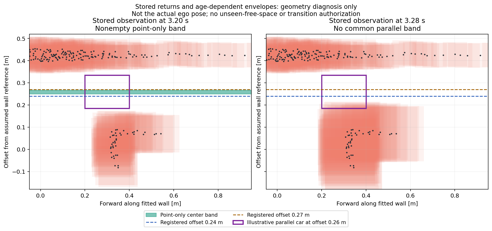

# 중앙 정지차: 관측 공간과 등록 경로 폭의 분리

2026-10-30. 새 주행이나 보호 조건 변경이 아닌 저장 장면 분석이다.

[앞선 중앙 정체](../../2026-10-29/g2_tracking_preview_v1/README.md)는 초기 전이 순위와 팽창 도형을 바꿔도 해결되지 않았다. 이번에는 동일 수치를 재탐색하지 않고, 당시 실제 점유·나이별 여유를 그대로 둘 때 등록된 최대 편이0.27m 안에 평행 통과 공간 자체가 존재하는지 확인한다.

입력은 이미531판단 동일 재구성을 확인한10/29 `prototype2_stop_diagnosis.json`의5장면이다. 당시 긴 외벽으로 분류되어 기본55mm 여유를 받은 실제 반환만으로 방향·기준선을 계산한다. 정답 자세·표적 ID/형상은 분석 계산에 사용하지 않는다. 벽에서 기준선까지0.425m는 현행 제어기 가정으로 명시한다.

차체를 외벽과 평행하게 놓고 각 전방 위치에서 점유하지 않는 측방 구간을 계산한다. 이는 **점유만 본 필요조건**이다. 여기서 빈 구간이 있어도 미관측이 채워지는 것이 아니며, 그 위치로 이동할 전이·센서 관측·잔디 바퀴·조향/제동 검증을 통과한 경로가 아니다. 차체/여유/판정선을 바꾸지 않는다. 결과를 보고 경로 범위 제한인지, 현재 점유 가정상 공간 자체가 부족한지 분리한다.

## 결과와 제한 후속

입력 해시를 보존했고 단일 점/구간 교집합의 해석식 대조를 통과했다. 외벽 적합 잔차는 중앙값8.8–9.6mm, 최대28.6–30.6mm였다. 따라서 아래 구간은 정확한 실제 트랙 폭이나 실차 여유가 아니라, 현재 관측점과 당시 여유를 사용한 진단이다.

| 시각 | 전방0–0.9m 전체의 고정 평행 편이 구간 | 등록 편이 포함 |
|---:|---|---|
| 3.16초 | 없음 | 없음 |
| 3.20초 | 0.249714–0.266789m | 없음 |
| 3.28초 | 없음 | 없음 |
| 9.50초 | 0.254734–0.266422m | 없음 |
| 9.58초 | 없음 | 없음 |

두 새 스캔 직후 구간은0.24와0.27m 사이에 놓였다. 그러나 스캔 나이가 늘어난 세 장면은 고정 평행 구간 자체가 없으므로, 편이를 넓히거나 중간 값을 추가하면 모든 문제가 해결된다는 근거는 아니다. 원래3.16초의 실제 차체는 벽과 평행하지도 않았으므로 위 결과를 당시 명령의 승인으로 쓰지 않는다. [원시 분석](analysis1.json).

다음 [편이 간격 대조](../g2_center_offsets_v1/README.md)에서 기존9개 후보 중±0.27만±0.26으로 바꾼 중앙 합성을1회 비교한다. 관측에서 나온 좁은 구간을 빠뜨린 효과인지 확인하는 한정 비교이며, 실패 뒤 수치 탐색을 반복하지 않는다. 기본/최대편이범위/보호/물성은 그대로다.

## 확인 그림

검은 점은 당시 실제 센서 반환이고 붉은 영역은 당시 여유다. 보라색은 설명을 위해 평행하게 놓은20×15cm 차체이며 당시 실제 자세가 아니다. 초록은 점유만 본 차체 중심 구간, 점선은 기존 편이0.24/0.27m다. 미관측/전이/실차 통과 허가를 나타내는 그림은 아니다. GPT가 생성된 그림의 범례·축·기준 자세 표기를 육안 확인했다. 최초 그림은 Matplotlib3.6의 범례 위치 옵션 미지원으로 실패해 당시 소스/오류 설명을 남겼고, 패키지 설치 없이 지원 위치로 수정해 생성했다.
