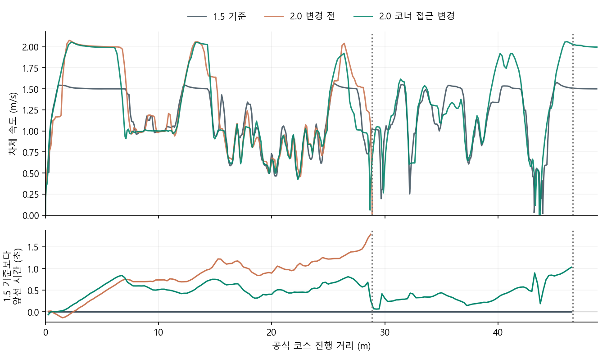
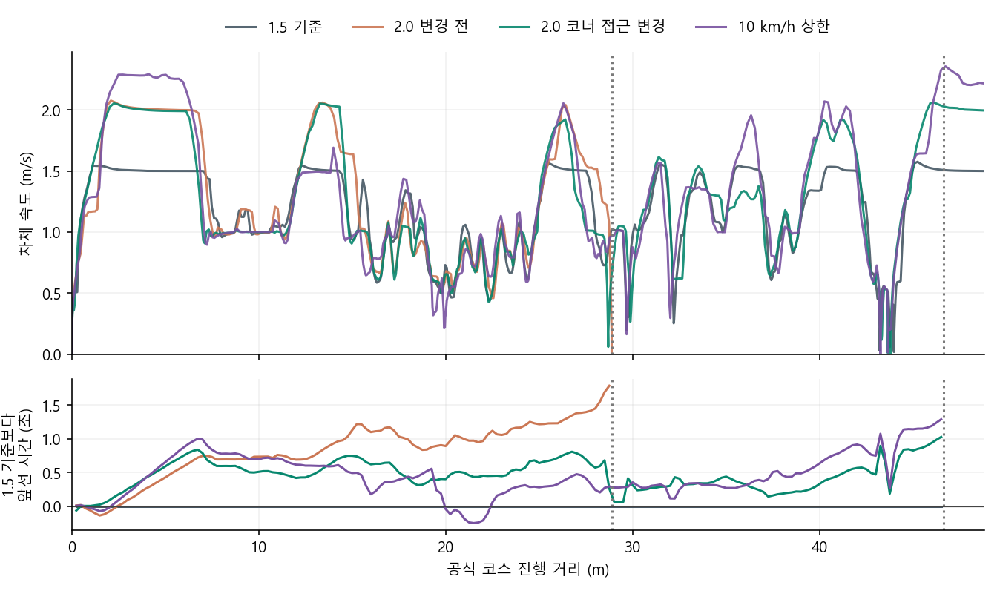
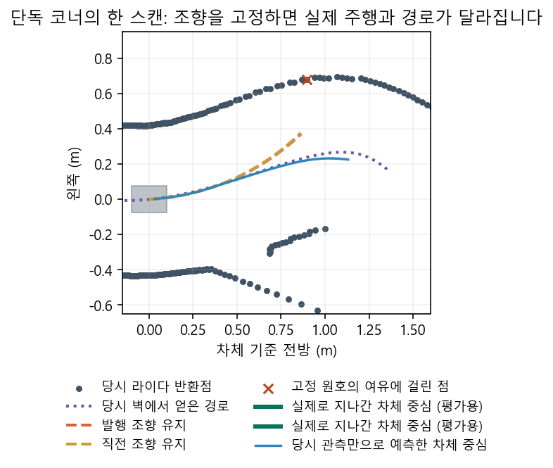

# 코너를 앞둔 단독 속도 시험 — 2026-11-01

비교 기준은 [1.5 m/s 경기 경로 완주(46.918초)와 2.0 m/s의 28.88 m 정체](../race_continuity_v1/README.md)다. 앞쪽 반환이 있었고 보호층은 진행을 허용했다. 2.0 실행은 따라갈 기준 벽이 바뀌기 전부터 확인한 주 경로가 1.74→1.48→1.27→0.96 m로 줄었다. 이때도 최대 순항 속도를 유지할 수 있다고 가정하고 마지막 순간에 후보를 버리는 대신, 확인된 길이가 짧아지면 **기존 1 m/s 위에 더한 속도만** 부드럽게 거둔다.

팀 시험값: 현재 기준 벽이 확인되고 전방 반환이 있는 경우, 확인 길이 1.70 m 이상이면 종전 순항 상한 전부, 1.10 m 이하이면 추가분 0, 그 사이는 선형으로 잇는다. 1.10/1.70 m는 저장 기록상 벽 전환 전 길이와 긴 직선 길이에서 잡은 시험 가정이며 정지거리나 공식 규정이 아니다. 곡률·제동·점유·속도 응답·독립 보호의 작동은 그대로다. 새 최저속도, 지도 좌표나 장애물 예외는 쓰지 않는다. 이전 속도 프로필은 그대로 보존한다.

판정 순서: [기존 입력 재생](replay.py)에서 예전 속도·조향의 재현, 긴 직선 2 m/s 유지, 코너 접근 시 목표 감소, 0명령 추가 여부를 먼저 본다. 그다음 방지턱 OFF, 슬롯 3, 동일 센서/기어비·기존 경기 경로로 Gazebo 1회를 실행한다. **한 랩, 경과 시간, 최고·유지 속도, 접촉/노면·실제 STOP**을 따로 판정한다. 28 m만 통과한 상태로 완주를 선언하지 않는다. 조건이 같으면 같은 실패를 반복하지 않는다.

[저장 입력 1,319호출](replay.json): 이전 설정의 불일치 0, 새 설정에서 조향 변경·추가 정지 0. 긴 직선 구간의 평균 명령은 2.000→1.994 m/s, 코너 접근 구간은 1.379→1.130 m/s였다. [영향 범위 회귀 177개 통과](pytest.log). 재생은 원래 차체 궤적으로부터 얻은 수치다.

**실제 Gazebo 결과:** 2.0 m/s 설정은 녹색 첫 표본에서 랩선까지 **45.871초**, 1랩 통과 후 종료 표본까지 48.753 m를 진행했다. 예전 2.0의 28.88 m 정체를 넘었고, 1.5 완주본(46.918초)보다 1.047초 빨랐다. [차체 속도](solo_2p0_metrics.json) 최고 2.061 m/s, 가장 빠른 1초 평균 2.027 m/s. 1.90 m/s 이상으로 4.98초·9.97 m 진행했다. 독립 보호는 466개 표본 중 두 표본에서 진행을 제한했지만 지속 정체하지 않았다.

[실행·종료·출처 요약](solo_2p0_final_summary.json), [노면 감사](solo_2p0_surface.json), [모터축 검사](solo_2p0_motor_audit.json). 28,491개 자세에서 바퀴 이탈·벽 교차·벌점 표본 0, 명시 STOP과 차체 정지·정상 종료 통과. 이는 방지턱 없는 단독 1회의 결과로 반복 완주율이나 실제 차의 허용 속도가 아니다. 교통 속도까지 올리기 전에는 별도로 [앞차 추종·급정지](../race_follow_pair_v1/README.md)를 비교한다.

[같은 진행 거리 비교](course_arrival.json): 28 m 첫 표본의 종속도는 1.5 기준 약 0.973, 새 2.0은 0.983 m/s였다(이전 2.0 실패 시 약 1.52 m/s). 초록 이후 20 m까지는 18.450→18.047초, 40 m까지는 39.004→38.672초다. 코너 접근 속도를 예전 완주 수준으로 낮추면서 직선의 속도 이득은 일부 남았다.

[랩선까지만 센 속도대별 시간](lap_budget.json): 2.0 완주에서 0.05 m/s 미만은 **0.90초**, 0.5–1.0 m/s는 **19.67초**, 1.9 m/s 이상은 3.92초였다. 랩 평균 속도는 0.994→1.017 m/s다. 종료선 이후까지 넣은 위의 4.98초와 집계 범위가 다르다. 단독 랩에서 정지 시간을 모두 없애도 회수할 시간이 1초 미만인 반면, 중속 코너·회복 구간이 길다. 교통에서 앞차 때문에 서는 시간은 이 결과에 포함되지 않는다.

**10 km/h 단독 시험 사전 조건:** 앞차 비교 뒤 `g1_open_10kmh_approach`로 한 번만 시도한다. 같은 접근 길이·보호·명시 STOP·단독/방지턱 OFF·그리드 3을 유지한다. 최고 **2.778 m/s(10 km/h)** 도달, 1초 유지, 95% 이상 실제 주행 거리, 노면, 실질적인 랩타임은 각각 따로 적는다. 2.0 완주본보다 느려지거나 완주하지 못하면 새 상한을 경기 설정으로 추천하지 않는다.

[2 m/s 완주 기록에 10 km/h 상한을 적용한 결과](ten_kmh_diagnostics.json): 2,410회 중 480회가 2 m/s를 넘었고 최고 **요청**은 2.584 m/s였다. 가장 빠른 표본에서 앞쪽 충돌 검사와 길이별 속도 상한은 모두 2.778 m/s를 허용했지만, 실제로 이어서 따라갈 수 있었던 벽은 2.30 m, 경로는 2.29 m여서 경로 끝까지의 제동 상한이 먼저 걸렸다. [같은 스캔에서 탐색 길이만 0.4/0.8 m 늘린 대조](straight_range_probe.json)에서도 이어진 벽 길이는 변하지 않았다. 이 한 장면에서 스캔 범위를 임의로 늘리거나 보호층을 완화할 근거는 없다. 더 넓은 경로 적합은 조향에도 영향을 주었다(기존 대비 1° 초과 496호출). 실제 더 빠른 궤적의 속도와 완주는 별도다.

**실제 10 km/h 상한 시험:** [45.598초에 한 바퀴](solo_10kmh_metrics.json). 차체 최고 **2.357 m/s(8.48 km/h)**, 1초 평균 최고 **2.282 m/s(8.21 km/h)**. 목표 95%인 2.639 m/s 이상은 0초·0 m였다. 같은 평가에서 보호 출력 표본 최고 2.302 m/s, 진행 48.773 m, 표본상 접촉 0. [28,729개 자세에서 노면 벌점·바퀴 이탈 0](solo_10kmh_surface.json), [모터축·정지 확인](solo_10kmh_motor_audit.json), 정상 종료. 2 m/s 기준보다 0.274초 빠르지만 각각 1회여서 반복 성능이나 실차 최고속도로 보지는 않는다.

[주행 중 계획기의 최고 요청](solo_10kmh_peak_request.json)은 **2.602 m/s**였다. 이때 관측 경로 2.405 m의 제동 상한은 2.657 m/s, 현재·직전 조향 원호를 검사한 여유 2.48 m의 제동 상한은 2.602 m/s였다. 2.778 m/s까지 허용한 직선 길이 조건이나 독립 보호층이 이 표본의 병목은 아니었다. 위의 2.302 m/s는 더 성긴 주기로 수집한 보호 출력 표본의 최고값이어서 전체 명령 시계열의 최고값과 다르다.

[2.0 상한](solo_2p0_limits.json) / [10 km/h 상한](solo_10kmh_limits.json)에서 실제 계획기 기록을 랩선까지만 분류했다. 현재 조향각/직전 조향각을 유지했을 때의 차체 통로로 계산한 제동·간격 상한 때문에 **1 m/s 이하 양수 명령**을 낸 시간은 각각 16.14초 / 15.58초였다. 0명령은 1.42초 / 1.14초였다. [사후 궤적 대조](solo_2p0_clearance.json)에서 해당 조건의 서로 다른 스캔은 190장이다. 관측 경로가 충분했던 177장 모두 실제로 다음에 지나간 궤적에서는 **당시 반환과 같은 여유를 유지한 채 기존 예측 지점보다 20 cm 더 진행**했다. 나머지 13장은 관측 경로가 짧아 비교하지 않았다. 이 20 cm는 분석 창이며 차량 제어기에 준 보너스 거리가 아니다. 사후 자세 없이 **그때 확인한 경로와 점만으로** 같은 현상을 설명할 수 있는지와 앞차 급정지 반례를 먼저 본다.

[당시 센서만으로 계산한 후속 비교](solo_2p0_sensor_turn_samples.json): 같은 190장 중 95장에서만 기존 경로를 따라 조향을 갱신한 예측의 차체 표본이 추가 20 cm까지 당시 반환에 걸리지 않고 거리 표본 지지를 얻었다. 나머지는 속도 증가에 필요한 현재 경로가 아니거나(38), 경로 길이가 짧거나(12), 앞을 보는 Pure Pursuit 목표가 먼저 끊겼다(45). 95장의 기존/가상 속도 요청 평균은 0.780/1.029 m/s였다. [앞차 급정지 기록](moving_stop_sensor_turn_samples.json)에서 해당 33장 중 25장은 표적 반환이 예측 차체에 걸려 거부했다. 나머지 8장은 녹색 후 0.42–1.12초로, 상대가 4초에 멈추기 **전**이었다. 후보 계산은 제어기에 연결하지 않았고, 이 기록 한 건으로 끼어들기·측방 접촉을 보장하지 않는다.

실선은 차체 중심, 붉은 ×는 고정 원호의 차체 폭과 측정 여유에 걸린 점이다. 녹색은 나중에 얻은 평가 자세, 파란색은 그때 센서만 쓴 예측으로 서로 독립이다. [동일한 장면의 반례](preview_counterexamples.json)에서 전방 42 cm에 정지차 폭의 반환을 넣었을 때는 실제 반환이 걸려 거부했고, 같은 22개 광선이 무반환이면 관측 근거가 없어서 거부했다.

차체의 아홉 점만 확인하는 대신, 조향이 달라지는 구간의 **차체 폭에 걸치는 광선**이 실제로 그 뒤까지 반환을 주었는지 확인했다. [단독 190장 중 72장](solo_2p0_turn_beams_local.json)에서 추가 20 cm를 지지했다. 해당 장면의 통상 요청 평균은 0.856 m/s, 후보는 1.104 m/s였다. 스캔 양 끝 사이의 빈 각도도 앞길에 걸치는 경우에만 거부했다. 뒤에 빈 각도가 있다는 이유만으로 전체를 거부한 [이전 비교](solo_2p0_turn_beams.json)는 51장에 그쳤다. [정지차 접근 33장](stop_turn_beams_local.json) 중 25장은 표적 간섭, 5장은 시야 부족으로 거절했고 허용한 3장은 앞차가 멈추기 전이었다. [같은 장면의 검산](preview_beam_edges.json)에서 전방 물체·전방 가림은 거절하고 뒤쪽 반환 87개만 없앤 경우는 원래 선택을 유지했다. 해당 PC 표본의 후보 호출 중앙값 약 4.05 ms는 노드 전체 시간이나 Jetson 측정값이 아니다.

**직선에서의 다음 선택:** [높은 요청이 나온 두 스캔](straight_wall_end.json)에서 같은 벽 방향에 반환이 더 있어도 실제 이웃 광선 사이 거리가 0.206/0.231 m라 기존 0.180/0.183 m 연결 기준에서 벽이 분리됐다. 그 뒤에는 벽과 다른 면도 실제로 있었다. [한 랩 안의 93개 고속 스캔](straight_budget_lap.json) 중 기존 경로 옆에서 연속 세 광선 이상이 같은 접선의 3 cm 안에 더 보이고 현재 원호의 제동 여유도 10 km/h에 충분한 것은 **8장**이었다. [시험 시작~마감 전체](straight_budget.json)의 **15/118장**에는 결승을 지난 장면도 있다. 이것만으로 끊긴 벽을 자동 연결하거나 광선 사이를 자유 공간으로 보지 않는다.

[발행 속도 제한 대조](acceleration_budget.json)에서는 **한 랩 2,269판단, 실제 발행 449표본과 기존 재계산 오차 0**이었다. 같은 계획 속도·정지를 두고 50 Hz 증속 상한만 1.0→1.5 m/s²로 바꾸면 명령 최고 2.342→2.422 m/s, 2 m/s 이상 요청 3.32→5.14초였다. 2.0 m/s²에서도 요청 최고는 2.437 m/s로 추가 상승이 작았다. 0명령 추가·해제는 모두 0이고 감속 목표를 즉시 적용하는 규칙도 바꾸지 않았다. 속도 명령 적분의 +2.85 m는 차체 이동 이득이 아니다. 복잡한 벽 연결을 기본으로 추가하기 전에, 같은 직선/코너 판단에서 1.5 m/s²만 바꾸는 비교가 우선이다. 제동 능력이나 실물 가속에 대한 결론은 아니다.
