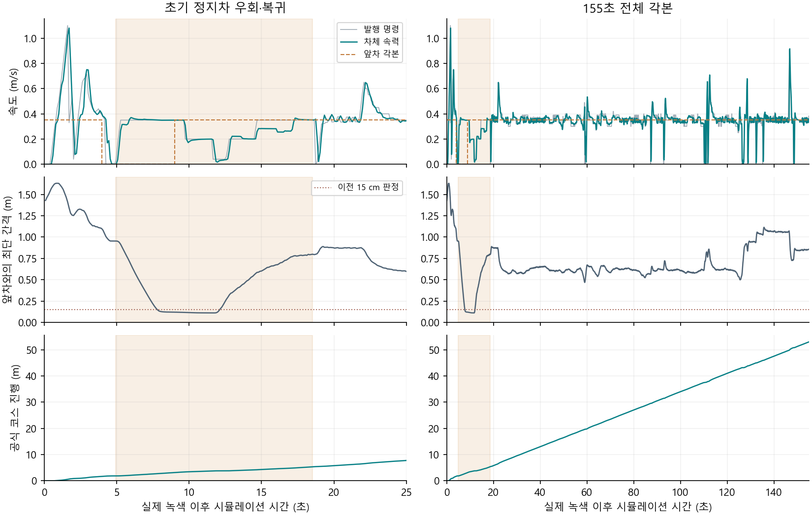

# 앞차와 옆차가 있는 대표 코스 한 랩

10/31과 같은 155초 각본을 사용한다. 앞차는 0.35 m/s로 출발해 4–9초에 정지하고 다시 출발한다. 왼쪽 차는 직선 잔디 쪽에서 함께 출발해 15초에 정지한다. 좌측 차는 도로 안에서 치열하게 병렬 주행하는 상대가 아니다. 우리 차는 새 공칭 감속비, 전방 B0183, 순차 C1, 앞차 비교의 **1.5 m/s** 프로필, 방지턱 OFF를 사용한다. 2×5 신호 월드의 ID45는 옆으로 옮긴 위치다. 앞차 속도·중심선·각본은 평가기에만 있다.

[등록된 각본](course.json)은 [원본 한 랩 조건](../../../../config/tests/g1_traffic_full_course_v1.json)의 앞차·판정과 [예전 옆차 각본](../../2026-10-31/g1_continuous_prefix_course_v1/actor_overlay.json)을 유지한다. [상대 배치 검사](geometry.json)에서 앞차 경로 52.5 m의 5,251개 자세가 도로·벽 조건을 만족했다. 왼쪽 차의 잔디 구간과 두 상대 간 최소 표본 간격 약 0.170 m도 확인했다.

우리 차를 평가할 때는 한 바퀴 진행, 우회 중 상대 재출발과 복귀 여부, 가까운 접촉·벽 교차 및 세 바퀴 이상 이탈, 불필요한 정체, 명시 STOP을 구분한다. 원래 뒤 유지/HOLD 조건은 그대로 기록하여 우회를 그 조건의 성공으로 바꾸지 않는다. 추종 방식은 [등속·정지 실제 비교](../race_follow_closing_v1/README.md)를 마친 선택형 closing이며 아래 run1에서 실제 주행했다.

## run1 실제 진행

[실행 보고서](run1/report.json)의 시험 무결성·신호·모터 정책·정상 종료는 통과했고, **53.032 m·한 랩**을 진행했다. 2×5 실제 녹색은 7.682초에 적용되고 차량 출발 허가는 7.991초였다. 실제 앞차가 5초 정지한 뒤 재출발하는 동안, 우리 차는 녹색 후 **4.927초에 BYPASS, 18.527초에 REACQUIRE, 18.627초에 FOLLOW**로 돌아왔다. 앞차 최단 간격은 표본 0.112199 m·연속 보수 하한 0.112197 m, 옆차는 각각 0.168211/0.168205 m였다. 표본 겹침·접촉 이벤트는 없었고 명시 STOP과 모든 정지 검사도 통과했다.

원래 `hold`, `sampled_gap`, `swept_gap`, `ego_stays_behind`는 **실패**다. 뒤에서 서서 기다리는 대신 우회했고, 기존 15 cm 간격선보다 가까워졌기 때문이다. 실제 접촉이 없었다는 결과와 이 실패를 함께 보존한다. 왼쪽 차는 잔디에서 나란히 출발하는 각본으로, 도로 내 고속 병렬주행 결과가 아니다.

[계획 명령 분류](command_time.json)에서 기록이 있는 154.754초 중 정상 경로 102.014초, 전진 앞차 접근 35.540초, 우회 13.600초였다. 미래 우회 공간을 남겨두기 위한 0명령은 **0.060초**였다. 벽 재확인·다른 제한으로 인한 0은 별도로 기록했다. 제어 계산 단계의 분류이고 실제 차체가 서 있던 시간은 아니다. 녹색 후 24초부터 마지막까지는 앞차 속도 0.35 m/s에 맞춰 차체 평균 약 0.34–0.35 m/s로 진행했다. 이 각본에선 추월 대신 앞차를 따라가도록 한 의도에 맞는다.

[바퀴 노면](run1_surface.json)은 78,752개 자세를 조사했다. 오른쪽 두 바퀴가 함께 잔디에 걸린 시간은 9.397초, 한 바퀴라도 걸친 연속 시간은 10.240초였다. 벽 교차 표본과 세 바퀴 이상 이탈은 0이다. 두 바퀴 기준의 적합과 장시간 잔디 사용에 대한 실제 심판 판단은 구분한다. [단일 모터축 감사](run1_motor_audit.json)에서 8.9706:1·28카운트와 실제 구독을 확인했다.

[기존 진행 요약](summary.json)은 주행 기록표가 STOP 요청 전에 끝나 끝점 포함 여부에서 실패했다. 원래 결과는 그대로 두고, [당시 입력과 고밀도 차체 자세로 독립 재집계](run1_dense_progress.json)했다. 녹색 관측부터 STOP 요청까지 74,586개 평가 자세(최대 간격 4 ms)에서 중심선 진행 범위가 5 cm 이내에 머문 최장 시간은 **1.184초**, 투영 도약은 0이었다. 이 실행에선 10초 정체가 없었다. 이 값은 바퀴 속도가 0이던 시간이 아니며 차량 제어에 사용하지 않는다. 같은 각본을 재실행하지 않았다.

[3인칭 주행 영상](run1/video/lidar_third_person_simtime_1x.mp4): 녹색 전부터 종료까지 164.05초, 960×540, 20 FPS. [시간 감사](run1/video/video_timing_audit.json)에서 원본 이미지가 없는 78프레임은 직전 화면을 유지했다. 배속이나 합성 동작은 없다. [3,281프레임 디코드](run1/video_inspection/video_inspection.json)를 확인했고, [앞차가 재출발하는 장면](run1/video_inspection/frame_00334.jpg)에는 도로 가장자리로 우회하는 자차가 보인다.
