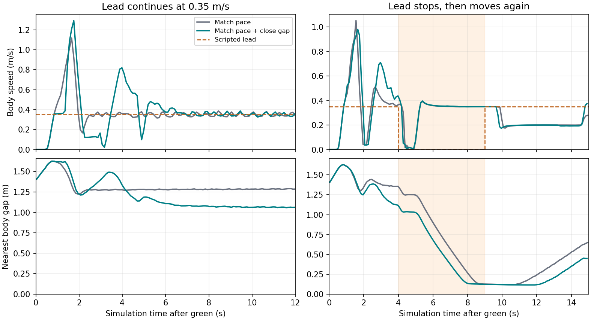

# 움직이는 앞차와 남은 간격

[기준 주행](../race_follow_pair_v1/README.md)에서는 0.35 m/s 등속 앞차를 뒤따라 12초간 움직였지만, 마지막 간격이 1.281 m로 등록 목표 1.20 m 이내에 들지 못했다. 510회 판단에서 카메라나 상대 정답 대신 라이다의 전방 반환 조각이 앞으로 움직인다고 보았다. 앞차가 움직이는 속도만 허용했기 때문에 이미 벌어진 간격이 거의 그대로 유지됐다.

후보의 추가 속도 상한은 `관측 전진율 + max(0, 뒤차 후륜축부터 앞쪽 반환까지 거리 − 기존 우회 진입 여유) / 기존 관측 창`이다. 진입 여유가 1.20 m, 관측 창이 0.8초인 현재 시험에서 쓰던 값을 그대로 사용한다. 진입 여유는 두 차체의 범퍼 간격과 다르다. 원래 G1이 허용한 목표보다 빠르게 요청하지 않는다. 전진 근거가 없으면 기존 처리이며, 정지 명령·우회 행동·조향·독립 보호엔 손대지 않는다.

[등속 앞차 고정 입력](../race_follow_pair_v1/slow_closing_preview.json)에서는 589회 중 510회에서 요청 증가, 0해제·조향·모드 변화 0이었다. [급정지 입력](../race_follow_pair_v1/stop_closing_preview.json)에서는 앞차가 정지한 뒤에도 11회에 걸쳐 기존보다 높은 요청이 남았다. 그동안 속도 명령 차이의 적분은 0.073 m다. 이것은 실제 추가 이동량이 아니며 급정지를 확인해야 하는 이유다.

실제 비교는 1.5 m/s 상한·그리드 3·같은 10 Hz 순차 LiDAR·같은 물성에서 **등속 12초와 급정지/재출발 15초**를 각각 한 번 사용한다. 기존 원 판정(마지막 간격·뒤 유지·HOLD·노면 포함)을 보존하고, 진행이 늘더라도 실제 접촉·3바퀴 잔디·미복귀를 따로 기록한다. 등속에서 간격을 좁히지 못하거나 급정지에서 손실이 커지면 기본값으로 채택하지 않는다. 조건을 바꾸지 않은 재실행은 하지 않는다.

[기존 두 주행에서 가장 큰 0.30초 감속](baseline_approach.json)은 **앞차 정지 전, 최초 추종 전환 시점**이었다. 등속 각본에서는 녹색 후 1.657–1.957초에 실제 차체 1.110→0.370 m/s, 정지/재출발 각본에서도 1.659–1.959초에 0.815→0.042 m/s였다. 둘 다 그 구간의 독립 보호 상태 표본은 `clear`였다. 등속에서는 첫 전방 조각 확정 전 1.3 m/s 안팎의 요청이 우회 여유 확보에 들어가자 0.35 m/s로 내려갔다. 그래서 가장 큰 0.30초 속도 감소와 발생 시점을 함께 보며, 급정거가 필요했던 시점과 보통 추종 중의 큰 감속을 구분한다.

**등속 앞차 실제 비교:** [같은 12초 각본](slow_compare.json)에서 후보는 원래 판정을 모두 통과했다. 진행 **4.300→4.520 m**, 마지막 간격 **1.281→1.063 m**, 최소 간격 **1.185→0.900 m**였다. [노면 감사](slow_surface.json)에서 벽과 바퀴 이탈은 없었다. 다만 최초 추종의 0.30초 최대 속도 감소는 **0.740→0.792 m/s**로 조금 커졌고, 첫 출발 후 0.05 m/s 미만도 **0→0.201초**였다. 간격을 회복한 것과 감속이 부드러워진 것은 다른 결과다. 이후 정지/재출발 각본과 함께 판단한다.

**정지·재출발 실제 비교:** [같은 15초 각본](stop_compare.json)에서 진행은 4.240→4.460 m, 마지막 간격은 0.649→0.444 m, 최소 간격은 0.119→0.115 m였다. 두 설정 모두 앞차 정지 후 뒤에 서 있지 않고 우회했다. 기존 뒤 유지·HOLD·간격·차체 전체 도로 내 판정의 실패는 그대로다. [후보 바퀴 감사](stop_surface.json)에서 최대 두 바퀴 이탈, 벽 교차·세 바퀴 벌점·상대차 접촉은 0이었다. 첫 출발 이후 0.05 m/s 미만 시간은 0.910→0.909초로 거의 같았고, 0.30초 최대 속도 감소는 오히려 0.773→0.881 m/s였다. 양쪽 모두 명시 STOP 이후 안정적으로 정지하고 정상 종료했다.

**선택:** 간격을 회복하는 효과는 있으나 평상시 큰 감속을 줄이지 못했으므로 기본 채택하지 않는다. 155초 대표 코스에는 두 짧은 장면을 모두 측정한 `closing`을 **비교용으로만** 쓴다. 다음 개선은 최초 상대 관측에서 감속을 시작하는 시점이다. 움직이며 멀리 있는 앞차와 임박한 충돌은 별도로 다루며 후자의 제동 명령은 늦추지 않는다. 수치는 두 각본 각각 한 번씩의 비교이며 실제 차량의 제동거리가 아니다.

**불필요한 0명령의 크기:** [기록된 판단 대조](entry_hold_probe.json)에서 등속 각본의 FOLLOW 0명령 14회 중 5회, 정지·재출발 각본의 26회 중 12회는 가장 긴 미래 우회 경로를 남기기 위한 정지였다. 이때는 현재 G1 경로가 양수 속도를 허용했고 1.20 m 우회 여유 밖으로도 0.184–0.315 m가 남아 있었다. 같은 여유 앞에서 정지하는 기존 제동식·상한 0.35 m/s를 유지하며 접근하도록 계산하면, 두 기록에서 속도 명령 적분의 차이는 각각 +3.5 cm·+6.3 cm뿐이다. 차체가 그만큼 더 간다는 뜻은 아니다. 원래 입력의 나머지 정지와 우회 전환은 건드리지 않았다. 이 짧은 정지만을 위해 새로운 주행 모드를 만들지 않고, 대표 코스의 실제 정체부터 본다.

**전방 관측 범위를 단순히 넓히는 대안은 보류:** 세 점 이상 이어진 반환을 2.5 m까지 보고, 두 직선 벽과 현재 진행 원호가 함께 확인될 때만 미리 감속하는 후보를 같은 기록에 적용했다. [등속](early_slow.json) 11회와 [정지·재출발](early_stop.json) 7회에서 일부 양수 목표가 먼저 낮아졌지만 첫 4초의 0.30초 최대 **계획 명령** 감소폭은 각각 1.201, 1.450 m/s로 줄지 않았다. [차가 없는 완주 입력](early_empty_course.json)에서도 6회 불필요하게 감속했다. 모든 시험의 0명령 수는 같았다. 일단 이 방법은 주행에 넣지 않는다. 1.60 m는 우회 조각을 찾는 범위이지 C1 하드웨어 거리 한계가 아니다. 최초 인식 지연의 원인이 범위 하나라고 결론내리지 않는다.

**현재 계획 경로로 대조해도 조기 감속만으로는 부족했다:** [경로 위 조각에 한정한 후보](early_path_probe.py)는 실제 차체 폭으로 경로에 걸리는 전방 반환만 골랐다. [차 없는 한 랩](early_path_empty_course.json)은 2,284판단 중 속도 변경 0으로 원호 기준의 오감속을 없앴다. 그러나 [등속](early_path_slow.json)·[정지 재출발](early_path_stop.json)에서는 최초 4초의 최대 명령 감소가 여전히 같았고, 속도 명령 적분만 각각 −1.036/−0.664 m였다. 입력이 고정된 비교라 실제 진행 손해와 같지는 않지만, 이 결과로 제동 분기를 추가할 근거는 부족하다. 이 후보도 미연결이다.
