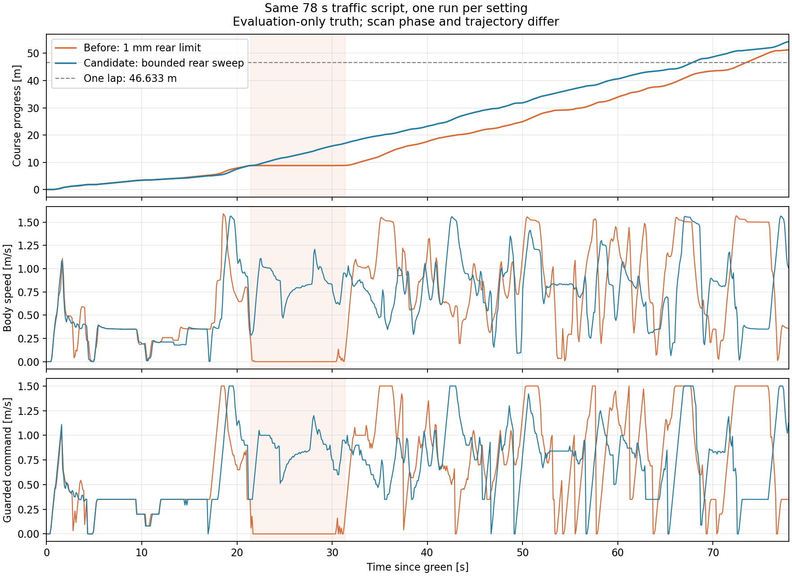

# 복귀 후 곡선의 작은 후반부 이동과 정체

[빠른 앞차 코스](../fast_lead_course_v1/README.md)는 한 랩 73.515초·51.312 m 진행·접촉 0이었다. 그러나 녹색 후 21.428–31.363초에 5 cm 이내 진행이 9.935초 이어졌다. 독립 보호 출력은 clear였고, 원래 G1은 현재 벽으로 경로와 양수 목표를 만들었다. 통과 이력을 유지하는 선택기가 뒤쪽 미관측 영역을 거절하고 직선 전용 대체 경로를 고른 것이 정지 원인이다.

[원시 입력 진단](../fast_lead_course_v1/stall_geometry.json)에서 거절점은 차체 뒤쪽 x=-26.6~-23.1 mm, 옆면 밖 최대 1.449 mm였다. 원시 442번 광선 한 개가 +inf였고 양옆 반환은 3.894 m/11.114 m, 가까운 실제 반환까지 최소 0.350 m였다. 기존 뒤쪽 미관측 기준은 1 mm여서 이 장면이 오래 정지했다. 도로가 모두 보인다는 사실이 뒤쪽 사각까지 관측했다는 뜻은 아니다.

## 후보 범위

기존 1 mm 함수·GUARD 동작은 보존한다. 선택형 released_rear_sweep_trial에서만, 측방 통과 이력이 있고 현재 위협이 없는 RELEASED 상태의 retained 분기에 다음을 비교한다.

- 기본 G1의 현재 경로가 fully_observed이고 양수 목표인 경우만, 실제 측정·요청 속도 모두 0~0.35 m/s 범위에서 사용한다.
- 현재/직전 조향으로 계산한 차체·바퀴 영역 중 미관측점 전부가 뒤쪽 반차체의 옆면 밖 1 cm 이내여야 한다. 1 cm는 기존 작은 횡이동·가림 꼬리 기준을 재사용한 운용 위험 상한이다. 수치 오차나 자유 관측으로 취급하지 않는다.
- 원시 +inf, 3도 이내 공백, 양옆 유효 반환 0.6 m 이상, 기존 팽창 안 실제 점유 부재, 마스크 경계 거절을 그대로 검사한다. 전방·뒤 범퍼 너머·넓은 공백·가까운 물체·시간 불일치에는 적용하지 않는다.
- 통과 이력·unknown 수·후방 위험은 그대로 남긴다. 작은 돌출물/반사 실패/동적 접근 위험은 수용 범위에 남는다. 목표에 맞춰 작은 불확실성 때문에 긴 정지하는 빈도를 줄이는 비교이며 안전 보장은 아니다.

기본 OFF. 저장 입력에서 개선 호출과 불변 호출을 나누고, 기존 반례 회귀 뒤 같은 빠른 앞차 코스를 한 번 비교한다. 실패를 성공할 때까지 반복하거나 새로운 보호 조건을 늘리는 작업이 아니다.

## 회귀와 출처

수정 전 6개 파일은 [before.zip](before.zip), 후속 출처는 [계약](../../../../config/tests/released_rear_sweep_r1_sha256.json)에 보존했다. [초기 검사](pytest_initial.log)의 1건은 새 계약 연결 전 해시 불일치였고 행동 163개는 통과했다. 계약 연결 뒤 [252개 회귀](pytest.log)가 통과했다. 새 경계·반사 대칭·0속도 재개, 가까운 반환·전방·넓은 공백·잘못된 입력·고속·위협 재출현·원래 정지를 함께 확인했다. 일반 GUARD 및 옵션 OFF의 1 mm 기준을 바꾸지 않았다.

옵션은 FollowConfig.released_rear_sweep_trial, ROS g1_g2_released_rear_sweep_trial, launch evaluation_handoff_rear_sweep, 평가기 --handoff-rear-sweep로 명시한다. 기록 헤더에도 실제 선택을 확인한다. 신규 분기 보고는 selector_released_rear_sweep이며 기존 1 mm 예외로 잘못 표시하지 않는다.

## 저장 입력 대조

[기록 재생](replay_result.json)은 원래 판단 1,990/1,989/849회를 재현했다. 빠른 앞차의 정체에서 **460회 0명령이 양수로 바뀌었고 새 0명령은 0회**였다. 느린 앞차의 대표 완주는 2회만 바뀌었으며 15초 정지·재출발 각본은 849회 모두 동일했다. 정지 해제 호출에서는 이전 조향 고정 대신 같은 호출의 G1 곡선 조향을 선택하므로 조향도 달라졌다. 원시 해시·순번·종료를 확인했고 재생 종료코드는 0이다. 기록된 자세를 그대로 쓰는 비교라 실제 경로/접촉/랩 개선은 아래의 한 번 실제 주행으로 확인한다.

[공칭 차체의 후방 바깥 모서리 회전](nominal_corner_swing.json)을 별도로 계산하면 최대 조향 0.37 rad에서 약 1.247 mm의 바깥 흔들림이 가능하다. 1 mm가 단순한 수치 오차 기준이 아니라 정상 회전도 제한할 수 있는 값임을 보여준다. 이 계산은 안쪽 모서리가 원래 옆면을 통과하는 움직임·바퀴·실제 조향 오차·동적 접근을 포함하지 않으므로 1 cm 위험 상한의 안전 증명으로 쓰지 않는다.

## 같은 78초 코스 실제 비교

새 소스 빌드 뒤 [run1](run1/report.json)을 한 번 실행했다. [등록 대조](registration_comparison.json)에서 코스·상대 각본·물성·센서가 같고 선택형 후반부 후보만 추가됐음을 확인했다. [독립 결과 비교](comparison.json)와 [실행 소스/현재 소스 대조](source_review.json)를 남겼다.

| 항목 | 기존 1 mm 기준 | 선택형 후반부 후보 |
|---|---:|---:|
| 최초 한 랩 | 73.515초 | **67.863초** |
| 78초 진행 | 51.312 m | **54.372 m** |
| 5 cm 이내 진행 최장 | 9.935초 | **1.026초** |
| 최종 앞차 간격 | 4.263 m | **1.828 m** |
| 최소 표본 간격 | 0.115509 m | 0.113869 m |
| 접촉·벽 충돌 표본 | 0 | 0 |
| 최대 잔디 바퀴 | 2 | 2 |

녹색 후 FOLLOW 복귀는 16.605초였다. 실행 유효·소스 불변·명시 STOP·정상 종료·모터 감사가 통과했다. 잔디 연속 최대 7.888초, 세 바퀴 벌점 추정 0이다. 78초 원시 진행과 STOP 전까지의 고밀도 진행 54.772 m는 구간이 다르다. 원시 HOLD·최종 간격 1.20 m·15 cm 최소 간격·뒤 유지 실패는 그대로 남아 실행 코드는 1이다. 현재 목표인 완주/정체 개선과 과거 판정 실패를 따로 읽어야 한다.

표는 각 한 번의 실행이며 스캔 위상과 궤적이 다르다. 앞차가 있는 상태에서 조향을 계속 바꿔도 모든 기하를 통과한다는 증거는 아니다. 차량 뒤쪽의 작은 미관측 위험을 명시적으로 수용한 후보이며 기본값은 OFF다.

자동 3인칭 영상은 20 fps·87.2초·1,744프레임 전체 디코드를 확인했다. 다음은 같은 설정의 [300초·5랩 유지력](../race_distance_v2/README.md)이다. 새로운 드문 반례나 속도 프로필을 동시에 추가하지 않는다.
