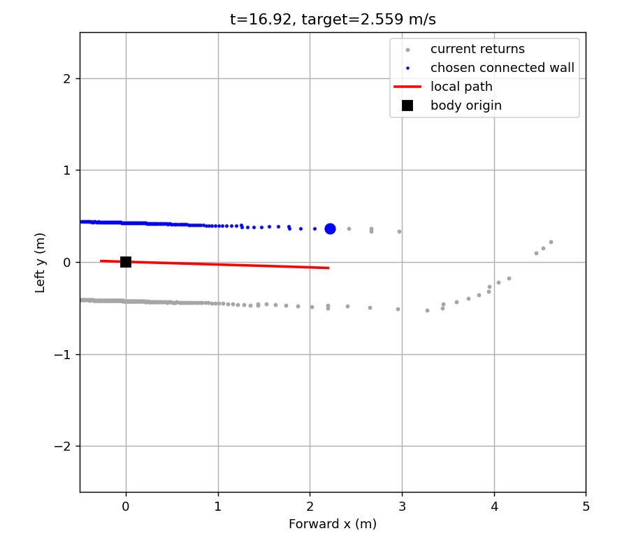

# 단독 고속의 관측 벽 길이와 경로 길이 진단

[37.934초 단독 완주](../solo_corridor_arc_v1/README.md)에서 0.5초 시간 간격보다 실제 제동거리·경로 끝 제한이 더 컸다. 최고 목표 약 2.559 m/s도 경로 끝 제동 한도였다. 현재 탐색 길이는 벽을 따라 측정한 호길이이며 차체 경로는 벽에서 0.425 m 떨어진 평행 곡선이므로 두 길이는 같지 않다.

기존 2,006판단 전체를 재현하면서 현재 반환·선택 경로가 일치하고 목표 1.8 m/s 이상인 호출만 관찰한다. 벽 탐색 예산에 0.425×π/2 m를 더해 실제 같은 연결 벽에서 더 많은 구간이 나오는지, 그때 가까운 경로·조향이 얼마나 달라지는지 기록한다. 이 증분은 90도 평행 원호 길이 차이의 진단값이며 새로운 운영 설정이나 임의 여유 완화가 아니다.

기존 출력은 바꾸지 않는다. 새 점/무반환을 자유 공간으로 만들지 않고 지도/정답 입력·새 Gazebo 주행·물성/제동 설정 변경도 없다. 더 멀리 본 결과 경로가 잘못 휘거나 개선이 없다면 연결하지 않는다. 전역 cubic 적합 구간이 바뀌므로 탐색을 늘리는 일이 항상 이득이라고 가정하지 않는다.

[진단 코드](probe.py)는 원래/추가 경로, 근거리 호길이 일치, 제동·곡률을 포함한 경로 상한과 소스 해시를 남겼다. [결과](probe.json)는 기존 2,006출력 동일, 120개 비교 중 벽 길이 0.1 m 이상 증가 17개·경로 상한 0.05 m/s 이상 증가 10개였다. 개선 10개는 가까운 경로 일치였지만 최대 조향 차이는 0.0326 rad였다. 전체 기록 중 해당 조건의 호출이며 랩 완료 뒤의 표본도 포함한다.

이어서 [조건부 비교](shadow.py)는 예산을 실제로 채운 벽만 경로 길이 부족분만큼 추가 조회했다. 가까운 경로가 일치하고 길이가 증가한 경우만 사용했으나, [랩 창 결과](shadow.json)는 명령 626개 변경·새 정지 21개·정지 해제 5개였고 최고 목표 2.559 m/s는 같았다. 추가 경로 자체가 정상 관측의 확인 이력과 달라지는 문제가 남았다. 목표 적분도 51.637→51.146 m로 낮아졌으며, 이 값은 실제 주행거리가 아니다.

**탐색 예산 증분을 운영에 연결하지 않는다.** 조건 수치만 더 바꾸거나 이 후보로 코스를 다시 달리지 않는다. 최고 목표 근처 세 시각의 실제 반환과 선택 연결 벽을 [직접 관찰](inspect_peaks.py)하여, 예산에 도달하기 전 벽 관측이 끝나는 이유를 분리한다. 런타임 소스는 변경하지 않았다.

## 최고속도 부근의 직접 원인

[세 시각 관찰](peaks.json)에서는 탐색 예산보다 먼저 벽 연결이 끊겼다. 16.92초는 x=2.220→2.422 m의 점 사이가 0.202 m였고 현재 연결 한도는 0.179 m였다. 28.12초도 0.206 m 간격에 한도 0.177 m였다. 옆 벽을 비스듬히 보는 광선에서 먼 점 간격이 커지는 효과가 보이며, 후속 실제 점은 존재했다. 이것만으로 실제 벽이 연속한다고 인증하지는 않는다.

다음 진단은 [연속 광선/국소 직선 조건](sampling.py)으로 같은 한 회전의 원시 광선 인덱스가 연속된 실제 여섯 점만 검사한다. 양쪽 세 점이 같은 직선과 3 cm 방사 잔차를 지지하고 원래 탐색거리 안일 때만 원래 단절 후보를 보완한다. 점이나 무반환을 생성하지 않고 현재 점유 검사를 유지한다. [진단 복사본](sampling_shadow.py)은 메모리에서만 local_path의 단절 선택을 바꿔 원본·후보 명령을 비교한다. 실제 제어 코드와 기본 설정에는 아직 연결하지 않았다.

[저장 입력 결과](sampling_shadow.json)는 기존 2,006출력 재현, 연결 206개/127회 함수 호출, 랩 창 1,887판단 중 명령 변경 100개였다. 새 정지/정지 해제는 0/0, 최고 목표 2.559→2.683 m/s, 목표 2.6 m/s 이상은 0→0.08초, 목표 적분 51.637→51.776 m다. 소스/입력은 그대로였다. 이득이 작고 지속 시간이 짧으므로 바로 실제 속도 개선이나 10 km/h 가능으로 확대하지 않는다. 연속 source 인덱스와 두 국소 직선만으로 잘못 연결할 반례·노이즈·비용을 검토한 뒤 필요한 연결/회귀/제한 시험 여부를 판단한다.
