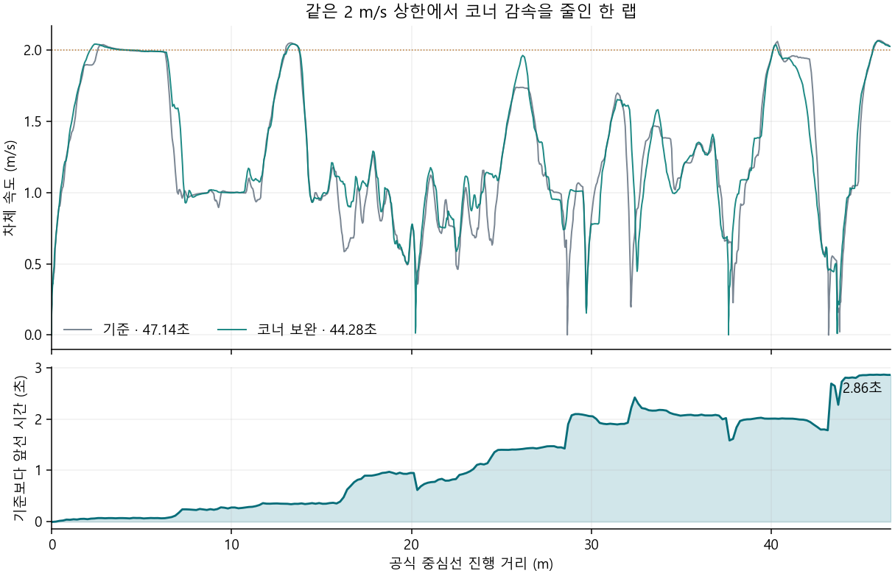

# 코너에서 이미 보이는 경로를 따라갈 때의 속도

2.0 m/s 단독 완주본에서 고정 조향각의 원호가 코너 벽을 일찍 만나, 실제로는 돌아나갈 수 있는 구간에도 낮은 속도를 오래 요청했다. [저장 라이다 대조와 그림](../corner_approach_v1/README.md). 이 후보는 지금 따르는 벽에서 경로가 새로 확인되고, 현재 조향 원호는 양수 진행을 허용하지만 정상 경로의 속도보다 낮게 제한한 경우만 쓴다. 직전/발행 조향으로 시작해 취득·응답 시간을 지나고 나서 현재 경로에 Pure Pursuit를 적용한다. 반환점의 거리 여유와 회전 중 광선 시각을 유지한다. 예상 차체를 가릴 수 있는 무반환, 표적 간섭, 끊긴 경로에서는 기존 속도 그대로다. 새로 관측한 구간은 최대 20 cm이고, 기존 정지나 재출발 판정을 바꾸지 않는다.

이전 완주 기록의 [2,410회 판단](fixed_input.json)에서 363회(서로 다른 스캔 95개)의 양수 속도만 상승, 증가 최대 0.25 m/s, 정지 해제·정지 추가·조향 변경은 0회였다. [앞선 스캔별 비교](../corner_approach_v1/solo_2p0_turn_beams_local.json)는 각 스캔의 첫 해당 호출만 본 72장이므로 집계 범위가 다르다. 현재 시험에서는 후방 사각이 앞길과 무관할 때 이를 이유로 감속하지 않고, 앞길의 점유는 그대로 확인한다. [시험 전 소스](before.zip)를 보존했다.

폐루프 비교는 3번 그리드·방지턱 OFF·같은 임시 신호·같은 2.0 m/s 상한·가속도·독립 보호·MCU STOP을 사용한다. 기준은 단독 한 랩 45.871초·최고 2.061 m/s·벽 접촉 및 이탈 표본 0이다. 새 랩타임, 실질적인 정체·코너 속도·접촉·바퀴 이탈을 판정하며 미완주나 입력·제어 지연도 그대로 기록한다. 재생 결과를 주행 성공으로 해석하지 않는다.

[첫 시도](run1/report.json)는 주행 전 실패다. [원 로그](run1/simulation.log)에서 ROS 콘솔 실행 파일 7개가 두 패키지의 설치 메타데이터를 찾지 못했고 Gazebo도 별도로 `std::future_error: Broken promise`로 종료됐다. 두 현상의 인과는 확인되지 않았다. 명령 0표본·궤적 0행이어서 이 시도로 랩 시간·차체 속도·정상 STOP을 평가할 수 없다. [실행 래퍼 종료 코드 누락](run_exit.log)도 보존했다.

[후속 실행 환경](environment.sh)은 WSL bash 파일 안에서 작업공간을 설정한 뒤 패키지 메타데이터·설치 prefix·7개 실제 entry point의 import를 확인하고 그 환경을 그대로 자식에게 전달한다. 이 검사에서는 두 설치 메타데이터와 7개 노드가 정상적으로 로드됐다. [run2 진입점](run_environment_fixed.py)은 run1 등록 입력과 실제 파일 해시를 대조하고 출력 폴더만 바꿔 실행한다.

**run2도 주행 결과는 없다.** [보고서](run2/report.json)와 [실제 종료 코드 1](run2_exit.log)을 보존했다. 이번에는 시작 데이터와 50 Hz 명령 5,533표본이 들어왔지만, [임시 3등 적용](run2/simulation.log)의 `yellow 렌즈 적용 실패: Service call timed out` 때문에 녹색 전환이 완료되지 않았다. 109.6초 동안 WAIT_GREEN·진행 0 m였다. 노드는 모두 종료됐으나 보고서의 `shutdown_clean=false`는 종료 전 서비스 오류까지 포함하므로 그대로 둔다. 코너 후보의 실패나 성공으로 분류하지 않는다.

임시 3등의 시간을 더 쓰지 않고, [성공한 제작측 2×5 프리랩](../official_prelap_v1/README.md)과 같은 입력을 쓰는 [run3](run_official.py)를 준비했다. 비교 기준은 2×5·촬영 포함 **47.143초**이며, 다른 시설이었던 45.871초와 직접 비교하지 않는다. 변경은 같은 2 m/s 프로필에서 코너 관측 보완을 켠 것이다.

[run3](run3_console.log)는 Gazebo 시작 전에 검사기의 예전 단독 프로필 제한에 막혔다. 당시 진입점은 [별도 보존](run_official_run3.py)했다. 검사기는 등록된 `g1_open_2p0_turn` 및 `g1_open_10kmh_rise15`도 2×5 신호 시험에 연결하도록 수정했다. 단독·1랩·3번 그리드·촬영·방지턱 OFF·software STOP 조건과 원래 주행 판정은 그대로다. [현 실행기](run_official.py)는 **run4**에만 새로 쓰며 실패 출력을 덮어쓰지 않는다.

**run4 실제 비교:** [녹색부터 공식 결승선까지](run4_lap_compare.json) 같은 2×5·촬영·2 m/s 상한 기준 **47.143 → 44.278초**(−2.865초, 약 6.1%). 차체가 0.5–1.0 m/s로 달린 시간은 **19.36 → 15.24초**, 1.0–1.5 m/s는 **13.25 → 15.40초**, 1.9 m/s 이상은 4.33 → 4.36초였다. 직선 최고속도보다 중속 구간 개선이 컸다. 8개 등거리 구간 중 6개가 빨라졌고, 가장 큰 차이는 5번째(−1.13초)였다. 2,205회 랩 판단 중 282회가 현재 광선을 확인하고 양수 목표를 높였고 최대 증가는 0.25 m/s였다.

[실행 보고](run4/report.json): 실제 녹색 0.271초 후 출발 허가, 1랩·실제 최고 2.065 m/s·1초 평균 최고 2.027 m/s, 접촉 표본 0, 명시 STOP 후 차체 정지·정상 종료. [27,464개 자세](run4_surface.json)에서 바퀴 이탈 및 벽 교차 표본 0, [8.9706:1 단일 모터축](run4_motor_audit.json) 확인. [3인칭 영상](run4/lidar_third_person_simtime_1x.mp4)은 [903프레임](run4_video_review/video_inspection.json), [보충 프레임 0](run4/video_timing_audit.json)이었다. 한 번씩의 비교이며 방지턱 OFF·단독에 한정한다. 프리랩의 유력 후보로 유지하고 교통 기본값으로 켜지 않는다.

