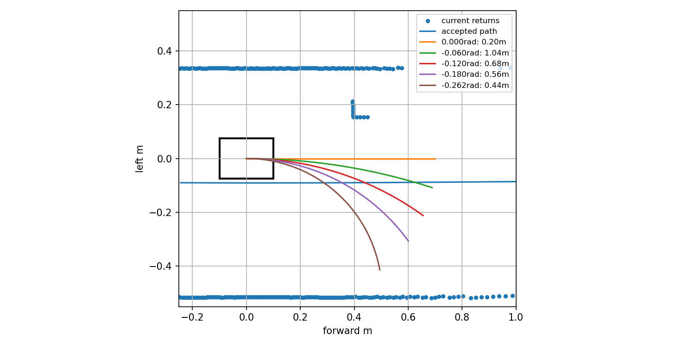
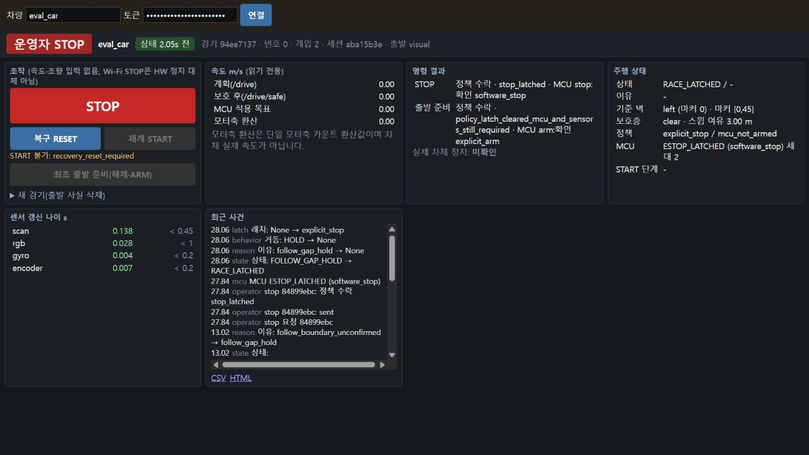

# 상향 카메라 선두 출발: 신호 수신 성공, 출발 주행 실패

명시 `local_sensor_config`와 카메라 pitch -20° 후보를 연결했다. 기본 수평 센서 파일은 유지했고, 114개 집중 회귀·빌드·224개 파일 등록을 마쳤다.

선두 index2에서 화면의 출발 준비 요청이 수락됐으며 RGB 실제 초록으로 출발 허가를 받았다(상태12.94초). ID0/45도 보였다. 그러나 차체는 움직이지 않았고13.185–23.283초 10.098초 동안 위치 변화가0이었다. 경로38m·ID20/30·주행 중 화면STOP을 확인하지 못했으므로 이 통합 시험은 실패다.

실제 UI STOP `84899ebc`는27.84초에 정책 수락·MCU software_stop 응답을 확인했다. 차가 이미 정체했으므로 주행 중 제동 증거는 아니다. 이후 평가기만SIGINT하여 종료코드1·KeyboardInterrupt를 원본으로 보존했다. Gazebo 종료 서비스·두 프로세스 exit0·잔존0이며 런타임카메라 설정/224소스 해시는 일치했다. Windows 별도 감사에서 설치 symlink1개가 누락으로 보였지만 WSL 원본 감사에서는 모두 존재했다.

## 저장 관측 원인

현재 오른쪽 벽 경로는 차량보다 약9cm 오른쪽에 있으나, 이전 조향0의 직진 스윕이 왼쪽 앞 신호등 기둥 반환에 걸려0명령을 유지했다. 기준20.02초 입력에서 직진 여유0.20m, -0.06rad 조향1.04m, 목표 -0.262rad 조향0.44m였다. 여유는 기존 점유 팽창을 그대로 적용한 저장 기하이며 실제 주행 성공이 아니다.

후속은 [정지 조향 복구](../standing_steering_v1/PLAN.md)다. 전진 허가 조건을 낮추지 않고 현재 확인 경로가 있을 때 정지 상태에서 바퀴를 먼저 돌리는 기존 기능을 명시 재획득 후보에도 연결한다. 진단 스크립트 최초 tuple 인덱스 오류와 수정 후 결과는 각각 보존했다.

분석 도구의 종료코드 파일은 실행 담당이 `passed=false`와 혼동해1로 기록한 오류가 있었다. [정정](analyze_exit_correction.json)에 따라 실제 분석 프로세스 exit는 미확인이다. 원본 run.py의 종료코드1 및 정체 실패 판정과 별개이며 분석 도구를 재실행하지 않았다.
