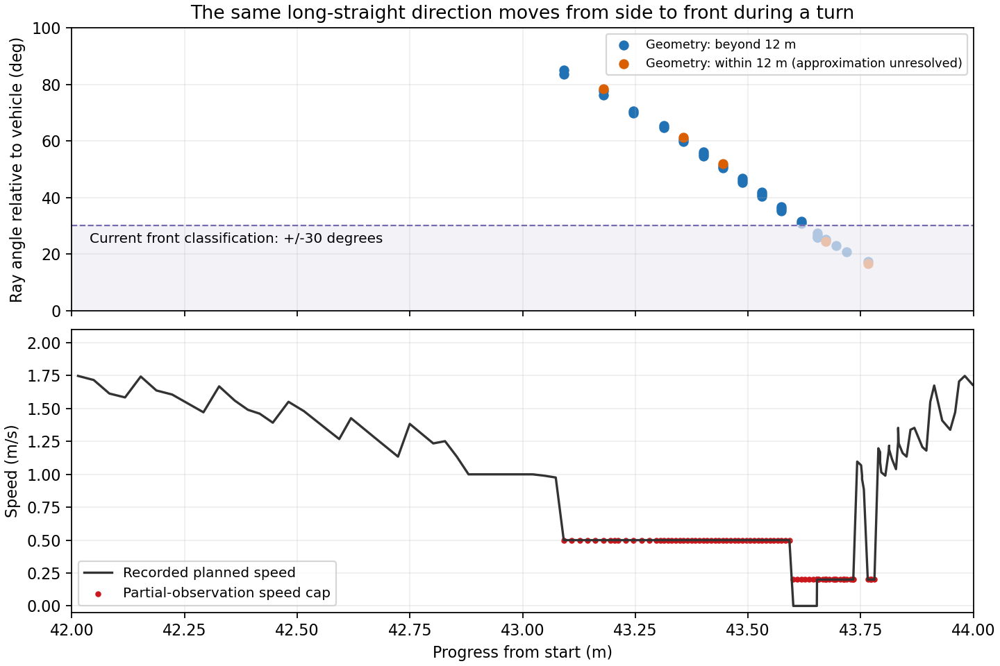

# 새 공식 월드의 단독 속도 손실 진단

11/2 공식 월드 `official_facility_v1/run1`의 저장 입력을 사용한다. 35.606초 완주 당시의 42–44 m와 신호 기둥 앞 0.5–4 m가 대상이다. 이 폴더의 기하 정답은 평가에만 쓴다.

## 무반환의 방향 변화

회전 보정 전 원시 스캔에 이미 `+inf`가 있었다. 후방 마스크가 전방에 옮겨간 것이 아니다. 고유 스캔 57개에서 전방 ±100°의 무반환 39개를 확인했다. 코너를 도는 동안 같은 긴 직선 방향이 차체 기준 약 85°에서 17°로 바뀌었다. 제어기의 정면 ±30° 분류에 들어가면서 측방 0.5 m/s에서 정면 0.2 m/s 상한으로 내려갔고, 정면 공백 폭 기준과 해제 대기도 발생했다.

[inspect_rays.py](inspect_rays.py)는 당시 차체 정답을 취득 시각으로 보간하고 공식 SDF 상자 visual과 광선을 교차한다. [rays.json](rays.json) 결과:

| 항목 | 결과 |
|---|---:|
| 예측 첫 표면이 12 m 밖인 무반환 | 34개 |
| 예측 첫 표면이 12 m 안인 무반환 | 5개(약 4.74–11.98 m) |
| 대조한 실제 유효 반환 | 710개 |
| 유효 반환과 예측 거리의 절대 차이 중앙값 | 1.18 mm |
| 최대 차이 | 4.48 m |

**5개를 렌더링 결함으로 확정하지 않는다.** 순차 광선은 직전 고빈도 프레임을 쓰고 이 계산은 저장 정답을 보간한다. 멀리 있는 얇은 기둥·비스듬한 벽에서는 작은 각도 차이도 첫 표면을 바꾼다. 원본 box visual을 비교했으며 배치된 렌더 mesh·자차 기하·plane·구형 광원까지 재연한 검사가 아니다. 가까운 곳에 장애물이 없다는 보증이나 무반환을 자유 공간으로 바꾸는 근거로 쓰지 않는다.

실행 요약 JSON과 `run.log`는 생성됐으며 내부 실행은 0을 보고했다. 실행 담당이 받은 외부 WSL 세션 코드는 1로 불일치했으므로 종료 상태 전체를 통과로 올리지 않는다. 계산 산출물의 범위와 실행 래퍼 상태를 구분한다.

## 현재 관측한 반대 벽 속도 상한 비교

신호 기둥 근처에서 선호 벽이 짧아져도, 기존 양측 관측·경로 확인을 거친 반대 벽 경로가 남는다. 현재 고속 허가는 경로가 선호 벽에서 왔는지도 요구하므로 이 구간의 상한은 1 m/s다.

[compare_alternative.py](compare_alternative.py)는 **명시 단독 구성(`solo_route_only`)에 한해** 현재 스캔의 승인된 반대 벽 경로에도 고속 상한을 열었을 때를 별도 모듈로 비교한다. 경로 확정, 전방 실제 반환, 길이·곡률·제동·점유 한도는 그대로다. 런타임 소스는 변경하지 않는다. 저장 궤적이 고정이므로 계산상의 명령 증가를 랩 시간 단축으로 부르지 않는다. 결과를 보고 폐루프 시험 여부를 정한다.

저장 입력 대조는 1,900판단 모두 기준 출력과 일치했다. 별도 후보는 209회 속도 명령만 달라졌고 최대 증가 1.593 m/s, 조향 변경 0, 정지→전진 변경 0이었다. [비교 결과](alternative.json). 근거가 있어 [별도 단독 1랩 시험](../solo_alternative_speed_v1/PLAN.md)을 준비한다. 원래 무반환 상한은 그대로다.
