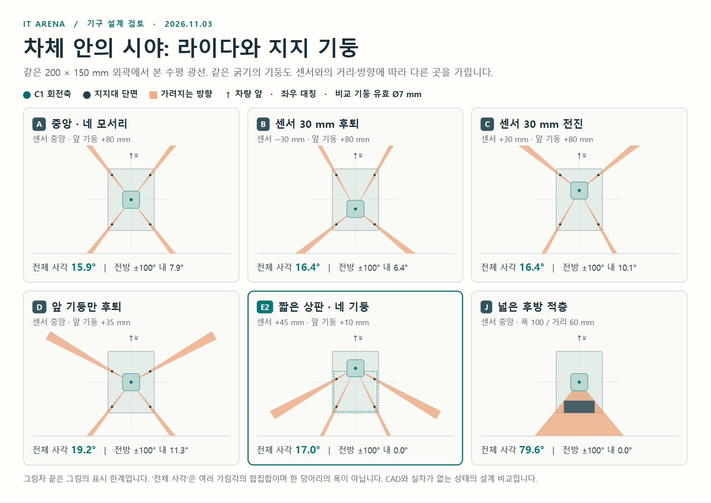

# C1 장착: 네 기둥, 짧은 상판, 후방 적층 비교

**기구팀 최종 목업 제안(JR):** 차체와 앞범퍼는 유지하고 **C1 회전축을 차체 중심보다 50 mm 앞**에, 1차 광축 높이를 **지상 75 mm**로 잡는다. 지지 기둥은 앞줄 (+10, ±62), 뒷줄 (−80, ±52) mm. 뒤 가로 보강은 광학창 위·아래에서 연결하고 전선도 기둥으로 모은다. **상판은 C1 위의 첫 부품 선반**이다. 여기에 PDB 한 장, 그 위 별도 층에 나머지 한 장을 두고 무거운 부품은 가능한 한 아래에 둔다. 기본 15안에 후방 보강·전진 6안을 추가한 결과다. 범퍼/타이어 홈, 구동계·상부 전장품·하중까지 확정한 제작 도면은 아니다.

[대표 9개 평면도 한 장 PNG](c1_mount_topview_onepage.png) · [하드웨어팀 전달 ZIP](hardware_handoff.zip) · [치수 조절 HTML](index.html) · [J 전진·보강 비교 PNG](j_forward_comparison.png) · [저상 C1·PDB 적층 PNG](low_c1_pdb_stack.png) · [기본 6안 PNG](designs.png) · [기본 15안 결과](results.json) · [J 전진·PDB·높이 결과](stack.json) · [1,280개 위치/지름 조합](sweep.csv) · [후방 연속 가림 56조합](rear_width.csv) · [위치 변동 8,505조합 요약](tolerance.csv) · [72개 상판 처짐 예시](plate_screen.csv)

## 전진한 J와 낮은 센서층: 최종 제작 비교

| x=차체 중심 기준 | 레이저 높이에 있는 구조 | 합산 사각 | 해석 |
|---|---|---:|---|
| J0 / J50 / J60: 센서 0 / +50 / +60 | 같은 뒤판 하나, 폭 100·앞면 x=−60 mm | 79.6° / 48.9° / 45.2° | 센서를 50 mm 전진시키는 이득이 크고 그 다음 10 mm의 추가 이득은 3.6° |
| JS: +50 | 위 뒤판 + Ø7 지주 네 개, 앞뒤 모두 y=±62 | 64.7° | 판만 계산한 48.9°로 완조립 사각을 예상하면 안 됨 |
| JP: +50 | 폭 140 × 깊이 100 mm의 불투명 단면이 x=0까지 접근 | 108.9° | 창과 같은 높이를 큰 박스나 보강벽이 점유하는 경우 |
| **JR: +50** | 가로 보강과 PDB는 창 밖; 앞 Ø7 지주 ±62, 뒤 Ø7 지주 **±52** | **16.6°** | 앞·뒤 지주에 나뉘며 전방 ±100°와 정후방은 열림. 실물 가림·주행 검증 전 |

+50에서 C1의 앞면–차 외곽 여유는 중심 사각 근사 22.2 mm, +60에서는 12.2 mm다. +50은 정중앙에서 공칭 최소거리 50 mm가 앞범퍼와 일치한다. +60은 범퍼 바로 앞 10 mm가 최소거리 이내다. 위치를 최대로 밀기보다 실물 앞범퍼·케이블·고정 구멍·충격 여유에 따라 +45~+50부터 검토한다. 앞쪽 기둥을 뒤로 보내지 못하면 기본 A도 후보이다. 아래 E2는 짧은 선반·위치 변동을 비교한 관련안이고, 최종 JR은 **낮은 층에서 뒤 타이어와 기둥이 겹치지 않도록** 개선했다.

**라이다를 얼마나 내릴 수 있는가:** 팀의 Ø65 타이어, 임시 축거·윤거 135 mm, 폭 12 mm를 수평 직립 원기둥으로 잘랐다. 광축 60 mm이면 +50 위치에서 바퀴만으로 직진 82.2°, 앞바퀴를 같은 방향으로 ±0.45 rad 돌린 예시 81.0°가 가려진다. JR 지주까지 합치면 각각 **98.9°, 97.6°**이다. 광축 75 mm면 타이어 꼭대기보다 10 mm 높아 타이어 차폐는 0°, JR 합계 **16.6°**다. 70/80/95 mm도 이 이상화된 타이어 모델에서는 0°이므로 실제 펜더·범퍼·조향 링크와 낮은 상대차의 단면을 보고 고른다. 단순 좌우 동일 조향이고 실제 아커만, 타이어 변형·장착 편차, 차체 개별 부품·광학창 유한 크기, 상대차 높이는 모델 밖이다. 기존 단순 차체 상자 속에 센서를 묻으면 이 결과가 성립하지 않는다.

광축 75 mm 예시에서 설치면은 45.2 mm, 센서 꼭대기는 86.5 mm다. 층간 유효 높이 50 mm의 예에서는 첫 선반 밑면이 95.2 mm로, 그 위 공간은 전장에 쓸 수 있다. 이때 **아래층 판은 휠 자리를 파거나 안쪽으로 좁혀야** 한다. 뒷바퀴 안쪽은 |y|=61.5 mm이고, |y|=62인 Ø7 뒤 지주가 이 높이까지 내려가면 4 mm 겹친다. JR의 |y|=52로 옮기면 명목 6 mm(Ø10이면 4.5 mm)가 남는다. 낮은 실물 구조에서는 핀/나사 머리까지 확인한다.

**PDB와 높이 예산:** [주최 측 PDB 원문](https://github.com/MOSW626/istech-it-arena/blob/17178293029d446fa603f3229556dd865bbddd38/docs/hardware/power-modules.md#L43-L56)은 J01·M01 두 장 각각 100 × 140 mm, 적층·방열·커넥터 접근을 안내한다. [J01 평면도](https://raw.githubusercontent.com/MOSW626/istech-it-arena/17178293029d446fa603f3229556dd865bbddd38/docs/hardware/PM_KAIST-MR-J01_Preliminary.pdf#page=2)·[M01 평면도](https://raw.githubusercontent.com/MOSW626/istech-it-arena/17178293029d446fa603f3229556dd865bbddd38/docs/hardware/PM_KAIST-MR-M01_Preliminary.pdf#page=2)에는 결합한 XT-30·케이블 포함 높이나 층간 간격이 없다. 100 mm를 좌우 폭, 140 mm를 앞뒤로 두면 차 폭에 대해 좌우 각 25 mm, 반대로 두면 각 5 mm다. 긴 방향 배치의 선반 예는 150 × 140 mm, x=−95…+55, 앞 지주 밖 돌출 45 mm이다. 같은 아래 보 모델에서 0.081 mm 처짐(짧은 25 mm는 0.014 mm)이며 조립체 강성 보증은 아니다. 관통 지주가 보드/포트를 침범하지 않게 아래 지주는 첫 선반에서 끝내고, 보드 홀에 맞는 별도 고정으로 위층을 잇는다.

높이를 확정하려면 첫 선반 밑면에 **선반 두께 + 첫 보드 받침 + 첫 보드의 실제 점유 높이 + 층간 접근/방열 여유 + 다음 보드·플러그·상부 부품의 실제 점유 높이**를 더한다. [높이 상한 400 mm·350 mm 권고](https://github.com/MOSW626/istech-it-arena/blob/17178293029d446fa603f3229556dd865bbddd38/MANUAL.md#L167-L172)를 남는 실장 공간으로 오해하지 않는다. 배터리·Jetson·카메라/후방 마커까지 패키징·무게중심을 확인해야 한다.



## 가능한 각도와 기구 치수

기준 외곽은 200 × 150 mm, 원점은 그 사각형의 중심, +x는 전방, +y는 좌측이다. 실제 타이어 조향·차체·범퍼·볼트·마커를 포함한 검차 외곽은 별도 확인한다. [구매 C1 실행 프로필](../../../../src/arena_description/config/b0183_c1.yaml)은 x=+60 mm, z=95 mm, 정후방 ±30° 마스크다. 이는 실물 측정값이 아니다. 이번에는 라이다 층에 큰 부품을 두지 않고 주로 지주와 배선만 남긴다는 설계 의향을 기준으로 삼았다. [수집한 부품 CAD](../../../../docs/hardware/CAD_COLLECTION_2026_10_24.md)는 있으나 이 실험에 실제 차체 조립 CAD/확정 기둥 치수는 제공되지 않았다.

| 배치 | 유효 Ø7 mm 명목 | Ø8 mm 명목 | Ø10 mm 명목 | Ø7~10 mm + 위치 변동 표본 전체 범위 |
|---|---:|---:|---:|---:|
| A · 중앙, 기둥 x=±80 | 15.9° | 18.1° | 22.7° | 14.8~24.4° |
| E2 · +45, 앞 기둥 +10 | 17.0° | 19.5° | 24.3° | 15.3~27.4° |

각도는 **360°에서 가려지는 방향들의 합집합**이다. A는 한 곳이 약 4°인 네 그림자다. E2의 Ø7 mm 앞 기둥은 좌우 약 119.4°에 폭 5.64°씩, 뒤 기둥은 좌우 약 153.6°에 폭 2.87°씩 그림자를 만든다. 곧은 정후방도 열려 있다. 맞물린 그림자는 두 번 더하지 않았다. 단일 원형 지주의 차폐폭은 `2 asin(D/(2r))`, 중심각은 `atan2(y, x − 센서x)`다. 예컨대 E2의 앞 기둥 그림자 하나는 센서에서 1 m 떨어진 곳에서 폭 약 98 mm가 된다. 총각과 연속 가림폭 모두 중요하다.

각 유효 지름에서 센서 x, 앞·뒤 기둥 x, 앞·뒤 좌우 반간격에 각각 −5/0/+5 mm를 적용해 243개 좌우대칭 조합씩 비교했다. 실제 제작 공차·확률분포가 아니다. Ø10 mm E2에서도 앞 기둥 그림자가 시작하는 가장 안쪽은 106.45°였다. 덜 뒤로 보낸 E(+40/+15)는 같은 조건에서 98.44°까지 들어왔다. 축의 좌우 이동, 비대칭 비틀림, 전선 이동, 외형 및 구멍의 기구 간섭은 도면/실물에서 다시 본다.

- **지름을 억지로 줄이지 않아도 된다.** 대변 6 mm 육각 지주의 최대 대각은 6.93 mm이다. [시판 M3 알루미늄 치수 예](https://uk.farnell.com/wurth-elektronik/970400366/standoff-hex-female-female-40mm/dp/2987949)는 단면의 근거이며, 길이 40 mm를 제안하는 것은 아니다. [제조사 M4 강재, 길이 50 mm·대변 7 mm 도면](https://www.we-online.com/components/products/datasheet/970500471.pdf)은 대각 약 8.08 mm이다. 조립 방향을 모르면 외접원, 슬리브·타이·케이블이 지나면 스캔 높이에서 **실제로 차지하는 폭**을 쓴다. 임의의 하중 등급이나 제품 채택을 뜻하지 않는다.
- **C1과 상판은 서로 다른 층이다.** [SLAMTEC 기계 도면, p.18](https://bucket-download.slamtec.com/2d4664be9f9f5c748f3b608f2cf1862962b168eb/SLAMTEC_rplidar_datasheet_C1_v1.1_en.pdf#page=18)의 외형 55.6 × 55.6 × 41.3 mm와 광학 기준 높이 약 29.8 mm를 적용하면 스캔 높이 95 mm일 때 설치면은 약 65.2 mm다. E2에서 몸체를 축 중심 사각으로 근사하면 앞끝까지 약 27.2 mm가 남는다. 하판 기준 층간 **유효 높이**를 50 mm로 잡는 예에서는 몸체 상단과 위층 밑면 차이 8.7 mm다. 커넥터, 체결구, 카메라, 송·수광창 전체, 기울기·처짐까지 들어가는 제작 여유인지는 STEP 단면으로 확인해야 한다.
- **선반을 잘라도 차체를 줄일 필요는 없다.** E2 선반 예시는 x=−95…+35, y=±70 mm(130 × 140 mm), 지지점은 x=−80/+10, y=±62이다. 100 × 140 mm 보드 하나의 명목 평면은 방향을 맞추면 들어가지만 140 mm 방향은 선반과 폭이 같으므로 커넥터·여유·고정 위치까지 맞는다는 뜻은 아니다. 두 보드·무거운 전원부는 각각 창 밖의 층을 검토한다. 상판 앞쪽이 더 필요하면 광학창 위의 접힌 가장자리/리브, 낮은 앞범퍼로 지지하는 별도 카메라 브래킷을 검토한다. C1 케이스를 구조 기둥으로 쓰지 않는다.

## 센서 위치, 기둥 위치, 실제 공간의 차이

0°가 정면이다. 모든 %는 **같은 차체 고정 영역의 숨은 점 비율**이지 사고/검출 확률이 아니다. 전방 대각은 x=120…720, |y|=100…400, 바로 옆은 x=−80…80, |y|=100…300, 뒤 대각은 x=−720…−120, |y|=100…400 mm. 10 mm 간격 셀 중심, 양쪽 합산. 센서를 옮겨도 평가 구역은 그대로다. 광선 최소거리 50 mm도 구분해 계산했다.

| 시안(기본 Ø7 mm) | 총 사각 | 전방 대각 가림 | 바로 옆 가림 | 뒤 대각 가림 |
|---|---:|---:|---:|---:|
| O · 창 높이에 지지대 없음, 중앙 | 0° | 0% | 0% | 0% |
| R · 실행 프로필 위치와 후방 단일 60° | 60.0° | 0% | 0% | 57.8% |
| A · 중앙, 네 모서리 | 15.9° | 7.8% | 0% | 7.8% |
| B · 같은 기둥, 센서 30 mm 후퇴 | 16.4° | 9.8% | 0% | 5.9% |
| C · 같은 기둥, 센서 30 mm 전진 | 16.4° | 5.9% | 0% | 9.8% |
| D · 중앙 유지, 앞 기둥만 +35로 후퇴 | 19.2° | 4.2% | 2.2% | 7.8% |
| E2 · 센서 +45, 앞 지지 +10 | 17.0° | 0% | 8.1% | 12.2% |
| F · 뒤 기둥만 2개, 중앙 | 7.9° | 0% | 0% | 7.8% |
| J / K · 뒤 연속폭 100 / 140 mm, 앞면 거리 60 / 45 mm | 79.6 / 114.5° | 0 / 0% | 0 / 0.6% | 70.0 / 91.9% |

센서를 뒤로 빼면 앞 기둥 하나의 각폭은 줄지만 그림자 중심이 37.8°에서 약 29.4°로 정면 쪽에 온다. 반대로 센서를 앞으로 빼면 약 51.1°로 옮긴다. **그림자가 좁아지는 것과 보고 싶은 영역이 깨끗해지는 것은 다르다.** 직선 앞 범퍼 폭 띠(x=120…1120, |y|≤75)의 Ø7 네 기둥 A~E2 점 표본은 모두 가림 0%였다. 이 구역이 앞범퍼에서 20 mm 이상 떨어져 있음에 주의한다. R/L/O60에서는 축이 앞범퍼에서 40 mm 뒤라 정중앙 범퍼 바로 앞 약 10 mm가 50 mm 최소거리 안이다. E2의 축–앞범퍼 거리는 55 mm다. 이는 센서와 범퍼의 기하이지, 접촉 직전 안정 검출 보장이 아니다.

**전선의 경로:** A의 뒤 왼쪽 기둥을 묶음 포함 Ø9 mm로 둔 G는 총 17.0°, 앞 대각 가림 7.8%다. 같은 A에 별도로 x=42, y=16 mm를 통과하는 Ø5 mm 전선을 둔 H는 총 22.2°, 앞 대각 가림 15.7%다. H에서 그 전선은 축으로부터 약 45 mm 거리의 불투명 단면이다. 자체 거리값이 공칭 최소거리보다 가깝다고 해서 뒤의 물체가 보이지는 않는다. 묶을 때도 타이 머리와 전선이 기존 기둥 그림자 밖으로 얼마나 나오는지를 본다.

**점 하나와 상대차는 다르다.** 별도로 같은 공간의 50 mm 그리드에 지름 50/150 mm의 불투명 원형 단면을 놓고, 0.72° 광선 500개 × 시작 위상 4가지에서 표적에 닿는 광선을 셌다. 차체와 겹치는 표적은 제외했다. 50 mm 표적의 앞 대각에서 A는 0점이 0/576, B는 2/576, E2는 0/576, H는 11/576이었다. 뒤 대각의 150 mm 표적은 R에서 **196/568**번 광선이 하나도 닿지 않았고 E2는 0/568이었다. 그러나 E2에서도 50 mm 뒤 대각 표적은 **28/576**번이 3점 미만이었다. ‘3점’은 비교용 수치일 뿐 제어기 검출 기준이 아니다. 좌우 y=±225 mm에 둔 평행 벽의 x=−500…+1000 mm 구간에서 5 mm 격자로 본 왼쪽 최장 연속 결손은 A 40 mm, E2 60 mm, G 55 mm, H 200 mm, R 170 mm였다. 특정 표본 위치·위상을 바꾸면 수치도 바뀐다. 반사율, 실제 광학창의 크기/상하각, 스캔 중 운동과 군집화, 실차 속도는 포함하지 않았다. [C1 공칭 사양](https://www.slamtec.com/en/c1/spec)

## 후방 60°의 현실성

레이저 높이에서 센서 바로 뒤를 **연속해서** 막는 직사각 부품의 폭을 W, 광축에서 가장 가까운 정면까지의 거리를 d라 하면 전체 가림각은 `2 atan(W/(2d))`다. 60° 안에 넣으려면 **W ≤ 1.155d**여야 한다. 거리 45/60/90/120 mm일 때 최대 폭은 약 52/69/104/139 mm다. 폭 100 mm를 60 mm 뒤에 두면 79.6°, 폭 140 mm를 45 mm 뒤에 두면 114.5°다. 예컨대 E2의 x=+45에 대해 x=−100…0 구간에 100 × 140 mm 판을 세로 전체가 막히는 박스로 배치하면 후자와 같다. 같은 보드를 창 아래에 수평 장착해 광학 경로를 침범하지 않으면 그 **보드**가 가리는 각은 0°다. 뒤 마커(50 mm)도 같은 높이에 있고 그 앞면이 축에서 125 mm 뒤라면 약 22.6°이므로 지지대뿐 아니라 판 자체의 높이도 중요하다.

## 상판 강성: 기둥을 없애는 대신 상판 길이를 조정

상판 끝의 등가 하중 7.36 N(0.25 kg × 3g, 임의 비교 하중), [6061-T6 탄성계수](https://www.starrapid.com/wp-content/uploads/2019/10/6061-T6.pdf) 69 GPa, 무공 유효 띠 폭 60 mm·두께 2 mm를 가정했다. 앞줄이 이상적으로 고정된 외팔보의 `δ=FL³/(3EI), I=bt³/12` 비교다. 3g는 실제 충격 측정값이나 통과 기준이 아니다.

| 선반 배치 | 앞 지지로부터 끝까지 | 끝 처짐 예시 | 고정단 휨응력 예시 |
|---|---:|---:|---:|
| A · 전장 상판 | 20 mm | 0.007 mm | 3.68 MPa |
| E2 · 짧은 상판 | 25 mm | 0.014 mm | 4.60 MPa |
| E2 · 같은 네 기둥에 전장 상판 | 90 mm | 0.648 mm | 16.55 MPa |
| F · 뒤 기둥만, 전장 상판 | 180 mm | 5.18 mm | 33.11 MPa |

단순 모델에서는 E2 짧은 판이 전장 판보다 앞 돌출부 처짐이 약 47분의 1이다. **조립체 전체의 실제 변형량 또는 내구성 판정은 아니다.** 두 기둥 사이 판의 굽힘, 체결부 회전·풀림, 판 개구부, 실제 적재 위치, 지주의 횡방향 변형, 진동·충격·피로는 별도다. F의 뒤 한 줄은 접합부가 모멘트를 전달하지 못하면 고정단 가정 자체가 성립하지 않는다. 창 높이의 지지대를 완전히 없앨 수 있고 충분한 강성을 다른 높이에서 만들 수 있다면 O가 광학적으로 가장 좋다. 무조건 지주를 빼거나 C1을 높이 올릴 이유는 없다. [낮은 상대차를 놓칠 수 있는 근거](../../../../docs/autonomy/G2_PREPARATION_2026_10_13.md)

## 목업에서 확인하고 소프트웨어로 넘길 것

1. 200 × 150 mm 하판 모형에 실제 C1·상판·마커·케이블·체결구를 얹는다. E2와 A 고정 위치를 표시해 같은 부품으로 바꾼다. 실물 광축 좌표, 지지대와 전선이 차지하는 각도, 가장 가까운 장애물까지 거리, 창의 상하 여유를 CAD 수평·측면 절단으로 확인한다. 조향 중 외형과 카메라 전방/상향 시야도 확인한다.
2. 상판 실제 적재 상태에서 앞 모서리에 **알려진 힘**을 가하고 모서리 처짐·대각 비틀림을 측정한다. 허용 변형은 광학창·하판 부품과의 실제 여유에서 정한다. 조립 전후/진동 후 배선 재진입, 체결 풀림, 센서 자세 변화를 확인한다. 재질·하중·지지 방식이 다르면 위 표의 수치를 그대로 쓰지 않는다.
3. 빈 장착대와 최종 조립 상태에서 같은 평행 벽·작은 세로 표적·대표 차량 단면을 놓고 원시 스캔을 비교한다. 앞 대각, 옆에서 뒤 모서리로 이동하는 경로, 접근 거리(예: 0.2/0.5/1 m)를 바꿔 광선 각도별 유효율·고정 근거리 자기반사·외부 표적의 누락을 따로 본다. 95 mm보다 낮은 차체도 따로 시험한다. 빈 방향을 무조건 자유 공간 또는 기둥으로 단정하지 않는다.
4. 확정 기구에 맞춰 센서 TF/운동 보정 오프셋, 실제 지지점의 개별 가림 및 자기반환, 보호·벽 추종·측후방 재관측을 스캔 재생과 폐루프로 갱신한다. 현행 ±100° 관심 범위는 시안 비교 참고치이며 기구팀 요구 규격으로 고정하지 않는다. 이전 후방 60°에서 [옆차가 사라졌다 재등장한 시험](../right_reapproach_v3/README.md)은 배치 변경 후 다시 볼 대표 장면이다. 이 보고서는 Gazebo 주행·실차 내구·검차·제동 성적을 새로 확보한 것이 아니다.

**재현:** 저장소 루트에서 아래 순서로 실행한다. 네 Python 단계는 표준 라이브러리만 사용하며 시뮬레이터 기본 설정을 바꾸지 않는다.

```text
python scripts/study_c1_mount.py
python scripts/screen_c1_mount_structure.py
python scripts/study_c1_stack.py
python scripts/render_c1_mount_study.py
node scripts/capture_c1_mount_study.cjs <playwright 모듈 경로> <Chromium 실행 파일 경로>
```

마지막 단계는 그림 3장을 캡처하고 HTML 21개 시안과 Python 결과, 고정된 뒤판에서 센서만 이동하는 동작과 지름 조절, 모바일 너비를 대조한다.
