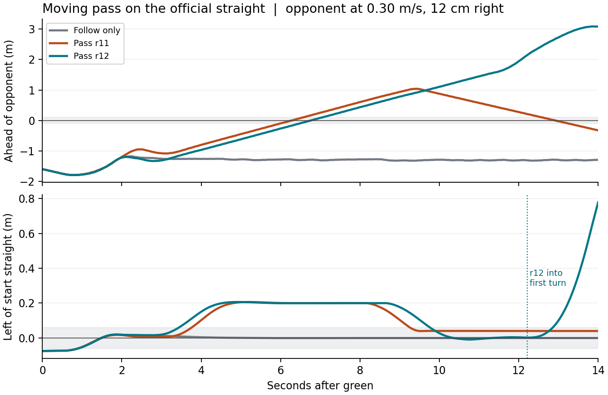

# 직선 저속 이동차 추월 — 첫 선택형 후보

목표는 계속 움직이는 0.30 m/s 앞차를 따라잡고, 나란히 지난 뒤 앞에서 원래 주행선으로 돌아와 계속 달리는 것이다. [r8 추종 비교](../moving_follow_continuity_v1/README.md)의 같은 14초 장면을 사용한다. 이전 정지차 우회나 단순히 앞차에 가까워진 것을 추월로 세지 않는다.

- 시뮬레이션 명시 옵션 `--moving-pass-trial`을 추가했다(기본 꺼짐). 기존 `--handoff-continuous-pace` 및 실제 G1/G2 교통 구성이 필요하다. 광선 5회에서 자차 운동을 보정한 앞면의 지속 전진과 속도 차이를 보고, 두 벽이 현재 관측되고 옆 경로가 제동·점유 검사를 통과할 때만 최대 0.65 m/s 명령으로 진입한다. 고정된 세계 좌표·상대 속도 각본·차량 ID는 제어 입력이 아니다.
- 현재 뒤쪽 반환으로 상대를 다시 확인하고, 보이는 점에서 차체 규격 대각선 0.25 m와 측정/이동 여유만큼 앞까지 보수적으로 잡아도 자차 후면 뒤인지 확인한다. 서로 다른 스캔 두 번과 현재 복귀 띠가 필요하다. 같은 스캔의 반복 처리는 확인 횟수를 늘리지 않는다. 보이지 않거나 여러 후보로 갈려 대응할 수 없으면 그 사실로 복귀를 시작하지 않는다. 이 조건은 신원이나 미래 가속을 보장하지 않으며 곡선 또는 다수 상대 추월은 범위 밖이다.
- JR60P20·Ø20 배선·후면 ID49 높이 140 mm, 단일 모터축 엔코더·현행 감속비·C1 10 Hz 순차 취득, 독립 보호 및 STOP을 유지한다. 후방 전체가 보이는 구성은 아니다. 구현은 GPT가 담당하며 시뮬 실행·수거는 GPT-6 Luna가 담당한다.

## 현재 근거

| 단계 | 결과 |
|---|---|
| 관련 회귀 | `unit4.log`: 204 통과. 실제 후방 반환 두 번·중복/소실·부분 차체·기준 시각 변경·앞쪽 새 점유/미관측·옵션 OFF·정상 초기화 포함. 이전 시험 입력이 옛 후방 마스크를 쓰거나 epoch/필수 옵션을 빠뜨린 실패는 구현 성능 결과로 세지 않는다. `unit1`~`unit3` 로그 보존. |
| r8 저장 입력 | `replay1.json`: OFF 742판단 모두 기존 출력/진단과 동일. ON은 센서 이력 5회 뒤 t=9.82 s에 .65 m/s 진입 명령. 633호출에서 진입 경로 선택. 742건의 전체 상세 차이는 진단 필드 추가도 포함하며 742개 속도가 바뀌었다는 뜻이 아니다. 실제로는 옆으로 움직이지 않는 추종 입력을 재생했으므로 순위 역전/복귀 증거가 아니다. |
| Gazebo | `closed_loop_v1`은 실행 전 등록 사본이다. HOLD에서 시뮬 상태 필드를 누락하면 판단기가 제어기 상태를 잘못 분류하는 것을 발견해 주행 전 고쳤다. 최초 실제 실행은 `closed_loop_v2/registered.json` 조건을 따른다. |

`before.zip`은 기존 파일 여섯 개의 변경 전 바이트다. `closed_loop_v2/sources.zip`은 등록한 제어기·실행기·시설 소스 스냅샷이다. 기존 추종 평가의 150 mm·계속 뒤 유지·차체 전체 도로 안 판정은 그대로 보존한다. 추월 판정은 별도의 `review.py`로 상대 지속 이동, 접촉·바퀴·간격, **뒤→옆→앞→복귀→0.20 m 이상 진행**, 추종 대비 진행 증가, 명시 STOP/정상 종료를 구별한다.

## 첫 실제 주행: 왼쪽 진입 뒤 정체

[판정](closed_loop_v2/review.json)은 **추월 실패**다. 상대는 1초 평균 0.294~0.303 m/s로 진행했지만, 자차는 2.460 m 진행해 같은 시간 추종 4.500 m보다 짧았다. 횡방향으로는 0.247 m 이동했으나 가장 가까워져도 차체 중심이 상대보다 0.664 m 뒤였다. 접촉 0, 연속 간격 하계 0.467 m, 노면 밖 최대 두 바퀴, STOP·정상 종료는 확인했다.

녹색 뒤 2.719초에 왼쪽 0.24 m 편이 경로로 진입했다. 5.119초부터 마지막까지 `entry_guide_current_wall_too_short`로 멈췄고 독립 보호층은 진행을 막지 않았다([판단 기록](closed_loop_v2/diagnostic.json)). [정지 직전 광선](closed_loop_v2/wall_probe.json)을 보면 긴 전방 벽 조각(약 1.44 m)과 뒤쪽 현재 반환(약 0.25 m) 사이에 실제 차체 지지대의 가림 9광선·약 0.032~0.035 m가 있다. 이전 기준은 한 조각만으로 후륜축까지 닿도록 요구해, 전방에 길이 보여도 후보를 잃었다. 뒤쪽 짧은 조각이 벽이라는 보장은 없다. 후속판은 실제 두 면의 정렬을 경로 기준에만 사용하고, 짧은 면의 이동 여유·모든 점유와 가림·제동 검사는 유지한다. `witness_before.zip`에 변경 전 바이트를 보존했다.

[수정 후 실패 입력 재생](witness_replay1.json): 벽 길이 부족 485호출 중 389호출은 진행 후보, 96호출은 실제 반환점과의 여유 부족으로 정지를 유지했다. r8 추종 OFF 742판단은 동일했다. `unit5.log`는 관련 회귀 218통과(좌/우, 미설명 결측, 광선 사이 점유, 짧거나 기울어진 면, 넓은 가림 포함). 이는 정지했던 당시 위치를 그대로 재생한 값이다. [후속 실제 주행 사전 등록](closed_loop_v3/registered.json)은 같은 14초 장면·기존 기준을 유지했다.

## 두 번째 실제 주행: 벽 기준은 회복, 추월은 여전히 실패

[결과](closed_loop_v3/review.json): 2.500 m 진행, 상대보다 최대 0.740 m 뒤, 연속 간격 하계 0.542 m, 접촉 0, 최대 두 바퀴 이탈, STOP·정상 종료. 164회 HOLD는 모두 점유/제동 여유 때문이고 벽 길이 부족은 0회였다. [실제 판단·명령·차체 속도](closed_loop_v3/diagnostic.json)에서 같은 스캔을 마지막까지 사용하는 시각마다 양수/0 명령이 반복됐다. 출력의 가속 제한이 매번 처음부터 적용돼 5초 이후 차체는 대부분 0.02~0.04 m/s였다.

명령 여유가 정확히 0인 [149개 호출의 반환 좌표](closed_loop_v3/nearby_returns.json)는 모두 자차 원점보다 뒤에 있고 바깥 벽 쪽이었다. 예: 녹색 후 6.499초 현재 점 x=−0.199~−0.074 m, y=+0.176~+0.178 m, 점유 여유 0.109~0.111 m. 당시 앞차는 계속 멀어졌다. 남은 15회는 간격이 0보다 크더라도 제동식의 잔여 거리 안이라 정지했다. 뒤쪽 점이나 명시 정지를 지우는 대신, 여러 스캔에서 막히고 측정 속도가 낮으며 상대의 보수적 후단이 아직 앞에 있는 경우 **관측된 기존 추종 경로로 돌아갈 수 있는지** 비교한다. 추월 중단과 완료는 별도 판정이다.

## 정체 뒤 복귀 시안과 진입 전 폭 선택

복귀 시안 두 개는 **미채택**이다. [시안 1](abort_probe1.json)은 506호출에서 상대가 충분히 앞인데도 추월 중 갱신하지 않은 추종기의 구조 가림 이력이 운동 이력 밖으로 밀려 대안을 내지 못했다. [시안 2](abort_probe2.json)는 매 새 스캔에서 추종도 관측해 그 오류는 없어졌지만, 벽 옆으로 이미 나온 위치에서 추종기가 돌아갈 경로를 확인하지 못했다(`follow_boundary_unconfirmed`). [실제 명령 비교](abort_replay2.json)는 5초 이후 450호출 중 0명령 154회·평균 목표 0.422 m/s로 변함이 없었다. 이 값은 가속 제한 전 계산값이며 실제 차체 속도가 아니다. 이력 리셋·강제 조향·양수 속도로 교체하지 않았다. 시안 1은 당시 변경을 되돌려 만든 소스 사본(`abort_draft1_reconstructed.zip`), 시안 2는 당시 바이트(`abort_draft2.zip`)다. 별도 시뮬레이션은 돌리지 않았다.

r11은 추월을 시작하기 전에 양쪽 벽과 실제 앞면으로 **나란히 달릴 폭**을 계산한다. 차체 폭, 측정 여유, 양옆 광선의 서로 다른 취득 시각, 1 cm의 조향 추종 여유(시험값)를 반영한다. 비어 있다고 단정하지 않고 같은 점유·제동 검사를 다시 통과한 편이만 사용한다. 폭이 부족하면 추종기를 그대로 사용한다. `unit8.log` 221통과 및 r9~r11 출처 검사 통과. [별도 각본](offset_course.json)은 상대를 도로 진행 방향 오른쪽 12 cm에 놓고 같은 속도·시간을 유지한다. 중앙 실패의 재시험이나 해결 증거가 아니다. 같은 오른쪽 배치에서 구한 OFF와 ON을 대조하고, 복귀는 상대의 치우친 선이 아닌 원래 도로 중앙선 기준으로 본다.

- [중앙 앞차 입력](admission1.json): 742호출 모두 기존 추종과 속도·조향 동일. 590호출은 현재 폭 부족, 152호출은 진입을 요청하지 않았다. 중앙 상대의 실제 추월 성공으로 세지 않는다.
- [오른쪽 12 cm, 추월을 끈 대조 주행](closed_loop_side_follow_1/review.json): 같은 공식 직선·0.30 m/s·14초. r8 추종 전 판정 통과, 진행 4.500 m·연속 간격 하계 0.971 m·접촉/노면 이탈 0·STOP/정상 종료.
- [같은 시각의 폭 계산](width_example.json): 녹색 후 2.519초의 왼쪽 반환에서 중앙 상대 때 36.5 cm, 오른쪽 상대 때 47.1 cm가 보였다. 후자에서는 자차 중심이 왼쪽 벽에서 21.2~23.4 cm인 범위가 남아 왼쪽 20.2 cm 편이를 제안했다. 전자는 허용 구간이 없었다. 이 폭은 전체 트랙 폭이나 공식 최소 차간거리 규정이 아니다.

## 오른쪽 12 cm 상대: 순서 역전 뒤 정지·접촉

[최초 ON 주행](closed_loop_side_pass_1/review.json)은 **실패**다. 녹색 후 2.919초 진입, 6.000초 나란히, 6.850초 앞섬, 8.019초 후방 현재 반환 통과 확인, 8.119초 중앙 복귀 시작까지 진행했다. 5.459 m로 추종 대조보다 0.960 m 더 갔고, 나란히 달릴 때는 접촉하지 않았다. 그러나 9.219초부터 벽 범위 부족으로 멈췄고, 도로 중앙 6 cm 안에 들어온 뒤의 연속 전진은 0.062 m에 그쳤다(필요 0.20 m). 정지 뒤에도 전진하는 상대가 따라잡아 녹색 후 12.668~13.523초에 접촉 메시지 856개가 남았다. 서로 다른 856건의 사고가 아니다. STOP/정상 종료, 최대 두 바퀴 이탈. `accepted=false` 및 [원인·행동 시계열](closed_loop_side_pass_1/diagnostic.json)을 보존한다.

[당시 726판단을 그대로 재현한 벽 관측](closed_loop_side_pass_1/rejoin_reference.json)에서 9.219초에 벽 반환 130개가 차체 중심 기준 x=−0.0256~+1.86 m를 덮었다. 직전에는 지지대 너머의 관측까지 후륜축 x=−0.0675 m 뒤를 덮었지만 이 시각에는 뒤쪽 조각이 기준을 충족하지 않았다. 상대를 후방에서 확인한 상태였는데도 동일한 벽 길이 조건 하나로 정지했다.

r12는 복귀를 이미 시작했고 상대가 현재 후방에서 확인될 때만, 관측된 긴 벽이 차체 중심과 전방 0.65 m를 덮으면 그 안에서 추종 목표를 고른다. 뒤쪽 미관측 공간에 가상의 벽을 만들지 않는다. 진입·일반 정지차 우회와 실제 점유·제동·STOP 경계는 그대로다. [정지 입력 재생](rejoin_replay1.json)에서 옛 벽 범위 거절 278회(시험 창 안 241·종료 시퀀스 37) 중 63회는 진행 가능, 215회는 그대로 정지였다. 추종 OFF 742판단 불일치 0. [관련 회귀](unit9.log) 229통과. 저장 입력의 진전은 새 폐루프의 완료를 뜻하지 않는다.

## 같은 오른쪽 12 cm 조건: 추월·복귀 후 주행 1회 성립

| 14초 실제 Gazebo | 추종만 | r11 추월 | r12 추월 |
|---|---:|---:|---:|
| 자차 진행 | 4.500 m | 5.459 m | **9.219 m** |
| 원래 선 복귀 후 연속 전진¹ | 해당 없음 | 0.062 m | **2.507 m** |
| 연속 간격 하계 | 0.971 m | −0.000007 m | **0.168 m** |
| 접촉 메시지 | 0 | 856 (약 0.86초) | **0** |
| 도로 밖 최대 바퀴 | 0 | 2 | 2 |

¹ 상대가 0.20 m 이상 뒤에 있고 원래 직선의 중심 ±0.06 m 안에서 계속 전진한 거리. [r12 판정](closed_loop_side_pass_2/review.json) · [명령/관측](closed_loop_side_pass_2/diagnostic.json) · [등록 소스](closed_loop_side_pass_2/registered.json). 녹색 후 진입 2.619초, 나란히 6.500초, 앞섬 7.350초, 현재 후방 확인 8.519초, 복귀 조향 시작 8.619초, 실제 복귀·0.20 m 전진 10.150초, 제어기 복귀 완료 10.519초였다. 상대는 1초 평균 0.294~0.305 m/s로 계속 전진했다. 원래 추종 시험의 ‘뒤를 유지·최종 추종 간격·차체 전부 도로 안’ 판정은 실패(`HARNESS_EXIT=1`)로 남고, 추월 전용 판정·노면 측정은 통과했다. 명시 MCU STOP·정상 종료·잔류 프로세스 없음. 옛 실패를 성공으로 다시 분류하지 않았다.

윗그림의 0은 두 차 중심이 나란한 시점, 아랫그림의 회색 띠는 원래 직선 중심 ±0.06 m다. 오른쪽 점선부터 r12 자차는 첫 코너로 진입하므로 그 뒤의 직선 투영값은 도로 이탈량이 아니다. 직선 1대·1회 성립이며, 중앙 상대는 저장 입력에서 추종 유지까지만 확인했다. 진입 뒤 상대가 가속할 때 포기해 계속 달리는 것, 중속·빠른 상대와 코너 병렬은 남았다. 기본은 OFF다.
