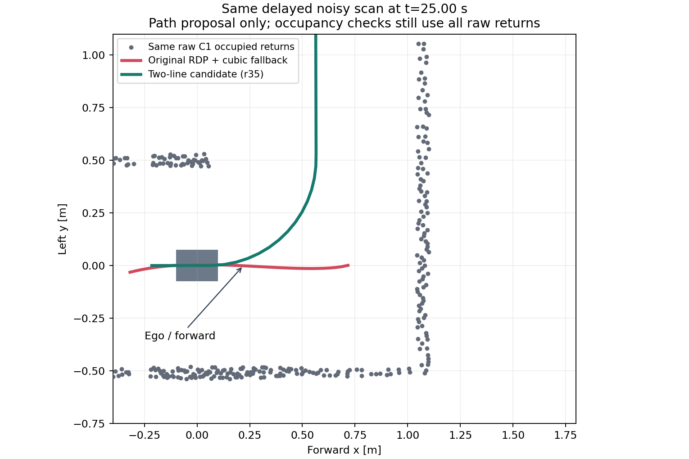

# C1 거리 오차·지연의 첫 코너 정체

2026-11-08. [원 B](../g1g2_lidar_stress_pair_v1/README.md)는 18.54초 부근부터 경계가 확정되지 않았고, 약9.11m에서 장기정체했다. 이 문서는 저장 관측에서 경로 표현을 비교한 결과이며 실제 개선 주행의 결과는 아니다.

## 원인과 비교

- 코너 접근에서 선호하는 왼쪽 안쪽 벽은 짧아진다. 기존 방식은 오른쪽 바깥 벽의 모서리 경로와 이를 대조한다.
- 같은 실제 지연·±3cm 입력의 오른쪽 연결 점들을 RDP로 분할하면 13–19개 꼭짓점이 나왔다. 원 모서리 표현은 꼭짓점3개일 때만 두 직선/원호를 구성하므로, 일반 곡선 적합으로 돌아갔다.
- 그 일반 적합은 모서리를 충분히 표현하지 못했다. 25초 저장 장면에서 오른쪽 벽과의 평행 경로가 사실상 직진으로 남았고, 짧은 왼쪽 벽과 회랑 확인을 얻지 못했다. 보호층의 별도 충돌 정지가 아니라 제어기의 `follow_boundary_unconfirmed` 0명령이었다.
- 중앙값3/5/7 표본으로 분할 제안만 평활화한 대안은 18.48초 일부만 회복했다. 다른 스캔에서는 여전히4–8꼭짓점이었다. 원시점을 평활화하여 보호층에 넘기지는 않았다.
- 모든 원시 점에 최대수직잔차3cm를 그대로 요구하는 두 직선 탐색은 18.48/18.58/19/25초의 모서리를 구성했다. [r35](../c1_piecewise_noise_v1/PLAN.md)는 이 제안 방식을 연결하며, 합성 잡음에서 표본 평균선이 한쪽으로 치우치는 문제는 같은 반환 띠의 가운데로 선을 놓아 보완했다. 점 삭제·점유 감소·잔차 기준 확대는 하지 않는다.

그림은 자차 중심 좌표다. 회색은 같은 원시 반환, 빨강은 기존 일반 곡선 경로, 초록은 새 두 직선 후보이다. 채색 선은 경로 제안일 뿐 자유 공간이나 실제 주행 궤적이 아니다. 같은 스캔의 모든 원시 점은 이후 점유·관측 검사에 그대로 남는다.

## 근거

[고정 입력 비교](result.json), [중앙값 대조](probe.py), [원시 두 선분 탐색](two_line_result.json), [보존된 입력](snapshots.json), [그림의 경로값](plot_paths.json). 스캔 지연만 따로 제거한 실제 A/B나 모든 잡음 분포를 검증한 것은 아니다. r35 실제 시험 결과는 별도 결과 파일로 연결한다.
