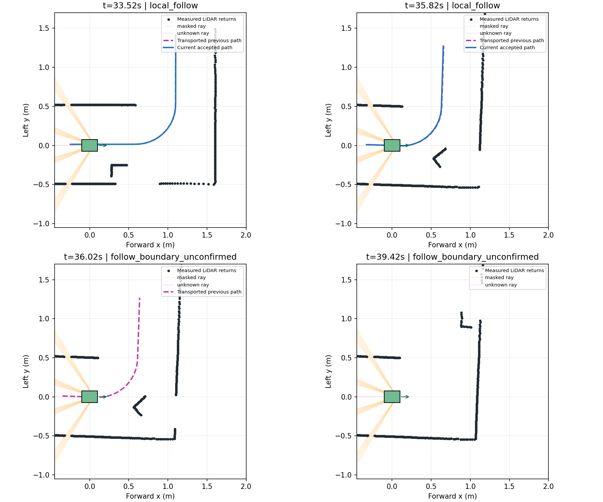

# r41 지속 코너 병렬의 정체 분리

2026-11-08. Claude는5시간94% 경고로 초기 읽기조사 후 인계했다. GPT가 계측·분석·도표를 작성하고 GPT-6 Luna가 저장 재생/기하 검사를 실행했다. 생산 소스와 물성·정책을 바꾸거나 Gazebo를 새로 실행하지 않았다.

## 재현과 실제 원인

[summary.json](summary.json): 현재r44 코드에서 원r41 **1,628판단·381reset**을 읽기전용 계측으로 재현했고 속도/조향 차이는0이다. 소스 해시 전후 동일. 32초 이후410호출·83고유스캔의 기본경로/평행후보/선택 출력을 보존했다. 33초 이후0명령235회는 다음과 같다.

| 직접 원인 | 호출 | 고유 스캔 |
|---|---:|---:|
| 기본 경계 미확정 | 214 | 43 |
| 기본 경로는 있으나 측방 GUARD 접근량 거부 | 15 | 3 |
| 기존 경로 재출발 확인 대기 | 5 | 1 |
| 정지 상태 조향 준비 | 1 | 1 |

상위 출력 `parallel_hold_baseline_unavailable`만 보고 측방 선택기의 문제로 단정하면 안 된다. 이 중 대부분은 선택기 전에 G1 기본 경계가 사라졌다. 현재두면 코너 보완은 실제15스캔에서 채택됐으므로 호출누락도 아니다.

## 관측 그림

검정은 측정 반환점, 파랑은 현재 채택 경로, 자홍 점선은 직전 경로를 운동 변환한 비교값이다. 점선을 그렸다는 것은 그 경로의 제어 사용을 허가했다는 뜻이 아니다. 주황은 자차 구조 가림, 분홍은 일반 미확인 광선이다. 차량 사각형은20×15cm 평가 표시이며 상대차 정답은 사용하지 않았다.

35.82초에는 두면 코너 가설을 계속 갱신한다. 35.92초부터 `ambiguous_or_absent_face_pair`로 갱신이 실패하고36.02초에기억 TTL이 만료돼 경로를 버린다. 마지막 성공의 꺾인 뒤 벽 시작점은 코너에서0.489m였다. 다음 단계는 기존0.5m 제한과 실제 전경 가림을 구분하는 [미연결 증거 후보](../corner_occlusion_witness_probe_v1/README.md)다. 오래된 경로를 무기한 보존하지 않는다.

## 측방 접근량은 별도 문제

33.52초의 오른쪽 접근량은 GUARD 최초경로 기준17.54mm이지만, 현재 차체 대비 추가값은0.02896mm다. 경로 좌표가 바뀐 영향과 실제 누적 이동을 이 기록만으로 분리해 확정하지는 않는다.

[geometry_summary.json](geometry_summary.json): 해당15호출을 기존 `motion_region`으로 검사하면 미관측0·반대쪽인왼쪽 작은가림 꼬리만 있었고 기존영역판정은15개 모두 허용이었다. 첫호출은1,491표본 중왼쪽가림747·오른쪽가림0, 가림꼬리1.43mm다. **모든 영역이 관측된 것은 아니다.** 1cm 누적접근 제약을 즉시 삭제하지 않고 경계의 긴 정체를 먼저 다룬다. 현행 GUARD에는 이미 곡선경로 저속 fallback이 있으며, 이를 새로 만들어야 한다고 보고하지 않는다.

## 후속 범위

현재 두 직선면·최근 유효코너·가까운 전경반환이 미보임 벽구간을 지지하는지 비교한다. 경로형상 가설과 점유/빈공간은 분리한다. 미관측을 자유로 채우거나현재센서에없는 벽점을 추가하지 않는다. 새 후보는 저장입력·반례·연결회귀 뒤에만 제한 주행을 검토한다. 빠른 추월, 지름길, 최신Jetson/실물 이관도 현행계획에 유지한다.
