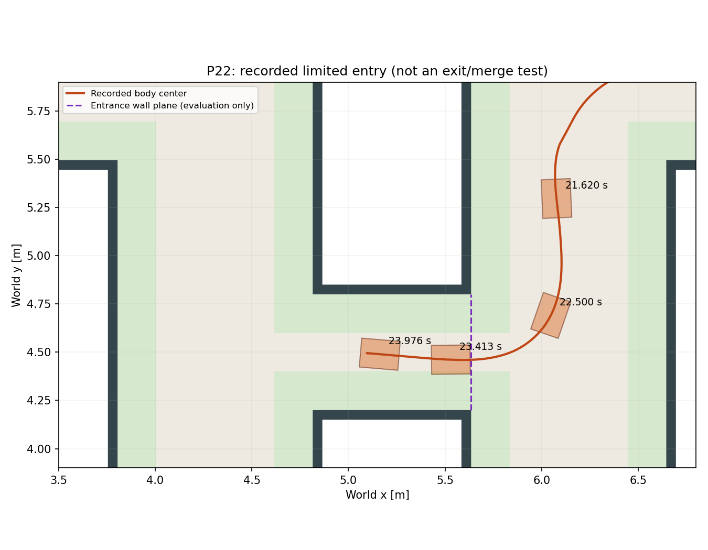

# P22 입구 이후 저장 관측과 출구 경로

r49의 입구 말기 20스캔을 읽었다. 본선용 벽 거리 0.505 m로는 양수 명령이 없었고, 좁은 통로 가정 0.300 m에서는 좌우 각각9스캔에 양수 명령이 나왔다. 단면 변경만으로 출구 합류까지 되는 것은 아니다. [관측 요약](summary.json)의 입력은 보존했다.

현재 오른쪽 통로 끝, 반대편 통로 벽, 진행 방향에 수직인 긴 맞은편 벽으로 출구 우회전 경로를 제안했다. 모든 반환은 점유 검사에 남긴다. 18스캔에서 경로를 만들었고, 첫 명령은 모두0.65 m/s였다. [센서 경로](exit_paths.json) 생성 뒤에만 평가용 실제 자세와 월드로 [정적 기하](exit_geometry.json)를 대조했다.

- 23.22초의 가장 이른 후보는 최대 세 바퀴 도로 밖·최소 벽 간격0.073 m로 노면조건 실패다.
- 23.32초 이후17후보는 최대두바퀴 도로밖, 최소벽간격0.140 m 이상이었다.
- 이는 고정한 경로의 정적 평가이며 실제 추종·입출구 주행·실물 성공이 아니다.

후속 [r50 선택형 연결](../p22_route_connected_v1/PLAN.md)은 입구 회전이 끝나가는 것을 측정 방향과 조향으로 확인하고, 서로 다른 두 스캔의 출구 후보를 측정 운동으로 맞춘 뒤 연결한다. 실제 주행은 그 결과 문서로 구별한다. 초기 probe 오류와 원 로그는 그대로 보존한다.
