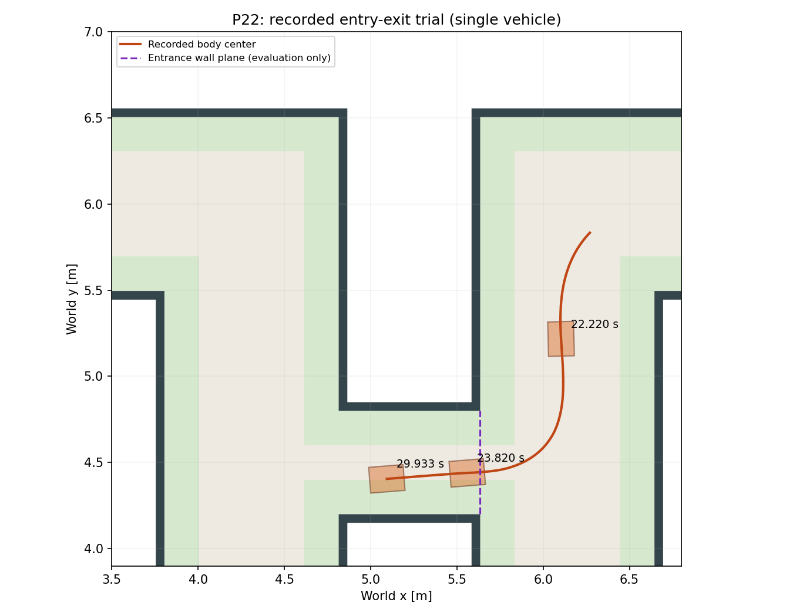

# P22 앞뒤 같은 물리 단면으로 본 저장 시간

지름길에서 본선 투영 진행량이 뛰는 것을 거리/시간 이득으로 해석하지 않기 위해, y=5.65m인 접근 도로와 합류 도로의 실제 좌표 단면을 평가 전용으로 정했다. 차체 중심의 남향 접근→북향 통과를 표본 사이 선형 보간했다. 제어기에 이 좌표를 입력하지 않는다.

| 저장 주행 | 구간시간 | 실제 궤적길이 | 출구 |
|---|---:|---:|---|
| r11 본선 | 6.334 s | 6.750 m | 통과 |
| r25 증속 본선 | 5.279 s | 6.718 m | 통과 |
| r50 지름길 후보 | 비교 불가 | 비교 불가 | 미통과 |

[비교 원문](comparison.json)과 입력해시를 보존했다. 각각 다른1회 실행이며 반복 분산·정확히 동일한 초기상태·최종 랩시간 차이를 입증하지 않는다. 이전 본선 투영구간4.52초와는 입출구 단면이 다르다. 지름길의 진입 전 감속과 복귀 회복을 포함하기 위해 넓힌 비교 구간이다.

