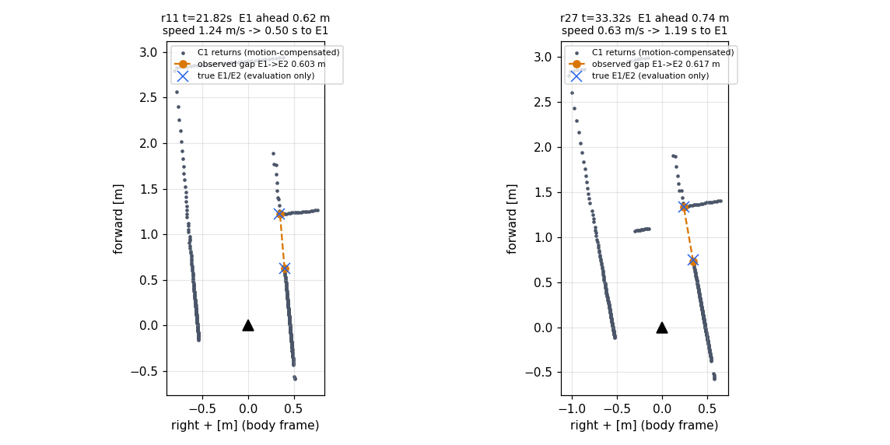

# P22: 저장된 본선 C1 관측으로 본 오른쪽 분기 식별 가능성

2026-11-09. 분석 전용 묶음이다. 새 Gazebo 실행·연결·생산 코드 수정·실물 접근은 하지 않았다. 관측 기준과 판정 의미는 [PLAN.md](PLAN.md)에 먼저 등록한 뒤 적용했다.

## 결론

**두 저장 랩(r11 단독, r27 교통) 모두 등록 기준상 "판별 가능"이다.** 오른쪽 벽이 끊긴 뒤 0.60 m 너머에서 같은 직선으로 다시 이어지는 형태(아래 "간극 N")는 실제 P22 입구에서 E1을 지나기 전 연속 4스캔(r11)과 10스캔(r27)으로 관측됐다. 실제 간극이 아닌 곳의 오검출과 C4 구간 검출은 두 랩 모두 0이다. 다만 다음 세 가지 한계가 있다.

1. **선행 시간이 짧다.** 첫 검출은 E1 전 0.62 m(r11)와 0.74 m(r27)였다. 자차 중심이 실제로 E1 횡단선을 지나기까지는 **0.408초(r11)와 0.969초(r27)** 였다. 검출 뒤 실제 진행 속도(전방 거리÷실제 시간 1.53/0.77 m/s)가 검출 순간 속도(1.24/0.63 m/s)보다 빨랐으므로, 정속 근사값 0.50/1.19초보다 짧다. r27은 도중에 0.49 m/s까지 줄었다가 다시 가속했다. 이 시점은 C4 회전 직후로 제한된다. C4 꼭짓점에서 E1까지 본선 거리가 약 1.2 m뿐이고, 회전을 마치기 전에는 입구가 오른쪽이 아니라 **왼쪽 앞 전면 벽의 틈**으로 보이기 때문이다.
2. **출구도 똑같이 보인다.** P22 출구(본선 북행 x=4.31의 오른쪽 벽)도 간극 0.60–0.62 m의 같은 특징으로 7·11스캔에서 검출됐다. 센서 형태만으로는 입구와 출구를 구별할 수 없다. 이 두 랩에서는 순서(ID20 → C4 왼쪽 회전 → 첫 오른쪽 간극)로 구별되지만, 이 순서 판단은 평가에서 확인한 사실일 뿐 구현된 규칙이 아니다.
3. **"오른쪽 벽 끝"만으로는 구별되지 않는다.** 일반 오른쪽 끝남 T는 C3·C5·C6과 출구에서도 반복해서 나타났다. P22 접근 후반(E1 전 약 0.13–0.19 m부터)에는 C5 안쪽 모서리의 T도 함께 보인다. 식별력은 간극 뒤에 같은 직선이 다시 이어지는 데서 나온다.

이 결과는 감지 가능성 판정이다. 진입 조향·준비 위치·지름길 주행 성공을 뜻하지 않는다. 기존 감사에서 확인된 좁은 진입 조건(반경 0.35 m·진입 전 왼쪽 0.175–0.20 m 치우침)을 이 남은 거리 안에서 만들 수 있는지는 검증하지 않았다.

## 실제 월드 확인: "직선–직각 벽 연결" 가정

각 실행의 `runtime_world.sdf` 벽 상자를 사후에 대조했다(꼭짓점 일치 0.0 mm, 간극 안 벽 상자 0개).

- 본선 남행 오른쪽 벽면 x=5.635는 y=4.80(E1)에서 끝난다. 그 아래 0.60 m가 비어 있고(지름길 0.20 m와 양쪽 잔디), 섬 동쪽 면이 y=4.20(E2)부터 다시 이어진다.
- 접근하는 차량에서 입구 북측 벽면(y=4.80, 남쪽 면)은 보이지 않는다. 간극으로 보이는 직각 면은 **섬 북면(y=4.20)** 이며, E2에서 섬 동쪽 면과 볼록 모서리로 만난다([대표 그림](first_entry_notch.png)에서 E2 오른쪽으로 뻗는 점열).
- 따라서 "오른쪽 직선 벽이 직각 벽과 바로 연결된다"는 가정은 접근 관측에서 성립하지 않는다. 대신 **같은 직선 위의 벽 끊김 + 간극 너머 실제 반환(≥0.25 m 깊이) + 직선 재개**를 특징으로 골랐다. 간극 너머 직각 면 B′는 E1 통과 전 입구 검출 스캔마다 1개씩 보였지만 필수 조건으로 쓰지 않았다.

## 관측 기준(요약, 상세 PLAN §4)

센서 단계는 `follow_decisions.jsonl` 호출 입력을 `restore_call` → `motion_scene`으로 복원한 순차·운동보정 C1 반환만 사용한다. 같은 스캔 시각은 한 번만 쓴다. 지도·진행량·마커·정답 자세·시각·절대 위치·순번은 쓰지 않았다. 무반환·마스크 광선은 선분 연결을 끊을 뿐 간극 근거로 세지 않았다(No hit=free 금지). E1 통과 전 입구 검출(4+10스캔)에서 간극을 지나는 무반환 광선은 0개였다. 평가 단계는 센서 단계 출력이 고정된 뒤 실행했다.

- 평행 측벽 A: |각| ≤20°, 횡거리 0.20–1.20 m. 끝남 T: A 끝 뒤 0.80 m 안에서 직선 너머 ≥0.25 m 반환 ≥3.
- 간극 N: T이면서 같은 직선(각 ≤8°, 편차 ≤5 cm) 위의 선분 C가 간극 0.40–0.85 m 뒤에서 시작하고, 간극 내부에서 너머 반환 ≥3.

## 결과

| 항목 | r11 단독 | r27 교통(앞차 2) |
|---|---:|---:|
| 한 랩의 서로 다른 스캔 / 건너뜀 | 334 / 0 | 610 / 0 |
| ID20 첫 상태(본선 s, C4 꼭짓점 s≈17.49) | 20.389초, s 16.33 | 30.94초, s 16.13 |
| ID20 서로 다른 원 영상 시각 | 20.304·20.512초(첫 시각 s 16.25) | **저장 안 됨**(상태 시각만 있음) |
| C4 안쪽 모서리 왼쪽 끝남 T 첫 관측 | s 16.25, 모서리 전 0.85 m, 10스캔 | s 16.19, 0.99 m 전, 15스캔 |
| 간극 너머 실제 반환 ≥3 첫 스캔(평가 전용 계수) | s 16.54, E1 전방 1.38 m | s 16.51, 1.54 m |
| 앞차의 간극 시선 가림 | 없음 | s 16.92–17.11 3스캔(반환 8→0→1) |
| P22 입구 오른쪽 끝남 T 첫 관측 | s 18.06, E1 전 0.79 m | s 18.06, 0.83 m |
| **P22 입구 간극 N 첫 관측** | **s 18.17, E1 전 0.62 m·중심 전 0.88 m** | **s 18.12, 0.74 m·0.95 m** |
| **첫 검출 → 자차 중심 E1 횡단선 통과(실제)** | **0.408초**(통과 22.228초) | **0.969초**(통과 34.289초) |
| 통과 시각 보간 표본 간격 / 통과 x | 2 ms / 6.130 m | 2 ms / 6.140 m |
| 정속 근사: 검출 속도 → E1/중심까지 (`E1_time_left_s` 등) | 1.24 m/s → 0.50 / 0.71초 | 0.63 m/s → 1.19 / 1.52초 |
| E1 전 입구 N(연속) / 옆 통과 포함 | 4(4) / 5 | 10(10) / 11 |
| 측정 간극(실제 0.60 m) / 끝점 최대 오차 | 0.600–0.607 m / 5 mm | 0.602–0.629 m / 22 mm |
| P22 출구 N(유사 후보) | 7스캔, s 22.89–23.62 | 11스캔, s 22.85–23.62 |
| 실제 간극 아닌 곳 N / C4 구간 N / 왼쪽 N | 0 / 0 / 0 | 0 / 0 / 0 |
| 오른쪽 끝남 T 장소별 스캔 | C3 11·C5 11·C6 9·입구 6·출구 7 | C3 25·C5 23·C6 16·입구 12·출구 12 |
| **등록 판정** | **판별 가능** | **판별 가능** |

해석상 주의할 점은 다음과 같다.

- **ID20과 C4:** 두 랩 모두 ID20은 C4 꼭짓점보다 1.2–1.4 m 앞(본선 s 16.1–16.3)에서 처음 보였다. 그 시점의 실제 오른쪽 입구까지는 본선 거리로 약 2.4–2.6 m 남아 있다. 이 구간의 센서에는 C4 안쪽(왼쪽) 끝남과 전면 벽만 보였고, 오른쪽 간극 N은 한 번도 없었다. 따라서 **등록 특징 기준으로는 C4와 혼동하지 않았다.** 반대로 ID20만 보고 오른쪽 동작을 시작하면 C4 앞에서 시작하게 된다.
- **가시성과 기준의 분리([sensitivity.json](sensitivity.json), 판정 비변경):** 평행 각을 45°, 횡거리를 2.0 m로 완화해도 첫 입구 검출 시점은 같았고 오검출도 0이었다. 반면 간극 너머 실제 반환은 C4 회전 전(E1 전방 1.38/1.54 m)부터 있었다. 그때 입구는 차체 기준 **왼쪽 앞**(횡 +1.2–1.35 m)이므로, 이 정보는 "오른쪽 측벽 간극"이 아니라 "전면 벽의 틈"으로만 쓸 수 있다. 첫 검출을 늦추는 원인은 임계값이 아니라 C4 직후라는 기하·관측 방향이다.
- **교통 가림:** r27에서는 앞차가 C4 접근 중 간극 시선을 3스캔 가렸지만, 회전 뒤 입구 관측에는 영향이 없었다. 첫 검출 때 앞차는 이미 섬 옆(6.14, 4.21)을 지나고 있었다. 다른 차량 배치에서 입구 검출이 가려질 수 있는지는 이 한 랩으로 판단할 수 없다.
- **속도 조건:** r11은 C4 감속 뒤 P22 접근에서 1.15–1.54 m/s였다. 이번 사례는 r11 P21 접근의 약 2.5 m/s 같은 조건이 아니다. 두 실행은 속도 외에 교통·경로도 달라 속도 단일변수 비교가 아니며, 각 한 랩 사례라 검출률·오검출률을 뜻하지 않는다.
- **시간 정의([crossing.json](crossing.json)):** 실제 시간은 첫 검출 스캔의 판단 기준 시각 t에서, 자차 기준점이 월드 y=4.80 횡단선을 지난 시각까지다. y=4.80은 E1 (5.635, 4.80)을 지나는 본선 남행 횡단선이며, 입구 근처 x 5.80–6.50에서만 찾았다. 기준점은 `ego_poses.jsonl`의 모델 원점이다. 이는 `base_link`, 즉 chassis 중심(앞뒤 바퀴축 ±0.0675 m의 가운데)이며 전면 범퍼는 약 0.10 m 앞이다. 통과 시각은 인접 표본 두 개(간격 2 ms) 사이를 선형 보간했다. 스캔 광선은 t보다 약 0.1–0.2초 먼저 취득됐으므로, 첫 반환 취득 시점부터 재면 시간이 조금 더 길다. `evaluation.json`의 `E1_time_left_s`·`center_time_left_s`는 "차체 전방 투영거리 ÷ 검출 순간 속도(±0.05초 중앙차분)"인 **정속 근사**다. 값은 그대로 보존했고, `summary.json`에서는 `*_const_speed_approx_s`로 이름을 바꿨다. 근사가 실제보다 0.095초(r11), 0.221초(r27) 길었다.
- **평가 좌표:** 평가 자세는 Gazebo `ego_poses.jsonl` 보간값이다(최근접 간격 ≤1 ms). 본선 s는 최근접 중심선 투영값이며, P22 구간 이름은 `scene.json` 중심선 코너 자동 번호(C4 s 17.49)를 따랐다.

그림은 각 실행에서 첫 입구 간극 N이 관측된 스캔의 차체 좌표다. 제목의 "s to E1"은 위 정속 근사값이다(실제 0.408/0.969초). 주황 점선은 센서 관측 E1→E2, 파란 ×는 평가 전용 실제 끝점이다. r27의 전방 약 1.08 m 가로 점열은 앞차 후면이다.

## 다음 제안(결정은 총괄 판단)

1. 지름길을 계속 검토한다면, 진입 판단은 "ID20 → C4 왼쪽 회전 관측 → 첫 오른쪽 간극 N" 순서로 묶는 것이 이 자료와 맞는다. 출구 간극과 구별하는 방법이 함께 필요하다.
2. 남은 0.6–0.75 m 안에서 등록 감사의 좁은 진입 조건을 만들 수 있는지는 별도의 제한 속도 진입 시험으로 확인해야 한다. 더 빠르게 알아차리는 것이 필요하면, C4 회전 전 "전면 벽 틈" 관측(E1 전 약 1.4–1.5 m부터 실제 반환 존재)을 관측 전용 후보로 비교할 수 있다. 이번 묶음에서는 이 후보를 등록·판정하지 않았다.
3. 본선 전략 유지와 P21 우선 결론은 이 결과만으로 바뀌지 않는다.

## 재현과 근거

- 실행: `bash run.sh`(WSL, ROS jazzy 환경). 1단계 [`observe_run.py`](observe_run.py)+[`observe.py`](observe.py), 2단계 [`evaluate.py`](evaluate.py), 보조 [`sensitivity.py`](sensitivity.py), 실제 통과 시각 [`crossing.py`](crossing.py), 요약 [`make_summary.py`](make_summary.py).
- 근거: [summary.json](summary.json)(입력 SHA256 포함), [evaluation.json](evaluation.json)(접근 창 스캔별 관측/비관측 표 `approach_rows`), [sensitivity.json](sensitivity.json), 센서 결과 `observations_r11.json`·`observations_r27.json`.
- 입력 불변: 두 `follow_decisions.jsonl`의 실행 전후 SHA256이 같다(`input_unchanged=true`). r11은 기존 P21 분석과 같은 `ca04838b…`다.
- 재현성: 최초 산출물 해시 [first_pass.sha256](first_pass.sha256)를 남긴 뒤 별도 보조 실행(Claude Haiku 5.5)으로 `run.sh`를 다시 실행했다. 종료코드 4개가 모두 0이었고 4개 JSON이 바이트 단위로 같았다.
- 반복 경위: 최초 평가에서는 간극 항목 이름이 `"notche"`로 잘못 붙어 입구 N 0개·"판별 불가"가 출력됐다. 센서 관측은 바꾸지 않고 이름 문자열만 고친 뒤 재평가했다. 그림의 한글 라벨은 WSL 글꼴 누락으로 영어로 바꿨다. 보조 점검은 등록 판정 뒤에 추가했다. 최종 검토 뒤에는 정속 근사를 실제 시간처럼 읽을 수 있다는 지적에 따라 `crossing.py`를 추가했다(평가 전용, 관측기·판정 불변, 센서 재실행 없음). 이 추가 뒤에도 `first_pass.sha256`의 JSON 4개는 그대로 일치했다.
- 원시 로그·bag은 복사하지 않았다.
