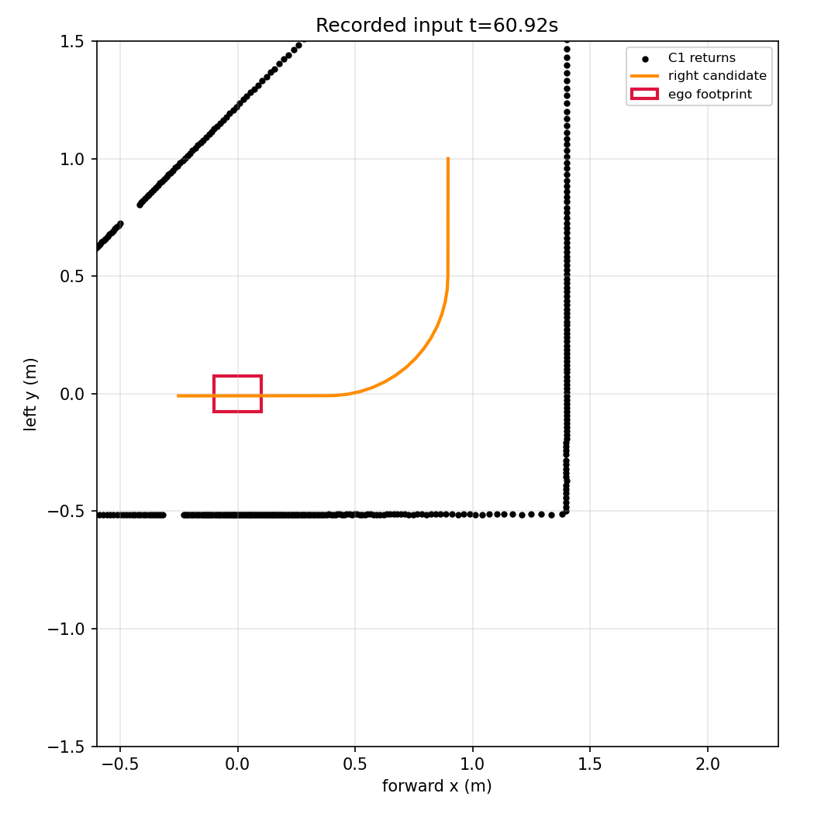

# 지연 교통 후반 갈림길 정지 재현

r212의466판단을 현재 소스·동일 r186 시험 참조로 재생해 전체 비교 대상 출력이 일치했다. 미완주 후반60.92–67.32초에는 연속60개 `follow_boundary_unconfirmed`가 남았다. `diagnosis.json`·두 센서 그림은 저장 입력만 사용하며 새 주행 허가나 지도 입력은 없다.

차량 기준 오른쪽 벽에는 현재2.90m의 충분한 직각 코너 반환과 앵커 오차9.1mm의 경로 가설이 있었다. 왼쪽은 갈림길의 비스듬한 경계여서 짧은 벽/내측 일관성 검사를 통과하지 못했다. 그림의 주황색은 오른쪽 반환만으로 만든 가설이며 실제 승인/명령 경로가 아니다. 원점의 빨간 외형은20×15cm다. 표시되는 좌표는 제어기가 받은 차체 좌표이며 평가용 정답을 넣지 않았다.

단순 관측 기준 부족으로 결론 내리기 전에 직전 호출을 확인했다.60.32초에는 현재 오른쪽 경계를 다시 받았지만, source 만료 뒤60.72초에 `axis 1 is out of bounds for array of dimension 0` 예외가 `follow_input_stop`으로 처리됐다. 그 뒤 경로 기억이 사라졌다. 따라서 먼저 **None 경로를 검사하는 시험용 참조 분기의 구현 오류**를 r216에서 재현하며, 관측 길이·기억 TTL·간격을 줄이는 방식으로 우회하지 않는다.
