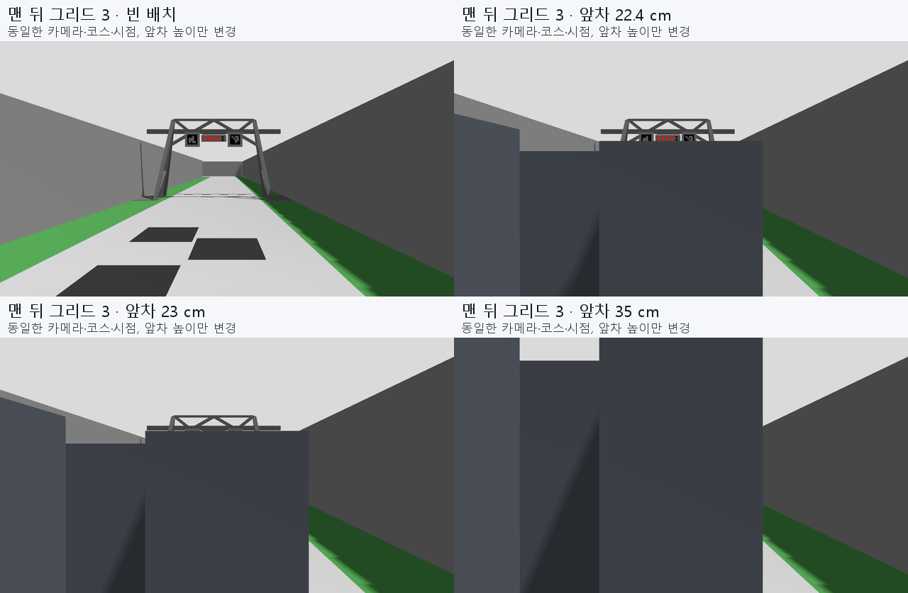
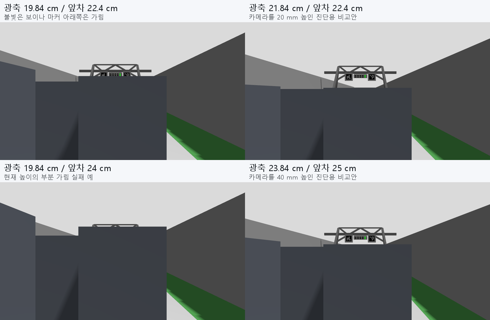

# r307 — 프린팅 전 6개 그리드 카메라 시야·앞차 가림

2026-11-13. **현재 광축 높이 약198.36 mm는 빈 그리드에서는 충분하지만, 같은 높이 차량 뒤에서의 가림 여유가 작다.** 224 mm 앞차에서 신호는 읽어도 두 뒤쪽 자리의 마커가 가려졌다. 230 mm 앞차에서는 뒤쪽 두 자리의 신호 인식도 실패했다. 따라서 렌즈 높이를 **약220–240 mm 사이에서 조절할 수 있는 브래킷**을 권고한다. 카메라·CAD·운영 설정은 자동 변경하지 않았다.

## 입력과 시험 범위

- 현행 `official_v2026_11_06` 팀 파생 월드와 공식 6개 출발 위치. 그리드0·3은 뒤, 1·4는 중간, 2·5는 앞이다.
- 현재 선택형 CAD 프로필의 B0390: `[0.055, 0, 0.198363]` m, 수평, 1280×720, 공칭 수평62.2°. 수직은 정사각 픽셀 가정에서 약37.5°다. 정지 렌더 취득은10Hz이며 운영 영상60Hz 성능 시험은 아니다.
- **높이는 구형 카메라가 들어 있는 CAD의 광축 추정**, X55 mm는 임시값이다. 실제 B0390 렌즈 위치·화각/왜곡/노출·장착 오차를 교정한 결과가 아니다. 전체 자기 차체 CAD는 렌더에 넣지 않아 자기 가림·브래킷 간섭은 별도다.
- 다른 5개 그리드에 길이200×폭150 mm의 불투명 외곽 상자를 배치했다. 6자리를 모두 점유한 보수적 정지 배치이며 실제 경기 참가 대수나 상대차 세부 형상을 확정한 것이 아니다. 높이224/230/240/250/280/350 mm는 비교 조건이며, 350 mm 상한은 이번 사용자 전달에 따른다.
- 새11/12 STL의 신호 지주를 추가했다. 기존 광원/판을 유지한 조건과 **새 STL 접지 기준에 맞춰 신호 머리를9 mm 내린 비교 조건**을 구분한다. ID0·45는 기존 위치를 유지한다. 실제 설치 높이 확정으로 해석하지 않는다.
- 실제 Gazebo RGB를 현행 `LocalOfficialStartSignal` 및 `MarkerAnchoredStartSignal`에 전달했다. 상태 전환은 평가기가 광원을 제어하고, 검출기는 영상과 영상 시각만 받는다. 차량·MCU·B3 운영 상태기계·주행 명령은 실행하지 않았다.

## 결과

아래 주 표는 머리−9 mm 조건이다. 출발 패턴은 빨강4열 확인→초록 확인, 늦은 출발은 빨강 이력 없이 현재 ID0·45와 초록 쌍을 확인하는 선택형 영상 기능이다.

| 광축 높이 | 다른 차량 높이 | 정상 신호 패턴 인식 | 두 마커 기반 늦은 출발 패턴 | 실패 위치/이유 |
|---|---:|---:|---:|---|
| 198.36 mm | 없음 | 6/6 | 5/6 | 그리드3 ID0 미검출 |
| 198.36 mm | 224 mm | 6/6 | 4/6 | 그리드0·3 마커 아래쪽 가림 |
| 198.36 mm | 230 mm | 4/6 | 3/6 | 0·3은 램프 부분 가림, 4는 마커 가림 |
| 198.36 mm | 240 mm | 2/6 | 2/6 | 앞줄2·5만 인식 |
| 198.36 mm | 350 mm | 2/6 | 2/6 | 앞줄2·5만 인식 |
| **218.36 mm** | **224 mm** | **6/6** | **6/6** | 높이+20 mm 진단안 |
| **238.36 mm** | **250 mm** | **6/6** | **6/6** | 높이+40 mm 진단안 |

현재 광축·기존 머리 높이의 첫 렌더에서도 빈 배치와224 mm 조건의 정지 패턴은 각각6/6이었다. 해당 수집기의 단계 사이 간격을0.4초로 건너뛴 표본은 기존0.35초 프레임 유효기간 때문에 실패했다. 원문은 보존하고 [정지 사진10Hz 재생](render_current/static_patterns.json)으로 영상 자체와 인위적 수집 공백을 분리했다. **정지 사진 반복은 실제 연속 영상의 대체 증거가 아니다.** 이후 v3은 실제 수신 프레임을 보존한 채 최대 간격0.1초에서 위30개 조건의 같은 결론을 확인했다.

소등 단계의 저장 표본에서는 출발 판정0이었다. 이는 단일 렌더 배경의 제한 결과이며 실제 배경 사람·옷·조명이나 실물 LED의 소등 색상 전체 검증은 아니다.

전체 시점: [빈6개 그리드](grid_empty.png), [224 mm 앞차가 있는6개 그리드](grid_same224.png). 비교판은 실제 저장 프레임을 축소 배열했으며 원 PNG는 각 실행 폴더에 보존했다.

## 마커를 신호등 위치 기준으로 쓰는 기능

두 마커로 신호 영역을 찾는 로직은 이미 선택형 늦은 출발 경로에 있다. 현재 영상에서 ID45/0의 위치·크기·배열을 확인하고, 두 마커 사이 예상 영역의 초록 두 점을 연속 확인한다. 정답 위치를 입력하지 않는다.

그러나 현재 높이에서는 램프보다 낮은 마커의 하단이 먼저 가려질 수 있다. 마커가 있다는 사실만으로 모든 그리드의 늦은 출발이 해결되지는 않는다. 빈 그리드3의 ID0는 현행 `minMarkerDistanceRate=0.02`에서 빠졌고, 같은 저장 사진의0.005 비교에서는 검출됐다. 기존 렌더/후보 그룹화 민감도와 관련된 결과이며 운영 검출기 계수는 이번에 변경하지 않았다. 높이+20 mm의224 mm 상대 조건에서는 계수0.02 그대로 두 ID가6자리 모두 검출됐다.

**주변 차량이 움직였다는 이유만으로 출발하는 기능은 없다.** 앞차가 떠난 뒤 신호와 마커가 드러나면, 선택형 `official_marker_late_candidate`는 이전 빨강을 못 봤어도 현재 초록으로 출발할 수 있다. 기본 OFF이며 B3 출발 준비 경계를 요구한다. 이번 검사는 영상 패턴만 다뤘으므로 실제 가림 해제→B3 허가→주행까지 성공한 것으로 확대하지 않는다.

## 프린팅에 대한 판단

1. 빈 그리드의 화각은 충분하다. 공칭 핀홀에서 높이±10 mm·앞뒤±20 mm·피치/요±3°를 조합해도 신호와 마커의 화면 경계 여유 최솟값은 약92.7 px였다. 이 오차 범위는 시험 가정이며 실측 공차가 아니다.
2. **앞차 위로 넘겨보는 높이가 병목**이다. 뒤쪽 그리드의 최초 램프 표본 가림 높이는 기존 머리 기준 약225.2 mm, −9 mm 비교 기준 약224.0 mm다. 현재224 mm 상대와 사실상 여유가 없다.
3. 렌즈 높이 약218 mm는 이번224 mm 상대 조건에, 약238 mm는250 mm 상대 조건에 유리했다. 기하상 둘 다 제자리에서 마커까지 보려면 각각 약205/235 mm 이상이 필요하지만, 최소 경계값에 맞춰 고정 제작하지 않는다. **220–240 mm 조정 범위를 권고**하는 이유다. 실제 B0390 광학 중심과 상판/렌즈 주변 간섭을 함께 맞춰야 한다.
4. 위로 기울이기는 화면 안 배치를 바꿀 뿐, 같은 렌즈 중심에서 앞차가 가린 직선을 뚫지는 못한다. 우선 수평을 유지하며 높이 여유를 확보하는 편이 낫다.
5. 높이350 mm의 불투명 차량 뒤까지 모든 마커를 보는 것은 이 구조에서 기대하지 않는다. 기하 최소 광축도 약353 mm로 계산돼 사용자 전달 차량 높이 상한과 충돌한다. 뒤늦은 신호 재획득과 가림 해제 후 출발을 별도 운영 검증으로 남긴다.

## 실행 실패와 원시 근거

- `render_current`: 20조건 취득 뒤 짧게 생성한 `gz service` 자세 요청이 응답 시간 초과. 원 결과 `passed=false`, 정상 종료/잔여 프로세스0. 당시 소스는 `audit_v1.py`다.
- `render_newhead`: 배경 수신 방식에서 첫 프레임을 얻지 못해 중단. SIGINT로 ROS가 먼저 종료돼 종료 처리가 중복 호출 오류를 냈다. 가시성 결과 없음. `audit_v2.py`와 `harness_failure.json` 보존. 별도 정리 조회 시 기록된 launch PID는 이미 없었다.
- `render_newhead_v3`: 지속 자세 클라이언트와 원 주 스레드 수신으로30조건 전부 취득, 소스 불변. 서버 종료 서비스 뒤 Gazebo가 끝나지 않아 launch가 SIGKILL로 정리했다. **원 `passed=false`/종료 실패를 유지**, 이후 잔여 프로세스0. 당시 소스 `audit_v3.py`.
- `render_plus20`/`render_plus40`: 각각6조건 취득·소스 불변·정상 종료·잔여0, `passed=true`. 소유한 launch에 직접 정상 종료 신호를 보내는 방식으로 종료 경로를 바꿨다. 이는 렌더 시험 정리 변경이며 대회 STOP/보호 경계의 변경이 아니다.
- `pose_client.cpp`는 기존 지속 Visual 서비스 클라이언트를 평가용 Pose 메시지에 맞췄다. 정상 수락·거부·서비스 실패·없는 서비스·파싱 오류 자체검사를 통과했다. 운영 코드는 수정하지 않았다.

기계 산출물: [핀홀/화각](geometry.json), [가림 높이 경계](occlusion_margin.json), [필요 광축 높이](mount_margin.json), [30조건 실제 렌더](render_newhead_v3/report.json), [+20 mm](render_plus20/report.json), [+40 mm](render_plus40/report.json). 각 보고서에 입력 해시·배치 응답·프레임 시각·검출 상태·코너 좌표·종료 기록이 있다. 첫 보고서의 `audit.py` 해시는 당시 보존 사본과 대조한다.

## 다음 작업

프린팅 담당에게 실제 B0390 광학 중심과 약220–240 mm 높이 조정 여유를 전달한다. 이 문서는 CAD 변경 승인이나 실차 보장이 아니다. 영상 위치 확인의 대표 결과를 확보했으므로 r306 시설 직선 조각 후보 주행/실물 운영 연결로 복귀한다. 가림 해제 뒤 늦은 출발의 B3 전체 연결은 이후 대표 시험으로 다룬다.
