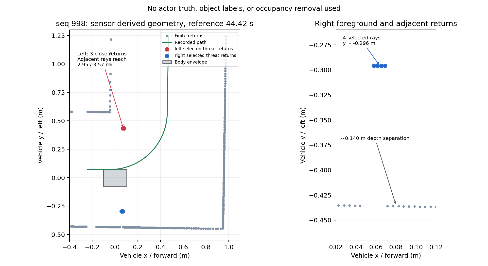

# r445 센서 위협점 독립 조사

전체 plan은 seq 441에서 baseline이 달라 중단한 상태를 유지했습니다. root의 별도 지시에 따라 seq 895/998의 **원 scan/history와 기록된 path**만 복원했습니다. Windows Python 수치 경로로 동결 `ReturnGrid/side_return_masks`를 실행했고, 제어기·selector 상태·0.1 후보는 실행하지 않았습니다. actor/world 정답은 사용하지 않았습니다.

## 원 evidence와의 일치

| 원 trace seq | 왼쪽 점수 / present | 오른쪽 점수 / present | 원 ds 위치와 차이 |
|---|---:|---:|---:|
| 895 | 2 / false | 4 / true | 0 m |
| 998 | 3 / true | 4 / true | 0 m |

점수·present는 exact, 투영 위치도 실제 차이 0입니다(독립 수치 대조 허용값 1e-12 m). 이것은 해당 센서 기하만의 재현이며 전체 plan 기억 상태의 재현이나 native 시간 측정이 아닙니다. 첫 Windows 실행은 interface 경로 누락으로 import 단계에서 종료했고, 두 동결 package 경로를 명시한 뒤 실행했습니다. 공통 import나 라이브러리 포팅은 하지 않았습니다.

## 위협으로 선택된 이유

현재 코드의 `wall_offset_m=0.505`, `wall_tolerance_m=0.03`, 위협 종방향 창은 뒤 0.6 / 앞 0.35 m, 최소 위협 점수는 3입니다. 선택된 점의 경로 횡위치는 왼쪽 약 +0.316~+0.323 m, 오른쪽 약 −0.373~−0.375 m입니다. 따라서 고정 벽 띠와 **0.13~0.19 m** 떨어져 있고, 내부 측방 창 및 compact 조건에 들어갑니다.

seq 998에서 왼쪽 source 127–129는 센서 기하 XY의 y≈+0.434 m에 있는 3점, 폭 약 0.01091 m입니다. 오른쪽 source 384–387은 y≈−0.296 m의 4점, 폭 약 0.01117 m입니다. compact 상한 약 0.310 m보다 작으므로 분류됩니다. 왼쪽은 seq 895에 2점으로 문턱 미달이었다가 998에는 3점으로 present가 됩니다. 오른쪽 4점은 두 대표 모두 현재 관측된 위협입니다.

## 단순 벽 조각으로 지울 근거는 없음

**인접 유한 반환의 깊이가 다릅니다.** seq 998 왼쪽 위협의 직전 source 126은 y≈+2.951 m, 직후 source 130은 y≈+3.573 m입니다. 오른쪽 위협 바로 앞뒤 source 383/388은 y≈−0.436 m이고, 위협점보다 약 **0.140 m 뒤**에 있습니다. seq 895도 오른쪽에서 같은 약 0.140 m 차이가 나타납니다. source index가 연속인 유한 반환 사이의 거리 단절이며, NaN 구간 때문에 긴 벽이 작은 조각으로 잘렸다고만 설명할 수 없습니다.

위협 묶음의 직선 연장선에서 ±1 cm, 종방향 ±1.5 m를 탐색했을 때 같은 선 근처 반환은 원 위협을 포함해 4~6점뿐입니다. 약 0.89 m 떨어진 소수 점도 있으나 연속 벽 면을 증명하지 않습니다. 이 1 cm는 보고용 선 근접 집계 기준일 뿐 제어 조건에 추가하지 않았습니다. 전경의 짧은 반환이 실제 존재한다는 것은 확인되지만, 차량·지주·다른 구조물 중 무엇인지는 이 원자료로 확정하지 않았습니다.

따라서 **present를 과거 기억이라고 삭제하거나, 긴 벽과 합쳐 점유를 없애는 변경은 제안하지 않습니다.** 현재 우선순위는 plan completion 기록을 완전하게 연결하여 baseline 재현을 확보하는 것입니다. 이후 같은 GUARD 상태에서 0.1을 검사하더라도 양쪽 누적/추가 접근·현재 관측·점유 검사를 모두 유지해야 합니다. 0.1 지속 주행이 목표가 아니라 제한 회복 후 정상 가속으로 돌아갈 수 있는지 확인하는 범위입니다.

증거: [센서 대조 결과](sensor_only_v1/summary.json), [seq 895 전체 기하](sensor_only_v1/seq895.json), [seq 998 전체 기하](sensor_only_v1/seq998.json), [인접 반환·직선 근접 집계](sensor_only_v1/line_support.json), [센서 전용 복원 코드](sensor_only.py), [그림 생성 코드](plot_sensor_findings.py). [전체 plan 중단 결과](README.md)의 한계는 그대로 유지합니다.
