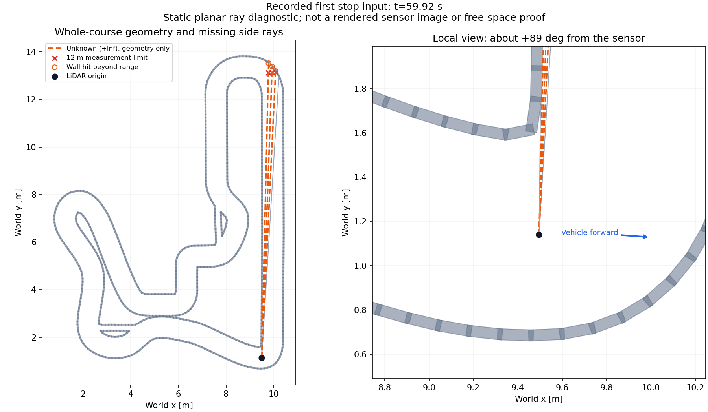

# G1 급커브 경계 후보 — 설계와 검증

10/15 오전 재개. [새벽 한 바퀴 실패](G1_FRAGMENTED_BOUNDARY_2026_10_13.md#12-1015-전체-코스-단독-후보-회귀-실패와-급커브-경계-진단)를 기준으로 한다. 기존 `connected`/`fragmented_candidate`·실패 기록은 그대로 보존한다. 최초 12:30 KST 이후 종료 준비 예정이었으나, 사용자의 후속 마무리 요청에 따라 진행 중인 저장 입력 진단까지만 완료하고 새 구현/주행을 시작하지 않았다. 이후 같은 날 재개/승인은 각 절에, **10/16 선택형 공식 단독 주행과 최신 마감은 7절**에 구분한다. 커밋·게시·Jetson/전원 변경은 이번 범위가 아니다.

## 1. 문제와 후보의 의미

안쪽 벽의 **전방** 길이가 급커브에서 짧아지는 경우, 그 벽이 실제로 사라진 것과 같은 조건으로 처리했다. 바깥 벽에서 안쪽 기대 벽을 평행 이동해 만드는 방식도 급커브에서 접히며, 접히기 전만 남겨도 전방 0.65 m는 확보되지 않았다. 임계값을 일괄 낮추거나 반대 벽만으로 운행하지 않는다.

선택형 `corner_anchor_candidate`는 다른 기하 계약이다. 기존 분리 관측을 먼저 사용하고 실패할 때만, **길고 연속된 바깥쪽 관측 곡선 + 현재 차체 앞뒤를 가로지르는 안쪽의 실제 연결 벽**을 함께 대조한다. 안쪽 벽의 총 관측 길이는 0.65 m 이상을 유지하되 앞쪽으로만 0.65 m를 요구하는 직선 계약과 구별한다. 뒤쪽 자료를 앞으로 옮기거나 미관측 구간을 벽/자유 공간으로 채우지 않는다.

## 2. 제한과 수용 조건

- 채택할 바깥 경로는 기존 전방 관측 0.65 m·앵커 조건을 통과해야 한다. 경로가 안쪽으로 30~135도 회전하고 누적 반대 회전은 5도 이하인 경우만 후보에 포함한다. 단순 직선·반대 방향 분기는 이 대체 조건으로 승인하지 않는다.
- 안쪽 하나의 실제 연결 관측에 12점 이상·총 길이 0.65 m 이상·차체 중심 앞뒤 각각 반 길이(현재 0.10 m) 이상의 반환이 있어야 한다. 각도 순서의 연결 간격을 넘는 조각을 합치지 않는다.
- 안쪽 관측의 직선성, 현재 근접 경로의 방향(15도 이내)과 기존 간격 0.425±0.08 m, 미래 후보의 안쪽 관측점 이격을 따로 확인한다. 후보의 각도 범위는 실측 안전 한도가 아니다.
- 전체 PCA 잔차가 작아도 두 면이 한 직선처럼 합쳐질 수 있어, 연결 길이를 세 구간으로 나눈 각 PCA 방향의 차이도 10도 이내로 제한한다. 이는 안쪽 직선 앵커만 허용하는 후보 범위이며 일반 곡선의 품질 판정이 아니다.
- 새 경로와 유효 기억의 일치, 초기/만료 후 두 fresh 확인, 0.3초 TTL·음수 운동 HOLD·전방 무응답 정지·점유 반환 전량·기존 독립 보호층·정지/간격/속도 한도는 유지한다.
- 이는 경계 선택 근거이지 자유 공간·물체 분류·실차 안전 인증이 아니다. 벽과 구분되지 않는 긴 물체·관측면 아래 장애물·동적 가림 등은 한계로 남는다.

먼저 네 저장 시각과 좌우 대칭·직선/분기/짧은 표적·잘못된 간격·가림·중앙 봉쇄 반례를 비교한다. 기존 판단 재생 일치를 보존하고 후보의 고정 입력 결과와 새 폐루프를 구별한다. 유효 후보가 준비된 뒤 같은 전체 코스 조건을 최대 한 번 실행하고 첫 실패에서 분석으로 돌아간다. 기본 채택·G2 우회·고속화는 하지 않는다.

## 3. 저장 입력·단위·정적 광선 대조

- [기하 v1](../../artifacts/validation/2026-10-15/g1_corner_evidence_v1/tests.log)은 18개 중 한 반례에서 약 14도 꺾인 두 면을 하나의 직선 앵커로 승인했다. 세 구간 PCA 방향 비교를 추가한 [v2](../../artifacts/validation/2026-10-15/g1_corner_evidence_v2/tests.log)는 24개를 통과했다. 숫자만 낮춰 원래 실패를 통과시킨 것이 아니라 후보가 주장하는 직선 앵커의 모양 검사를 보강했다.
- [저장 4표본](../../artifacts/validation/2026-10-15/g1_corner_evidence_v2/report.json)의 31.82/31.92/32.02초는 긴 안쪽 관측과 바깥 곡선의 대응이 성립했다. 총 관측 길이는 0.966/0.893/0.819 m다. 37.02초는 앞쪽 관측 길이가 차체 반 길이에 미달하여 계속 거절했다. 모든 정지 장면에서 재출발할 수 있도록 만든 보정은 아니다.
- [연결 회귀 v1](../../artifacts/validation/2026-10-15/g1_corner_integration_v1/tests.log)의 195/196 통과와 1실패는 시험 장면의 epoch만 변경하고 광선 epoch를 그대로 둔 fixture 오류였다. 혼합 epoch 거절 계약은 유지하고 fixture를 수정한 [v2](../../artifacts/validation/2026-10-15/g1_corner_integration_v2/tests.log)에서 196개 통과했다.
- [전체 입력 고정 대조](../../artifacts/validation/2026-10-15/g1_corner_integration_v2/probe/report.json)는 기존 1,441/1,441 판단이 동일 재생된 뒤 후보를 비교했다. 기존 0명령 중 3호출이 양수로 바뀌었고 반대 변경은 없었다. 이전 조향·실제 입력은 그대로이므로 새 궤적/완주 근거가 아니다. `closed_loop_pass=false`, `driving_authorized=false`를 유지한다.
- [첫 반환 광선 30조건](../../artifacts/validation/2026-10-15/g1_corner_geometry_v2/report.json)은 정지 차량과 L자 회랑의 이상적 500방향/후방 60도 마스크다. 좌우 거울 대칭·코너 진입 거리 0.15/0.30/0.50 m를 비교했다. 열린 6조건 중 4개에서 진행하고, 중앙 봉쇄/측면 물체/안쪽 벽 부재/짧은 가짜 벽은 각각 6조건 모두 정지했다. 0.15 m 열린 코너도 앵커 부족으로 정지한다. v1 진단기의 NumPy 배열 비교 예외는 [원래 로그](../../artifacts/validation/2026-10-15/g1_corner_geometry_v1/probe.log)에 남기고 v2에서 실행 코드를 수정했다. 이는 정적 광선/계약 시험이며 동체 취득·실물 장애물 안전 증거가 아니다.

새 선택값은 실행 인자에 명시해야 하며 기존 `connected`·`fragmented_candidate`와 기본 G1 꺼짐을 유지한다. 기존 0.3초 기억·분리 관측·확인 횟수·보호층·속도/간격 한도는 변경하지 않았다. [단독 폐루프 등록](../../artifacts/validation/2026-10-15/g1_solo_lap_v2/README.md)의 결과는 별도 구분한다.

## 4. 폐루프 실행 경계

첫 v2 실행 요청은 사전 77검사 중 평가기 해시 후속 계약 누락 1건으로 **시뮬레이션 시작 전에 중단**했다. 기존 `per_ray_occupancy_r0` 계약을 덮어쓰지 않고 [새 후속 계약](../../config/tests/corner_anchor_r0_sha256.json)에 선택형 구현/새 의존성/평가기 변경을 명시했다. 평가기의 실제 변경은 선택 인자와 소스 보존 목록뿐이며 STOP·주행 gate는 그대로다. [사전 실패 로그](../../artifacts/validation/2026-10-15/g1_solo_lap_v2/preflight.log)를 보존하고 v3에서 같은 조건을 최초 실행했다. 버전 폴더 수를 실제 주행 횟수로 세지 않는다.

### 4.1 첫 코너 앵커 폐루프의 실패

[v3 보고서](../../artifacts/validation/2026-10-15/g1_solo_lap_v3/run/report.json)는 **19.697340 m·완주 0회**에서 `follow_boundary_unconfirmed`로 실패했다. 코너 앵커는 31.92/32.02/32.12초의 세 fresh 판단에만 채택됐으며, 32.22초부터 앞쪽 직선 벽 길이가 차체 반 길이보다 짧아졌다. 마지막 경계 원천 시각 32.002초에서 0.3초가 경과한 32.32초에 기억이 만료됐다. v1보다 약 0.12 m 더 갔다는 것은 기능 해결이 아니다.

- 실패 회수 STOP의 0.5초 밀집 자세 구간 통과(최대 시각 간격 3 ms), 종료 정상·잔존 0·충돌 표본 0. 단일 모터축 0속도만으로 정지를 판정하지 않았다.
- [재생](../../artifacts/validation/2026-10-15/g1_solo_lap_v3/replay.json) 1,455판단 일치, 점유·도로 감사 통과. [저장 판단 분석](../../artifacts/validation/2026-10-15/g1_solo_lap_v3/boundary_analysis.json)은 같은 입력/기준 판단을 유지했다.
- [관측 도식](../../artifacts/validation/2026-10-15/g1_solo_lap_v3/corner_loss.png)에서 안쪽 벽이 실제로 사라진 것은 아니다. 모서리가 차량 옆으로 이동하여 앞뒤 직선 앵커 계약이 더 이상 맞지 않는다. 이것은 앞쪽 길이 기준을 무조건 낮춰야 한다는 근거가 아니다.
- [고정 거리/시각 주입 32조건](../../artifacts/validation/2026-10-15/g1_corner_stress_geometry_v1/report.json): 열린 16/16 양수, 중앙 봉쇄 16/16 정지. 정적 반환·고정 오차 조건으로, 실패한 코너 폐루프를 성공으로 바꾸지 않는다.

## 5. 후속 기하 검토 — 실제 모서리까지의 거리

최초 운영 미연결로 검토한 `scripts/corner_distance_probe.py`는 길게 실제 관측된 안쪽 연결 성분과 바깥 후보 경로의 거리·안쪽 법선 방향을 직접 대조한다. 0.425±0.08 m 이격·실제 관측 성분 0.65 m 이상·미관측 연결 금지를 유지하며, 뒤쪽 직선을 앞으로 연장하지 않는다. 길이는 잡음의 지그재그 호길이가 아닌 실제 점 사이 거리의 하한을 사용한다. 바깥 긴 관측·기억/재획득·점유/보호는 별도 의무다. §5.1 연결 이후 이 스크립트는 동일한 운영 함수를 호출하는 진단용 진입점이며, 최초 실험 소스는 각 ZIP에 보존했다.

[첫 정적 검토](../../artifacts/validation/2026-10-15/g1_corner_distance_v1/report.json)에서 저장 실패 4표본을 모두 지지했지만, 이상적 코너의 모든 자세를 지지하지는 않았다. 안쪽 벽 부재/짧은 가짜 벽은 각각 26/26 거절했다. 이는 후보 기하의 범위를 확인하는 자료이며 아직 새 폐루프나 운행 허가가 아니다. 실행 담당 최초 문장 요약의 boolean 집계 오류는 원본 JSON 대조로 정정했다. 검사 로그가 없는 최초 단위검사 호출은 검사 개수 근거로 쓰지 않는다.

### 5.1 실제 지지 경로만 사용하는 선택형 연결

[v2 상세](../../artifacts/validation/2026-10-15/g1_corner_distance_v2/report.json)에서 열린 코너 진입의 거절은 대체로 경로 맨 끝의 이격 초과였다. 가까운 약 0.89~0.98 m는 기존 0.425±0.08 m 안에서 지원됐다. 따라서 거리 문턱을 늘리는 대신 **처음 미지원 지점 전까지의 연속 경로만 남기는** `corner_distance_candidate`를 별도 선택값으로 연결했다. 남은 경로도 0.65 m 이상·30도 이상 안쪽 회전이어야 하며, 불일치 구간 뒤의 일치점으로 건너뛰지 않는다. 속도 상한 계산과 기억도 잘라낸 경로를 사용한다. 기존 `corner_anchor_candidate`와 기본값은 변경하지 않는다.

- [연결 회귀](../../artifacts/validation/2026-10-15/g1_corner_distance_integration_v1/tests.log) 313개 통과. 기존 1,455판단은 변경 없이 재생되고, 같은 입력으로 새 후보만 대조했을 때 코너 선택 81회·기존 0명령에서 양수 368회·반대 변경 0회였다. 기존 입력/이전 조향을 유지한 반사실 비교로, 새 궤적 성공이 아니다.
- [정적 오차/나이 160조건](../../artifacts/validation/2026-10-15/g1_corner_distance_stress_v1/report.json): 5형상×2진입×좌우×4오차×2취득 나이. 열린 통로는 26/32 양수, 중앙/측면 봉쇄·안쪽 벽 부재·짧은 가짜 벽은 각각 32/32 정지다. 열린 6조건 정지는 가용성 한계이며 실패가 없다는 표현에 섞지 않는다. 오차는 0/±30 mm 고정 편향/seed 0 균등, 나이는 0.10/0.25초다.
- 기존 구현/평가기 원본 계약은 [후속 소스 계약](../../config/tests/corner_distance_r0_sha256.json)으로 연결했다. 새로운 모드는 명시 선택·판단 기록을 요구한다. 점유 반환 전량·미관측 전방 정지·0.3초 TTL·두 fresh 재획득·음수 운동 HOLD·독립 보호는 그대로다.
- [v4 폐루프 등록](../../artifacts/validation/2026-10-15/g1_solo_lap_v4/README.md)에 따라 동일 전체 코스 조건을 한 번 실행했다. 결과는 아래 §5.2와 같으며 완주에 실패했다.

정적 코너 장면의 90도 자세 중 하나는 ray가 열린 출구로 나가 `follow_front_unobserved`가 된다. 이는 정적 시험 장면과 현행 전방 무응답 계약의 한계이며 새 후보가 unknown을 자유 공간으로 바꾸지 않았음을 함께 기록한다. 실제 도로/차량의 측정면 아래 장애물·구조적으로 벽과 구분되지 않는 큰 물체·미래 cut-in은 해결하지 않았다.

### 5.2 두 번째 코너의 경계 미확인 — 전체 랩은 여전히 실패

[v4 결과](../../artifacts/validation/2026-10-15/g1_solo_lap_v4/run/report.json)는 사전 회귀 155개를 통과한 뒤 **29.295430 m·완주 0회**에서 실패했다. 약 19.7 m의 기존 급커브는 통과했지만 다음 급커브를 해결한 것은 아니다. [기록 요약](../../artifacts/validation/2026-10-15/g1_solo_lap_v4/corner_summary.json)의 코너 선택은 16회였다. 43.42초까지 fresh 경계가 채택됐고 마지막 원천 시각 43.302초의 기억이 **43.62초**에 만료되면서 `follow_boundary_unconfirmed`가 시작됐다. 평가기의 나중 실패 회수 시각과 최초 HOLD 발생 시각을 구분한다.

- 실패 회수 STOP ack·0.5초 밀집 자세 247구간 통과, 최대 간격 3 ms·최대 차체 속도 0.000501 m/s. MCU `ESTOP_LATCHED/software_stop`, 자식 14/14 정상 종료·강제 종료 없음·잔존 없음. 충돌 표본은 0이다.
- [기준 분석](../../artifacts/validation/2026-10-15/g1_solo_lap_v4/boundary_analysis.json)은 저장 2,021판단 모두 일치했다. 점유 감사 통과, 도로 감사는 주행 395표본에서 1 cm² 초과 이탈 0이다. 정지 상태 도로 표본은 0이므로 정지 footprint 감사까지 통과했다고 쓰지 않는다.
- [PC 비용](../../artifacts/validation/2026-10-15/g1_solo_lap_v4/profile/report.json): 한 번의 측정에서 전체 호출 p99/최대 9.222/12.727 ms, 판단만 4.377/6.520 ms, 20 ms 초과 0. 이는 PC 저장 입력 비용이며 Jetson·장시간 실시간 보장은 아니다. 분석 회귀 27개 통과·소스/입력 불변을 별도 확인했다.
- v4 합격을 조건으로 준비한 `g1_corner_follow_regression_v1`의 앞차 주행은 **미실행**으로 남겼다. 같은 실패 주행을 반복하지 않고 저장 관측의 성분 길이·기하를 분석한다.

### 5.3 관측 단절과 후방 사각을 분리한 확인

[여섯 시각의 관측 도식](../../artifacts/validation/2026-10-15/g1_solo_lap_v4/geometry/geometry.png)과 [원시 광선 대조](../../artifacts/validation/2026-10-15/g1_corner_visibility_v1/report.json)에서 안쪽 성분의 관측 길이 하한은 43.32/43.42/43.52초에 1.134/0.835/0.634 m로 줄었다. 43.52초의 성분 뒤쪽 끝은 원시 광선 432–433, 각도 약 131.04–131.76도다. 이웃 반환의 공간 간격 **0.2297 m**가 연결 한도 **0.1325 m**보다 커 분리됐다. 이때 두 점은 모두 2 m 관심 범위 안이므로 범위 제한이 최초 원인은 아니다. 43.62초부터는 이웃 광선이 훨씬 먼 면을 반환하며 범위도 벗어난다.

후방 60도 마스크를 저장 원시 입력에서만 제거한 진단도 여섯 시각의 안쪽 성분 길이/판정이 같았다. 따라서 이 실패를 후방 마스크 탓으로 설명하거나 후방 개방 기구를 해결책으로 확정하지 않는다. 연결 한도를 늘려 먼 반환까지 같은 벽으로 잇는 수정도 하지 않았다. 위 결과는 센서 관측의 변화이며 공식 트랙 형상 오류 판정은 아니다.

### 5.4 짧은 관측 기억의 낙관적 기하 대조

[기억 타당성 진단](../../artifacts/validation/2026-10-15/g1_corner_history_feasibility_v1/report.json)은 31개 고유 스캔에서 0.3초 미만의 실제 점을 원래 운동 이력으로 현재 좌표로 옮겼다. 근접 성분이 전부 같은 정적 벽이라고 **낙관적으로 가정**하고 최대 점간 거리를 계산했다. 조각을 잇거나 물체 동일성·정지·빈 공간을 인증한 것이 아니다. 같은 스캔 중복/원천 나이 갱신은 없고 입력·소스 불변이다.

| 시뮬레이션 시각 | 현재 점들의 최대 이격 | 과거 유효점 포함 최대 이격 | 0.65 m 길이 필요조건 |
|---:|---:|---:|---|
| 43.42 s | 0.8351 m | 1.1464 m | 충족 |
| 43.52 s | 0.6405 m | 0.8476 m | 과거 점 포함 시에만 충족 |
| 43.62 s | 0.6354 m | 0.6460 m | 미충족 |
| 44.02 s | 0.2839 m | 0.3005 m | 미충족 |

이 표는 모든 점쌍의 최대 거리이고 §5.3은 극점 부분집합으로 계산한 하한이므로 숫자가 조금 다르다. 단순히 과거 관측을 더 보관하는 것만으로 **이 저장 궤적의** 실패를 없애지는 못했다. 다른 조향을 냈을 때의 다음 관측까지 검사한 것은 아니므로 모든 시간축 방법이 불가능하다는 결론은 내리지 않는다. 모호한 조각을 같은 벽으로 합치거나 TTL을 늘려 결과를 맞추지 않았으며 진단은 운영 미연결이다.

### 5.5 오후 재개 — 관측 길이와 코너 형상의 양립 여부

사용자의 연속 작업 요청으로 오후에 재개했다. 같은 실패 주행을 반복하지 않고
[동심 원형 회랑 진단](../../artifacts/validation/2026-10-15/g1_corner_observability_v1/probe/report.json)을 추가했다.
반경 7개 × 좌우 × 무잡음/±30 mm seed 0 균등의 **28개 정적 조건**과 광선/해석식 회귀 **14개**다.
이는 **공식 트랙의 반경을 측정한 결과가 아니며**, 회전 취득 중 움직임·폐루프·실차 시험도 아니다.

반경 `R`인 원 밖 거리 `d`에서 보이는 가까운 원호의 최대 점간 거리는
`2R sqrt(1-(R/d)^2)`다. 반사면이 멀어 가려지는 접선 끝점으로 구하며 센서 오차가 없는 연속 광선의 상한이다.
차체 기준 안쪽 벽 이격 0.425 m, 센서 전방 0.06 m를 고정한 왼쪽 무잡음 예시는 다음과 같다.

| 안쪽 원 반경 | 이상적 가시 지름 상한 | 500방향 실제 표본의 지름 |
|---:|---:|---:|
| 0.10 m | 0.1964 m | 0.1894 m |
| 0.20 m | 0.3792 m | 0.3572 m |
| 0.30 m | 0.5466 m | 0.5100 m |
| 0.40 m | 0.7002 m | 0.6287 m |
| 0.60 m | 0.9738 m | 0.9296 m |

0.10–0.30 m 네 반경의 16조건은 모두 HOLD, 0.40 m는 4조건 중 1개 양수,
0.60/0.80 m는 8조건 모두 양수였다(전체 9/28 양수, 19/28 정지).
0.40 m의 한 양수는 `corner_distance_evidence` 승인이 아니라 기존
`bilateral_confirmed_alternative`였다. 전체 명령 결과를 거리 후보만의 성능으로 세지 않는다.
작은 곡선에서는 지름 기반 0.65 m 조건 자체가 성립하지 않을 수 있으므로,
관측 보관·표본 수 증가·후방 개방만을 만능 해결책으로 삼지 않는다.

### 5.6 곡선 길이로 대체하는 경우의 한계

[곡선 길이 진단](../../artifacts/validation/2026-10-15/g1_curve_length_v1/probe/report.json)은
각 관측점의 실제 위치가 반지름 30 mm 원판 안에 있다는 **조건부 가정** 아래,
관측 순서의 부분수열별 `현 길이 - 양 끝 오차` 합의 최댓값을 구했다.
이 값은 해당 순서로 점을 통과하는 표면 길이의 하한이지만 동일 물체/벽이라는 증거는 아니다.
[18개 회귀](../../artifacts/validation/2026-10-15/g1_curve_length_v1/tests.log)에서 전수 부분수열과 DP 일치,
원호/직선 잡음의 하한, 작은 주름 표면 반례를 확인했다.

저장 실패의 가까운 안쪽 성분은 43.62초 **0.6369 m**, 44.02초 **0.2338 m**로
여전히 0.65 m를 충족하지 않는다. 같은 화면의 더 먼 다른 성분을 이 벽으로 바꿔 세지 않았다.
한편 20×14 cm 안의 주름 표면은 지름 0.25 m 미만인데도 길이 하한이 3.2036 m였다.
이는 광선 첫 반환으로 재현한 차량 사례가 아니라 **길이 함수만의 기하 반례**다.
따라서 잡음 누적을 방지해도 긴 표면이라는 사실만으로 긴 벽을 인증할 수 없다.
길이 검사 교체를 운영에 연결하지 않았고 기존 0.65 m·0.3초·보호 경계는 유지했다.

### 5.7 정적 표면 대응 — 관측 연속성과 정체성은 다르다

운영 미연결 [`surface_correspondence`](../../src/arena_autonomy/arena_autonomy/surface_correspondence.py)는
현재 한 조각의 **모든 점**이 이전 한 조각의 실제 표본점 중 하나에
`2×거리 오차 + 자차 이송 오차` 이내로 대응하는지 검사한다. 모터축/자이로 이력으로 이전 좌표를
옮기되 과거 취득 시각은 유지하고, 조각끼리 합치거나 점 사이/끝 밖을 보간하지 않는다.
가림으로 과거 표면 일부가 안 보이는 것은 허용하므로 비대칭 검사이며,
유일하게 대응해도 정체성·정지·벽·빈 공간·기억 갱신을 승인하지 않는다.

[55개 관련 회귀와 30쌍 저장 대조](../../artifacts/validation/2026-10-15/g1_surface_correspondence_v1/probe/report.json)는
거리 오차 30 mm·이송 오차 10 mm를 **진단 가정**으로 사용했다. 가까운 안쪽 성분은
23/30쌍에서 전점 대응했고 7쌍에서는 전점 조건이 성립하지 않았다.
43.52/43.62/44.02초는 각각 54/54·49/49·38/38점이 대응했고 해당 쌍의 다대다 모호함은 없었다.
그러나 43.42/43.72/43.82/44.12초 등에서는 대응이 끊겼다. 선택 시각의 성공만으로 연속 추적 성공이라 쓰지 않는다.

단위 반례에서 표면을 따라 움직인 짧은 물체도 정적 가설과 양립했고,
서로 가까운 두 이전 표면에는 양쪽 후보를 모두 남겼다. 따라서 이 함수를 이용해
마지막 긴 벽 관측의 0.3초 나이를 계속 새것으로 갱신하는 구현은 하지 않았다.
불일치도 다른 물체라고 증명하지 못한다. 이산 표본·취득/운동 오차 때문에 같은 벽도 거절될 수 있다.
`memory_refresh_authorized=false`, `identity_certified=false`, 모든 점유 유지다.

**현재 결론:** 길이만 바꾸거나 매 스캔 최근접 대응을 연결하는 작은 수정으로 안전한 완주를 확보했다는
근거가 없다. G1의 다음 설계는 경계 정체성/양측 회랑의 관측 근거와 가림 시 축소 행동을
함께 다뤄야 한다. 지도 의존성·장착 변경·한도 완화·기본값 승격을 자동 도입하지 않는다.
이 진단 묶음을 마감하고 승인된 병행 C2 시각 기록 준비로 이동했다. G1 완주 실패는 그대로 남는다.

### 5.8 짧은 표면의 경로 지지와 벽 정체성 분리

C2 기록 준비 뒤에는 같은 길이 함수를 다시 조절하지 않고, **경로 기하가 잘못된 것인지 경계 인정 조건이 막는 것인지**를 분리했다.
[짧은 표면 대조](../../artifacts/validation/2026-10-15/g1_short_corner_geometry_v1/probe/report.json)는 실제 반환점과 경로의 0.425±0.08 m 간격·30도 이내 법선 방향만 검사한다.
미지원 점에서 경로를 자르고, 뒤의 일치 구간으로 건너뛰거나 점 사이를 표면으로 잇지 않는다. 운영 함수/길이 조건은 변경하지 않았다. 관련 회귀 31개를 통과했다.

| 판단 시각 | 현재 안쪽 점의 최대 이격 | 기하적으로 지지되는 연속 경로 |
|---:|---:|---:|
| 43.32 s | 1.1345 m | 0.9579 m |
| 43.42 s | 0.8351 m | 0.9753 m |
| 43.52 s | 0.6405 m | 1.0005 m |
| 43.62 s | 0.6354 m | 1.0246 m |
| 44.02 s | 0.2839 m | 0.9134 m |
| 44.62 s | 0.3072 m | 0.9621 m |

반경 0.075 m 원형 물체의 첫 반환 광선도 좌우 두 조건 모두 약 0.7854 m 경로를 기하적으로 지지했다. 관측 지름은 약 0.1380 m로 기존 길이 계약에서는 거절된다.
이것은 **15×15 cm 안에 들어가는 2차원 형상 반례**이며 실제 차량 조립/동역학 시험이 아니다. 기하 지지가 성립해도 벽이라는 정체성을 얻지 못한다는 뜻이다. 반대로 이 반례만으로 해당 경로가 물체와 충돌하거나 도로를 벗어난다고 단정할 수도 없다. 모든 반환점을 계속 장애물로 다루는 경우의 경로 적합성은 별도 문제다.

### 5.9 평가용 노면 대조 — 동시 자세 미평가와 전후 표본 민감도

센서로 먼저 만든 위 경로를 평가용 정답 자세로만 세계 좌표에 옮겨, 실행 당시 SDF 도로의 collision 합집합/벽과 20×15 cm 외곽을 비교했다. 정답 노면·자세를 경로 생성이나 제어기에 넣지 않았다.

- [v1](../../artifacts/validation/2026-10-15/g1_shadow_path_road_v1/probe/report.json)은 관련 회귀 14개 통과 후 **여섯 장면 모두 미평가**였다. 판단 시각 `.320`과 자세 기록 `.319/.321`처럼 위상이 1 ms 달랐고, 정확히 같은 시각의 자세가 없었다. 빈 집합의 합계 0은 무이탈 판정이 아니다. 원본 로그/소스를 보존했다.
- [v2](../../artifacts/validation/2026-10-15/g1_shadow_path_road_v2/probe/report.json)는 미평가 지표를 `null`/`metric_available=false`로 고쳤다. 관련 회귀 16개 통과, 정확 시각 평가 0/6은 그대로다.
- 별도 민감도에서 기록 간격 2.1 ms 이내의 **실제 전후 자세 각각**을 사용했다. 6장면×2자세=12조건의 경로 표본 모두 도로 밖 면적/벽 겹침 면적이 0이었다. 자세를 보간하거나 가운데 실제 운동이 두 표본에 감싸진다고 가정하지 않았다.
- 경로 접선에 맞춘 이산 외곽 검사다. 실제 Pure Pursuit의 추종 오차·조향 응답·연속 swept 외곽·새 미래 관측·완주는 검증하지 않았다. `driving_authorized=false`이며 운영 코드/보호 기준은 그대로다. 입력/소스 불변과 보존 해시를 확인했다.

따라서 현재 실패를 단순히 “경로를 계산하지 못한다”로 설명하지 않는다. 경로 후보는 있으나 짧은 안쪽 표면의 의미가 모호하여 현행 계약이 정지를 선택한다. 다음 선택지는 벽 정체성과 안전한 경로 판단을 분리하는 **별도 미채택 설계**다. 긴 바깥 벽·현재 안쪽 반환·가림/분기·점유를 함께 검사하고 짧은 면을 장애물에서 제외하지 않아야 한다. 기존 0.65 m 조건을 무조건 삭제하거나 반대 벽만으로 주행을 허가하는 수정과 구별한다. 사용자가 이 별도 후보의 설계·비교 진행을 승인했으며, 먼저 주행 미연결 단계로 진행한다.

### 5.10 사용자 승인 후 — 의미 미확정 표면을 유지하는 회랑 shadow

[`probe_corner_corridor.py`](../../scripts/probe_corner_corridor.py)는 런타임이 아닌 저장 입력용 도구다. 바깥 관측은 기존 0.65 m 길이·0.12 m 앵커를 요구하고, 짧은 안쪽 조각은 §5.8의 실제점 간격/법선·0.65 m 경로 prefix로 교차 확인한다. 일관된 30–135도 코너만 다루며 여러 조각이 같은 경로를 지지하면 그 공통 prefix만 남긴다.

안쪽 면은 끝까지 `boundary_surface`와 `other_occupied_object` 두 의미 가설을 남기고 벽이라고 확정하지 않는다. 모든 반환은 기존 취득 시각별 여유, 이전/새 조향의 swept 검사, 0.28 m 재출발 여유·제동/간격 속도 제한에 포함한다. 전방 unknown·0.3초 이상 나이·음수 운동 제한을 유지한다. 두 fresh 확인·기억 갱신·실제 주행 출력은 아직 연결하지 않았다.

[첫 비교](../../artifacts/validation/2026-10-15/g1_corridor_shadow_v1/probe/report.json): 관련 회귀 **73개 통과**, 원래 **2,021/2,021판단 재생 일치** 후 405개 고유 스캔을 비교했다. 기하 지지 160개 중 기존 점유/운동 제한까지 성립한 잠정 제안은 85개다. 나머지는 점유 여유 부족 72개·음수 운동 3개였으며, 전체 입력에서 긴 바깥 관측/일관된 코너/안쪽 지지 부재도 별도 거절했다.

43.52/43.62초는 잠정 상한 1.0 m/s, swept 간격 1.92/1.84 m였다. 43.72초는 간격 0.40 m에서 0.30 m/s로 줄었다. 43.82초 이후에는 음수 피드백 또는 줄어든 swept 간격으로 다시 제안이 0이 됐다. 이는 **원래 정지/실패 궤적의 미래 입력을 그대로 사용한 결과**다. 새 조향을 적용했을 때의 관측이나 궤적이 아니므로 새 후보의 완주 성공/실패로 세지 않는다.

저장 경로의 평가용 노면·정적 반례·시간축 대조는 아래에 이어 기록한다. 현재 결과는 `runtime_changed=false`, `driving_authorized=false`이며 기본값으로 채택하지 않는다.

### 5.11 회랑 shadow의 노면·정적 첫 반환 반례

[`audit_corridor_shadow.py`](../../scripts/audit_corridor_shadow.py)의 [결과](../../artifacts/validation/2026-10-15/g1_corridor_audit_v1/audit/report.json)는 관련 회귀 **42개 통과** 후 다음을 확인했다. 센서로 만든 경로를 평가용 노면에 대조했으며 정답 정보를 후보 생성에 사용하지 않았다.

- 저장 기하 장면 160개 중 같은 시각의 자세가 있는 32개를 직접 평가했다. 나머지 중 122개는 2.1 ms 이내 전후 실제 자세 각각, 총 244개로 민감도를 평가했다. **6장면은 자세 공백 때문에 미평가**다. 보간이나 평가 누락의 통과 처리는 하지 않았다.
- 직접 평가 32개와 전후 표본 244개에서 경로 접선에 맞춘 20×15 cm 외곽의 도로 밖/벽 겹침 표본은 없었다. 잠정 진행 후보에 해당하는 직접 21개·전후 120개도 포함된다. 이산 경로 외곽 결과이지 실제 추종·연속 swept·동시 자세가 없는 장면의 안전 증명은 아니다.
- 정적 반례는 안쪽 반경 0.15/0.30 m, 좌/우, 아래 6형상, 오차 없음/±30 mm 고정편향/균일 seed 0으로 **96조건**이다. 원/상자의 **첫 반환**을 계산하며 벽 뒤로 숨은 점을 센서에 덧붙이지 않았다. 취득 중 이동과 실제 차량 동역학은 재현하지 않았다.

| 정적 형상 | 조건 수 | 점유까지 성립한 잠정 진행 | 잠정 진행 경로의 도로 밖 / 상자 겹침 |
|---|---:|---:|---:|
| 열린 회랑 | 16 | 16 | 0 / 0 |
| 중앙 봉쇄 | 16 | 0 | 해당 없음 |
| 측면 상자 | 16 | 0 | 해당 없음 |
| 안쪽 표면 없음 | 16 | 0 | 해당 없음 |
| 짧은 상자가 안쪽 표면을 대신함 | 16 | 8 | 0 / 0 |
| 전방 한 광선 unknown | 16 | 0 | 해당 없음 |

측면 상자 조건의 기하 경로 16개는 상자와 겹쳤지만 **점유 검사가 모두 거절**했다. 기하 생성과 주행 여유 판정을 따로 두는 이유다. 짧은 상자 8조건의 잠정 진행은 상자를 벽으로 알아봤다는 뜻이 아니다. 상자를 점유에 유지한 상태에서도 제한된 합성 형상에서는 외곽 여유가 있었다. 실제 도로 형태/표적 운동/미관측 공간까지 안전하다고 일반화하지 않는다.

### 5.12 서로 다른 스캔과 운동 이송을 통한 시간축 확인

[`probe_corner_temporal.py`](../../scripts/probe_corner_temporal.py)는 매 호출 **현재 기하**를 요구한다. 과거 경로만으로 진행하지 않고, 이전 경로는 모터축/자이로로 이송하여 기존 0.08 m 공통 구간 일치·0.45 m 이송 한도·원래 취득 시각 기준 0.3초 만료를 대조한다. 같은 스캔의 50 Hz 재사용은 확인 횟수를 늘리지 않는다. 서로 다른 스캔 두 번으로 기하를 확인하고 두 fresh 점유 여유를 확인하므로, 최초 입력부터 계속 양호하면 세 번째 스캔에서 잠정 제안이 나온다. epoch/선호 측/시각 역행·현재 관측 소실·음수 운동은 확인을 해제하며, 점유 HOLD 뒤에는 두 fresh 여유를 다시 요구한다.

[시간축 결과](../../artifacts/validation/2026-10-15/g1_corridor_temporal_v1/probe/report.json): 관련 회귀 **33개 통과**, 총 2,021호출·405 fresh 장면 중 잠정 후보 378호출이다. 이 중 기존 제어기가 HOLD였던 것은 **43.62–43.72초의 6호출**이다. 43.62초 제안 1.0 m/s에서 점유 여유가 줄며 감속했고, 43.74초 음수 운동에 확인을 해제했다. 이후 기하/점유/재확인 조건에 따라 0제안을 유지했다. 이전 baseline 2,021판단 일치 결과는 입력/소스 hash를 확인해 재사용했으며 동일 재생을 반복하지 않았다.

이는 새 후보가 기존 실패 지점에서 다른 결정을 제안할 근거다. **그 결정을 실제로 적용한 뒤의 궤적·미래 관측은 없다.** 378호출을 378개의 독립 시험이나 성공 주행으로 세지 않는다. 경계 기억·런타임·주행 출력 연결은 없으며, 짧은 표면의 벽 정체성도 여전히 미확정이다. 다음은 장애물 반환점과의 비충돌뿐 아니라 경로 외곽 방향의 실제 인접 광선 깊이도 충분한지 기록 전용으로 확인한다.

### 5.13 광선 깊이와 현재 자세 출발 외곽의 대조

[`audit_corridor_visibility.py`](../../scripts/audit_corridor_visibility.py)는 경로 외곽 방향 양옆의 **원래 인접 광선**이 모두 해당 외곽보다 멀리 반환됐는지 대조한다. 취득별 원점/시각·기존 점유 여유를 사용하며 unknown/마스크/빠진 광선은 이어 붙이지 않는다. 통과도 광선 사이 작은 물체의 부재나 자유 공간 면적을 인증하는 것은 아니다.

- [v1 실패](../../artifacts/validation/2026-10-15/g1_corridor_visibility_v1/tests.log)는 25통과/2실패 후 본 감사 전에 중단했다. 정상 직선 fixture의 첫 표본이 차량 중심보다 뒤에 있어 후방 미관측을 건드렸다. 정상 fixture에 x=0을 포함시키고, 원래 fixture는 후방 거절 회귀로 보존했다. 검사 기준을 완화하지 않았다.
- [v2 결과](../../artifacts/validation/2026-10-15/g1_corridor_visibility_v2/audit/report.json)는 관련 회귀 **28개 통과**, 기하/시간축 후보의 합집합 461호출을 평가했다. 시간축 후보 378호출 중 126개는 경로 전체에서 깊이 지지를 얻었다. 나머지는 경로 시작부에서 실패하는 경우가 많았다. 기존 HOLD 6호출 중 5호출도 시작부의 후방 사각/인접 광선 부재로 실패했다.
- 이 검사는 차체를 **계산 경로 접선에 즉시 정렬**한다. 실제로는 현재 자세에서 조향해 이동하므로, 경로 시작점/접선의 오차를 실제 미관측 이동으로 바로 해석할 수 없다. 예를 들어 43.62초의 첫 실패 외곽 x는 -0.100323 m로 현재 차체 뒤보다 약 0.323 mm 뒤에 있었다. 이 표본을 지우지 않고 다른 물리적 질문으로 분리했다.

후속 [`audit_corridor_sweep.py`](../../scripts/audit_corridor_sweep.py)는 현행 `swept_limit`과 동일한 후륜축 거리/정곡률 식으로 **현재 (x,y,yaw)=(0,0,0)**에서 출발한다. 이전/새 조향 각각을 확인하고, 필요한 거리는 기존 제동식에서 명령 속도와 모터축 환산 속도 중 큰 값을 사용해 역산했다. 기존 standstill gap·반응 지연·감속 가정·시각별 여유는 바꾸지 않았다.

[현재 자세 swept 결과](../../artifacts/validation/2026-10-15/g1_corridor_sweep_v1/audit/report.json): 관련 회귀 **28개 통과**, 시간축 후보 **378/378호출**에서 이전/새 조향 외곽이 계산된 정지거리까지 인접 광선 깊이 지지를 얻었다. 기존 HOLD였던 6호출도 모두 해당하며 필요한 거리는 0.3101–0.7440 m였다. 앞선 경로 접선 감사의 실패를 주행 후보 실패로 곧바로 세지 않은 이유다.

남은 한계는 분명하다. **4 cm 이산 외곽**, 두 조향 끝값만의 검사이며 연속 swept·그 사이 조향 응답·실제 제동을 검증하지 않았다. 단일 모터축 환산값이 실제 차체 속도 상한이라는 보장도 없다. 현재 명목 차체 안 표본만 가시성 감사에서 제외했고 새로 진입하는 미관측 공간을 free로 바꾸지 않았다. 실제 주행/제어기에는 연결하지 않았다.

### 5.14 순수 기하 모듈의 동등성 준비

[`corner_corridor.py`](../../src/arena_autonomy/arena_autonomy/corner_corridor.py)는 승인된 shadow의 기하 부분만 재사용 가능한 ROS 독립 모듈로 분리했다. 시험 스크립트/정답 자료를 import하지 않는다. `supported`는 기하 지지이며 시간축 확인·점유·제동·주행 허가는 모두 별도다. **기존 `LocalFollow`와 launch에는 연결하지 않았다.**

보고용 관측 지름은 전체 O(n²) 배열 대신 좌표 극점의 거리 **하한**으로 계산하고 이름도 `observed_extent_lower_bound_m`로 구분했다. 이 값은 채택 조건에 쓰지 않는다. 실제점 경로 지지·거절 사유·경로 prefix의 수치는 그대로다.

[동등성 결과](../../artifacts/validation/2026-10-15/g1_corridor_module_v1/compare/report.json)는 관련 회귀 **37개 통과**, 저장된 고유 스캔 **405/405개**에서 지원/거절 사유/경로/선택한 지지점이 prototype과 동일했다. 기하 지원은 동일한 160개다. 이전 prototype과 실패/소스 snapshot을 보존했으며 기본 제어기 동작을 이 결과로 다시 성공 처리하지 않는다.

### 5.15 주행 미연결 관측기와 출력 우선순위

[`corridor_observer.py`](../../src/arena_autonomy/arena_autonomy/corridor_observer.py)는 현재 기하·전점 점유·스캔 간 확인을 하나의 비교용 관측기로 분리했다. frame/epoch/측 변경·시각 역행·음수 운동·오래된 입력을 거절하고, 이전 조향 범위와 설정한 더 짧은 TTL도 검사한다. `LocalFollow`의 경계 기억에 경로를 넣거나 기존 ROS 실행 경로를 바꾸지 않는다.

[`compare_corridor_observer.py`](../../scripts/compare_corridor_observer.py)의 [결과](../../artifacts/validation/2026-10-15/g1_corridor_observer_v1/compare/report.json): 관련 회귀 **44개 통과**, **2,021/2,021호출**에서 기존 temporal prototype의 제안/사유/확인 횟수/속도가 같았다. 잠정 제안 378호출 중 기존 `follow_boundary_unconfirmed` HOLD에 대한 대체 비교는 **6호출(seq 2181–2186)**뿐이다. 다른 HOLD 사유와 원래 양수 출력은 그대로 유지했다. 소스 26개·입력 4개의 hash를 별도로 대조했다.

출력 대조 함수의 반환은 `/drive` 명령이 아닌 비교 자료다. 재출발 확인 대기·점유 HOLD·역행·입력 고장을 회랑 제안으로 우회하지 않는다. 아직 새 명령에 따른 미래 관측·모드 전환/추종 동역학은 확인되지 않았다. 같은 원시 궤적의 재생을 더 늘리기보다, 다음에는 실제 ROS에 연결하지 않은 작은 운동학 모형에서 원래 후보와 새 후보가 만드는 미래 입력을 비교한다.

### 5.16 작은 원형 코스의 합성 폐루프 비교

[`compare_corridor_closed_loop.py`](../../scripts/compare_corridor_closed_loop.py)는 스크립트 내부에서만 두 출력 방식을 비교한다. [사전 범위와 명령](../../artifacts/validation/2026-10-15/g1_corridor_closed_loop_v1/README.md)은 좌/우·열린 원형 코스/정지 상자·기존/회랑의 8조건이다. 순차 C1 광선을 각 취득 시점의 운동학 자세에서 생성하고, 운동 피드백과 관측만 제어기에 전달한다. 기준선·새 후보 모두 기존 제한과 보호 계산을 사용한다.

이 비교는 이상적 모터축 환산 속도/자이로·이산 운동학에 한정한다. 모터 카운트 양자화·오차/지연·타이어·차동/제동 물리·독립 ROS 보호 프로세스·공식 코스는 포함하지 않는다. 새 실제 주행 설정은 미연결이다.

[첫 결과](../../artifacts/validation/2026-10-15/g1_corridor_closed_loop_v1/compare/report.json): 관련 회귀 **25개 통과**, 8조건 각각 8초 수행. 열린 원형 코스에서 기준선은 좌우 모두 진행 0으로 실패했다. 새 후보는 좌/우 각각 12.388985/12.388811 rad 진행했으며 이산 차체 외곽의 이탈/충돌은 없었다. 반바퀴 진행 기준을 통과했지만 공식 코스가 아니다. 정지 상자 4조건은 처음부터 움직이지 않고 최소 간격 0.279480 m와 마지막 0.5초 대기를 유지했다. 이는 **이미 가까이 있는 상자 앞의 정지 유지**이며 움직이다가 제동한 시험은 아니다.

원형 코스는 **모드 전환이 0회**다. 따라서 전환 검사 실패가 없다는 수치를 전환 검증 완료로 해석하지 않는다. 이를 보완하는 직선-반원 연결 비교를 아래에 따로 기록한다. 소스가 바뀐 후에도 원형 v1 당시 ZIP·결과·해시는 그대로 보존한다.

### 5.17 직선-급커브 전환의 합성 폐루프

[`compare_corridor_stadium.py`](../../scripts/compare_corridor_stadium.py)는 길이 2 m 직선 두 개와 안쪽 반경 0.15 m 반원을 연결한 별도 평가 코스다. 차량 크기·센서 취득·속도/조향·점유/제동 기준은 §5.16과 같다. 차체 이탈/충돌 또는 진행 중 모드 전환의 0.08 m 경로 일치 실패 시 해당 조건을 중단한다. 0명령 사이에 남겨 둔 마지막 양수 경로도 **전환 감사용**일 뿐이며 0.3초 만료 뒤에는 비교 불가로 둔다. 이 경로를 현재 경계 증거나 명령에 사용하지 않는다.

[결과](../../artifacts/validation/2026-10-15/g1_corridor_stadium_v1/compare/report.json): 관련 회귀 **30개 통과**, 각 조건 12초 1회. 판정 전에 고정한 최소 진행은 코스 절반 약 3.806 m였다.

| 방향 | 기준선 진행 | 회랑 비교 진행 | 회랑 선택 호출 | 진행 중 모드 전환 |
|---|---:|---:|---:|---|
| 왼쪽 | 2.762 m·실패 | 9.375 m·통과 | 50 | 4회, 모두 경로 일치 |
| 오른쪽 | 2.865 m·실패 | 9.344 m·통과 | 40 | 4회, 모두 경로 일치 |

네 조건 모두 표본 외곽의 이탈/충돌은 없었다. 기준선은 진행 부족으로 실패했으며, 새 후보는 기준 경로가 끊기는 급커브 구간에서만 선택됐다. 왼쪽 전환 시각은 3.7/4.3/8.3/8.9초, 오른쪽은 3.8/4.3/8.4/8.9초다. 원형/연결 코스 모두 **이상적 단일 평균 속도·자이로 피드백의 운동학 결과**다. 현재까지의 유효한 결론은 이 제한 모형에서 새 미래 입력과 경로 전환이 성립했다는 것이며, 실제 차동·엔코더 양자화·실차 정지·공식 코스 완주는 아니다.

추가 계산 비용과 전체 회귀는 다음 절에서 동작 결과와 별도로 판정한다.

### 5.18 PC 추가 비용과 native GC 관측

[미연결 묶음 전체 회귀](../../artifacts/validation/2026-10-15/g1_corridor_checks_v1/tests.log)는 **2,467개 통과**다. [첫 비용 비교](../../artifacts/validation/2026-10-15/g1_corridor_checks_v1/profile/report.json)는 기존 판단과 관측기의 2,021호출 출력을 각각 전부 일치시켰다. 입력 복원·운동 보정·기존 판단·관측기를 계측하되 JSON 파싱/결과 비교/독립 보호는 제외했다. PC native GC, warmup 없이 한 번씩 수행했으며 Jetson이나 ROS 마감 보장이 아니다.

| 첫 비용 비교 | p99 | 최대 | 20 ms 초과 |
|---|---:|---:|---:|
| 새 관측기 | 3.758 ms | 7.669 ms | 0 / 2,021 |
| 기존 판단 + 관측기 | 8.058 ms | 17.361 ms | 0 / 2,021 |
| 입력 복원·운동 보정 포함 전체 | 19.476 ms | 37.969 ms | 18 / 2,021 |

운동 보정 단계 자체에서도 8회가 20 ms를 넘었으나 이 첫 측정에는 원인 계측이 없었다. 후속 [GC/CPU 귀속 관측](../../artifacts/validation/2026-10-15/g1_corridor_cost_attribution_v1/profile/report.json)은 관련 회귀 14개와 동일 출력 2,021/2,021씩을 확인했다. GC 정책/전원을 변경하거나 GC 시간을 wall 비용에서 빼지 않았다.

후속 전체 p99/최대는 18.464/33.711 ms, 20 ms 초과는 19회다. **그 19회 모두 운동 보정 중 GC가 1 ms 이상 기록됐고**, 해당 호출들의 GC 중앙값 19.158 ms·최대 25.117 ms였다. 현재 thread CPU도 함께 소비됐다. 따라서 이번 재현에서는 GC가 긴 비용에 기여했다는 근거가 있다. 앞선 실행의 원인 전체를 소급 확정하거나 OS 지연을 완전히 배제하지 않는다. 두 판단 함수 합계는 후속에도 최대 13.799 ms·20 ms 초과 0회였다.

관측기 비용만으로 연결을 불가능하다고 보지는 않지만 **20 ms 마감 통과라고도 하지 않는다.** 실제 연결 후 새로운 반복 정지/입력 적체가 나오면 원천 시각과 비용을 먼저 회수한다. 이 단계에서 GC 정책·센서 주기·신선도 한도를 바꾸지 않는다.

### 5.19 사용자 승인 후 명시 선택형 연결과 사전 검증 마감

사용자가 기본 비활성 옵션의 연결 및 독립 보호/STOP/기존 판정을 유지하는 **공식 코스 단독 주행 1회**를 승인했다. `FollowConfig.corridor_fallback_enabled`와 ROS `g1_corridor_fallback_enabled`는 기본 false다. true에는 기존 `corner_distance_candidate`와 `per_ray_candidate`를 함께 요구한다. 단독 평가기는 `--g1-corridor-fallback` 선택 시 판단 기록도 필수로 요구한다.

`LocalFollow`는 기본 함수 본체를 유지하고, 선택형 관측기를 별도로 계산한다. 원래 출력이 `follow_boundary_unconfirmed`의 0명령이고 현재 회랑 제안이 확인된 경우에만 사용한다. 다른 HOLD·기존 양수 출력은 보존한다. 회랑 경로를 벽 기억으로 쓰지 않으며 전점 점유와 점별 여유를 감사 가능한 필드로 기록한다. 신호/영상/입력 허가와 독립 보호층을 우회하지 않는다. reset은 관측기 확인도 지운다.

[새 소스 계약](../../config/tests/corridor_fallback_r0_sha256.json)은 기존 계약의 후속으로 추가했으며 이전 파일을 덮어쓰지 않았다. [연결 사전 회귀](../../artifacts/validation/2026-10-15/g1_corridor_integration_v1/README.md)는 정상 종료했고 **전체 pytest 2,489개 통과(94.44초)**, [기존 판단 재생](../../artifacts/validation/2026-10-15/g1_corridor_integration_v1/baseline_replay.json)은 **2,021/2,021 일치·불일치 0**이다. 이 재생은 회랑 옵션을 켜지 않은 기존 실패 입력이며 선택형 주행 성공을 뜻하지 않는다. 입력 SHA-256 `c8a0ce465dcd98146c6f55669aeb83f5ef63730972d368b9c676fef0d574312a`와 실행 전 910파일 manifest·후속 계약을 대조했다. 시험 중 소스 변경은 없었다.

사용자가 작업 마무리를 요청하여 **현재 사전 검사까지만 마쳤다**. 새 옵션의 colcon 빌드·Gazebo/ROS 주행은 시작하지 않았다. 이미 승인된 공식 코스 단독 주행 1회는 다음 재개 항목이며 실패/성공 어느 쪽으로도 집계하지 않는다. 실행 담당도 종료했으며 커밋·푸시·외부 게시·Jetson/전원 변경 없이 로컬에 보존했다.

## 6. 10/15 마감 상태와 당시 다음 작업

- 오전 [전체 회귀](../../artifacts/validation/2026-10-15/corner_final_checks_v1/tests.log) **2,217개**, 오후 주행 미연결 묶음 **2,467개**, 마지막 선택형 연결 **2,489개 통과**는 각각 당시 소스의 결과이며 합산하지 않는다. 기본 `connected`/`oldest`·G1/회랑 꺼짐, 실패 기록·센서/구동/보호 기준은 유지한다.
- 사용자 승인 전에는 진단/합성 비교만 수행했다. 승인 후 별도 false 옵션의 연결 구현·사전 검증을 마쳤고 **마무리 요청으로 여기에서 중단**했다. 회랑 경로로 기본 경계 기억을 갱신하지 않으며 새 옵션의 실제 ROS 실행은 미실시다.
- **개선은 부분적이다.** 선택형 거리 후보는 첫 실패 코너를 통과했지만 전체 코스는 29.295 m에서 실패했다. 따라서 앞차 회귀/후보 기본 채택/Jetson 실행을 완료로 표시하지 않는다. 새 앞차 회귀는 단독 코스 조건이 성립한 뒤 재검토한다.
- 사용자 승인 뒤 **벽 정체성과 경로 기하를 분리한 회랑 후보**를 설계했다. 긴 바깥 관측은 기존 길이 계약을 유지하고 안쪽 짧은 면은 실제점으로 경로를 교차 지지하되 끝까지 장애물로 남긴다. 정적 반례·저장 노면·시간축·광선 깊이·합성 미래 입력/전환·PC 비용을 대조했다. 다음 재개에서는 빌드와 고정 실행 명령/소스 보존을 준비한 뒤 **승인된 단독 공식 코스 1회**를 수행한다. `--g1-follow`·`corner_distance_candidate`·`per_ray_candidate`·판단 기록에 `--g1-corridor-fallback`을 함께 명시하고 기존 속도/STOP/독립 보호/판정은 유지한다. 실패 시 회수·분석하며 자동 반복하지 않는다. 이산 광선/외곽 확인을 연속 공간이나 실차 안전으로 확대하지 않는다. 관측점 이력 합산·단순 길이/TTL 완화·기본 채택을 하지 않는다.
- 후속 구현 전 조건: 기존 실패 입력 동일 재생 → 대안의 증거/모호함/원천 나이 계약 명시 → 짧은 물체와 가림 반례 → 새 후보 고정 입력 대조 → 유효 후보가 있으면 한 번의 폐루프. 저장 입력상 명확한 이득 없이 같은 주행·물성 조절·고속화를 반복하지 않는다. 더 큰 구조/장착 변경이 필요하면 선택지를 먼저 보고한다.
- 일부 이전 진단 wrapper의 `__file__` 경로 때문에 최초 ZIP에 호출 wrapper 자체가 빠진 사실은 [추가 provenance 기록](../../artifacts/validation/2026-10-15/corner_provenance_supplement.log)과 각 해당 폴더의 보충 파일에 남겼다. 나중에 수집한 소스를 실행 당시 증거로 소급하지 않고 최초 ZIP/로그를 보존했다.

## 7. 10/16 승인된 공식 단독 1회와 후속 진단

### 7.1 실행 조건과 결과

05:30 KST 예약으로 재개했다. GPT 주 에이전트가 설계·구현·분석·검토, GPT-6 Luna가 실행·대기·회수를 담당했다. 이전 미커밋 변경과 실패 원본을 유지했고 Clarisse/Claude·Sol·Jetson은 사용하지 않았다.

[고정 실행 묶음](../../artifacts/validation/2026-10-16/g1_corridor_solo_v1/README.md)은 이전 단독 시험의 슬롯 3·순차 C1 10 Hz·both 운동 보정·50 Hz 제어·virtual MCU·단일 모터축 28카운트/15:1/65 mm·G1 상한 1.0 m/s·방지턱 해제를 유지했다. `corner_distance_candidate`, `per_ray_candidate`, 판단 기록에 **`--g1-corridor-fallback`만 명시적으로 연결**했다. 기본값과 독립 보호층은 그대로다. 빌드 전 기존 910파일 manifest/후속 계약을 대조하고 새 577파일 snapshot을 보존했다. 두 패키지 colcon 빌드/import 성공 뒤 승인된 주행 **1회만** 수행했다.

| 판정 | 이번 결과 | 해석 범위 |
|---|---|---|
| 공식 코스 진행 | **43.113530 m, 요청 성공 목표 48.632900 m, 완주 0회·실패** | 이전 29.295430 m 실패 지점은 통과했지만 단독 완주는 아님. 목표 진행량과 코스 자체의 랩 길이는 구분 |
| 실패 원인 | 59.92 s부터 `follow_front_unobserved`, 독립 보호도 `front_unobserved`; 약 66.96 s에 지속 정지로 종료 | 경계 길이 실패가 아니라 현재 스캔의 전방 관측 게이트 |
| 충돌/노면 표본 | 충돌 표본 0, 주행 차체 외곽 557표본에서 1 cm² 초과 노면 이탈 0 | 연속 무접촉·바퀴 접지·공식 잔디 벌점 판정 아님. 정지 노면 표본은 별도 미평가 |
| 위치/속도 | 중심선 오차 최대 0.09027 m, RMSE 0.01623 m, 실제 차체 최고 1.04209 m/s | 평가 정답일 뿐 제어 입력 아님. 최고 약 3.75 km/h, 고속 시험 아님 |
| 명시 STOP | `software_stop`·`ESTOP_LATCHED`; 67.002–67.502 s 밀집 위치 248구간, 최대 간격 3 ms·속도 0 | 단일 모터축 0만으로 정지를 판단하지 않음 |
| 종료 | Gazebo 서비스 성공, launch 0, 자식 14/14 정상, 강제 정리/잔존 0 | 주행 실패와 정상 종료는 별도 |
| 입력/재생 | 2,837/2,837 판단 일치·불일치 0, 순차 취득/센서 인터페이스·소스 불변 | 동일 기록의 결정 재현이며 새 주행 통과 아님 |

근거: [실행 보고서](../../artifacts/validation/2026-10-16/g1_corridor_solo_v1/run/report.json), [판단 재생](../../artifacts/validation/2026-10-16/g1_corridor_solo_v1/replay.json), [전점 점유 감사](../../artifacts/validation/2026-10-16/g1_corridor_solo_v1/occupancy.json), [노면 감사](../../artifacts/validation/2026-10-16/g1_corridor_solo_v1/run/road_audit.json). 새 원시 판단 SHA-256은 `9a44e3b8eb38f4358652c0b416eef6b947901a9086b0bc2ef532bf10f226a57d`다. 상세 입력/수신 로그는 기존 정책대로 로컬 Git 제외다. `/drive` 수신 시각 기준 50 Hz는 내부 실행 마감 보장이 아니며, MCU 고장 진단 메시지 0개도 지연 부재의 증명으로 쓰지 않는다.

### 7.2 회랑 선택과 전환

[`audit_corridor_runtime.py`](../../scripts/audit_corridor_runtime.py)의 [결과](../../artifacts/validation/2026-10-16/g1_corridor_runtime_audit_v1/audit/report.json)는 관련 47회귀 통과, 실제 회랑 **30호출 선택**을 기록했다. 모두 기존 경계 미확정 HOLD에서만 선택됐고 확인 횟수·원천 나이·출력 범위·전점 점유/벽 기억 미갱신 계약을 충족했다. 명령은 0.8–1.0 m/s였다. 이전/새 조향 끝값의 차체 외곽은 필요한 정지거리 0.6367–0.7849 m까지 **30/30호출**에서 인접 광선 깊이 지지를 얻었다. 이는 기존 4 cm 이산 표본 감사이며 실제 연속 제동/공간 안전 인증은 아니다.

**두 모드 전환은 시간 계약상 평가 불가**였다. 공통 길이 부족이 아니라 이전 경로 원천 나이가 각각 0.318/0.618 s로 0.3 s TTL을 넘었기 때문이다. 이 두 건을 ‘불일치 0이므로 성공’이라고 세지 않는다. [추가 설명용 대조](../../artifacts/validation/2026-10-16/g1_handoff_review_v1/audit/report.json)는 관련 3회귀 통과 뒤, 만료 경로를 운영에 쓰지 않고 기하/명령만 회수했다.

| 전환 | 설명용 공통 경로 차이(p80) | 사이 명령/속도 | 남은 문제 |
|---|---:|---|---|
| 기존 → 회랑, 43.82 s | 0.01550 m | 중간 0명령 없음, 모터축 환산 1.021 m/s | 형상 차이가 작아도 만료 경로의 연속성 미인증 |
| 회랑 → 기존, 44.82 s | **0.10764 m** | 사이 20명령 전부 0(`release_wait` 15, `reverse_motion` 5), 환산 1.021→0.146 m/s | 기존 0.08 m 형상 기준보다 큼. 감속 구간이며 0명령을 실제 완전 정지로 보지 않음 |

전환 직전/직후 조향 차이는 각각 0.00485/0.01916 rad였다. 큰 차체 이탈 표본은 없었지만 **전환 안정성 완료·기본 채택 근거는 부족**하다. 복귀 때의 새 경로 확인과 현재 차체 운동을 함께 다루는 계약이 후속 항목이다. 과거 경로 TTL을 늘려 비교를 통과시키지 않았다.

### 7.3 최종 정지: 12 m 밖 벽을 향한 측방 무응답

원시 기록의 최초 결측은 스캔 취득 59.802 s, 판단 59.92 s의 광선 373–375(+88.56~90.00°)에서 `+Inf`다. 정지 후에는 광선 368–371(+84.96~87.12°)에 4개가 남았다. G1과 독립 보호의 관측 범위는 **±100°**이므로 측방에 가까워도 포함된다. 383판단/77고유 스캔이 해당했고, 무응답을 현재 반환으로 보충하지 않았다.

[`diagnose_front_unknown.py`](../../scripts/diagnose_front_unknown.py)는 보존된 실행 SDF 충돌 상자와 batched visual OBJ의 양면/앞면 삼각형 교차를 각각 계산한다. 제어기에는 정답을 주지 않는다. v1의 마지막 정상/첫 실패/마지막 실패 표본에서 문제 광선의 벽 거리는 **12.064–12.512 m**로 실행 센서 상한 12 m를 넘었다. 양면/앞면/충돌 형상은 1 µm 이내로 일치했다. 따라서 조사한 표본의 주된 설명은 **긴 직선 쪽으로 열린 방향의 측정 범위 초과**이며, 배치 메시의 벽 틈이나 뒷면 렌더링 실패를 지지하는 근거는 없었다.

위 그림은 Gazebo 사진이 아니라 저장 자료에서 만든 **평가 도식**이다. 주황 점선의 구간을 관측한 자유 공간으로 인증하는 그림이 아니다. 수평 센서·마지막 안정 높이·취득 최대 2.1 ms 근사 구간 양 끝의 기록 자세를 사용했으므로 실제 GPU의 모든 픽셀/광학·실물 C1 오차를 재현한 것은 아니다. 인접 정상 반환 전체의 거리 정확도가 일치한다는 주장도 하지 않는다.

전체 고유 스캔 확장 [v2](../../artifacts/validation/2026-10-16/g1_unknown_diagnostic_v2/README.md)는 11회귀 통과 후 취득 시각 주변의 dense pose 구간 부족으로 **감사 중단**했다. 로그와 실패 직후 회수 소스를 보존했다. [v3](../../artifacts/validation/2026-10-16/g1_unknown_diagnostic_v3/audit/report.json)는 상한을 늘리지 않고 미평가 표본을 분리했다. 예상 무응답 광선·자세 **614조합 중 602조합**을 평가했고, 모두 12.0637–12.5188 m의 범위 밖 교차·세 형상 일치를 확인했다. 무응답 취득창 6개×양끝 2=12조합은 미평가다. 별도로 인접 정상 반환 2창도 미평가여서 산출물 `unavailable_ray_windows`는 총 8이다. 60.875~62.676 s 일부 내부 기록 구간에서 발생한 부족이며 입력/소스 hash는 유지했다. 이는 최종 STOP의 별도 0.5초 밀집 위치 통과와 모순되지 않는다.

실물에서 `+Inf`는 거리 초과뿐 아니라 반사 실패·가림 등에서도 나올 수 있다. **시뮬의 정답 벽이 멀다는 이유로 운영에서 `+Inf=12 m free`로 바꾸지 않는다.** 센서 상한 확대, ±100° 축소, 미관측 보간, 트랙 벽 추가/물성 변경을 하지 않았다.

### 7.4 입력 복구와 새 궤적 PC 비용

[후속 묶음](../../artifacts/validation/2026-10-16/g1_corridor_followup_v1/README.md)은 관련 **103회귀 통과**다. 활성 회랑 뒤 정면/±86.4°에 +Inf/−Inf/NaN/최소거리 미만/최대거리 초과를 넣은 15조건에서 정지·회랑 확인 초기화·fresh 재확인을 검사했다. 동일 스캔의 반복 호출을 새 확인으로 세지 않았고, 범위 최대값인 유한 12 m와 무응답 +Inf도 구별했다. 순수 입력 계약 시험이며 ROS 전체 고장/실제 제동을 다시 시험한 것은 아니다.

같은 묶음의 [PC 비용](../../artifacts/validation/2026-10-16/g1_corridor_followup_v1/profile/report.json)은 native GC·warmup 0·1회, 2,837출력 일치·불일치 0이다. 연결된 제어기를 한 번만 호출했으며 관측기를 덧붙여 중복 계측하지 않았다.

| 구간 | p99 | 최대 | 20 ms 초과 |
|---|---:|---:|---:|
| 입력 복원·운동 보정·전체 판단 | 10.346 ms | 17.536 ms | 0 / 2,837 |
| 판단 함수 | 6.741 ms | 10.171 ms | 0 / 2,837 |
| 실제 회랑 선택 30호출의 전체 | 10.656 ms | 11.125 ms | 0 / 30 |

새 입력·새 측정의 제한 결과다. 이전 10/15 GC 긴 호출을 소급 해결로 바꾸지 않으며 JSON·ROS/DDS·영상·독립 보호·액추에이터/실제 도착 시각은 비용 밖이다. Jetson/온라인 50 Hz 마감 확인이 아니다.

### 7.5 다음 판단과 재개 경계

1. **같은 공식 주행은 자동 반복하지 않는다.** 승인된 1회는 사용했고 완주는 실패했다. 새 앞차/우회/G2·고속화·후보 기본 채택으로 넘어가지 않는다.
2. 우선 현재 ‘±100°의 모든 광선이 반환해야 진행’ 계약과 범위 밖으로 열린 직선의 충돌을 설계 차원에서 검토해야 한다. 기본 정책 유지 시 이번 위치의 정지는 정상이며 완주 제약이 남는다. 대안은 미관측을 그대로 남기고 실제 필요한 제동 swept 영역의 관측 충분성을 별도로 증명하는 방향이지만, **운영 보호 조건 변경은 별도 승인 전 미구현**이다. 단순 각도 축소나 +Inf 채움의 대체 표현으로 사용하지 않는다. 차체 외곽/조향 응답/지연·취득별 원점·사각·동적 물체/반사 실패 반례까지 계약에 포함해야 한다.
3. 회랑 복귀의 만료/형상 차이도 별도로 남긴다. 실제 반환과 새 경로 확인은 유지하고, 경로를 전환할 수 있는 현재 운동 조건·재출발 구분을 정해야 한다. TTL 연장·과거 경로를 벽 기억으로 승격하는 방식은 제외한다.
4. 이번에 운영 제어·센서/구동/물성/트랙은 수정하지 않았다. 추가 구현은 사후 감사·회귀·설명 그림에 한정했다. 새로운 장시간 실행 대신 현재 결과와 미해결 계약을 인계한다. 커밋/푸시·외부 게시·Jetson/전원 변경·컴퓨터 종료는 하지 않는다.

### 7.6 마감 검증

[마감 묶음](../../artifacts/validation/2026-10-16/g1_final_checks_v1/README.md)은 **전체 pytest 2,538개 통과, 82.54초, 종료 코드 0**이다. 기존 10/15 사전 manifest 910파일과 이번 주행 577파일 모두 변경 0건이며, 새 감사/회귀를 포함한 마감 snapshot 585파일도 시험 전후 변경 0건이었다. 관련 문서의 로컬 링크와 `git diff --check`, 원시 판단·pose·수신/취득 로그의 Git 제외를 확인했다. 활동과 재개 조건은 [당일 기록](../activity/2026-10-16.md), [현재 현황](../PROJECT_CONTEXT.md)에 정리했다.

승인된 1회 주행은 이미 사용했고 다음 단계에는 보호/전환 계약의 추가 판단이 필요하다. 따라서 예정된 07:30까지 같은 시험을 반복하지 않고 이 결과에서 마감했다. 마지막 회귀에는 새 Gazebo/ROS 주행이 없으며, 앞선 실제 실행은 명시 STOP과 정상 종료/잔존 0을 확인했다. 기본 기능 활성화나 추가 실험 예약은 하지 않았다.
