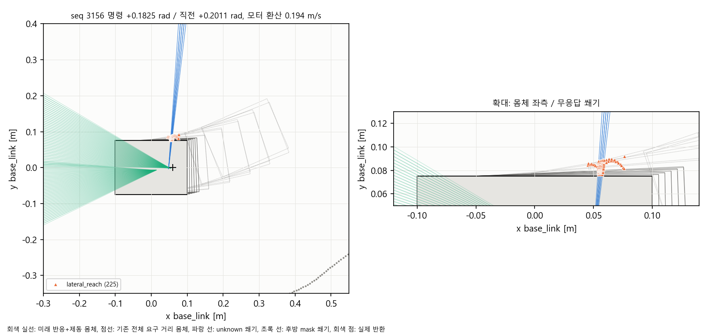

# G1 관측 충분성: 전방 전체 무응답 게이트의 후속 설계

## 1. 범위와 문제

10/16 오후 사용자는 이전 제한이 본인이 직접 요청한 것이 아니라 예약 프롬프트에 들어간 내용임을 지적했다. 이후 정지 요청 전까지 GPT 주 에이전트가 필요한 계획·개발을 판단하고 GPT-6 Luna가 실행/대기를 맡도록 했다. 보호 판단의 개선은 현재 작업 범위다. 새벽 범위의 ‘별도 승인 전 미구현’은 당시 종료 상태로 남기되 영구 금지로 승계하지 않는다.

[새벽 공식 단독 실패](G1_CORNER_BOUNDARY_2026_10_15.md#7-1016-승인된-공식-단독-1회와-후속-진단)는 43.113530 m 진행 후 발생했다. 새 경로 계산과 LiDAR 12 m 범위는 다른 기능이다. 경로 계산이 급커브를 처리해도, 경로와 독립적인 ±100° 전방 전체 유효 반환 요구가 일부 측방 무응답으로 출력을 막는다. 이번에는 기록을 대조해 그 무응답이 센서 범위 밖의 긴 직선 방향임을 설명했지만, 그 정답 지식을 운영 코드에 줄 수는 없다.

## 2. 수정 전에 확인할 것

1. 센서 각도만 줄이는 대신 현재 조향·속도·제동 거리에서 필요한 차체 외곽을 계산한다. 직진에 불필요한 측방이 회전에는 필요할 수 있다.
2. 무응답은 취득 원점부터의 미관측 방향으로 유지한다. 원래 각 셀 폭·취득 시각·차체 운동 보정을 보존하며, 거리 상한 반환을 만들어 넣지 않는다.
3. 후방 마스크·최소거리·측방 반사 실패에도 동일 원칙을 적용한다. 단지 목표 속도를 낮췄다는 이유로 현재 운동 속도를 지우지 않는다.
4. 현재 명목 차체 내부와 안전 여유를 구분한다. 현 차체를 검사에서 제외하는 것은 자유 공간이라고 선언하는 일이 아니며, 미관측 안전 여유까지 슬쩍 제외해서 진행시켜서는 안 된다.
5. 원시 결측/변형 메타데이터/시각 공백, 실제 반환 장애물, 회전 방향 반전, 취득 중 이동을 대조한다. 독립 보호층은 별도로 판단하고 `/drive/safe`를 우회하지 않는다.

## 3. 첫 비교

새 `probe_observation_envelope.py`는 저장된 무응답 스캔마다 기록 직전각/직진/좌우 한계각과 0.2/1.0 m/s 요구를 비교한다. 실제 모터축 환산 속도를 포함한 기존 제동식과 차량 치수를 유지한다. 정곡률 외곽 표본과 표본 사이 운동을 덮는 상계에서 각각 미관측 부채꼴 교차를 기록한다. 상계 교차는 실제 충돌 증명이 아니고, 실제 표본 교차도 미관측과의 겹침이지 물체 존재 증명이 아니다. 기존 깊이 감사와 차체 전체 영역의 의미도 구분한다.

[v1](../../artifacts/validation/2026-10-16/g1_observation_envelope_v1/README.md)은 13회귀 뒤 기존 평가 함수의 0.37 rad 상한과 실제 기록 0.3710583448410034 rad 차이로 분석을 중단했다. 이 실패와 snapshot을 보존했다. [v2](../../artifacts/validation/2026-10-16/g1_observation_envelope_v2/README.md)는 기록의 조향 상한을 직접 쓰는 평가 함수를 분리했다. 14회귀·78장면 분석을 완료했다. 운영 조향 한도나 기존 감사 기준을 수정한 것이 아니다.

첫 무응답(seq 2996)의 직전 조향 +0.175417 rad·모터 환산 0.58344 m/s에서 필요한 길이는 저속 목표라도 0.43229 m다. 측방 unknown 3개가 실제 표본 차체의 새 진입 부분과 겹쳤다. 단순히 측방이므로 무시할 수 없다. 기존 4 cm 간격 외곽 깊이 표본은 이 얇은 교차를 놓치므로 깊이 표본 통과를 전체 영역 관측으로 해석하지 않는다. 직진의 명목 새 진입 영역에서는 교차가 없었지만, 여유를 포함하면 후방 가림까지 들어온다. '현재 몸체'와 '몸체 주변 안전 여유'를 같은 것으로 취급하지 않았다.

## 4. 짧은 직진 후보 — 운영 미연결

[v1](../../artifacts/validation/2026-10-16/g1_linear_observation_v1/README.md)에서는 현재 직진 경로 일치 조건이 77개 모두 실패했다. 경로가 좌회전하기 때문에, 정지 후 남겨둘 0.16 m 간격까지 계속 직진해야 한다는 요구는 별도 의미라는 점을 분리했다. [v2](../../artifacts/validation/2026-10-16/g1_linear_observation_v2/README.md)는 관측 요구 거리/기존 간격은 유지하고, 최대 0.25초·모터축 환산 5 cm pulse와 반응·제동·여유에 해당하는 짧은 경로만 비교한다. 신규 순수 후보 55회귀, 저장 입력 72/77장면이 선행조건을 충족했다. 차체 정지·횡슬립·측방 cut-in·실제 제동 인증은 아니다.

다만 [정적 시점 대조](../../artifacts/validation/2026-10-16/g1_recovery_viewpoint_v1/report.json)에서 0/2.5/5/10 cm 직진 모두 무응답 광선 4개가 유지되었다. 이 대조는 정적 벽 기하의 평가이며 GPU/잡음/순차 취득 재현이 아니다. **짧게 움직일 수 있는 후보여도 관측 회복 이득이 없어 현재 운영 연결은 보류한다.** 반복 pulse로 몰래 진행시키지 않는다.

## 5. 후속: 실제 이전 광선의 제한된 재사용 대조

현재 unknown은 그대로 두되, 기존 0.3초 이내의 실제 유한 반환을 현재 모터축/자이로 이력으로 옮겼을 때 새 진입 영역의 깊이를 지지하는지 비교한다. 경계 경로의 기억과 관측 광선의 기억은 다른 자료다. 오래된 관측·같은 스캔의 시각 재설정·마스크 구간 보간·정답 지도 입력은 허용하지 않는다. 먼저 첫 8개 무응답 고유 스캔에서 현재/이전 깊이 지지를 대조하고, 현재 실제 반환 장애물 우선·움직이는 물체·외곽 표본 사이 한계를 따로 검토한다. 아직 실행 정책은 아니다.

[평가 v1](../../artifacts/validation/2026-10-16/g1_temporal_observation_v1/README.md)은 list/배열 인덱스 오류로 1통과/2실패, 분석 미실행이다. [v2](../../artifacts/validation/2026-10-16/g1_temporal_observation_v2/audit/report.json)는 3회귀 뒤 첫 8장면을 대조했다. 첫 정지 순간의 1 cm 격자/얇은 unknown 대표점 723개 중 현재 720개·이전 스캔 포함 723개가 깊이 지지됐다. 이전 스캔의 최초 취득 나이는 0.218초였다. +0.175417 rad 좌회전 민감도에서는 처음 3장면만 모두 지지됐고 이후 만료로 미지지가 남았다. 차체 정답은 이 계산에 사용하지 않는다.

`observation_support.py`의 별도 순수 모듈은 현재/최근 최대 3개 장면·원 취득 시각·세대·현재/직전각 외곽·얇은 unknown 교차 질의를 보존한다. 정면 ±60° 결측은 과거로 가리지 않고 즉시 거절하며 현재 반환 장애물은 이력보다 먼저 검사한다. 새 전면 0.16~0.30 m 장애물/세대/역행/시각 만료 포함 [v2 22회귀](../../artifacts/validation/2026-10-16/g1_observation_support_v2/tests.log), [v1과 16사례 판단 동일성](../../artifacts/validation/2026-10-16/g1_observation_support_v2/audit/report.json)을 확인했다. 2 cm 외곽과 unknown 교차 꼭짓점/대표점의 검사이며 연속 외곽·표본 사이·동적 침입을 증명하지 않는다. 단일 호출 비용 25~95 ms가 관찰되어 현재는 런타임 미연결이다. 계산/역학/시간 검증을 구분한다.

[프로파일](../../artifacts/validation/2026-10-16/g1_observation_support_profile_v1/profile.pstats)에서는 전체 trace 재구성/장면 이송 비용과 관측기 비용을 분리했다. 관측기 자체에서는 `clip_halfplane` 반복이 컸다. 현재 명목 차체 안에만 걸친 unknown은 기존 제외 의미 그대로 사전 걸러내는 최적화를 판단 동일성 대조 중이다. 여유 영역이나 실제 새 진입 영역을 버리는 최적화는 하지 않는다.

비교 참고: [Nav2 Jazzy Collision Monitor](https://docs.nav2.org/jazzy/configuration_and_development/configuration_guide/core_servers/collision_monitor/configuring_collision_monitor_node/)도 명령 속도별 영역과 센서 시각 제한을 독립적으로 둔다. 이를 여기의 모든 unknown 무시 허가나 실차 안전 인증으로 해석하지 않는다. 이번 구현은 Nav2 이식이 아니라 기존 독립 보호에 필요한 관측 근거를 검토하는 것이다.

## 6. 측방 시간 불확실성 반례와 후속 선택지

[최적화 v4](../../artifacts/validation/2026-10-16/g1_observation_support_v4/audit/report.json)는 22회귀·v1 대비 16/16 판단/메타데이터 동일을 확인했다. 단일 호출은 기록각 약 10~39 ms, 추가 좌회전 비교 약 31~67 ms(잘못된 상태의 조기 반환 제외)다. 이는 오프라인 PC 비용이며 20 ms 제어 마감 통과가 아니다.

연산 개선보다 먼저 채택 가능성을 다시 검토했다. 기존 깊이 검사는 **반환점에서 깊이 방향으로** 물체 이동 여유를 차감하지만, 미관측 부채꼴의 **옆 경계로부터** 물체가 들어오는 여유를 자동으로 포함하지는 않는다. `audit_observation_history.py`는 같은 `.5 m/s` 가정과 원 취득 시각을 사용해, 질의점에 도달할 수 있는 과거 미관측 출발점이 있는지를 별도로 대조했다. 현재 명목 몸체 안은 출발점에서 제외한다. 가정 속도의 물체가 실제 있었다거나 충돌했다는 결과가 아니다.

[감사 v1](../../artifacts/validation/2026-10-16/g1_observation_history_v1/audit/report.json)은 관련 26회귀 통과 뒤 8장면·16조향 사례를 검사했다. 모든 질의의 깊이가 지지된 경우는 12개였지만 측방 도달 가능성까지 제외하면 7개였다. 최초 정지 입력 seq 2996의 기록각은 762개 깊이 질의 중 **3개가 측방 미관측에서 도달 가능**해 남았다. 따라서 이전 762/762 깊이 통과를 운용 허가로 쓰지 않으며 **최근 광선 후보는 그대로 연결하지 않는다.** 음수 모터 속도·경로 지지·연속 차체 외곽 등의 별도 운용 조건을 모두 확인한 16개 합격률이라는 뜻도 아니다.

다음은 고정된 원래 조향만 허용하려고 과거 자료를 보강하는 대신, 현재 관측 영역 안에 머무는 작은 조향 선택지가 있는지 저장 입력으로 비교한다. 현재/직전 조향의 점유, 실제 모터축 환산 속도, 원 제동식·간격·8 cm 경로 일치 범위를 유지한다. 선택지 통과는 경계 확인이나 운용 연결을 뜻하지 않는다. 짧은 직진의 기존 기하 대조는 무응답 **개수**만 확인했으므로, 그 개수가 같아도 다음 회전의 새 진입 영역과의 관계가 달라지는지는 별도로 남는다.

이 절의 비교 당시에는 운영 미연결이었다. 후속 선택형 연결은 아래와 같으며 기본값은 유지한다. 새벽 실패·판단 재생·정지/종료 증거는 새 분석 성공으로 소급하지 않는다.

## 7. 후방 사각과 기존 보호 범위의 구분

[첫 장면 증거](../../artifacts/validation/2026-10-16/g1_observation_history_witness_v1/audit/report.json)를 다시 추적했다. 측방 도달 가능성에서 남은 3개 질의는 앞쪽의 12 m 결측이 아니라 **후방 차체 모서리의 새 진입 부분**이었다. 현재 몸체 뒤·옆의 가림에서 약 5.5~5.7 cm 떨어져 있고 해당 광선의 취득 시차 팽창과 겹쳤다. 이를 앞쪽 12 m 결측의 실패 원인과 섞으면 요구 범위를 잘못 설명하게 된다.

기존 보호층의 관측 요구는 전방 ±100°였다. 새 `observation_lateral.py`는 이 범위의 새 진입 질의에 한해 과거 미관측에서의 횡방향 도달 가능성도 추가 대조한다. 후방 질의의 실제 깊이 확인과 현재 모든 반환점 점유 검사는 그대로 유지하되, **기존에 보장하지 않던 후방 사각의 동적 침입까지 해결했다고 주장하지 않는다.** `rear_dynamic_risk_unresolved=true`를 결과에 남긴다. 후방 공간을 자유로 채우거나 센서 마스크를 제거하지 않았다.

[범위 대조 v1](../../artifacts/validation/2026-10-16/g1_observation_scoped_v1/audit/report.json)은 관련 36회귀와 첫 8장면·16사례를 검사했다. 최초 기록각의 762개 질의는 원 취득 시각을 유지한 이전 광선까지 포함해 지지됐다. 이 결과는 새 횡방향 조건이 들어간 것이므로 이전 16사례와 완전 동일한 판단이라고 표시하지 않는다. 단일 함수 비용은 최대 약 71 ms로 20 ms 제어 주기보다 길었다. 이전 실행 도구의 `reference_mismatches=0`은 비교를 하지 않은 경우에도 출력되는 표현이어서, 이후에는 `reference_compared=false`와 `reference_mismatches=null`로 구분한다.

## 8. 선택형 연결 — 단위/저장 입력까지, 실제 실행은 후속

`--g1-recent-observation` / `g1_recent_observation_enabled:=true`는 기존 거리 경계·점별 시각·회랑 후보를 함께 명시해야 사용할 수 있다. 기본값은 false다. 계획기와 독립 보호층은 **각자 받은 센서·운동 이력으로 별도로 확인**하며 계획기의 통과 표시는 보호층 입력이 아니다.

- 측방 결측에서는 현재 반환점으로 경로를 먼저 계산할 수 있게 하되, 그 경로가 있다는 이유만으로 구동하지 않는다. 정면 ±60° 결측·잘못된 순차 취득·0.3초 이상 관측·음수/비정상 운동은 보완 근거로 사용하지 않는다.
- 보완이 필요한 명령은 최대 0.2 m/s로 제한한다. 제동 요구 거리는 목표뿐 아니라 실제 모터축 환산 속도로 계산한다. 이는 실측 제동 성능이나 권장 실차 속도 확정이 아니다.
- 현재/직전 조향의 새 외곽, 얇은 결측 교차와 실제 반환 장애물을 검사한다. 같은 스캔 재수신으로 시각을 갱신하지 않고, 시계 역행·세대 변경·관측 만료로 이력을 비운다.
- 기존 HOLD/0명령을 관측 검사만으로 양의 명령으로 바꾸지 않는다. `/drive` → 독립 보호층 → `/drive/safe`와 입력 신선도·STOP은 유지한다.
- 2 cm 자세 표본 및 교차 꼭짓점 검사는 연속 외곽, 두 조향각 사이 모든 전환, 횡슬립, 실제 차체 정지, 동적 cut-in의 보증이 아니다. 500점·10 Hz·현재 장착값 시험 구성에 한정한다.

단위 회귀 v1/v2는 ROS Python 경로가 실행 shell에서 소실되어 수집 단계에서 실패했고, bash 파일로 환경 설정을 묶은 v3에서 정상 수집됐다. v3의 223통과/1실패는 시계 역행 시 입력 삭제를 반영하지 못한 시험 mock 문제였다. 실제 시계처럼 입력과 독립된 stamp를 사용하도록 시험을 수정한 [v4](../../artifacts/validation/2026-10-16/g1_recent_observation_unit_v4/tests.log)에서 **224회귀 모두 통과**했다. 실패 로그·실행 전 snapshot은 모두 보존한다.

[후속 저장 입력 대조](../../artifacts/validation/2026-10-16/g1_recent_observation_replay_v1/README.md)는 옵션 OFF일 때 기존 **2,837판단 모두 일치**했다. ON일 때 341회 명령 tuple이 달라졌고, 그중 실제 관측 보완 선택은 3회였다. 최초 seq 2996(59.92 s)은 `follow_front_unobserved`·0에서 `local_follow`·0.2 m/s·조향 0.19123 rad로 바뀌었다. 이후 모터 역회전/복귀 대기 등에는 정지가 유지됐다. 나머지 입력은 **기존 정지 명령을 받은 차량의 기록**이므로 새 명령으로 주행하면 어떻게 되는지는 이 재생에서 알 수 없다. 341회 전진이나 코너 통과를 뜻하지 않는다. 최대 판단 77.32 ms, 입력/소스 불변을 확인했다. 현재 구성은 20 ms 주기를 충족했다고 볼 수 없으며 기본 채택 전 실제 실행 비용을 따로 검증해야 한다.

`recent_observation_r0_sha256.json`은 이전 회랑 계약을 덮어쓰지 않고 선택형 변경의 후속 소스 계약으로 연결했다. 독립 보호층의 이전 hash는 새벽 시험 snapshot과 대조했다. 다음 실행용 `validate_pipeline_faults_ros.py`에는 `g1_recent_observation_candidate`를 추가해 두 노드 각각의 실제 옵션 사용·측방 결측 0.2 m/s 제한과 기존 입력/프로세스 고장을 확인하도록 준비했다. 작성과 실제 시험 통과는 구분한다.

전체 회귀 [v1](../../artifacts/validation/2026-10-16/g1_recent_observation_regression_v1/tests.log)은 2,672통과/7실패였다. 독립 보호층·평가기의 후속 계약을 일부 과거 검사에서 따라가지 못한 연결 누락이다. 이전 계약 JSON은 수정하지 않고, 후속 등록의 실제 `after`와 부모 hash를 확인한 뒤 역사적 `before`와 대조하도록 정리했다. 이 연결의 소스·부모 변조 거절 반례도 추가했다. G0 기본 비교 도구는 여전히 실제 변경(launch·보호층)을 차이로 보고하며, 예전 원본이 같다고 소급 표시하지 않는다.

최종 [전체 회귀 v2](../../artifacts/validation/2026-10-16/g1_recent_observation_regression_v2/README.md)는 **2,682개 모두 통과**했다(82.54 s). 실행 전 `src/scripts/tests/config` 943파일 snapshot과 사후 hash를 대조해 변경 0을 확인했다. 단위 시험·저장 입력 검증까지의 마감이며 colcon 빌드·ROS 고장 시나리오·새 Gazebo 주행을 실행한 결과가 아니다.

## 9. 10/16 마감과 당시 재개 순서

사용자의 마감 요청에 따라 새 colcon 빌드·ROS 고장 시험·Gazebo 주행은 시작하지 않았다. 마지막 전체 회귀 통과를 확인해 소스/문서/활동 기록을 정리했고 시험 프로세스는 종료됐다. 커밋·푸시·외부 게시·Jetson/전원 변경은 하지 않았다.

1. ROS Jazzy 및 `install/local_setup.bash`를 source한 **bash 파일**로 checkout의 Python 경로를 기존 `PYTHONPATH` 앞에 추가한다. 환경 수집 실패 v1/v2를 기능 실패나 패키지 미설치로 해석하지 않는다.
2. `colcon build --symlink-install --packages-select arena_autonomy arena_bringup` 후 `scripts/validate_pipeline_faults_ros.py --controller-profile g1_recent_observation_candidate --scenario full --wall-cap 600 --output <새 artifact/run>`을 1회 실행한다. 계획기와 보호층의 실제 설정·발행자/입력 경계·측방 .2 제한·기존 입력/프로세스 고장·정지·소유 프로세스 종료를 각각 확인한다. 42조건은 준비한 시나리오 수이며 아직 통과 수가 아니다.
3. 최대 77.32 ms의 결정 비용 원인을 분리하고, 독립 보호층의 별도 이력 투영/관측 검사 비용을 포함해 검토한다. 검사 생략·TTL 연장·안전 여유 축소 대신 동등 출력 최적화 또는 계산 시점/보수적 정지 정책을 검토한다. 실시간 마감 충족 전에는 운영 기본값을 켜지 않는다.
4. 앞 조건이 타당할 때 새벽과 같은 속도·물성·센서·정지/노면 판정에 `--g1-recent-observation`만 추가한 공식 단독 1회로 실제 진행 여부를 확인한다. 실패는 보존하고 성공할 때까지 반복하지 않는다. G2·고속화·전체 코스 완료로 선행 결과를 확대하지 않는다.

남은 관측 한계는 후방 동적 사각, 2 cm 표본 사이와 두 고정 조향각 사이의 연속 외곽, 모터축 속도와 실제 차체 이동의 차이, 실물 센서/제동이다. 회랑→기존 경로 전환의 만료/형상 차이도 이전 보고서에 남아 있다.

## 10. 10/17 실제 ROS 연결의 첫 실패와 직진 극한 수정

06:30 KST 예약 작업으로 재개했다. [ROS v1](../../artifacts/validation/2026-10-17/g1_recent_observation_ros_v1/run/validator_output/report.json)은 두 패키지 빌드 후 실행했으나 `recent_side_observation_independent_cap`에서 시간 초과로 실패했다. 부팅/초록만 출발 금지/새 적색→초록 회복의 3조건과 실패 회수 STOP은 통과했으며, 예정한 전체 42조건을 수행한 결과가 아니다. 실제 모델 정지·cleanup 오류/잔존 프로세스 0·런타임 소스 hash 일치를 확인했다. 기존 실패는 보존한다.

이 실패에서 계획기는 `follow_observation_unconfirmed`와 `follow_release_wait`를 반복했고 보호층은 0명령을 그대로 유지했다. 저장 상태에서 정지 후 조향은 약 −9.61×10⁻⁹ rad였다. [합성 직선 분리 v1](../../artifacts/validation/2026-10-17/g1_recent_straight_precision_v1/report.json)에서는 정확한 0 rad가 189/189 질의를 지지했지만 이 작은 음수각은 394개 중 21개를 후방 마스크 때문에 거절했다. ROS float32 각도/거리 여부와 무관하게 재현됐다.

두 구현 문제를 구분해 수정했다. 첫째, 작은 원호에서 `(1-cos(yaw))/curvature`가 소거 오차를 일으켜 정확한 곡선 위치를 잃으므로 같은 식인 `2*sin(yaw/2)**2/curvature`를 사용한다. 둘째, 얇은 결측 부채꼴을 자른 **닫힌** 다각형에는 현재 몸체 경계의 꼭짓점도 포함되므로, 일반 외곽 표본과 동일한 기존 `1e-10 m` 몸체 제외 조건을 이 질의에도 적용한다. 별도 조향 deadband나 안전 여유 축소는 넣지 않았다.

[v2 기하 진단](../../artifacts/validation/2026-10-17/g1_recent_straight_precision_v2/report.json)에서 음수 미세각은 381/381 지지로 바뀌었다. 반대 부호의 미세각은 실제 왼쪽 90° 결측 부근 `(0.059529, 0.075000000573) m`, 광선 375/376으로 새 외곽이 들어가므로 계속 거절한다. 처음 추가한 단위 시험은 양쪽 부호 모두 통과를 기대해 79통과/1실패였고, 이 기대가 잘못됐음을 좌표로 확인하여 **실제 결측 방향은 정지 유지**로 고쳤다. 미세한 실제 침입까지 임의로 허용한 결과가 아니다. 원래부터 보장하지 못한 후방 동적 침입/연속 외곽의 한계도 유지한다.

깊이 질의는 원래 인접 광선 선택과 여유를 유지하면서 큰 `(질의,500,2)` 임시 배열을 없애고 선택한 두 광선의 거리만 구하도록 정리했다. [첫 scoped 대조](../../artifacts/validation/2026-10-17/g1_recent_support_comparison_v1/report.json)의 16사례 통과/거절은 모두 이전과 같지만, 현재 몸체 경계점 제외로 7사례의 질의 수/상세 정보가 달라졌다. 따라서 전체 메타데이터 동일이라고 하지 않는다. 이 대조 최대 44.34 ms는 여전히 20 ms보다 길며, 직전 82.71 ms는 cProfile이 포함된 측정이므로 두 수치로 순수 가속률을 계산하지 않는다. 후속 실제 ROS/동일 조건 비용 검증은 별도 결과로 남긴다.

### 10.1 지속 결측 시험 실패와 안전 계약 시험의 구분

수정 후 관련 93회귀가 통과했지만 [ROS v2](../../artifacts/validation/2026-10-17/g1_recent_observation_ros_v2/run/validator_output/report.json)도 같은 지속 주행 조건에서 실패했다. 실제 도달한 4조건 중 3개가 통과했으며 실패 회수 STOP과 정상 종료는 별도 확인이다. 양의 명령 및 독립 보호의 지지 표시가 일부 나타났지만, 보호 정지/복귀가 반복돼 가속 ramp가 약 0.01 m/s부터 다시 시작했다. 이것을 “0.2 m/s 지속 주행 성공”으로 표시하지 않는다.

관측 나이가 증가하는 [합성 대조 v1](../../artifacts/validation/2026-10-17/g1_recent_age_v1/report.json)에서는 0.105~0.135초에 두 조향 모두 지지되고, 0.155초부터 미세 음수각이 미지지, 0.195초부터는 정확한 직진도 미지지가 됐다. 현재/이전 결측을 계속 자유 공간처럼 쓰는 것이 아니라 취득 뒤 미관측 영역으로부터의 이동 가능성을 차단하기 때문이다. v1의 독립 설명용 witness는 후방까지 포함했으므로 개별 witness를 전방 ±100° 거절 원인으로 그대로 인용하지 않는다. 후속 진단은 보호 범위에 해당하는 질의만 독립 대조한다.

따라서 원래 `continuity` 시험의 `>0.05 m/s`·지속 구간 조건과 실패는 보존한다. 새 **명시 시험 모드** `--recent-check-mode evidence_expiry`는 요구사항이 다르다. 두 독립 노드에서 실제 결측을 검사한 양의 제한 명령 증거를 회수한 뒤, 새 스캔 공급을 끊으면 과거 근거가 만료되어 밀집 0출력/모델 정지가 유지되는지, 전체 반환이 복구되면 기존 진행 조건으로 돌아오는지 확인한다. 이 모드의 통과를 지속 결측 통과나 코스 완주로 대신하지 않는다. 통과를 위해 운영 TTL·여유·물성·STOP 판정은 변경하지 않는다.

### 10.2 같은 조건의 비용 비교

[AB/BA 비용 v1](../../artifacts/validation/2026-10-17/g1_recent_cost_v1/report.json)은 같은 16사례를 교대로 각 3회 호출했으며, 잘못된 운동 상태로 즉시 반환한 경우를 제외하면 버전별 36표본이다. 프로파일러는 시간 측정 중 껐고, 깊이/기하 변경 전→후의 p50 **32.72→20.03 ms**, p95 **61.68→36.55 ms**, 최대 **62.77→37.37 ms**였다. 20 ms 초과는 21→20개로, 개선은 있었지만 주기 충족은 아니다. 통과/거절은 같고 메타데이터 차이는 앞 절과 같다. 입력·소스 불변을 확인했다.

별도 cProfile에서는 `sweep_queries`가 18호출 누적 0.228초, `clip_halfplane` 138,345호출 누적 0.143초였다. 이에 현재 몸체의 축 정렬 반평면과 전혀 교차하지 않는 조각/이미 전부 바깥인 조각을 먼저 구분하여 불필요한 자르기를 줄이는 동등 계산을 추가했다. 이전 기하/면적 조건 대조 회귀와 동일 입력 비용 재측정으로 판단하며, 함수 시간은 ROS 두 프로세스·센서 전달·Jetson 마감 시간과 구분한다.

최적화 후 [전체 회귀 v1](../../artifacts/validation/2026-10-17/g1_recent_regression_v1/pytest.log)은 2,707통과/1실패였다. 후속 소스 계약의 부모 SHA-256을 옮겨 적으면서 한 글자를 잘못 적은 것이 원인이었으며, 실제 부모 파일의 hash와 대조하여 후속 JSON만 정정했다. 원본 계약·런타임 판정·기존 실패 기록은 변경하지 않았다. 후속 회귀와 실행은 새 산출물로 구분한다.

[전체 회귀 v2](../../artifacts/validation/2026-10-17/g1_recent_regression_v2/pytest.log)는 **2,708개 모두 통과**했고 전후 소스 hash가 같다. [비용 v2](../../artifacts/validation/2026-10-17/g1_recent_cost_v2/report.json)의 같은 입력 36표본/버전에서 추가 사전 제외 전→후 p50 **23.79→21.11 ms**, p95 **34.38→31.35 ms**, 최대 **35.12→32.28 ms**다. 20 ms 초과는 21→18개이며 판단은 동일하다. v1과 v2의 이전 버전 수치가 다른 것은 서로 다른 실행이므로 전체 가속률을 교차 계산하지 않는다.

### 10.3 실제 ROS 만료·복구 계약 통과와 제한 코스 시험 결정

[ROS v3](../../artifacts/validation/2026-10-17/g1_recent_observation_ros_v3/run/validator_output/report.json)는 `evidence_expiry`에서 **43/43조건**이 통과했다. 실제 선택 증거는 `/drive` 약 0.02 m/s, `/drive/safe`와 적용 출력 약 0.01 m/s였다. 두 독립 노드가 실제 측방 결측을 처리했음을 확인한 **시점 증거**이며 0.2 m/s 지속 주행을 입증하지 않는다. 새 스캔을 끊은 뒤 신선도 거절·정지 유지 0.6초 구간, 적용 0출력 73개·최대 관측 간격 0.01초·정지 유지 변위 0 m를 확인했다. 전체 반환 복구 후에는 기존 0.4 m/s 초과 진행 기준으로 회복했다. 실패한 v1/v2의 지속 조건은 별도로 남는다.

나머지 기존 센서/영상/프로세스 고장·명시 STOP·재허가 조건도 실행했으며 cleanup 오류·잔존 session/vision 프로세스는 0, 런타임 소스 hash는 일치했다. 이는 합성 직선 입력과 임시 종방향 모형의 ROS 경로 검증이며 Gazebo 물리 제동/실물 시험은 아니다.

[나이 진단 v2](../../artifacts/validation/2026-10-17/g1_recent_age_v2/report.json)는 설명용 witness도 보호범위 안으로 제한했다. age 0.155/0.175초의 미세 음수각에서 왼쪽 결측 ray 375와 새 전면 모서리 사이 약 0.0395 m가 0.04/0.05 m 이동 상계 안이었다. 단순한 float 오류와 달리 관측 시차로 남는 위험이다. 이 값은 실제 차량 접근 속도 측정이 아니다.

[옵션 OFF 재생](../../artifacts/validation/2026-10-17/g1_recent_replay_off_v1/baseline.json)은 2,837개 모두 같고, [ON 반사실 재생](../../artifacts/validation/2026-10-17/g1_recent_follow_v2/run/report.json)은 명령 tuple 변경 341회·실제 보완 선택 3회로 이전 결과와 같았다. 전체 판단 최대 50.60 ms로 실시간 문제는 남는다. ON 최초 호출은 도구가 새로 만들 출력 폴더를 실행기가 먼저 생성한 준비 오류로 분석 전에 종료됐고, 기존 로그를 보존한 뒤 새 하위 경로에서 1회 분석했다.

정지·복구 연결이 확인됐으므로 [공식 단독 v1 실행 정의](../../artifacts/validation/2026-10-17/g1_recent_solo_v1/README.md)로 제한 1회를 진행한다. 목적은 **느린 오프라인 Gazebo에서 보완 후보가 실제 궤적에 주는 효과와 정지/종료**를 확인하는 것이다. 계산이 20 ms 안에 끝난다는 전제가 아니며, 50 Hz 실시간/Jetson 성능 합격이나 기본 활성화 근거로 사용하지 않는다. 한도·센서·물성·STOP은 기존과 같고 실패해도 자동 재시도하지 않는다.

### 10.4 공식 단독 결과 — 일시 보완 후 정지, 완주 실패

[실행 결과](../../artifacts/validation/2026-10-17/g1_recent_solo_v1/run/report.json)는 **43.093540 m·완주 0회**, 기존 43.113530 m 실패와 실질적으로 같은 구간이다. 목표 48.6329 m를 충족하지 못했다. [판단 집계](../../artifacts/validation/2026-10-17/g1_recent_solo_v1/recent_summary.json)에서 seq 3151~3155, 시뮬레이션 63.02~63.10초의 **5회**에 실제 관측 보완·0.2 m/s 명령이 선택됐다. 실행 담당의 최초 요약은 종료 순간의 미선택을 전체로 잘못 표현했으나 원시 기록 대조로 5회를 확인했다.

63.12초의 다음 스캔에서 977질의 중 752개만 지지되어 정지했다. 이어 재출발 대기·경계 확인 실패가 유지돼 70.16초에 기존 지속 정지 판정을 받았다. 기존 .65 m 경계 관측/양측 재획득 조건과 현재/이전 광선 지지는 서로 다른 검사이며, 하나만 개선해 완주했다고 볼 수 없다. 실패 뒤 새 주행을 반복하지 않고 해당 저장 입력을 분석한다.

3,001판단 재생이 모두 일치했고 전점 점유 감사는 2,581평가/420미평가로 통과했다. 589개 주행 노면 표본에서 차체 외곽의 도로 밖 면적은 0, 충돌 표본도 0이었지만 연속/실차 무충돌 인증은 아니다. 실패 회수 STOP은 MCU `ESTOP_LATCHED/software_stop` 확인, 밀집 238구간·최대 시각 간격 3 ms·최대 차체 속도 약 0.000526 m/s로 통과했다.

**정상 종료는 실패했다.** `/server_control`은 응답했고 서버 PID도 사라졌지만 `gz-1`이 `libgz-sim8.so.8` 내부 스택과 함께 SIGSEGV(-11)로 끝났다. 자식 14개 중 13개 정상, 잔존 0·소스 불변이다. 정지 서비스 응답과 프로세스 소멸을 clean exit로 바꾸지 않는다. 주행 정지는 그보다 먼저 기록됐고, 이번 스택만으로 기존 GPU/종료 잠금 문제와 같은 원인이라고 확정하지 않는다. 상세 로그는 [simulation.log](../../artifacts/validation/2026-10-17/g1_recent_solo_v1/run/simulation.log), 이전 분류는 [종료 분석](../simulation/SHUTDOWN_DIAGNOSIS_2026_09_15.md)을 참조한다.

### 10.5 첫 거절의 원인 분리 — 깊이 부족이 아니라 측방 도달 가능성

[저장 입력 진단](../../artifacts/validation/2026-10-17/g1_recent_rejection_v1/report.json)은 최초 거절 뒤 12호출까지 2,627개 원래 출력을 재생해 불일치 0을 확인했다. 첫 거절의 977질의는 현재/이전 반환 깊이만으로는 모두 지지됐다. 부족한 225개는 **전부 기존 전방 ±100° 보호범위 안의 측방 이동 가능성** 때문이며, 깊이 부족 0개·후방 거절 0개다. `lateral_rejected_queries=256`은 여러 출처 검사 중 중복도 세는 값이므로 고유한 미지지 225개와 다르다.

독립 Shapely 대조는 질의 `(0.045106, 0.084610) m`에 대해 현재 광선 368의 미관측 영역에 출발점 `(0.057389, 0.083297) m`가 있음을 찾았다. 둘 사이 **12.35 mm**는 원 취득 시각 63.0756초부터 판단 시각 63.12초까지의 기존 `.5 m/s` 이동 상계 **22.20 mm**보다 작다. 이전 스캔의 광선 373에서도 같은 질의에 대해 40.11 mm < 71.70 mm였다. 현재/이전 스캔의 무응답은 각각 4개이며 센서 원점·취득 시각은 보존했다.

이는 실제 물체나 충돌을 발견했다는 뜻이 아니다. **주어진 정보만으로 해당 측방 공간이 비었다고 확정할 수 없다는 반례**다. 앞 절의 극미세 조향 수치 오류와는 구분해야 한다. 정지 뒤에는 경계 기억 만료와 긴 바깥 경로 재획득 실패도 이어졌으므로, 과거 광선만 더 오래 보관하거나 무응답 방향을 지우는 것으로 해결하지 않는다.

### 10.6 판정을 바꾸지 않는 부채꼴 계산 사전 제외

좁은 광선 부채꼴의 두 cross 반평면 교집합은 센서 광선 정방향의 dot 반평면 안에 있다. 볼록 외곽 조각의 모든 꼭짓점이 이 방향의 뒤에 있으면 원래도 교차가 불가능하다. 이를 clipping 전에 제외하고 경계 `1e-12` 이내는 기존 계산으로 보낸다. 관측 영역·TTL·실제 질의·점유/보호 조건을 축소하는 변경이 아니다.

[운영 미연결 shadow v2](../../artifacts/validation/2026-10-17/g1_recent_forward_halfplane_shadow_v2/report.json)는 4운동×9조향×4거리 **144사례의 질의 좌표와 얇은 교차 수가 완전히 같았다.** 동일 실행의 질의 생성 p50/p95/최대는 8.57/15.07/17.12 → 5.57/10.98/12.93 ms였다. 전체 판단이나 ROS 마감 시간이 아니다. 최초 shadow v1은 평가용 문자열 치환의 들여쓰기가 잘못되어 반복문 밖에서만 `possible`을 갱신한 준비 오류였다. 128/144 불일치와 원본/생성 코드를 보존하고 운영에 반영하지 않았다. 올바른 들여쓰기의 v2와 별도 원본 cross-only 회귀를 근거로 후속 소스 계약 `recent_observation_wedge_r0_sha256.json`을 추가한다. 과거 계약은 덮어쓰지 않는다.

운영 함수 반영 후 [전체 회귀 v3](../../artifacts/validation/2026-10-17/g1_recent_regression_v3/pytest.log)는 **2,854개 통과**·소스 불변이다. [동일 입력 비용 v3](../../artifacts/validation/2026-10-17/g1_recent_cost_v3/report.json)의 36표본/버전에서 통과/거절뿐 아니라 모든 상세 결과가 같았다. p50 **22.06→16.46 ms**, p95 **32.55→24.88 ms**, 최대 **32.85→25.52 ms**, 20 ms 초과 **21→3개**다. 여전히 실시간 마감 통과는 아니다. 후속 전체 주행 기록 재생은 10/17 ON **3,001/3,001**, 10/16 OFF **2,837/2,837**가 기존 `equal_output`의 `1e-10` 부동소수점 허용오차 안에서 일치했다. 원시 질의 좌표는 앞의 배열 완전일치와 별도로 구분한다. 입력·소스 hash도 불변이다.

### 10.7 같은 실제 운동에서 작은 조향/감속 대안

[운영 미연결 대조](../../artifacts/validation/2026-10-17/g1_recent_alternative_shadow_v1/report.json)는 실제 모터축 속도와 직전 조향을 그대로 두고, 한 주기의 조향 변화 `−.06/−.03/0/+.03/+.06 rad`와 목표 `.05/.1/.2 m/s`의 15조건을 각각 비교했다. 다른 차량의 형상/최소 크기, 물체 운동 상계, 제동식·TTL·노면·독립 보호 조건은 바꾸지 않았다.

| 시점 | 관측 지지 | 해석 |
|---|---:|---|
| 63.02 s, 최초 보완 | 15/15 | 실제 속도 .632 m/s를 포함하므로 목표만 낮춰도 같은 .458 m 요구가 남음 |
| 63.12 s, 첫 거절 | 0/15 | 작은 조향 변경/목표 감속만으로 기존 측방 거절을 피하지 못함 |
| 63.32 s, 모터 환산 역행 | 0/15 | 음수 실제 입력을 0으로 바꾸지 않고 무효 상태로 거절 |
| 63.42/63.52 s, 모터 환산 0 | 각각 3/15 | 정확한 직진의 세 목표만 관측 지지. 경로·노면·실제 차체 정지나 주행 허가를 뜻하지 않음 |

정지 후 오른쪽 실제 경계는 1.8 m 관측·차체에서 약 .439 m 거리에 있다. 왼쪽 관측은 약 .451 m로 기존 .65 m 양측 재획득 조건을 충족하지 못한다. 현재 회랑 함수는 입력 `side`의 반대쪽을 긴 바깥 벽으로 검사하므로, 이때 선호 벽 `right`가 실제 긴 오른쪽 관측과 같은 상황에서는 짧은 왼쪽만 긴 기준으로 시도한다. 선호 방향과 코너 안쪽/바깥쪽 역할을 혼동한 한계인지 별도로 분석한다. 단순히 선호 벽을 반대로 바꾸면 마커의 분기 의도가 바뀔 수 있으므로 그렇게 연결하지 않는다.

### 10.8 경계 기억 불일치와 선호 벽/코너 역할 분리

[같은 기억 유효 구간의 경계 대조 v2](../../artifacts/validation/2026-10-17/g1_recent_boundary_refresh_v2/report.json)는 seq 3156의 경로를 seq 3161로 운동 보정했다. 원 취득 후 **.218초**로 기존 .3초 안이다. 현재 원시 412점, 기억 지지 선택 뒤 399점, 추가 돌출 제거 뒤 399점 각각에서 만든 경로는 모두 1.8 m 관측·벽 거리 .43901 m로 길이/앵커 조건을 충족했다. 하지만 공통 x구간 .39443 m의 대칭 최근접 p80 차이가 **.126756 m**로 기존 .08 m 일치 조건을 넘었다(최대 .320445 m). 원인은 짧은 관측만이 아니라 **기억 경로와 새 경로의 형상 차이**도 있다. 이것만으로 실제 새 경로가 더 옳다고 판정하거나 허용치를 늘리지 않는다. v1은 평가기에서 tuple을 NumPy 인덱싱해 실패했으며 로그를 보존하고 v2에서 입력 배열 형식을 정정했다.

별도 [역할 대조](../../artifacts/validation/2026-10-17/g1_recent_boundary_roles_v1/report.json)의 9개 저장 시점은 모두 선호 경계가 `right`였다. 이를 코너 **안쪽**으로 간주한 기존 기하는 짧은 왼쪽을 긴 바깥 기준으로 요구해 거절했다. 반대로 왼쪽을 안쪽, 오른쪽을 바깥쪽으로 평가하면 9개 모두 약 1.035~1.078 m의 기하 지지가 나왔고 현재 오른쪽 관측에서 만든 경로와 일치했다. 선호 경계와 실제 코너 안/바깥 역할은 같은 개념이 아니다.

이에 운영에서 import하지 않는 [역할 구분 후보](../../src/arena_autonomy/arena_autonomy/corridor_roles.py)를 추가했다. 기존 역할의 성공은 그대로 유지하며, 실패할 때만 반대 기하 역할을 평가한다. 선호 경계를 바꾸지 않고 현재 선호 관측 경로·원래 .65 m 길이·앵커·형상 일치를 다시 요구한다. 안쪽 실제점의 정체성은 여전히 미확정이고 전점 점유·시간 확인·관측 검사·독립 보호는 별개다. **기하 지지만으로 기억 갱신이나 분기 의도·구동을 인증하지 않는다.** 좌우 대칭/기존 성공/잘못된 입력/현재 선호 경로 불일치를 포함한 관련 60회귀가 통과했으며, 운영 연결과 새 주행은 하지 않았다.

[전체 저장 입력 대조](../../artifacts/validation/2026-10-17/g1_recent_role_shadow_v1/probe_run/report.json)는 먼저 원래 3,001개 출력을 확인한 후, 독립 평가 프로세스에서만 기하 함수를 바꿔 재생했다. **속도·조향 명령 변경은 0개**, 상세 결과 변경은 828개였다. seq 3181(63.62초) 등에서 기하/점유/서로 다른 관측 확인 뒤 회랑 후보가 선택됐지만 다음 관측 검사가 `sweep_unobserved`로 거절해 최종 명령은 계속 0이었다. 따라서 역할 혼동은 수정할 수 있는 한계지만 **이것만으로 이번 정체가 풀리지 않는다.** 실제 주행·독립 보호는 새로 검증하지 않았고 후보는 운영 미연결로 남긴다. 평가 프로세스의 함수 복구·기준 재생 우선 검사를 포함한 3개 추가 회귀가 통과했으며 입력/소스 hash도 같았다.

### 10.9 전체 기록의 비용 — 재생 방식과 실제 보완 호출 구분

최신 부채꼴 최적화 소스로 [ROS v4](../../artifacts/validation/2026-10-17/g1_recent_observation_ros_v4/run/validator_output/report.json)를 다시 빌드·실행하여 `evidence_expiry` **43/43조건**, 만료 STOP/복구·cleanup 오류/잔존 0·설치 소스 일치를 확인했다. v1/v2의 지속 주행 실패는 그대로 남는다.

실제 10/17 기록 3,001개를 같은 소스로 재생한 [preload 측정](../../artifacts/validation/2026-10-17/g1_recent_full_profile_v1/report.json)과 [stream 측정](../../artifacts/validation/2026-10-17/g1_recent_full_profile_stream_v1/report.json)은 모두 출력 일치·입력/소스 불변이다. 각 1회, 별도 warmup 0이지만 먼저 전체 기준 재생을 수행했으므로 cold-cache 시험이 아니다. 아래 total은 기록 입력 복원+운동 투영+판단이며 파일/JSON 읽기·ROS 전달·독립 보호·구동은 제외한다.

| 평가기 입력 방식 | total p50/p95/최대 ms | total >20 ms | 투영 최대 ms | 판단 최대 ms | GC 최대 ms |
|---|---|---:|---:|---:|---:|
| 전체 입력 상주 `preload` | 5.372 / 8.159 / 89.959 | 27/3,001 | 87.553 | 38.491 | 84.862 |
| 순차 입력 `stream` | 5.389 / 8.539 / 42.749 | 6/3,001 | 9.348 | 40.009 | 6.630 |

preload에서 GC가 20 ms를 넘은 21회는 total 초과와 겹쳤고 stream에서는 없었다. GC 설정은 바꾸지 않았으며 이는 **평가기의 입력 상주 방식에 따른 대조**다. 실제 제어기의 GC 문제가 해결됐거나 ROS/Jetson 마감이 통과했다는 결과가 아니다. 실제 보완 5회와 첫 거절 1회(seq 3151~3156)는 stream에서도 판단 **31.00~40.01 ms**, total **33.86~42.75 ms**로 모두 20 ms를 넘었다. 해당 6회 GC 시간은 .34 ms 이하였으므로 이 구간은 별도 알고리즘 비용 개선이 필요하다. cProfile로 호출 비중을 조사하되 프로파일러가 포함된 시간을 이 표의 순수 비용과 비교하지 않는다.

[6호출 cProfile](../../artifacts/validation/2026-10-17/g1_recent_hot_profile_v1/report.json)에서 판단 누적 .2684초 중 `sweep_support` .1958초, `depth_support` .0966초(자체 .0917초), 이전 관측 이송 .0456초가 나왔다. 서로 중첩되는 누적 시간이며 합산하지 않는다. 첫 최적화 후보는 최종 `.025 rad` 합 조건에 들어갈 수 없는 큰 각도의 `atan2`만 생략했다. [실제 12묶음·8,987질의 AB/BA](../../artifacts/validation/2026-10-17/g1_recent_depth_cone_v1/report.json)에서 boolean 출력은 같았지만, 각 60회 측정 p50 **5.245→5.947 ms**, p95 **13.523→19.269 ms**로 오히려 느렸다. 마스킹/추가 배열 비용을 포함한 이 후보는 **미채택**이며 실패한 최적화 증거를 보존한다. 이어 전체 각도를 그대로 계산하면서 임시 배열만 작은 행 묶음으로 나누는 별도 후보를 비교한다.

### 10.10 동일 깊이 질의의 128행 분할

[같은 12묶음·8,987질의의 고정 크기 비교](../../artifacts/validation/2026-10-17/g1_recent_depth_chunk_v1/report.json)는 기존 계산과 64/128/256행 후보 각각 60표본을 대조했다. 모든 boolean 결과는 같았다.

| 계산 방식 | p50 ms | p95 ms | 최대 ms |
|---|---:|---:|---:|
| 원래 전체 행 | 5.786 | 13.147 | 13.673 |
| 64행 | 2.757 | 7.323 | 7.828 |
| 128행 | 2.615 | 6.798 | 8.167 |
| 256행 | 2.431 | 7.455 | 8.806 |

크기별 차이는 작은 표본의 결과지만, 세 후보 모두 기존보다 작았고 128행의 p95가 가장 작았다. 따라서 **같은 500광선·원점·수식·argmin·깊이 조건을 128개 질의씩 계산**하도록 반영했다. 실제 관측이나 모서리 질의를 줄이는 것이 아니라 임시 배열 규모만 제한한다. 최초 각도 생략 후보와 달리 모든 `atan2`는 유지한다. 기존 소스 계약을 덮어쓰지 않고 [후속 계약](../../config/tests/recent_observation_depth_r0_sha256.json)을 추가했다.

각도 경계/결측/이동원점 59회귀와 행 경계/빈 배열 72회귀 뒤, 운영 반영 및 독립 전체각도 대조를 포함한 [전체 회귀 v4](../../artifacts/validation/2026-10-17/g1_recent_regression_v4/pytest.log) **2,998개**가 통과했다. 최초 후보 실행 중 새 테스트 파일 한 개가 추가되어 전체 목록 차이는 있었으나 기존 런타임 파일 변경은 없었고, 전체 회귀 실행 전후 hash는 같았다. 함수 단독 표로 50 Hz 마감 통과를 선언하지 않는다.

최신 소스의 [ON 재생](../../artifacts/validation/2026-10-17/g1_recent_depth_replay_v1/oct17_on.json)은 **3,001/3,001**, [OFF 재생](../../artifacts/validation/2026-10-17/g1_recent_depth_replay_v1/oct16_off.json)은 **2,837/2,837**로 기존 출력과 일치했다. 입력/소스 hash 차이는 0이다. [stream 전체 비용](../../artifacts/validation/2026-10-17/g1_recent_depth_full_profile_v1/report.json)의 3,001호출에서도 출력은 같았고 total p50/p95/최대는 **5.614/8.957/30.686 ms**, 판단 최대 **27.836 ms**였다. 실제 보완 5회와 첫 거절 1회의 total은 **26.88~30.69 ms**로 앞 절의 33.86~42.75 ms보다 작아졌지만 **6호출 모두 20 ms 초과**다. 각 버전 전체 재생은 1회씩의 대조이며 장시간 성능 보증은 아니다. ROS 전달·독립 보호·실물/Jetson은 이 비용에 포함하지 않는다.

### 10.11 최신 ROS 전체 실패 — 엔코더 입력 거절과 진단 공백

128행 분할 후 [ROS v5](../../artifacts/validation/2026-10-17/g1_recent_observation_ros_v5/run/validator_output/report.json)는 빌드·실행 소스 일치를 확인했지만 **28조건 중 27통과/1실패로 중단**했다. 원래 43조건의 나머지 15개는 미실행이며 v3/v4의 43/43을 최신 버전의 성공으로 옮기지 않는다. 선택형 보완의 양의 출력/독립 상한·증거 만료 STOP·전체 반환 복구는 통과했다. 후속 영상 SIGKILL·제어기 재시작 뒤 적색→녹색 복귀가 실패했고, 상위 명령과 `/drive/safe`가 약 .6 m/s여도 MCU 고장 고정 때문에 적용 출력·모형 변위는 0이었다. 실패 회수 STOP과 cleanup은 성공했고 소유 자식 7개 모두 정상 종료·잔존 0이다. 같은 ROS 시험을 자동 반복하지 않았다.

[이벤트 원본](../../artifacts/validation/2026-10-17/g1_recent_observation_ros_v5/run/validator_output/events.json)의 첫 MCU `FAULT_LATCHED/invalid_encoder`는 시뮬레이션 **36.700초**, sequence 25794다. 해당 상태의 마지막 수락 피드백 시각은 **36.525초**로 차이가 175 ms이며 모터 카운트는 9,385다. 이 시각/카운트는 **마지막 수락 표본**이므로 실제 거절된 표본의 값이라고 쓰면 안 된다. 거절 인수·MCU 콜백 진입은 원본에 없고 `mcu_deadline_diagnostics`도 비어 있다.

기존 수신 코드의 `invalid_encoder`는 정수 범위 오류 외에 **취득 나이 50 ms 이상**도 포함한다. `_ingest`를 먼저 처리해 고장이 고정되면 뒤의 `tick`은 이미 비활성인 상태를 보고 `control_deadline_missed`의 최초 진단을 남기지 않을 수 있다. 따라서 빈 deadline 진단은 MCU 작업 공백이 없었다는 증거가 아니다. 새 [분류 회귀](../../tests/test_motor_feedback_fault_classification.py)는 정상 정수 카운트의 49.999/50/175 ms 경계, ingest/tick 순서, 신선한 피드백의 자동 고장 해제 금지를 검사했고 [기존 구동 회귀와 합계 81개](../../artifacts/validation/2026-10-17/g1_recent_encoder_classification_v1/pytest.log)가 통과했다. 이것은 **고장 라벨의 의미를 확인한 결정론적 시험**이며 ROS v5 지연의 실제 원인 재현은 아니다. 현재는 입력/처리 지연 가능성이 있지만 OS/DDS/발행/수신 중 어느 단계인지는 미확정이다.

다음 회수 때 같은 정보가 빠지지 않도록 [시험 전용 거절 진단](../../scripts/pipeline_mcu_rejection_probe.py)을 `validate_pipeline_faults_ros.py`의 **MCU 자식에만** 연결했다. 원래 `_ingest`를 정확히 한 번 호출하고 반환/예외를 유지한 뒤, 새 `invalid_encoder` 전환에 한해 실제 `now_us/capture_us/sequence/counts`·나이·전환 직전 마지막 피드백/제어 시각을 `MCU_ENCODER_REJECTION=` 로그로 남긴다. 보드/운영 launch·수신 계약·임계값은 바꾸지 않는다. 도구 소스도 시험 snapshot에 포함한다. 진단 추가 뒤 확인 결과는 아래에 구분하며 기존 v5 로그에 없던 사실을 복원하지 않는다.

진단의 기존 반환/예외 보존·정상 입력 무기록·출력 실패 격리·중복 설치 거절·MCU 자식만 연결을 포함한 [전체 회귀 v5](../../artifacts/validation/2026-10-17/g1_recent_regression_v5/pytest.log)는 **3,013개 통과**, 전후 소스 hash 차이 0·시험 프로세스 잔존 0이다. 위 2,998회귀 이후 추가한 15개는 고장 분류 6개와 시험 진단 9개다. 실제 ROS의 로그 회수 결과는 별도 실행으로 구분한다.

이어서 [정지 ARM 상태의 실제 ROS 진단 확인](../../artifacts/validation/2026-10-17/g1_recent_encoder_probe_ros_v1/run/report.json)은 **6조건 통과**했다. 같은 시험 발행기에서 취득 시각이 75 ms 오래된 모터 표본 한 개를 의도적으로 보냈고, MCU 처리 시점에는 **80 ms**가 됐다. 실제 거절 인수는 `now=5.190초, capture=5.110초, sequence=302, counts=[0]`였으며, 직전 수락 표본은 5.185초·직전 제어도 5.185초였다. 정상 정수 카운트가 신선도 50 ms 한도 때문에 거절된 경우를 정확히 기록했다. 신선한 입력으로 자동 고장 해제하지 않음·명시 STOP·정지 상태·정확한 그래프·소유 프로세스 5개 정상 종료·잔존 0·실행 소스 일치도 확인했다. `received_wall_s` 필드는 원래 `_ingest` 호출 뒤 진단을 작성한 호스트 시각이며 DDS 도착/콜백 진입 시각은 아니다. 이 결과는 **의도적 오래된 표본의 진단 경로 확인**이고 v5의 자연 발생 원인 재현은 아니다.

### 10.12 짧은 직진으로 후속 회전 시야가 개선되는지 정적 대조

[평가 전용 시점 대조](../../artifacts/validation/2026-10-17/g1_recent_viewpoint_turn_v1/report.json)는 정지 말기 seq 3501의 기록 자세에서 0/2.5/5/10 cm 앞에 각각 **따로 정지한** 센서 관측을 보존 월드의 벽 충돌체로 생성했다. 기존 500광선·12 m 범위·나이/후방 마스크·보호 한도를 유지하고 0/.03/.06/.12/.18 rad를 검사했다. 지도/정답 자세는 가상 관측 생성기에만 들어가며 대회 제어 입력으로 전달하지 않았다.

| 정적 전진량 | ±100° 내 무응답 광선 | 정확한 직진 관측 지지 | 양의 조향 4조건 |
|---|---|---|---|
| 0 cm | 364–367 | 통과 | 모두 `sweep_unobserved` |
| 2.5 cm | 364–367 | 통과 | 모두 `sweep_unobserved` |
| 5 cm | 365–367 | 통과 | 모두 `sweep_unobserved` |
| 10 cm | 365–368 | 통과 | 모두 `sweep_unobserved` |

0 cm의 유한 반환 273개는 실제 기록 대비 오차 p50 **.88 mm**, p95 **74.68 mm**, 최대 **523.94 mm**였다. 정적 충돌체 교차와 실제 GPU 시각 형상/회전 취득 기록은 같지 않으므로 정밀 실측 재현으로 해석하지 않는다. 원래 무응답 인덱스는 일치했으며 입력/소스 hash는 불변이다. 각 정적 위치의 짧은 직진은 관측 경로 거리 대조도 통과했지만 도로/동역학/중간 이동/복귀 가능성을 확인한 것은 아니다. **이번 10 cm 이하의 직진만으로 회전 결측이 풀린다는 근거는 없으며**, 더 멀리 임의로 전진하거나 실제 구동에 연결하지 않는다.

양의 조향만 본 v1의 범위를 보완한 [양방향 v2](../../artifacts/validation/2026-10-17/g1_recent_viewpoint_turn_v2/report.json)는 같은 4위치에서 −.18/−.12/−.06/−.03/0/+.03/+.06/+.12/+.18 rad **36조건**을 대조했다. 모든 위치에서 지지는 정확한 0 rad만 통과했다(각 189/189질의·보호범위 189·후방 0). 비영 조향은 거절됐으며 10 cm 위치의 −.18/−.12/−.06 rad는 현재 반환 장애물 조건부터 거절했다. 후방 위험 미해결·연속 외곽/실제 정지 미검증 표시는 그대로다. v1·원시 입력·운영 소스는 변경하지 않았다. 반대 조향이나 작은 직진을 조합한 실제 복구 정책은 채택하지 않는다.

### 10.13 진단을 포함한 동일 ROS 조건 1회 — 명령 만료로 실패

정지 상태에서 진단 경로를 확인한 뒤, 운영 정책/시간 한도를 바꾸지 않고 [ROS v6](../../artifacts/validation/2026-10-17/g1_recent_observation_ros_v6/run/validator_output/report.json)를 **한 번** 실행했다. 최신 관측 소스 hash는 128행 분할 후와 같고 시험용 거절 진단만 포함한다. 결과는 **28조건 중 27통과/1실패·후반 15조건 미실행**이다. 최근 관측 보완·만료 STOP·반환 복구는 통과했지만 영상 SIGKILL 후 제어기를 재시작한 구간에서 MCU가 이번에는 `FAULT_LATCHED/command_expired`로 정지를 유지했다. v5의 `invalid_encoder`와 같은 실패로 합치지 않는다.

[원시 이벤트](../../artifacts/validation/2026-10-17/g1_recent_observation_ros_v6/run/validator_output/events.json)의 최초 MCU 명령 만료는 **sequence 24712·시뮬레이션 35.360초**다. 직전 피드백 취득은 35.355초, sequence 3150·모터 카운트 9,204이며 `feedback_valid=true`였다. 적색→녹색 복귀 시험 시작은 36.830초, 최종 실패 판정은 45.165초이므로 **신호 복귀를 시작하기 전에 이미 고장이 고정돼 있었다.** 복귀 사례에 기록된 첫 0출력 시각 36.840초를 최초 고장 발생 시각으로 해석하지 않는다.

`MCU_ENCODER_REJECTION` 로그는 0개이고 deadline 진단도 비어 있다. 따라서 v5 엔코더 거절은 이번에 재발하지 않았으며, 명령 만료의 원인이 발행 중단·호스트 전달/거절·실행 지연·시험 시계 진행 중 어디에 있는지는 미확정이다. 제어기 교체 중 정지 명령과 MCU 허가의 시각을 별도로 추적해야 한다. 이 결과만으로 MCU가 고장 났거나 ROS 자체가 느리다고 결론내리지 않는다.

복귀 실패 시 상위 `/drive`·`/drive/safe`는 약 .6 m/s였지만 적용 출력과 시험 모형의 속도/변위는 0이었다. 실패 회수 STOP 수락·신선한 0출력·모형 정지를 확인했고 소유 자식 **7개 모두 정상 종료·cleanup 오류/잔존 0·실행 소스 일치**다. 이는 고장 고정이 출력을 막은 증거이며 정상 재출발 성공은 아니다. 이번에는 추가 반복하지 않고 v5/v6와 의도적 지연 진단의 증거를 각각 보존한다.

### 10.14 10/19 후속 — 재시작 명령 경로 분리

아래 §11 재개 순서 1번을 [고장 경계 보고서 §7](PIPELINE_FAULT_VALIDATION_2026_10_04.md#7-1019-제어기-재시작-중-mcu-고정--v5v6-원인-분리와-시험기-수정)에서 수행했다. v6 고장 표본의 시계·피드백은 신선했고 유효 DRIVE가 갱신되지 않아 보수적으로 산정된 만료를 넘긴 것까지 확인했다. 정확한 수락 공백·끊긴 단계와 v5 거절 조건(신선도 실패는 유력 가설)은 미확정이다. 재시작 사례가 MCU 고정을 통과로 기록하던 시험 판정 결함과 시작 그래프 이름 조회 경쟁을 고쳤다. 같은 최근 관측 후보·관측 모듈 hash(`209ecff7…`)로 진단 포함 전체 ROS **v8·v9 각각 43/43**(후반 15조건 포함)이 통과했다. v8의 같은 2번째 재시작에서는 출력 감시·보호층·검사기의 임계 미만 동시 정지(sim 45~65 ms)가 실측됐지만 기전과 v5/v6와의 동일 인과는 확정하지 않았다. 두 통과를 간헐 정지 해결로 보지 않는다.

## 11. 10/17 오전 작업 마감과 다음 재개 순서

- **해결/유지:** 거의 직진일 때의 수치 소거/닫힌 몸체 경계 문제를 수정했다. 같은 질의의 부채꼴 사전 제외·128행 깊이 계산으로 비용을 줄이고 전체 3,013회귀·ON 3,001/OFF 2,837출력 일치를 확인했다. 시험용 MCU 거절 인수 진단을 추가하고 의도적 오래된 표본의 실제 ROS 6조건을 확인했다. 최종 관측 모듈 hash는 `209ecff7e64e89ab2941fb521513bc98481fcb88c42407340798727f54b87084`다.
- **미해결:** 공식 단독은 43.093540 m에서 실패했고 실제 보완은 5호출에 그쳤다. 측방 관측·경계 기억 형상·코너 역할과 재획득이 별개의 병목이다. 역할 후보만으로 최종 명령은 바뀌지 않았고 작은 정적 전진/양방향 조향도 회전 가능성을 확보하지 못했다. 선택형 보완 6호출은 여전히 20 ms를 넘는다. ROS v5는 엔코더 입력 거절, v6는 명령 만료로 각각 27통과/1실패·15미실행이다. 두 원인을 확정하지 않았으며 Gazebo 정상 종료 실패도 별도로 보존한다.
- **기본 상태:** 최근 관측/회랑 후보는 기본 false, 역할 후보는 운영 미연결이다. 단일 모터축 28카운트·15:1·65 mm·기존 센서/물성·독립 보호·STOP을 유지했다. 커밋/푸시·외부 게시·Jetson/전원 변경은 하지 않았다. 자기 시험 프로세스는 종료했고 잔존은 없다.

재개 시 다음 순서를 따른다.

1. **재출발 중 최초 고장까지의 명령/피드백 경로를 분리한다.** 거절 인수 진단의 실제 ROS 확인은 끝났다. 먼저 v6의 제어기 재시작→35.360초 명령 만료 구간에서 신선한 0명령 발행, 호스트의 MCU 허가 수신/명령 거절, MCU 마지막 수락 명령과 시험 시계 진행을 대조한다. 현 로그로 빠진 단계만 시험 전용으로 계측한다. v5의 거절 표본 인수는 여전히 없고 v6에서는 엔코더 거절이 재발하지 않았다는 구분을 유지한다. 시간 한도/고장 고정을 늘리거나 오래된 입력을 새 입력으로 바꾸지 않는다. 원인에 맞는 수정과 고정 반례를 먼저 마련하고, v5/v6에서 미실행된 후반 15조건을 포함한 통합 확인은 그 뒤에 수행한다. 성공할 때까지 같은 전체 시험을 반복하지 않는다.
2. **G1 관측 복구 설계를 다시 평가한다.** `seq 3156` 최초 측방 거절과 정지 후 `3181/3501`을 고정 반례로 사용한다. 선호 벽/안팎 역할, 기억 경로 갱신, 실제로 관측 가능한 이동을 분리하여 검토한다. 정확한 직진만 통과하는 현재 결과로 복구 구동을 연결하지 않는다. 경로 자체의 형상과 필요한 관측 영역을 함께 바꾸는 후보에는 양방향 회전·짧은 표적·후방 사각·유효한 정지/취소 경로 대조가 필요하다. 새 근거 없이 같은 공식 코스를 반복하거나 주행 불가를 ‘차량 없음’으로 바꾸지 않는다.
3. **계산 비용은 실제 실패 호출 중심으로 개선한다.** 최신 stream 입력과 seq 3151~3156을 유지하고 이력 이송/질의 생성/독립 보호 비용을 따로 측정한다. 현재 프로파일에는 독립 보호·ROS 전달이 빠져 있으므로 전체 실시간 마감으로 합산/확대하지 않는다. Jetson에서 쓸 기준은 별도 검증 전이다.

G2·고속화·기본 활성화는 아직 다음 자동 단계가 아니다. 완주·ROS 전체 운영·정상 종료·실물 안전의 서로 다른 판정을 유지한다. 제한 실험의 결과가 부정적일 때는 후보를 더 붙이는 대신 그 반례를 해소할 설계 근거부터 준비한다.

## 12. 10/19 고정 실패 입력의 기하 분해

§11의 관측 복구 재검토를 수행했다. Claude가 고정 입력/광선/몸체 진입 거리를 분해했고 사용량 경고 뒤 GPT가 인계받아 새 진단 테스트와 결과를 검토했다. **운영 제어·보호 코드 변경, 새 복구 후보 연결, 공식 주행은 하지 않았다.** [원시 자료·실패·재현 안내](../../artifacts/validation/2026-10-19/g1_observation_geometry_v1/README.md), [검토 후 분해 보고서](../../artifacts/validation/2026-10-19/g1_observation_geometry_v2_retry/run/report.json)가 근거다.

### 12.1 최초 정지는 단순 격자/정지 간격의 과대 표현만이 아니다

seq 3151/3156/3181/3501까지 **2,960판단이 기존 출력과 일치**했다. 전체 3,001개 재생을 다시 수행한 결과가 아니라 마지막 지정 입력까지의 부분 재생이다. seq 3156의 기존 **977질의 중 752지지·225거절**을 그대로 재현했다. 별도 순간 회전 중심(ICR) 식과 0.5 mm 이동 표본으로 각각의 거절점이 명목 차체에 들어오는 거리를 대조했고, 검사 범위에서 기존 원호 밖에만 존재하는 거절점은 없었다. 연속 외곽이나 실제 제동을 증명한 것은 아니다.

| seq 3156 요구 거리 항 | 거리 | 해당 누적 구간에 처음 진입한 거절점 수 |
|---|---:|---:|
| 미래 반응 0.1 s + 2 m/s² 제동 모형 | 0.0300 m | 46 |
| 입력 나이 항 | 0.0236 m | 66 |
| 기존 제동 여유 | 0.0600 m | 84 |
| 기존 정지 간격 | 0.1600 m | 29 |
| 합계 | 0.2736 m | 225 |

모두 안쪽 옆면의 `lateral_reach` 거절이었다. 즉 일부 과거 반환은 해당 점의 깊이를 지지하지만, 취득 뒤 가까운 무응답 구간에서 물체가 그 점까지 움직였을 가능성을 현재 모형이 배제하지 못한다. **0.16 m 정지 간격 항을 빼도 최초 46개는 미래 반응/제동 거리 안에 남는다.** 이 표를 근거로 간격·제동·물체 속도 한도를 줄이지 않는다. 모터 환산 속도 0.19448 m/s는 차체 실제 정지/미끄러짐의 정답이 아니다.

그림은 저장 센서 입력의 평면 기하이며 실제 주행 사진이 아니다. 왼쪽은 전체 위치 관계, 오른쪽은 차체 안쪽 옆면 확대다. 파랑은 무응답 각 셀, 초록은 후방 마스크, 주황은 관측 지지가 거절된 질의다.

### 12.2 직전 조향과 후방 사각은 서로 다른 제약이다

- seq 3156에서는 실제 직전 조향 **+0.20111 rad**를 함께 검사하면 조사한 15개 조향 모두 거절됐다. 직전 조향을 새 명령과 같다고 *가정*하면 직진/우회전 일부가 통과하지만, 실제 입력을 바꾼 가정 대조이므로 복구 명령의 근거가 아니다.
- 정지 뒤 seq 3181/3501에서는 실제 직전 명령이 0 rad이며 조사한 15개 중 **정확한 직진만** 지지됐다. 좌회전은 안쪽 옆면의 무응답, 우회전은 뒤 차축보다 뒤에 있는 바깥 모서리의 swing-out과 후방 마스크가 문제였다. 직진으로 충분히 전진한 뒤 돌 수 있다는 폐루프 증거는 아직 없다.
- 거의 직진인 미세 조향에도 실제 작은 옆면 진입이 존재한다. 이를 반올림해 0으로 바꾸지 않았다. 깊이 결측은 각 셀 쐐기 내부뿐 아니라 양쪽 인접 광선 중 하나가 결측인 경우도 구분한다.

인계 당시 새 테스트의 좌우 대칭 개수/단일 실패 원인 가정이 틀렸다. 같은 회전의 +90°와 −90°는 취득 시각이 50 ms 다르므로 동적 도달 여유도 다르며, fixture에 있는 후방 마스크 실패도 함께 나온다. 이를 운영 조건 변경 없이 분리하고 실제 출발점·시간 예산·기존 입력 거절까지 포함한 관련 **40회귀**를 통과했다. 기존 실패 로그는 보존했다.

### 12.3 12 m 밖 무응답과 다음 코너의 한계

기록 자세를 보존된 벽 충돌체와 대조한 **평가 전용 현재 자세 근사**에서는 무응답 4광선의 실제 교차 거리가 약 **12.01~12.48 m**였다. 북향 직선 끝벽 방향이며, 공식 중심선을 따라 코너를 돌면 무응답 방향이 정면 ±60° 안으로 들어오는 정적 위치도 있었다. 이는 후속 병목을 찾기 위한 가상 시점 대조이지, 그 중심선이 주행 입력이거나 실제 주행한 결과는 아니다.

현재 드라이버/ROS 무응답만으로는 범위 밖, 반사 실패, 센서 오류를 확실히 분리하지 못한다. 따라서 평가용 정답 거리를 이용해 `Inf`를 12 m 자유 공간으로 바꾸지 않는다. **측방 한 조건을 풀더라도 코너 전체가 해결된다는 결론은 낼 수 없다.** 기존 ±60° 전역 거절을 실제 필요한 이동 영역 검사로 대체하는 설계는 별도 반례가 필요하고, 그 검사에서도 필요한 영역이 끝내 관측되지 않으면 정지를 유지해야 한다.

### 12.4 다음 판단

1. 같은 코스 반복과 임계값 조정 대신, 코너 진입 이전에 관측 가능한 경로를 확보할 수 있는지 또는 필요한 관측 계약 자체가 부족한지를 구분한다. 근거 없는 미관측 보간·직전 조향 삭제·후방 모서리 생략은 하지 않는다.
2. 계산 비용은 정체 원인과 별도로 개선할 수 있다. 먼저 기존 관측값·취득 시각·검사 생성자를 유지한 장면 이송의 동일 결과 대조를 진행한다. 운영 적용은 동등성·회귀·실제 비용 개선 확인 뒤 판단한다.
3. 선택형 후보 기본 false·독립 보호 경계·단일 모터축 기준과 기존 43.093540 m/완주 0 실패를 유지한다. 이번 분석을 공식 코스 통과나 실차 안전 증거로 확대하지 않는다.

## 13. 10/19 장면 이송의 동일 결과 비용 개선

최근 관측 500광선마다 `dataclasses.replace`가 수행하던 필드 조회를 생략하고 **같은 광선 클래스의 생성자**를 직접 호출하도록 바꿨다. 생성자의 유효성 검사와 모든 필드, 좌표 연산 순서, 원래 취득 시각·세대·결측/마스크 상태는 유지한다. 이전 생성 방식은 시험에 별도로 고정했고 [후속 소스 계약](../../config/tests/recent_observation_transport_r0_sha256.json)을 추가했다. 관측이나 정지 허용 조건을 바꾼 최적화가 아니다.

[함수 AB/BA](../../artifacts/validation/2026-10-19/g1_transport_constructor_v1/run/report.json)의 실제 6입력 쌍·버전당 240표본에서 객체 값 차이는 0이었고, p50 **2.281→1.860 ms**, p95 **2.354→1.922 ms**였다. 이를 반영한 [전체 검증](../../artifacts/validation/2026-10-19/g1_transport_runtime_v2/README.md)은 **3,101회귀**, ON **3,001/3,001**, OFF **2,837/2,837** 판단 일치·전후 소스 불변·정상 종료를 확인했다. 첫 전체 검사에서 ROS 환경을 읽지 않아 수집 단계가 실패한 로그는 별도로 보존했다.

| 저장 입력 | total p50 / p95 / 최대 ms | total >20 ms |
|---|---|---:|
| 10/17 최근 관측 ON | 5.274 / 8.305 / 29.617 | 6/3,001 |
| 10/16 최근 관측 OFF | 5.033 / 7.928 / 15.665 | 0/2,837 |

ON의 seq3151~3156은 각각 **29.617, 28.043, 27.152, 25.935, 26.602, 23.958 ms**로 여전히 모두 20 ms를 넘는다. 두 행은 서로 다른 저장 실행의 입력이며 ON/OFF 기능 비용만의 통제 비교가 아니다. 함수 단독 개선과 달리 전체 비용은 각 버전 1회 재생이므로 작은 최대값 차이를 안정적 개선율로 확대하지 않는다. 독립 보호·ROS 전달·Gazebo/Jetson을 포함한 실시간 통과나 새 주행 성공은 아니다.

## 14. 10/19 진입 위치와 이동 이력 — 정면 거절의 분리

정지 뒤 조향 격자만으로 다른 진입 경로가 없다고 판단할 수 없어, 코너 전후 공식 중심선 `s=40.414~42.493 m`의 위치를 **평가 생성기에서만** 사용했다. [조건·원시 결과](../../artifacts/validation/2026-10-19/g1_visibility_moving_v2/README.md)에 정지/이동/사전 조건 분리의 소스와 실패를 모았다. 모든 단계에서 운영 제어·센서·보호값은 불변이고 새 Gazebo 주행은 하지 않았다.

1. **정지 단일 관측:** 14개 진행 위치×측방 −6/0/+6 cm×방향 −8/0/+8°의 126조합에서 조향 6개를 비교했다. 관측과 표본 노면을 함께 통과한 91조건은 모두 직진이었다. 최근 이동 이력이 없는 결과이며 주행 중 선택지 부재를 뜻하지 않는다.
2. **일정 원호 이동 이력:** 방향은 중심선 접선으로 고정하고 42위치×6조향을 검사했다. 각 후보는 이미 해당 곡률로 후륜 속도 .2 m/s로 이동해 왔다고 가정하며, 최근 2스캔의 각 광선을 그때의 원점/방향에서 생성하고 현재로 완전히 투영했다. 원래 취득 시각·.3초 미만 조건·결측/마스크는 보존했다. 이는 완전 운동 보정의 시나리오 가정이지 실차 추정 결과가 아니다.

| 진행거리 s (m) | −.12 | −.06 | 0 | +.06 | +.12 | +.18 rad |
|---:|---:|---:|---:|---:|---:|---:|
| 40.414 | 3 | 3 | 3 | 3 | 3 | 3 |
| 40.574 | 3 | 3 | 3 | 3 | 3 | 3 |
| 40.734 | 2 | 3 | 3 | 3 | 3 | 3 |
| 40.894 | 2 | 3 | 3 | 3 | 3 | 3 |
| 41.054 | 2 | 2 | 2 | 0 | 0 | 0 |
| 41.214 | 0 | 0 | 2 | 0 | 0 | 0 |
| 41.374 | 0 | 0 | 0 | 0 | 0 | 0 |
| 41.533 | 0 | 0 | 0 | 0 | 0 | 0 |
| 41.693 | 0 | 0 | 0 | 0 | 0 | 0 |
| 41.853 | 3 | 3 | 3 | 3 | 3 | 3 |
| 42.013 | 3 | 3 | 3 | 3 | 3 | 2 |
| 42.173 | 3 | 3 | 3 | 3 | 3 | 2 |
| 42.333 | 3 | 3 | 3 | 3 | 3 | 2 |
| 42.493 | 3 | 3 | 3 | 3 | 3 | 2 |

각 셀은 세 측방 위치 중 현재 관측 지지와 과거/미래 원호의 표본 노면·벽 조건을 함께 통과한 수다. 과거 노면 거절은 0, 미래 노면 거절은 22였고 벽 겹침 거절은 없었다. **서로 다른 행/조향의 가정 이력은 연결된 실제 궤적이 아니다.** 진입·조향 전환·제동·동적 상대차·연속 외곽을 검증하지 않았다.

중간 3개 진행거리의 54조건은 모두 `current_forward_unobserved`로 조기 거절됐다. 이 사전 조건이 단독 원인인지 확인하려고, 동일 소스에서 그 **if-return 한 개만 제외한 독립 평가 함수**를 만들었다. 운영 모듈이나 전역 함수를 덮어쓰지 않았고 나머지 실제 반환 점유·TTL·측방 도달·후방/외곽 지지를 유지했다. 원본 54조건과 대조 6조건이 재생 결과와 일치했으며, 사전 조건을 제외해도 **53건 `sweep_unobserved`, 1건 `current_occupancy_overrides_history`, 새 통과 0건**이었다. 따라서 현재의 고정 반례에서는 전역 정면 조건만 제거하는 운영 수정을 채택하지 않는다.

관련 기하 34회귀와 독립 함수 18회귀가 통과했다. 이동 격자 첫 실행은 보고서의 변수명 충돌로 출력 단계에서 실패했고, 이름만 수정한 v2에서 정상 종료·입력/소스 무변경을 확인했다. 정적 생성기와 기록의 유한 273반환 차이는 중앙 .88 mm·p95 74.68 mm·최대 523.94 mm, 무응답 인덱스는 4개 모두 같았다. 생성기는 가까운 기록 자세/최종 z와 양면 시각 메시를 사용하므로 GPU·노이즈·반사/가림과 동일한 실측 재현은 아니다.

**판단:** 이동 이력은 정지 단일 관측보다 회전 여지를 제공하지만 이번 제한 격자에서는 코너 중간의 관측 공백을 잇지 못했다. 이는 모든 경로의 불가능 증명은 아니며, 임계값을 낮추거나 더 먼 직진을 자동 실행할 근거도 아니다. 다음 관측 설계에는 실제 C1 무응답의 의미, 필요한 표적/가림 범위, 관측을 확보하는 이동의 성립 조건을 명시해야 한다. 현재 구성에 새 공식 주행을 붙여 같은 실패를 반복하지 않고, 운영 의미를 유지할 수 있는 계산 비용 개선은 별도로 진행한다.

## 15. 10/19 깊이 각도 창 후보 — 미채택 중간 결과

[실패 6호출 프로파일](../../artifacts/validation/2026-10-19/g1_hot_profile_v2/report.json)은 기존 2,615판단을 그대로 재생한 뒤 seq3151~3156만 계측했다. 6호출 합산 누적 비용에서 깊이 질의 52.36 ms, 외곽 질의 생성 41.58 ms, 장면 이송 36.77 ms가 큰 부분이었다. cProfile 자체의 부하가 포함되므로 §13의 실제 지연 통계와 직접 합산하거나 같은 값으로 해석하지 않는다.

깊이 질의마다 500광선 전체의 각도를 계산하는 비용을 줄이기 위해 [운영 미연결 후보](../../artifacts/validation/2026-10-19/g1_depth_window_v1/README.md)를 만들었다. 모든 광선 원점을 포함하는 원의 반경을 R, 그 중심에서 질의까지 거리를 d라 할 때 원 밖 질의의 후보 방향 범위를 `asin(R/d)+.025 rad`와 수치 여유로 잡는다. 원 안/큰 범위는 전체 광선으로 돌아가며, 범위 안의 결측·마스크를 건너뛰지 않고 원래 배열 순서와 이웃 판정을 유지한다. 기하 상계가 보이는 것만으로 운영 채택하지 않는다.

첫 관련 검사는 **103통과·3실패**였다. 새 시험에 추가한 정확한 광선 원점에서만 독립 감사 함수와 달랐다. 세 seed 모두 query 304/312/320에서 후보와 운영은 같았고, 감사 함수만 달랐다. 원점에서는 방향이 정의되지 않는데 운영의 명시적 내적 합과 감사의 `np.sum`이 부호 있는 0을 다르게 처리해 `atan2`가 각각 π와 0이 된다. 운영은 다른 광선 232/233을 골라 지지하고, 감사는 원점 광선 497/498/499를 골라 반경 0으로 거절했다. **후보가 새로 만든 차이는 아니며, 어느 쪽을 기하 계약의 정답으로 삼을지는 해결하지 않았다.** 기존 함수들을 수정하거나 이 차이를 안전성 증거로 사용하지 않았다.

첫 시험 소스와 실패 로그를 보존한 뒤, 후보↔운영 동등성은 모든 질의에서 확인하고 감사↔운영은 원점 아닌 질의에서 대조했다. 정확한 원점 3개는 불일치 자체를 드러내는 별도 회귀로 남겼다. 최종 관련 **107회귀·정상 종료 0·전후 해시 일치**를 확인했다. 진단 출력 수집 래퍼의 종료 코드 오류는 별도 실패로 남겼고, 마지막 회귀는 on-disk bash의 실제 종료 코드로 확인했다.

사용자 마감 요청에 따라 **실제 저장 입력의 후보 AB/BA 비용 측정·운영 반영·새 전체 회귀/주행은 하지 않았다.** 따라서 후보의 속도 개선이나 전체 제어 동등성은 아직 주장할 수 없다. §13의 전체 3,101개는 장면 이송 적용 시점의 결과이며 이후 추가된 평가/후보 테스트를 포함한 새 전체 개수가 아니다.

## 16. 10/19 마감과 재개 순서

- **완료:** 재시작 시험 판정/그래프 경쟁 수정과 v8/v9 43조건, 실패 기하 분해, 장면 이송 동일 결과 최적화와 전체 회귀/ON·OFF 재생, 정지/이동 관측 격자 및 정면 거절 단독 원인 배제.
- **운영 적용:** 장면 이송의 같은 생성자 직접 호출만 비용 개선으로 채택했다. 깊이 각도 창·정면 거절 제외는 미채택이고 최근 관측/회랑 후보 기본 false를 유지한다. 모터축 28카운트·15:1·65 mm, 센서/물성·독립 보호 경계·STOP은 불변이다.
- **미해결:** 공식 코스 43.093540 m 실패, 옆면/후방 관측과 연속 외곽, 20 ms 초과, 간헐 명령 공백의 기전, Gazebo 종료 SIGSEGV, 원점 질의의 감사/운영 계약 차이. 제어 통과·실물 안전으로 확대하지 않는다.
- **종료 상태:** 사용자 요청으로 추가 실행을 중단했다. 마지막 관련 회귀 이후 담당 시험/진단과 ROS/Gazebo 시험 프로세스 잔존은 없었다. Windows/Armoury Crate Turbo는 앞서 승인받아 전환한 상태를 유지하며 컴퓨터는 끄지 않았다. 커밋·푸시·외부 게시·Jetson 변경은 없다.

다음 재개는 아래의 작은 묶음부터 수행한다.

1. **깊이 후보:** 정확한 원점의 기대 동작과 실제 질의 도달 가능성을 먼저 명시한다. v1 첫 실패/소스를 유지하고 새 출력 디렉터리에서 실제 저장 6호출의 원본↔후보 불리언 일치 및 AB/BA 비용을 확인한다. 기존 `run_checks.sh`는 실패 로그가 있어 재실행을 거절하며, 기존 출력을 덮어쓰지 않는다. 의미 변경이 필요하면 동등 최적화와 분리한다.
2. **채택 조건:** 이득이 확인됐을 때만 새 소스 계약을 추가하고 전체 회귀·ON 3,001/OFF 2,837출력 동일 재생을 수행한다. 단위 비용과 ROS/Jetson/보호를 포함한 전체 마감은 구분한다. 이득이 없으면 후보를 보류하며 최적화 자체를 무기한 반복하지 않는다.
3. **관측 설계:** §14의 중간 54반례를 재사용해 무응답의 의미·표적 크기/가림·관측 가능한 이동의 조건부터 정리한다. 위치/조향 격자의 개별 성공을 연결 가능한 경로로 확대하지 않는다. 근거 없는 보호 완화·미관측 자유 공간 채우기·같은 공식 주행 반복은 하지 않는다. G2/고속화/기본 활성화는 자동 다음 단계가 아니다.
