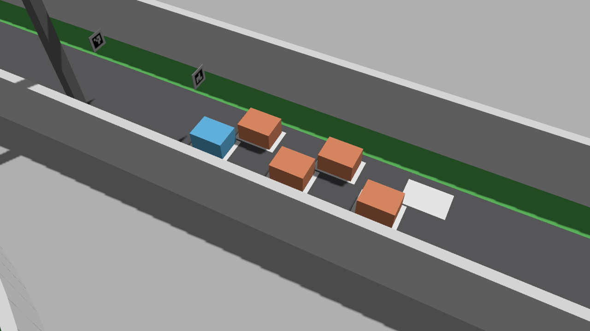
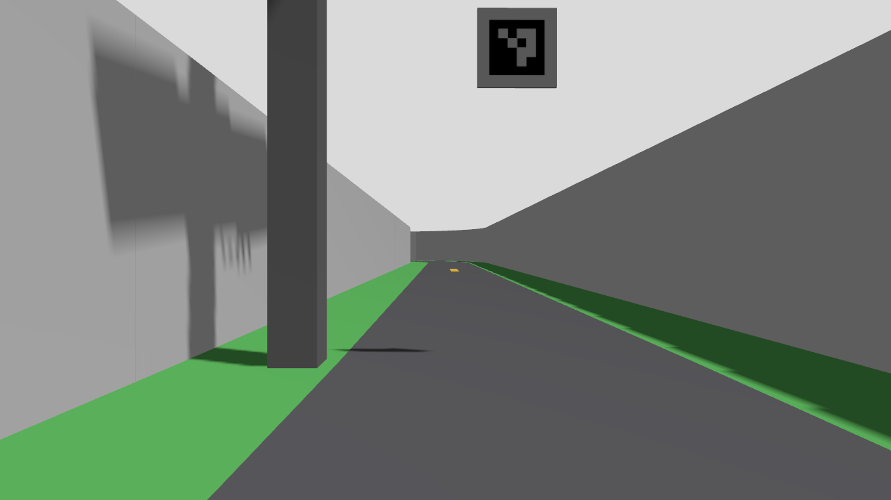
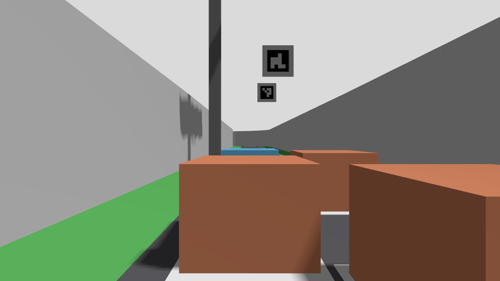

# M5 — 공식 그리드의 정지 배치·출발 시야 사전 검사

2026-10-24. **준비 도구와 정지 장면만 검증했다. 다중 차량 출발 주행은 미실행이다.**

## 1. 목적과 입력 경계

10/23 계획의 M5를 위해 공식 6개 그리드의 좌표와 2/3/5대 배치를 고정하고, 현재 차량이 놓이는지와 신호등이 보이는지를 먼저 검사했다. 통과시키기 위해 칸 간격·카메라·공식 신호등을 옮기지 않았다.

- 공식 출처는 10/13 보존한 `b27f94730b869837a804a3088447103d6b35b87e`의 `scene.json`/`world.sdf`다. 새 온라인 판을 조회한 작업이 아니다. [보존 입력·기존 B3 기하](../../artifacts/validation/2026-10-13/race_start_geometry_v1/result/geometry.json).
- 현재 실행본은 `src/arena_gazebo/worlds/it_arena_official/`이다. 공식 `scene.json`의 좌표를 원본 SDF 및 실행본의 링크+visual 합성 pose/치수와 각각 대조했다. 실행본은 grid paint를 병합 링크에 보존한다. 공식 배포 원본은 수정하지 않았다.
- 차량은 확정 외형 목표 **0.20×0.15 m**, 직진 바퀴의 명목 직사각형이다. model origin은 **축간 중앙 지면**이며 후축 중심으로 옮기지 않는다. 명목 지면 z=0과 기존 시뮬레이션 초기 spawn z=0.01 m를 별도로 계산했다. 물리 안착 높이는 측정하지 않았다.
- 전방 B0183는 임시 장착 `[0.055, 0, 0.145] m`, 수평, 1280×720, 수평 시야각 75°다. 정지 사진의 전달 주기는 2 Hz이며 실제 60 fps 성능 시험이 아니다.
- 정지 사진의 차체는 0.20×0.15×0.12 m 색상 상자(바닥 0)다. 다른 팀의 실제 높이·형상·가림을 대표하지 않으며 구동·충돌 시험용 차량도 아니다.
- 시설은 **공식 원본의 4적색+1녹색 배열 그대로**다. 팀 실행본의 임시 3등 장면과 혼동하지 않는다. PNG 경로 해석과 평가용 플러그인·카메라만 추가했다.

## 2. 칸과 간격

`s_m` 내림차순으로 `[2, 5, 1, 4, 0, 3]`을 앞→뒤 시험 순서로 정했다. 공식 예선 순위 배정 규칙을 확정한 것이 아니다. 실제 좌표·yaw·쌍별 거리는 [JSON](../../artifacts/validation/2026-10-24/m5_grid_v2/preflight/report.json)에 있다.

| 대수(자차 포함) | 사용한 grid index | 차체 겹침 | 도로 안·낮은 벽 무겹침 | 최소 차체 간격 | 현 0.15 m 비교 기준 |
|---|---|---|---|---|---|
| 2 | 2, 5 | 없음 | 만족 | 0.0299833 m | 미달 |
| 3 | 2, 5, 1 | 없음 | 만족 | 0.0299833 m | 미달 |
| 5 | 2, 5, 1, 4, 0 | 없음 | 만족 | 0.0299833 m | 미달 |

두 열 중심 간격은 약 0.18 m, 앞뒤 엇갈림은 약 0.20 m다. 폭 0.15 m 차 두 대의 가까운 모서리 사이에 약 3 cm가 남는다. 같은 열 앞뒤 차체 간격은 약 0.30 m이며 6칸의 명목 차체와 도로 가장자리는 약 0.06 m 떨어져 있다.

**3 cm는 현재 배치의 기하 결과이지 권장 안전 간격이 아니다.** 0.15 m는 현재 교통 시험에서 쓰는 비교 기준이지 공식 출발 규정이 아니다. 이 기준을 모든 방향에 그대로 적용하면 주행 전부터 충족되지 않는다. 겹침이 없다는 이유로 출발을 허가하거나 기준을 자동 축소하지 않았다. 조향 돌출·자세 오차·다른 차의 횡이동·실제 제동까지 포함한 출발 정책은 별도 설계가 필요하다.

## 3. 공식 출발등 시야

공식 램프 중심 높이는 1.08 m다. 수평 전방 카메라에 다섯 램프를 투영하면 모든 칸에서 화면의 위쪽 밖이다. 다음은 지면 z=0, 영상 높이 720 px에서 첫 적색/마지막 녹색 중심의 세로 좌표다. 음수는 위쪽 밖을 뜻한다.

| grid index | 첫 적색 v (px) | 마지막 녹색 v (px) | 배열 전체가 영상 안 |
|---|---:|---:|---|
| 2 | -800.94 | -624.99 | 아니오 |
| 5 | -534.63 | -426.38 | 아니오 |
| 1 | -305.53 | -243.71 | 아니오 |
| 4 | -208.52 | -162.79 | 아니오 |
| 0 | -106.48 | -75.24 | 아니오 |
| 3 | -56.65 | -31.55 | 아니오 |

초기 spawn z=0.01 m 대조도 여섯 칸 모두 영상 밖이다. 배열이 주행 방향과 거의 나란해 일부 칸의 화면상 좌→우 순서도 기대와 다르다. 자세한 배열·방향 검토는 [B3 신호 계약](RACE_START_CONTRACT_2026_10_13.md)에 남긴다. 실제 신호등의 최종 설치 높이·방향이 미정이므로 이 결과를 실물 설치 오류라고 단정하지 않는다.

## 4. 정지 장면 촬영

공식 SDF에 5개 정지 상자와 3개 평가 카메라를 넣은 1회 실행이다. 각 시점에서 서로 다른 `/clock` 시각 0.002, 0.5, 1.0초의 영상 3장을 수신하고 마지막 영상을 저장했다. 제어기·MCU·차량 구동은 실행하지 않았다.

위: 공식 칸과 상자 차체의 명목 위치를 확인하는 전체 시점. 출발 영상이 아니다.

위: grid 2. 노면과 표지는 보이나 공식 램프 배열은 화면 위 밖이다.

위: grid 0. 앞의 정지 상자들이 노면 일부를 가린다. 이 높이의 상자에서는 표지가 보이지만 실제 더 높은 차량까지 검증한 것은 아니다.

## 5. 검사·실패 보존

- [v1](../../artifacts/validation/2026-10-24/m5_grid_v1/README.md)은 18통과·1실패로 촬영 전에 중단했다. 감사기가 실행본의 병합된 grid visual 표현을 읽지 못했다. 월드가 잘못됐다는 결과가 아니다. 실패 당시 소스를 별도 보존했다.
- 감사기가 부모 링크와 visual pose를 합성하도록 고치고 중복/잘못된 pose 거절을 추가했다. [v2](../../artifacts/validation/2026-10-24/m5_grid_v2/README.md)는 관련 20회귀·SDF 유효성·정지 촬영을 통과했다.
- [촬영 보고서](../../artifacts/validation/2026-10-24/m5_grid_v2/preflight/capture/report.json): 소스 불변, bridge 선종료·Gazebo `server_control` 확인, launch exit 0, 자식 2/2 정상 종료, 강제 정리/잔존 0. GPT가 원본 사진 3장을 육안 확인했다.
- GPT 설계·구현·검토, GPT-6 Luna 실행·회수. Claude 사용량 경고에 따른 인계 뒤의 작업이다. 기본 차량·월드·보호·출발 모드는 유지했다.

## 6. 다음 판단과 실행 조건

1. 공식 신호등의 실제 설치 높이·방향을 확인하고 **마커와 출발등을 함께 볼 카메라 장착 조건**을 확정해야 한다. 현재 시야에 맞춰 공식 시설을 옮겨 성공으로 처리하지 않는다.
2. 출발의 매우 가까운 정지 배치와 주행 중 차량 간격을 같은 상수로 판정할지 재검토한다. 간격 축소가 아니라 시작 정지/신호 대기/직진 출발의 관측·동작 계약을 먼저 구분한다. 현재 0.15 m 수치는 변경하지 않았다.
3. 그 뒤에야 2→3→5대의 출발·합류 폐루프를 사전 등록한다. 이번 registry와 사진으로 M5 완료나 E4 진입을 선언하지 않는다.

## 7. 카메라 상향 피치만으로 해결되는가

현재 카메라 높이·화각과 공식 램프는 그대로 두고 상향 피치만 계산했다. `audit_grid_camera_pitch.py`의 [1회 결과](../../artifacts/validation/2026-10-24/m5_pitch_v1/README.md)는 관련 25회귀·소스 6개 불변·정상 종료를 확인했다. Gazebo를 새로 실행하거나 실제 장착값을 바꾼 작업은 아니다.

수직 화각은 약 46.692°다. 전방 거리 x·높이 차 z의 점을 담는 데 필요한 각도는 `atan2(z,x)`와 화면 상하 경계의 차로 구했다. 전체 램프에는 구체를 둘러싼 상자를 쓰는 보수적 조건을, 현 검출기 상부 58%의 불가능 판정에는 램프 **중심점만** 쓰는 필요조건을 적용했다. 수평 시야는 구간 중앙값 한 개에서 전체 투영으로 별도 대조했다.

| 카메라 기준 차체 지면 높이 | 전체 영상의 공통 수직 포함 구간(상향) | 중앙값 전체 영상 포함 | 상부 58%에 모든 중심을 넣는 공통 각도 |
|---|---|---|---|
| 명목 z=0 m | 31.479–48.234° | 39.857°에서 6/6칸 | 없음: 하한 30.959° > 상한 29.098° |
| 초기 spawn z=0.01 m | 31.191–47.998° | 39.594°에서 6/6칸 | 없음: 하한 30.667° > 상한 28.862° |

따라서 **현재 높이와 공식 고정 배열에서는 피치 하나만 바꿔 현 검출기까지 여섯 칸에서 충족시키는 방식은 성립하지 않는다.** 전체 화면을 사용하도록 검출기 영역을 바꾸더라도 다른 문제가 남는다.

- 위 중앙값에서는 현 상부 58% 영역에 다섯 램프가 모두 드는 칸이 2/6이고, 적색→녹색 화면상 좌→우 순서가 맞는 칸도 3/6이다. 가림·빛 번짐·픽셀 검출은 계산하지 않았다.
- 수평 노면은 이 중앙값 피치에서 전방 화면 아래 밖이다. 라이다 주행 자체의 실패 판정은 아니지만, 이후 카메라로 방지턱·노면을 확인하는 용도와 상충한다.
- 실제 코스 마커 대신 중심 높이 0.40 m·크기 0.10 m의 정면 수직 판을 대조했다. 카메라 전방 0.5 m에서는 전체가 보이고, 1 m에서는 아래가 잘리며, 2 m에서는 판 전체가 아래 밖이다. 실제 마커의 위치·회전·곡선 접근·검출 성능을 검사한 것은 아니다.

**설계 판단:** 우선 공식 실조립 높이·방향과 실제 B0183 화각을 받아 단일 고정 카메라의 높이/피치 범위를 다시 계산한다. 현재 결과를 이유로 카메라를 약 40°로 고정하거나 공식 신호등을 옮기지 않는다. ROI 확대는 픽셀 처리 조건을 바꾸는 별도 후보이며 실제 영상의 오검출/배열 추적 검증이 필요하다. 가변 마운트·별도 카메라·시설 변경은 예산·기구·공식 자료를 보고 선택할 대안으로만 남긴다. 이번 결과는 설치 오류 제보나 하드웨어 변경 결정이 아니다.

## 8. 10/26 — 정지 그리드의 라이다 첫 경로 진단

신호 시야와 독립적으로, 같은 공식 칸에서 G1/M3의 첫 경로를 점검했다. 개별 벽 visual과 다른 정지 상자의 합성 순차 광선만 제어기에 제공했으며 지도·그리드·표적 정답을 주행 입력으로 쓰지 않았다. 각 칸 단독 6조건은 양수 계획 요청이 나왔지만, 2/3/5대의 모든 자차 위치 10조건에서는 G1/M3 모두 0요청이었다. 첫 칸 2는 가까운 옆차에 대한 간격 검사, 나머지는 벽 경계 미확인이 원인이다.

관련 36회귀·16조건 진단·소스 불변을 확인했으며 최초 벽 표현 읽기 오류는 별도로 보존했다. 이는 4 fresh scan·20호출의 **정지 합성 입력 검사**이며 독립 보호/MCU·Gazebo·실제 출발은 아니다. 양수 요청을 허가로 해석하거나 0요청을 실제 동시 출발의 영구 교착으로 확정하지 않는다. 다음에는 저장 입력의 경계 미확인과 현재 중앙 복귀 경로의 초기 간격을 분리하고, 신호 시야와 함께 출발 정책을 설계해야 한다. [범위·결과·원본 실패·재개 순서](../../artifacts/validation/2026-10-26/m5_grid_follow_v1/README.md).

### 8.1 17시 재개 — 초기 간섭과 앞차 출발 뒤의 진행성

저장 입력과 움직이는 상대차의 순차 광선에서 최초 가까운 옆차, 가려진 벽 경계, 현재 방향 유지 대신 중앙으로 꺾는 후보, 오래된 반환의 팽창을 분리했다. 기존 측정 오차·2D 이동 노름 상계와 기계 여유를 유지하면서 네모 모서리의 과대 팽창을 원판으로 표현하는 **기본 OFF 점유 옵션**을 M3 순수 제어기에 추가했다. 앞차가 먼저 움직이는 일부 조건에서 직진 요청이 생겼으며, OFF 기존 6,165판단은 같다. 최초 밀집 배치와 오차/지연·노면 경계 거절은 여전히 남았다.

움직이는 자차·순차 센서·단일 정수 모터축·독립 보호 알고리즘을 넣은 제한 이상 bicycle 비교에서는 OFF 0 m, ON .680 m, ON 중앙 누락 .610 m였다. 누락 중 양수 요청/보호 출력은 0이고 연속 운동의 명목 최소 간격 하한은 29.483 mm였다. 여러 차례 HOLD가 남으며 물리 제동·ROS/MCU 실행·M5 전체 출발 성공은 아니다. 낮은 속도 탐색은 진행 개선 없이 비용만 늘어 반려했다. +3 cm 편향에서는 양쪽 거리 오차가 한쪽 기준 경로/반대 벽 비교에 누적되는 별도 문제를 확인했으며 운영 판정은 유지했다.

상세 전제·반례·실패 시험기·재현 결과는 [M5 원인 분해와 선택형 점유 비교](../../artifacts/validation/2026-10-26/m5_start_constraints_v1/README.md)에 모았다. CLI/launch·기본 모드는 유지한다. 후속은 양쪽 벽의 측정 불확실성으로 도로 추정을 검증하는 저장 입력 비교다.
