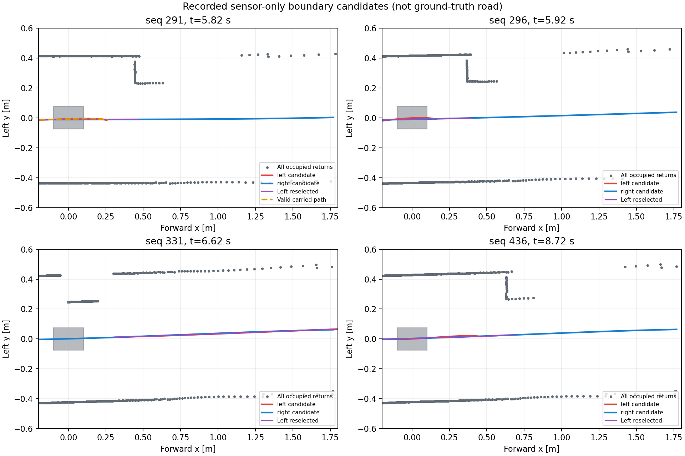

# 단일 모터축 저속 관측과 G1·LiDAR 운동 보정 감사

기준: 2026-10-13. GPT 주 에이전트가 설계·구현·분석·검토하고 GPT-6 Luna가 오프라인 회귀·분석 실행을 담당했다. **새 Gazebo 주행이나 제어기/보호층/물성 변경은 하지 않았다.** [10/12 solver 대조](LOCAL_FOLLOW_G1B_2026_10_07.md#1012-solver-제한-대조--pgs-미정지와-모터축-평균-상쇄)의 다음 과제다.

## 1. 결론

- 현행 피드백은 **모터축 엔코더 1개·28카운트/모터 회전·15:1·바퀴 65 mm**다. 옛 좌우 엔코더 설정이나 기어비 누락이 아니다.
- `stationary_ready`는 이름과 달리 **신선한 모터축 평균 저속이 일정 시간 지속된 구동 계약상 준비 조건**이다. 차체 정지·양쪽 바퀴 정지·노면 속도 정확성의 확인값이 아니다. 이 한계는 기존 `stationary_scope`에도 표시되어 있다.
- G1의 `HOLD`는 **0속도 요청 행동**, 해제는 **서로 다른 신선한 관측과 간격 확인**이다. MCU의 STOP 해제나 실제 정지 확인과 별개다. 기존 G1 왼쪽 실패의 첫 재진행은 차체가 거의 정지한 뒤였으며, 평균 0만 보고 미끄러지는 도중 재출발한 사례로 분류할 근거가 없다.
- 실제 위험은 **그럴듯하고 신선한 잘못된 이동 추정이 운동 보정·경계 기억·보호층에 함께 들어가는 것**이다. 50 ms 입력 공백 검사와 자이로 이상치 거절만으로 이 경우를 걸러내지 못한다.
- 관련 회귀 **275개 통과**는 위 동작과 관측 한계를 재현했다는 뜻이다. G1 왼쪽 주행 실패·PGS 미정지·실물 미검증을 해결하거나 성공으로 바꾸지 않는다.

## 2. 경로별 의미와 한계

| 사용 경로 | 실제 코드가 하는 일 | 정지/신뢰도로 해석하면 안 되는 것 |
|---|---|---|
| MCU `_stationary` → `stationary_ready` | 유효 피드백·50 ms 미만 나이·평균 바퀴 환산 속도의 절댓값 ≤0.03 m/s가 200 ms 지속됐는지 검사 | 모터축 평균이 상쇄되거나 잠긴 채 차체가 미끄러지는 상황은 구별 불가. 두 수치는 기존 임시 설정이지 새 실물 기준이 아님 |
| `CLEAR` / `ARM` | 위 준비 조건과 출력 준비·상태/세대 조건을 확인하고 **명시 명령**으로만 전환 | 상태 수신/STOP ACK만으로 실제 차체 정지가 입증되지 않음. 입력 복구만으로 STOP을 풀지는 않음 |
| 정상 0속도 DRIVE | 허가 상태 `ARMED`에서 0목표를 갱신 | 양수 명령용 500 ms 무진행 감시는 적용되지 않음. 정지 차량도 카운트가 없으므로 0목표에 단순 적용하면 정상 대기도 고장 처리됨 |
| G1 `HOLD` / 해제 | 관측 부족·간격 부족·음수 평균 속도에서 0요청. 재개에는 경계/간격 및 두 fresh 관측 필요 | `HOLD` 자체가 정지 완료는 아님. 현재 해제 조건은 차체 정지를 요구하지 않으며 전진 중 일시 HOLD 해제도 가능 |
| Pure Pursuit | `MotionHistory.wheels`의 최신 평균 바퀴 환산 속도를 lookahead 등에 사용 | 코드 변수 `measured_speed_mps`는 노면 대비 차체 속도 측정이 아님 |
| LiDAR `deskew` / `shift` / `both` | 모터축 평균 이동량 + 자이로 yaw를 시간 적분하여 점 좌표를 옮김 | `reason=ok`는 입력·시간 계약 통과이지 슬립 없음의 확인값이 아님. 평균 0·자이로 0이면 병진 보정도 0 |
| G1 경계 기억 | 같은 운동 이력으로 과거 경로를 현재 좌표계로 옮김. 시간 제한 ≤0.3 s·추정 이동 제한 0.45 m | **추정 이동량**의 제한이지 실제 차체 이동량의 보장된 상한이 아님 |
| 독립 LiDAR 보호층 | 별도 노드가 현재 반환·운동 보정으로 조향 경로의 간격/목표 상한을 재검사 | 제어기와 같은 센서 및 보정 구현을 사용하므로 공통 입력 오차에 독립적이지 않음. 0출력 자체가 실제 제동의 성공은 아님 |
| 평가기 종료 검사 | 평가용 차체 속도/자세 기록과 STOP·정상 종료를 별도 확인 | MCU 평균만으로 성공 처리하지 않음. 그래서 PGS는 ACK·종료 성공과 별개로 `stopped=false`로 남음 |

코드: [구동 계약](../../src/arena_vehicle_interface/arena_vehicle_interface/actuation_contract.py), [ROS 상태 발행](../../src/arena_vehicle_interface/arena_vehicle_interface/actuation_ros.py), [운동 이력](../../src/arena_autonomy/arena_autonomy/lidar_motion.py), [입력 검사](../../src/arena_autonomy/arena_autonomy/lidar_motion_ros.py), [G1](../../src/arena_autonomy/arena_autonomy/local_follow.py), [경계 좌표 이동](../../src/arena_autonomy/arena_autonomy/scene_motion.py), [보호층](../../src/arena_autonomy/arena_autonomy/lidar_safety.py).

## 3. 보존 기록에서 확인한 영향

### 기존 G1 왼쪽 실패

대상은 `2026-10-07/g1b_side_v1/side_left_s0`이다. 당시 `run_valid=true`, `passed=false`, 진행/옆차 통과 실패를 그대로 보존했다.

| 사건 | 제어 상태 시각 / 가까운 구동 진단 시각 | 평균 바퀴 / 차체 종방향 속도 |
|---|---|---|
| 1 m/s 도달 뒤 첫 경계 미확인 HOLD | 5.820 / 5.811 s | 0.523 / 1.016 m/s. 제어기가 기록한 속도는 별도 입력 표본의 0.535 m/s |
| 모터 평균은 저속이나 차체는 이동하는 진단 표본 | 5.894 s | 0.0213 / 0.9091 m/s |
| 위 HOLD 이후 첫 양수 명령 | 8.420 / 8.414 s | −0.000064 / −0.000091 m/s. 명령은 +0.02 m/s |

상태와 구동 진단의 대응은 **최대 10.5 ms 이내의 가장 가까운 표본**이다. 위 첫 HOLD는 9 ms, 재개는 6 ms 차이가 있어 같은 콜백/물리 step이라고 주장하지 않는다. 전체 준비 상태 중 차체 속도 >0.1 m/s와 대응한 기록은 0개였지만, 대응 표본이 없는 준비 상태 2개는 미확인으로 남겼다. 모든 순간의 정지 안전을 입증하는 결과가 아니다.

감속 중의 보정 영향은 다음 근사로 평가했다.

`거리 불일치 = ∫(평가용 차체 종방향 속도 − 진단 평균 바퀴 속도) dt`

약 20 ms 간격의 구동 진단을 구간별 일정 값으로 적분했다. 30 ms 초과 공백·기록 밖 외삽은 허용하지 않았으며 없으면 `null`이다.

| 기록 | 0.1 s 구간 최대 절댓값 | 0.3 s 구간 최대 절댓값 |
|---|---:|---:|
| G1 왼쪽 실패 | 0.08732 m | 0.19015 m |
| Dantzig 평가 대조 d1 | 0.02445 m | 0.02808 m |
| PGS 평가 실패 p1 | 0.09027 m | 0.26979 m |

G1 첫 HOLD **이전** 0.1/0.3초에서는 각각 약 0.03716/0.06375 m였다. 큰 불일치가 HOLD 뒤에만 생긴 것은 아니다. 그러나 **이 수치가 당시 라이다 점·경계 경로 오차의 직접 측정은 아니다.** 당시 실제 엔코더/자이로 콜백 이력과 채택 시각을 그대로 재생하지 않았고, 0.3초 내내 같은 경계 기억이 유지됐다는 뜻도 아니다. 선회·횡속도·취득 지연까지 반영한 SE(2) 점 오차와 구분한다. 경계 미확인에는 가림/경계 선정도 관여하므로 직접 원인을 확정하지 않는다.

Dantzig/PGS는 전체 적용 명령 시점·개수가 달랐다. 위 표는 각 기록의 관측 한계 규모이지 solver 간 개선율/제동 성능 비교가 아니다.

### PGS 반례: 준비 조건과 실제 정지가 분리됨

sim 4.580 s MCU 상태는 `ARMED`, `stationary_ready=true`, 평균 속도 0, 신선한 피드백이었다. 1 ms 뒤 진단에서는 차체가 **0.89724 m/s** 전진하고 좌우 후륜은 **+27.6186 / −27.6002 rad/s**였다. 평균 상쇄를 충분히 오래 유지하면 200 ms 조건도 통과한다.

기록된 준비 상태 중 차체 이동과 대응한 것은 126개다. **독립된 실패 126회가 아니라 수신 표본 수**이며 마지막 사례는 명시 STOP 뒤 `ESTOP_LATCHED` 상태다. STOP 고정은 유지됐지만 차체는 움직였다는 뜻이다. 이 시뮬레이션의 접촉/차동/제동 근사가 실물 발생 확률을 알려 주지는 않는다.

## 4. 이번 구현·검증과 변경하지 않은 것

- 오프라인 분석기 [analyze_motor_observability.py](../../scripts/analyze_motor_observability.py)를 추가했다. 입력 해시·원래 판정·상태 대응 시차·누락·거리 근사를 따로 기록한다. 정답은 이 도구의 평가에만 사용한다.
- [새 회귀](../../tests/test_motor_observability.py)는 평균 저속 ARM, 0명령과 무진행 감시의 분리, STOP 고정, 신선한 0운동의 보정 한계, 0평균에서도 자이로 회전 보정, 오래된 입력 거절, G1 fresh 해제와 중복 관측 거절, 분석기 누락/비유한 값 거절을 검사한다. 합성 0.9 m/s 병진 반례는 실제 센서 정확도 시험이 아니다.
- 관련 회귀 275개 통과. 새 ROS 노드/Gazebo/Jetson을 시작하지 않았으며, `src/`·`config/`·launch·물성·보호 판정선·기본 모드는 변경하지 않았다.
- 최초 실행 래퍼의 `set -u`가 ROS setup의 미정의 환경변수와 충돌해 시험 전 중단됐다. 실패를 보존하고 `-u`만 제거했다. `-e`와 pipeline 실패 전파는 유지했다.
- 구동 문서에서 **과거 양쪽 바퀴 조건과 현행 단일 평균 조건**을 명확히 분리했다. 기존 결과를 소급 수정하거나 `stationary_ready`의 호환 키를 바꾸지는 않았다.

근거: [분석 JSON](../../artifacts/validation/2026-10-13/motion_observability_v1/analysis.json), [실행/회귀](../../artifacts/validation/2026-10-13/motion_observability_v1/README.md). 원시 구동·스캔·수신 로그는 기존 로컬 보존/Git 제외 정책을 유지한다.

## 5. 다음 한 묶음: 센서 기반 불일치 진단의 성립 여부

이번 감사는 완료다. **다음은 제동 solver 반복이 아니라 기록 전용 관측 일치성 진단**으로 한정한다. 아직 운영 제어기로 채택한 설계가 아니다.

1. 기존 G1 raw scan으로 **이전/현재 관측이 엔코더 이동과 일치하는지** 오프라인 진단한다. 차체 정답·지도·상대차 정답 ID를 추정 입력으로 쓰지 않는다. 우선 저속/0평균인데 정적 구조의 관측이 움직이는 반례를 찾으며, 단순한 매칭 성공을 정지 확인값으로 사용하지 않는다.
2. 정적 구조를 충분히 구별하지 못하거나 긴 평행 직선·가림·동적 물체 때문에 특정 방향 이동을 구별할 수 없으면 **`unknown`**이다. 예를 들어 끝이 안 보이는 평행 벽만으로는 벽을 따라 미끄러지는 속도를 알아내기 어렵다. 주변 점이 비슷하다는 이유로 `stationary=true`를 만들지 않는다.
3. 독립적인 **미보정 스캔 → 관측 일치성 검사**를 우선 비교한다. 기존 엔코더로 보정한 점만 재사용하면 같은 오차를 서로 확인하는 문제가 생긴다. 순차 스캔의 이동 왜곡·C1 오차도 비교 기준에 포함한다. 원시 로그에 없는 고주기 자이로/콜백을 정답으로 만들어 채우지 않는다.
4. 먼저 합성 정지/직진/선회, 평균 상쇄, 평행 벽 퇴화, 동적 앞차/부분 가림, 시간 누락을 검사한다. 기존 G1 저장 스캔으로 가능한 범위를 대조하고, 부족한 입력만 후속 제한 재실행에서 수집한다. 처리 비용·오경보·미확인 비율을 기록한다.
5. **경계 기억 폐기/전진 재개 억제 같은 제어 연결은 진단 성립 후 별도 회귀로 결정**한다. 미확인 때 무엇을 금지할지 명시하지 않은 채 점수만 덧붙이지 않는다. 이번에는 자동 CLEAR/ARM, 속도 추정값 대체, G2·오른쪽·고속화를 추가하지 않는다.

실물에서는 별도로 **MD20A 제동 출력, 편측 접지에서 모터축 제동이 실제 차체를 멈추는지, 실제 카운트 기반 MCU PI**를 확인해야 한다. 소프트웨어가 미끄러짐을 알아채도 제동력이 생기는 것은 아니다. 새 센서 구매/기구 변경이나 IMU 가속도 이중 적분을 이번 감사만으로 결정하지 않는다.

## 6. 기록 전용 스캔 진단 결과 — 제어 연결 보류

위 제한 시험을 완료했다. 이전/현재 미보정 순차 스캔만으로 point-to-line 정합을 수행하고, 엔코더는 정합 초기값이 아닌 **완료 후 잔차 비교**에만 썼다. 이웃 반환의 PCA 법선·복수 초기값·양방향 변환 일치·방향별 관측 지원을 검사한다. 별도 Numpy 시험 코드이며 검증된 라이브러리나 위치 추정기로 간주하지 않는다.

| 입력 | 결과 | 해석 |
|---|---|---|
| 잡음 없는 합성 정지/직진, 충분히 넓은 전방 벽 | 가정 아래 일치 | 실제 정지나 정적 장면을 증명하지 않음 |
| 0 모터 이동·실제 합성 이동 0.42 m/0.3 s | 불일치 후보 | 잔차 약 0.42 m, 가정 오차 예산 약 0.37 m. 작은 슬립 검출 능력은 없음 |
| 끝이 안 보이는 평행 벽·작은 앞차·전방 가림·자이로 없는 선회 | `unknown` | 구별 근거가 부족하면 정지/자유 공간으로 바꾸지 않음 |
| ±30 mm 균등 잡음 합성 6개 | 모두 `unknown` | 오경보는 없었지만 관측 가능성을 얻은 것도 아님 |
| 기존 G1 왼쪽 실패, 0.1/0.3 s 간격 128쌍 | **128개 모두 `unknown`** | 수렴 실패 47·국소적 이동 지원 80·기하 퇴화 1. 기존 실패 해결 근거가 아님 |

단위 회귀 **13개**, 합성 기대 판정 **15/15개**를 확인했다. `unknown`이 기대값인 시험 통과를 정상 운동 추정 성공으로 세지 않는다. 작은 앞차는 스캔 사이 이동만 모델링했고, 실제 차량처럼 스캔 내부에서도 계속 움직이는 전체 검증은 아니다. 한 쌍의 정합에도 수십~수백 ms가 걸리는 오프라인 구현이다. 50 Hz 제어기에 넣을 처리 성능도 검증하지 않았다.

**결정:** 이 후보를 제어기에 연결하지 않고 추가 정합 튜닝을 중단한다. 원시 순차 취득 왜곡과 동적 구조를 구별하기 어려운데 잔차 한도를 내리거나 기존 엔코더 보정으로 입력을 바꿔 성공시켜서는 독립 진단의 의미가 사라진다. 센서 구성 변경도 하지 않는다.

다음 작업은 **G1 판단 단계의 실제 입력 스냅샷과 내부 상태 순서를 기록·재생**하여 경계 기억/선정 실패를 분리하는 것이다. 현재 기록에 없는 자이로 이력을 정답으로 채우지 않는다. 선택형 기록을 붙인 제한 재실행에서 사용된 운동 이력·스캔·경계 상태·출력을 회수하고, 동일 입력의 오프라인 재생부터 일치시킨다. 이 기록은 제어기 성능을 바꾸거나 기존 물리 실패를 해결하는 패치가 아니다.

근거: [v2 소스·회귀·결과](../../artifacts/validation/2026-10-13/scan_motion_v2/README.md), [최초 실패](../../artifacts/validation/2026-10-13/scan_motion_v1/result/report.json). 운영 제어 코드·기본 모드·보호 한도는 이 진단 시험에서 변경하지 않았다.

## 7. G1 판단 단계 기록/재생과 경계 비교 분리

기존 외부 상태 요약만으로는 실제 판단이 사용한 엔코더/자이로 이력·스캔·초기화 순서를 복원할 수 없었다. `g1_trace_path`가 지정된 경우에만 그 입력을 복사하고 유한 큐의 별도 스레드로 기록하도록 했다. 기본값은 빈 문자열이며 기본 주행에는 기록 스레드가 없다. NaN·±Inf·관측 마스크, 이미 환산된 m/s·rad/s를 보존하고 재생에서 중복 환산하지 않는다. 정상 footer·순번·쓰기/누락/오류를 검사하며 부족한 기록은 재생 실패다.

기록은 **LocalPursuit.command → G1 판단 단계**에 한정한다. RGB 출발 허가, 원시 센서 콜백 전체, 외부 증속/조향 변화율 제한, 독립 보호층, MCU·차량 물리까지 재생한 것은 아니다. 기록 복사 비용이 있으므로 on/off 단위 출력 동등성이 무부하를 의미하지도 않는다.

| 확인 항목 | 결과 | 범위 |
|---|---|---|
| 기록 구현 회귀 / 제한 주행 전 회귀 | 각각 111 / 162개 통과 | 서로 겹치는 집합이며 합산하지 않음 |
| 기존 왼쪽 가림 seed 0 재실행 | 유효 실행, 진행·옆차 통과 실패 | 다른 10개 gate는 통과. 이전 왼쪽 실패도 그대로 유지 |
| STOP·종료 | 차체 정지 확인까지 0.928 s·0.06937 m, 정상 종료·잔존 0 | 실제 정지와 MCU ACK는 별도로 확인 |
| 판단 재생 / 분석 래핑 | 각각 **372/372개 원래 출력 일치**, 입력 해시 불변 | 부동소수 비교 `1e-10`; 제어 안전 한도의 완화가 아님 |

최초 빌드는 colcon이 보존 소스 사본까지 검색해 중복 패키지로 주행 전에 중단됐다. 보존 자료를 삭제하지 않고 `--base-paths src`로 실행 소스 탐색만 제한했다.

### 경계 미확인 구간에서 확인한 내용

새 기록의 5.82 s에는 짧아진 선호 벽 후보가 확인되지 않았지만 기존 경계 기억으로 진행했다. 5.92 s에는 기억 원본(5.602 s)의 0.3초 기한이 지나 `follow_boundary_unconfirmed`가 됐다. 6.62 s 이후 양쪽 벽에서 얻은 경로가 공통 구간에서 가까워져도, 한쪽 경로에만 있는 앞쪽 구간의 끝점 거리까지 비교에 들어갔다. 이것은 **서로 다른 관측 범위와 경로 형상 차이를 섞는 문제**다.

그러나 이 문제 하나가 전체 대기 시간을 설명하지는 않았다. 공통 관측 구간만 비교하는 후보도 길이 0.25 m·각 5점을 확보하기 전에는 거절한다. 고정 입력 반사실 계산에서는 첫 양수 판단이 **8.92→8.72 s**로 0.2초만 앞당겨졌고, 경계 미확인 149→139·정상 추종 191→201 호출이었다. 후보 때문에 차가 다르게 움직였을 미래 입력은 계산하지 않았으므로 실제 주행 개선율로 해석하지 않는다.

### 수정 범위와 수용 조건

`path_agrees`는 전방 0.05~0.65 m 중 **양쪽 경로가 공통으로 관측한 구간**만 대칭 거리 비교하도록 수정한다. 양쪽 각각 0.25 m·5점, 거리 80백분위·0.08 m 조건을 유지한다. 보간/외삽으로 점을 만들지 않고, 점유 검사는 여전히 모든 반환을 쓴다. 경계의 최소 길이/앵커·두 fresh 확인·기억 0.3초·센서/물리/보호 한도는 유지한다.

단축 경로 일치·너무 짧은 공통 구간·실제 횡오차·교차 경로·기존 동일 범위 대조는 최초 후보 회귀 10개에서 확인했다. 운영 연결 후에는 관련 회귀와 왼쪽 같은 조건 1회, STOP/정상 종료/판단 재생으로 검증한다. 새 주행 실패는 보존하며 오른쪽/G2/고속화 또는 solver 반복으로 확장하지 않는다.

근거: [기록/재생 원본](../../artifacts/validation/2026-10-13/follow_trace_v1/README.md), [수정 후 시험](../../artifacts/validation/2026-10-13/follow_overlap_v1/README.md).

### 수정 후 결과와 G1 재개점

사전 회귀 **174개** 통과, 새 판단 기록 **368/368개** 재생 일치, 분석 래핑도 원래 출력을 유지했다(분석 회귀 4개). 그러나 **진행·옆차 통과 실패**는 남았다. 처음 경계 미확인 5.82 s→7.52 s 재개 뒤 8.82 s에 다시 대기해 9.52 s에 재개했다. 가림 중 충분한 공통 경로를 얻지 못하는 상태와 실제 형상 차이를 구분할 지원 개수/길이를 분석기에 추가했다. 이 결과로 기억 시간이나 형상 한도를 완화하지 않는다.

STOP 뒤 평가용 차체 정지 관측은 통과했지만 Gazebo 하위 프로세스가 `exit -11`로 종료하여 **`run_valid=false`**다. service 응답은 정상이나 하위 종료는 실패했고 잔존 프로세스는 없다. 정확한 크래시 원인은 이번에 확정하지 않았다. 로그 감사의 ‘shutdown request 이전’ 표시는 launch SIGINT가 기준이어서, 그 전에 보낸 service 요청과 혼동하면 안 된다. 기존 정상 종료나 주행 실패를 이 결과로 소급하지 않는다.

**이번 묶음 종료 판단:** 공통 구간 수정은 선택형 G1에 남기고 전체 G1 완료로 선언하지 않는다. 동일 solver/시뮬 반복은 보류한다. G1 재개 시에는 보존 입력의 짧은 경로/가림 지원이 부족한 구간부터 대안을 설계하고, 정지/진행/형상·점유를 분리한 회귀와 유효한 폐루프를 요구한다. 무작정 기억을 연장하거나 반대 벽 하나를 확정 경계로 채택하지 않는다. 병행 필수인 B3 출발·정지 계약은 별개로 진행할 수 있으나 G2·오른쪽·고속화의 허가가 생긴 것은 아니다.

후속으로 B3 제한 묶음을 수행한 뒤 [분리 관측 경계 증거 후보](G1_FRAGMENTED_BOUNDARY_2026_10_13.md)를 시작했다. 가림 앞뒤의 실제 벽 조각만 지지 증거로 세며 가림 간격/미관측 공간을 채우지 않는 별도 선택형 대안이다. 이 보고서의 기존 실패/판정은 그대로 보존한다.
