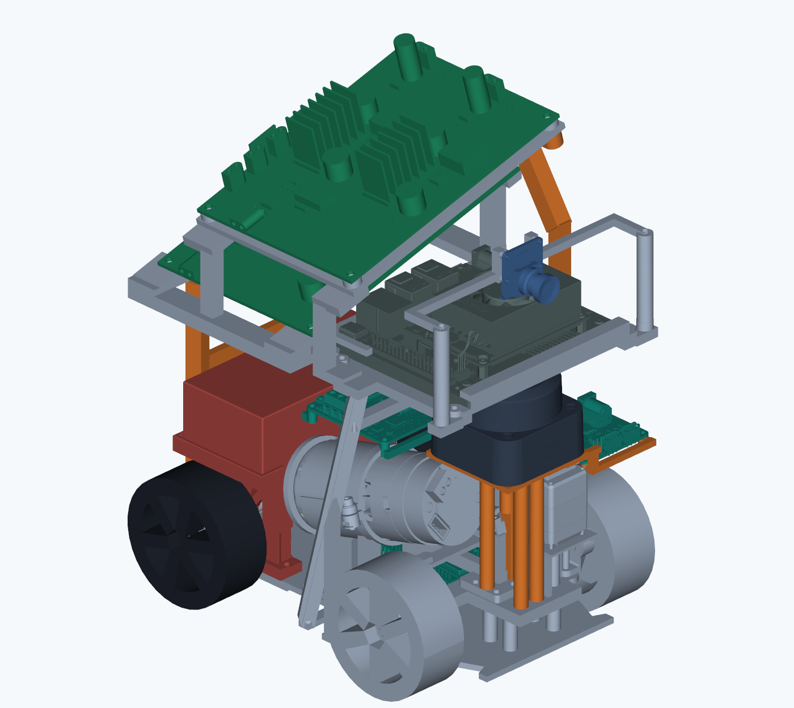

# 11/13 확정 패키징과 실장 가림 준비

사용자가 동일 이름의 STEP를 **확정본**으로 전달했다. 확정 설계, 아직 포함되지 않은 하네스, 실제 조립/광학 측정, 시뮬 검증을 구별한다.

11/14에 별도 제작 기준 STEP을 받았다. [직전 시뮬 기준과 새 STEP 대조](PACKAGING_CAD_COMPARE_2026_11_14.md)에서 공칭 C1 가림과 센서 위치가 유지됨을 확인했다. 이 문서는 기존 시뮬 프로필의 출처를 보존한다.

## 입력과 변경

- 원 파일: `C:\Users\Jinhyeong\Downloads\11.12 RC카_패키징_작업본 확인용.step`.
- 새 SHA-256: `c9c203b5a66585ccde71313ea888c16804a1ddb71e6e91514a46bebededbfce6`,146,081,505 bytes. [로컬 보존·분석](../../outputs/cad_final_2026_11_13/README.md).
- 이전 SHA-256 `37890b25…69a98a4`의145,608,206 bytes 파일과 다르다. Downloads는 사용자 갱신으로 새 파일이며, [이전 분석과 B-rep/그림](PACKAGING_STEP_REVIEW_2026_11_12.md)은 보존한다. 이전 원 STEP 사본까지 새로 복원했다고 주장하지 않는다.
- 조립 노드2,386개. 전체 B-rep 외곽 약199.700×150.000×256.364mm. 이전223.790mm보다 높아진 것은 상부 전원보드/지지 변경이며 카메라와 C1이 그만큼 올라간 것은 아니다.
- C1·카메라 대체 모델·타이어·조향 조립의 경계 상자는 이전과 같다. 상판·전원보드 받침·앞뒤 지주를 수정했고 일부 기존 이름은 빈 형상으로 남아 있다. 빈 항목을 실물 부품 누락이라고 판단하지 않는다.
- C1 추정 광축 Z134.6mm를 가로지르는 형상은 새 `2372`·`2385`다. 이전 `2373` 트러스는 비어 있으므로 새 프로필에서는 쓰지 않는다. 광축 위아래3mm 단면도 별도 보존했다.



## 시뮬 반영 범위

[r347](../../artifacts/validation/2026-11-13/cad_mount_r347_v1/README.md)에 새 지주 mesh/단면과 선택형 센서 프로필을 만들었다. 카메라와 C1의 위치/입력 사양은 기존 CAD 추정값을 유지했다. B0390 대신 들어 있는 카메라 모델의 렌즈 높이는 설치 추정이며 실제 광학 중심·intrinsic 교정이 아니다.

**전체 기하를 선택형 r350에 반영했고 r353의 부분 주행까지 확인했다.** 새 구성은18.58m 뒤 교통 해제 상태의 관측/대체 경로 거절로 정체했으므로 전체 랩은 미완료다. 실제 SDF·계획·독립 보호층·평가의 치수 전달과 정상 STOP/회수는 확인했다. [r353 결과](../../artifacts/validation/2026-11-13/final_geometry_crawl_drive_r353_v1/README.md). [r350](../../artifacts/validation/2026-11-13/final_vehicle_geometry_r350_v1/README.md)에 CAD 축거128mm·윤거123.9mm·타이어 폭26.1mm를 물리 모델/운동 보정/계획·보호/평가에 함께 전달했다. 기존 기본135/135mm는 과거 재현용으로 유지한다. 타이어 CAD64.4mm와 구매 공칭65mm/실제 유효 구름 반경도 구별한다. 차량 외곽은 축간 중점 기준 전후 비대칭(X 약−96.2~+103.5mm)이므로 대칭20cm 상자와 같다고 처리하지 않는다. 질량·관성·접지·서스펜션·조향 링크 한계는 CAD 확정만으로 실측값이 되지 않는다. 구동 환산28카운트·81/17×2.5·공칭65mm는 이번 센서 프로필 작업에서 변경하지 않았다.

## 배선과 고정 여유 — 사용자 후속 지시

전선은 기둥 앞/옆으로 오르내리고 고정이 완전히 강하지 않을 수 있다. 따라서 다음을 분리한다.

1. **배선 예약:** 앞면 또는 차체 안쪽 면으로6mm 돌출하는 선택형 형상. 실제 케이블 굵기/묶음 폭의 확정값이 아니다. 기존2/4/6mm 결과는 당시 자료로 보존한다.
2. **추가 움직임 여유:** `mount_motion_margin_m=0.003`으로 기둥·배선 가까운 거리의 각도/거리 범위를 확장한다. 가까운 구조에는 동일3mm가 더 큰 각도에 해당한다. 기존0.5°·2mm는 별도 측정/모델 여유다. 3mm는 실측 전 임시값이며 진동의 상한 보증이 아니다.
3. **실장 후 측정:** 원 스캔에서 실제 가까운 자기 반환을 관측한 뒤에도3mm·2mm·0.5° 여유를 남긴 후보를 만든다. 관측 최소/최대를 딱 맞춘 마스크로 줄이지 않는다. 반사점이 보이지 않은 기둥은 기존 범위를 유지하고 미확인으로 표시한다.

범위는 **각도와 가까운 거리의 조합**이다. 같은 방향이라도 이 거리 밖에서 오는 실제 반환은 남긴다. 미반환을 자유 공간으로 바꾸지 않는다. 넓어진 가림 안에 다른 물체가 있는지를 완전히 알 수 없으므로 범위를 무조건 크게 만드는 방식도 피한다.

### 조립 뒤 빠른 측정 준비

`scripts/review_c1_self_returns.py`가 준비되었다. 기존 `bridge_c1_native_preview.py`의 **마스크 적용 전** `converted.jsonl`과 해당 배치의 거리 한정 nominal mask를 입력한다. 현재 장치에 자동 실행/적용하지 않는다.

- 차를 외부에서 고정하고 라이다 주변0.5m에 차량 부품 외 물체·손이 없는 곳에서 최소10초/100스캔을 기록한다. 케이블을 최종 고정한 상태가 우선이다. 실제로 움직일 범위를 확인하는 추가 기록은 사람이 가능할 때 진행한다.
- 당시 실제 `source_frame_id`를 사용하고, 서로 다른 boot/센서 배치의 기록을 합치지 않는다. 스캔이 돌아오지 않은 구조를 빈 공간으로 간주하지 않는다.
- 도구는 CAD 예약 근처의 제한된 각도/거리에서만 자기 반환 후보를 수집한다. 각 구조가 최소20개 스캔에서 보여야 관측 충분으로 표시한다. 주변 장애물을 기둥으로 자동 학습하는 기능이 아니다.
- 출력은 `applied=false`인 **검토 후보**다. 그림/원점과 대조한 뒤 같은 `mask`를 제어기와 독립 보호층에 함께 적용해야 한다. 현행 ROS의 `lidar_blind_sectors_json` 형식과 같지만 자동 운영 적용·주행 검증은 아직 하지 않았다.

```bash
python3 scripts/review_c1_self_returns.py \
  --input /path/to/converted.jsonl \
  --nominal-mask artifacts/validation/2026-11-13/cad_mount_r347_v1/frontwire_6mm_nominal_mask.json \
  --frame-id ACTUAL_RECORDED_FRAME \
  --stationary-confirmed --nearby-clear-confirmed \
  --output /path/to/self_mask_candidate.json
```

제공 nominal은 C1 공칭 위치·앞면6mm·후면 ID49 중심140mm를 가정한다. 최종 마커/배선 배치가 다르면 먼저 nominal을 갱신한다. 실측 오차가 이 후보 검색 범위를 벗어나면 미확인으로 남으며, 범위를 키우기 전에 실제 부품/센서 좌표를 확인한다.

## 잔디 +3mm — 사용자 전달과 모델의 한계

사용자는 잔디가 도로보다3mm 높을 예정이라고 전달했다. 부드러운 타이어·잔디의 눌림 때문에 실제 영향이 작을 수 있으며, 강체 시뮬에서 턱 걸림을 과장할 우려도 함께 밝혔다. **현재 주행 개발의 기준은 `road_level`을 유지**하고, 새 `grass_above_3mm`는 별도 민감도 비교 옵션으로만 둔다. 공식 원본을 수정하거나3mm 강체 턱을 실물 재현이라고 부르지 않는다.

윤거123.9mm의 한쪽 또는 축거128mm의 한 축만 강체로3mm 올라간 단순 기하에서 roll/pitch는 약1.39°/1.34°다. 전자의2m 광선 높이 차이는 약48mm이며 실제 동적 크기의 예측은 아니다. 현재 평면 운동 보정이 이를 모두 보정하는 것은 아니다. 후속에는 접촉 통과 성공/실패와 별도로, 작은 기울기·진동에 따른 C1·IMU 관측 변화와 불필요 정지 여부를 확인한다. 이 비교 때문에 실제보다 과장된 턱 통과 문제에 개발을 계속 묶어 두지 않는다.
