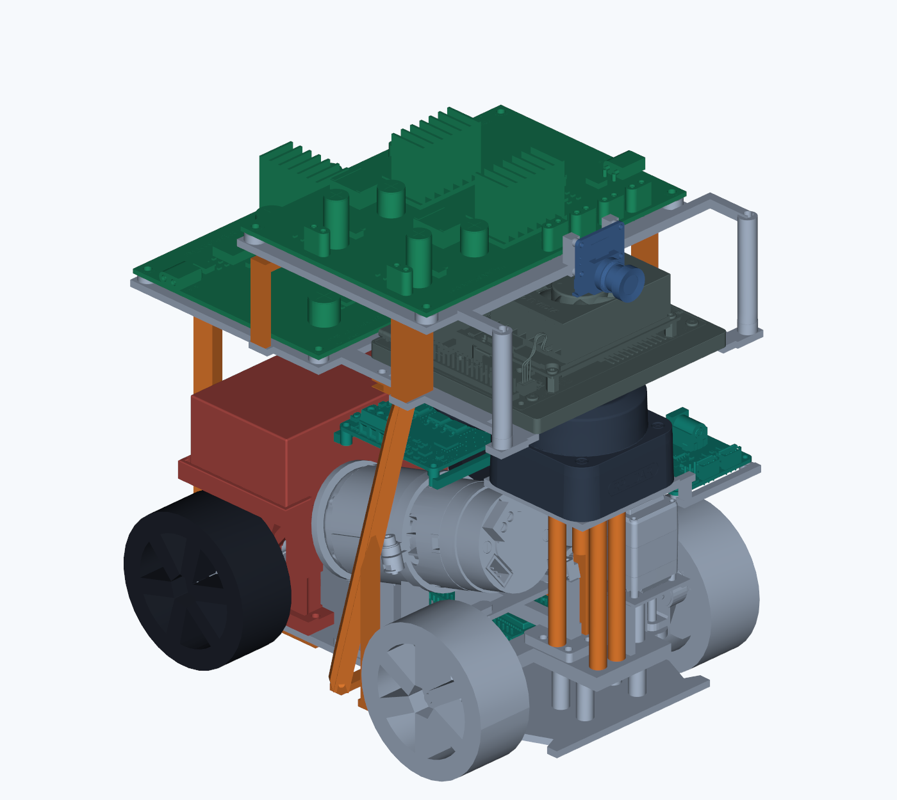
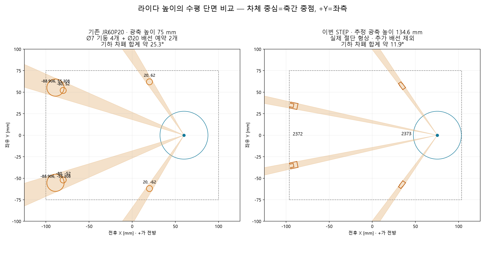
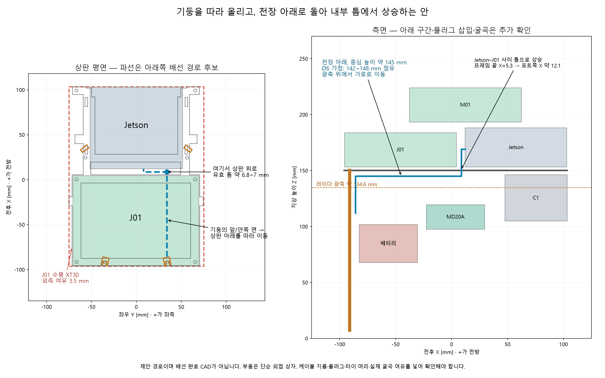

# 11/12 RC카 패키징 1차 STEP 종합 검토

검토일: 2026-11-12. GPT가 STEP의 조립 구조·B-rep 경계·단면·일부 부품 간 거리를 직접 분석했다. 원본·차량 모델·제어 설정은 변경하지 않았으며 실물 조립·열·하중·주행 시험은 하지 않았다.

**결론:** 주요 부품과 지지 구조의 배치는 상당히 구체화됐다. 그러나 케이블·결합 플러그·마커까지 포함한 제작 완료 형상은 아니다. 먼저 **수평 XT30 결합 외곽, 뒤/상부 기둥 배선 돌출, 상판 통과 구간**을 해결해야 한다. 기존 JR60P20과는 센서 높이·기둥 위치·윤거·타이어 폭이 크게 달라 기존 시뮬 결과를 이 형상의 검증으로 볼 수 없다.

## 1. 입력과 방법

- 원본: `C:\Users\Jinhyeong\Downloads\11.12 RC카_패키징_작업본 확인용.step`
- 145,608,206 bytes, SHA-256 `37890b25fc69c5c56e400b6236872ab480dc96016211055842722d52769a98a4`.
- STEP AP214, Autodesk Translation Framework, 파일 작성 시각 2026-11-12 21:50:04 +09:00.
- 조립 트리 2,384노드, 최상위 배치 부품 48개. 노드 수는 실제 구매 부품 수가 아니다.
- Open Cascade 8.0.1.1.0으로 원본을 읽고 배치 변환을 합성했다. 경계는 `AddOptimal`의 비삼각화 계산, 단면은 B-rep 평면 교차다. 렌더의 색은 검토용 재지정이다.
- 좌표는 **앞뒤 축 중점, 지면 기준**으로 환산했다. STEP 좌표 `(a,b,c)`에서 `X=-c-64`, `Y=21.2-a`, `Z=b+32.2` mm. +X 전방, +Y 좌측. 뒷바퀴 최저면을 지면으로 두었으며 앞바퀴는 이 면보다 0.3 mm 높다.
- 사용자 조건: 대부분 PLA 출력. 일부 판의 아크릴 5T 사용은 불확실하므로 별도 민감도로만 검토한다. 구형 카메라는 대체 형상이며 CF-0108은 의도적으로 미반영됐다는 설명을 반영했다.
- [산출물·재현 자료](../../outputs/cad_review_2026_11_12/README.md), [조립 목록](../../outputs/cad_review_2026_11_12/assembly.json), [치수/체적](../../outputs/cad_review_2026_11_12/geometry.json), [단면](../../outputs/cad_review_2026_11_12/sections.json).

## 2. 기존 임시 모델과 달라진 핵심

‘기존 임시본’은 **예전 전체 기구 STEP**과 **현재 주행에 쓰는 JR60P20 시뮬레이션 모델**을 구분해야 한다. 서로 다른 배치이므로 아래처럼 따로 비교한다.

### 예전 전체 기구 STEP과 비교

이전 `IT_ARENA_RWD_150x200_배치어셈블_v1.step`은 [11/4 보존된 CAD 분석](../../artifacts/validation/2026-11-04/lidar_mount_cad_reference/README.md)을 기준으로 했다. 이전 원본을 이번에 다시 수정/추출한 것은 아니다.

| 항목 | 이전 전체 기구 CAD | 이번 STEP | 변화 |
|---|---:|---:|---|
| 길이×폭×높이 | 197.4×148.0×266.3 mm | 199.7×150.0×223.8 mm | 높이는 약42.5 mm 감소, 길이/폭 여유는 감소 |
| C1 본체 높이 | Z225~266.3 mm | Z104.8~146.1 mm | 본체가 약120.2 mm 낮아짐 |
| C1 광축 높이 추정 | 약254.8 mm | 약134.6 mm | 같은 공칭 오프셋29.8 mm 적용 |
| 지주 | 수직 원통 외경3.6/4.0 mm, 내경3.2 mm | 뒤 U형8.6×7 mm + 앞 사선 트러스 | 단순 봉에서 배선 홈/보강 구조로 구체화 |
| J01 / M01 높이 | Z89.5~120 / 131.5~162 mm | Z153.2~183.7 / 193.3~223.8 mm | 전원보드는 위로 이동 |
| 타이어 지름/폭 | 64.4 / 26.1 mm | 64.4 / 26.1 mm | 이 부분은 이전 기구 CAD와 동일 |
| 구동계 | 쇽 포함, 동력전달계 미완성 | 기어·차동·축·조향 링크와 받침 구체화 | 형상 구현은 진전, 운동/강도 검증과는 별개 |

따라서 **이전 기구 CAD보다 전체 높이는 낮아졌고 구동계는 구체화됐다.** 다만 전원보드가 높아졌으며 이전 부품별 질량 자료가 없어 무게중심도 같은 비율로 낮아졌다고 단정하지 않는다.

### 현재 JR60P20 시뮬레이션 모델과 비교

| 항목 | 기존 JR60P20 시뮬 | 이번 STEP | 해석 |
|---|---:|---:|---|
| 정적 전체 길이×폭 | 200×150 mm 목표 | **199.700×150.000 mm** | 길이 잔여 약0.30 mm, 폭 여유 사실상0 |
| 전체 높이 | 확정 제작값 없음 | **223.790 mm** | 케이블·마커·추가 체결구 제외 |
| 축거 | 135 mm 임시 | **128 mm** | 조향·운동 보정 입력 변경 필요 |
| 윤거, 바퀴 중심 간 | 135 mm 임시 | 약 **123.90 mm** | 같은 무게중심 높이이면 좌우 하중 이동에 불리 |
| 타이어 지름/폭 | 65 / 12 mm | **64.4 / 26.1 mm** | 폭은 두 배 이상. 조향 외곽이 달라짐 |
| C1 회전축 X | +60 mm | **+75.4 mm**, Y 약0 | 15.4 mm 전진 |
| C1 광축 Z | 75 mm | **약134.6 mm** | 설치면104.8 mm + 공칭 광축 오프셋29.8 mm. 실측 전 |
| 카메라 광축 Z | 145 mm 임시 | 구형 B0183 축 약 **198.36 mm**, 수평 | 실물 B0390의 광학 중심은 다시 측정 |
| 앞 지주 | X20, Y±62, Ø7 | 광축 단면 중심 약 **X34.45, Y±57.44** | 기울어진 트러스라 높이에 따라 위치가 변함 |
| 뒤 지주 | X−80, Y±52, Ø7 | 광축 단면 중심 약 **X−90.95, Y+34.2/−34.8** | 뒤로 이동하고 좌우 중앙으로 모임 |
| 뒤 배선 채널 | 외곽16×12, 벽2 mm 가정 | 외곽 **8.6×7 mm**, 홈 **4×4.2 mm** | 기존 내부 약12×10 mm와 크게 다름 |

이번 형상은 ‘앞쪽 C1, 위쪽 연산/전원 부품, 광축에는 지주만 남긴다’는 의도는 유지한다. 다만 **낮은 센서층이라는 기존 전제는 유지되지 않았다.** 현재 75 mm 높이를 절단하면 모터·엔코더·배터리·마운트가 다수 걸린다. C1만 기존 높이로 내리는 단순 변경은 어렵다.

전방 C1 본체의 가장 앞쪽은 X 약103.2 mm, 차량 최전단은 X103.5 mm여서 **앞쪽 형상 여유가 약0.3 mm**다. 기존 임시 배치의 약12.2 mm보다 훨씬 작다. 보호/케이블 여유를 위해 C1을 5~10 mm 뒤로 옮기는 안은 검토할 가치가 있지만, 장착판·구동계·케이블과 다시 대조해야 하며 이번에 수정하지 않았다.

## 3. 기둥과 라이다 가림

추정 광축134.6 mm에서 라이다 자체를 제외한 조립체의 교차 형상은 앞 트러스 두 개와 뒤 기둥 두 개뿐이었다. 배터리·모터·전원보드·상판이 이 단면을 크게 막지 않는 점은 잘 구현됐다.

- 기존 Ø7 지주만의 합산 차폐는 약16.3°. Ø20 배선 예약을 포함하면 약25.3°.
- 이번 STEP의 **추가 배선 없는** 기둥 합산 차폐는 약11.9°다. 같은 배선 조건의 성능 비교가 아니다.
- 전방 연속 개방 범위는 기존 약±120.1°에서 이번 약±123.6°로 소폭 증가한다.
- 반대로 정후방 중앙의 연속 개방각은 기존 약33.5°에서 **약21.0°**로 줄어든다. 뒤 지주가 중앙으로 모인 영향이다.
- 현재 JR60P20 시뮬보다 광축 높이가 약60 mm 올라갔으므로 낮은 상대차/바퀴·범퍼를 지나칠 가능성은 별도다. 자체 차폐가 작다고 상대 검출이 좋아졌다고 결론 내릴 수 없다.
- 0.02° 간격의 점 광선 기하이며 광학창 폭·반사·실물 공차·배선·주행 변형은 제외했다. 가림 각도를 자유 공간으로 채우는 변경은 하지 않는다.

### 기둥 바깥으로 감으면 얼마나 두꺼워지는가

여기서 `t`는 **기둥의 각 바깥 면에서 배선/타이 등이 추가로 튀어나오는 두께**다. 케이블의 반지름이 아니며, 기둥에 닿은 Ø4 케이블 한 층은 해당 면에서 대략4 mm를 차지한다. 실제 나선의 피치/위상은 미정이므로 네 지주 단면을 전 방향으로 t만큼 확장한 보수적인 점유 가정이다.

| 추가 두께 t | 뒤 기둥+배선의 단면 외곽 | 네 기둥 합산 차폐 | 뒤쪽 돌출을 반영한 차량 길이 |
|---:|---:|---:|---:|
| 0 mm | 8.6×7 mm | 약11.9° | 199.7 mm |
| 2 mm | 12.6×11 mm | 약21.6° | **201.4 mm** |
| 4 mm | 16.6×15 mm | 약31.3° | **203.4 mm** |
| 6 mm | 20.6×19 mm | 약40.9° | **205.4 mm** |

이는 전선 개수를 역산한 결과가 아니라 **설계 여유에 대한 민감도**다. 실제 케이블 외경·겹침·타이 머리로 t를 정해야 한다. [계산 JSON](../../outputs/cad_review_2026_11_12/wire_cases.json).

위치별로 문제가 다르다.

1. **뒤 기둥:** 뒤끝 X−95.876은 타이어 후단 X−96.200보다 약0.324 mm 안쪽이다. 현재 길이 여유0.300 mm까지 더해도 뒤로 추가 가능한 두께가 약0.624 mm뿐이다. 뒤까지 한 바퀴 감는 배선은 피하고 **기둥 앞면 또는 안쪽 옆면에 세로로 고정**한다. 케이블 타이는 머리를 앞/안쪽으로 둔다.
2. **앞쪽 아래 트러스:** 광축 단면 최외측 |Y|약61.97로 폭 한계75까지 약13 mm가 남는다. t=6 mm 가정에서도 이 높이의 기둥만으로는 폭을 넘지 않는다. 다만 하부는 타이어·조향 이동과 별도로 대조해야 한다.
3. **Jetson–M01 사이 상부 뒤 지주:** 측면 끝이 Y+74.45/−74.85 mm라 여유가 **0.55/0.15 mm**뿐이다. 이 지주 외측을 감는 것도 폭 초과 원인이 된다. 안쪽 면에만 배정하거나 지주를 안쪽으로 옮겨야 한다.

전선 자체를 촘촘히 나선으로 감으면 길이와 굴곡이 늘어난다. **필요한 면에 곧게 붙이고 짧은 타이로 고정**하는 방식이 점유 공간을 관리하기 쉽다. 열수축·플러그 뒤 스트레인 릴리프·타이 머리까지 외곽에 포함한다.

## 4. 천장으로 넘어가는 구간

상판은 통판이 아니라 프레임이며 큰 개구부가 있다. 그러나 위쪽의 Jetson·J01이 개구부 대부분을 덮는다. **빈 프레임 그림과 완조립의 통로는 다르다.**

- Jetson–J01의 앞뒤 외곽 간격은 약 **7.8 mm**다. 상판의 가로 보가 X5.3 mm까지 나와 있어 실제 상승 통로는 약 **6.8~7 mm**로 좁아진다. 높이/좌우 위치에 따라 포트·보강 형상이 달라 추가 확인이 필요하다.
- 상판 옆의 작은 직사각 슬롯은 **10×3 mm**다. 타이 또는 얇은 선에는 쓸 수 있지만 일반 USB 완성 플러그나 여러 전력선 묶음의 통과 구멍으로 취급할 수 없다.
- **권장 경로 후보:** 뒤 기둥의 앞/안쪽 면으로 상승 → 상판 아래로 꺾음 → Jetson–J01 사이 틈으로 상승 → 상부 포트에 연결한다. 예를 들어 케이블 중심 Z145 mm, 외경6 mm이면 Z142~148 mm를 점유한다. 상판 밑면 약150.21 mm보다 낮고 광축134.6 mm보다 높다. 이 횡단 경로를 C1 본체가 있는 앞쪽까지 끌고 가지 않는다.
- 가로 통로에는 배터리 상단101.7 mm·MD20A 상단119.3 mm보다 높은 공간을 활용한다. 천장 아래 붙이는 클립/타이 고정으로 선이 광축으로 처지지 않게 한다.
- 큰 묶음 하나로 올리기보다 케이블별로 나누고, **USB 몸통과 플러그 통과/삽입 공간을 별개로** 확인한다. 6 mm 선이 들어간다고 10 mm 오버몰드 플러그가 통과하는 것은 아니다.
- 제작 수정이 가능하면 안쪽 프레임 가장자리에 **측면 개방형 노치**를 두는 방법이 있다. 완성 케이블을 미리 끼우지 않고 장착할 수 있으며 바깥 외형을 늘릴 필요가 없다. 노치 위치는 지주 체결 보스·하중 전달부를 피해 정한다. 직경/노치 크기는 실제 케이블로 결정한다.
- 상판 바깥 테두리를 넘어가는 경로는 판 자체가 폭 약149.3 mm여서 여유가 거의 없다. ‘위로 넘겼으니 폭에는 무관하다’고 볼 수 없다.

**아크릴5T가 큰 개구부를 유지한 프레임인지, 사각 통판인지가 중요하다.** 통판이면 위 경로의 구멍을 별도로 만들어야 하며 아래 방열/질량 추정도 달라진다.

## 5. 실제로 기둥을 오르내릴 배선

**11/13 배선 인계 후속:** 기존 층을 유지한 [층별 케이블 배치도](WIRING_LAYERS_2026_11_13.md)에 CF·STOP 하부 배정과 C1 USB 어댑터의 광축 아래 배치안을 표시했다. 후속 사용자 지정으로 Y 분기는 상부 1단 J01 근처로 옮겨 **현재 광축 통과량은 전원4쌍(8가닥)+USB2개**다. 아래 5쌍 표는 하부 Y를 가정한 당시 검토로 보존하며 현재 배선량에는 위 후속 도면을 사용한다. 아래 검토 당시 형상·원본은 변경하지 않았다.

기준은 [승인 전장 연결](APPROVED_ELECTRICAL_LAYOUT.md)과 현재 STEP의 부품 층이다. ‘모든 센서 선이 기둥 전체를 올라간다’는 구성은 아니다.

| 층을 넘는 연결 | 필요한 케이블/도체 | 방향 |
|---|---|---|
| 배터리→J01 입력 | 전력 +/− 2가닥 | 위로 |
| 배터리→M01 입력 | 별도 전력 +/− 2가닥 | 위로 |
| M01 CH1→MD20A VB+/VB− | 전력2가닥 | 아래로 |
| M01 CH5 또는 CH6→Servo Adapter A | 12 V 전력2가닥 | 아래로 |
| J01 CH4→엔코더/CF 전원 | 5 V/GND 2가닥, 하부에서 분기 | 아래로 |
| Jetson↔ESP32 | USB 데이터 케이블1개, 전원 포함 | 아래로 |
| C1↔Jetson | C1 5핀 리드 또는 USB 케이블1개 | 어댑터 위치에 따라 결정 |

즉, 상하 경계를 넘는 것은 **전력선5쌍(10가닥) + ESP32 USB + C1 연결 묶음**이다. 배터리 분기점을 아래에 두는 기본 안이며, Y선 위치가 달라지면 개별 구간의 가닥 수는 바뀐다. C1 USB 어댑터의 배치/고정이 현재 STEP에 없어 먼저 자리를 정해야 한다. 위층에 두면 가는 C1 리드가, 아래층에 두면 USB가 광축 높이를 통과한다. 고정 리드의 실제 길이와 커넥터 위치를 확인한다.

**기둥 분배 초안**—좌우는 차를 운전하는 방향 기준이며 최종 커넥터 배치에 따라 조정한다.

| 기둥/면 | 우선 배정 |
|---|---|
| 뒤 왼쪽 앞/안쪽 면 | ESP32 USB + C1 연결 묶음. 통로 하나에 겹쳐 감지 않고 나란히 고정 |
| 뒤 오른쪽 앞/안쪽 면 | 배터리→J01 2가닥 + J01→엔코더/CF 2가닥 |
| 앞 오른쪽 트러스 안쪽 | 배터리→M01 2가닥 + M01→MD20A 2가닥 |
| 앞 왼쪽 트러스 안쪽 | M01→Servo Adapter A 2가닥 |

이 표는 전선 굵기/길이가 확인된 완성 하네스 설계가 아니다. 전력/신호의 묶음을 분리하고 현재 피복 외경으로 단면을 채운 뒤 앞 절의 t를 다시 산출한다. 모터선·서보선의 실제 하부 경로에서는 기어·링크·회전축을 피한다.

**긴 기둥 전체를 탈 필요가 없는 선:** ESP32–IMU 7가닥, ESP32–MD20A PWM/DIR/GND 3가닥, ESP32–Adapter A TX/RX/GND 3가닥, 엔코더–CF–ESP32 신호, MD20A–모터 2선, Adapter A–서보 3선은 기본적으로 하부 안에서 정리할 수 있다. J01–Jetson 19 V 2선과 B0390–Jetson **22↔22 FPC**는 상부 연결이다. 카메라에 별도 전원선을 추가하지 않는다.

## 6. 누운 XT30 두 개

수평 입력은 **J01 CN1과 M01 CN1 각각 하나**다. 채널 CH1과 커넥터 CN1을 혼동하지 않는다.

| 입력 커넥터 | 현재 돌출 방향 | 기존 차량 폭 안의 남은 공간 |
|---|---|---:|
| J01 CN1 | 차량 오른쪽 | 약 **3.5 mm** |
| M01 CN1 | 차량 왼쪽 | 약 **4.5 mm** |

STEP에는 보드 쪽 커넥터 형상이 있지만 **결합한 수 플러그·납땜/열수축부·전선 굴곡은 없다.** 일부 PDB 소자 이름이 `SIMPLIFIED`/`PDF_EST`이므로 현물과 일치한다고 보증할 수도 없다.

선만 90° 꺾어도 **먼저 꽂힌 단단한 플러그 몸체가 차지하는 길이**는 없어지지 않는다. AMASS XT30U-M 도면의 단품 총길이13.7 mm를 곧바로 추가 돌출13.7 mm로 적용해서도 안 된다. 결합 깊이를 빼고 실제로 남는 길이를 재야 한다.

권장 순서는 다음과 같다.

1. 보유 수 플러그를 꽂은 상태에서 보드/차량 외곽부터 열수축부까지 재고, 좌우 각각 필요한 폭을 모델에 추가한다.
2. 현 방향의 보드+보드 측 수평 입력 전체 폭은 약141 mm다. 보드를 단순 평행이동해도 추가 플러그가 쓸 수 있는 **총 폭 예산은 최대9 mm**이고 조립 공차는 별도로 남겨야 한다. 현재 위치의 한쪽 여유3.5/4.5 mm와 구분한다.
3. 수치가 맞으면 보드를 안쪽으로 조정하고 플러그 뒤 선을 위/안으로 꺾는다. ‘ㄱ자 선’이라는 이름만으로 몸체가 들어간다고 판단하지 않는다.
4. 부족하면 **보드 방향/층 배치를 바꾸는 것이 확실한 방법**이다. 상단 M01을 평면90° 회전하면 긴140 mm 방향을 차 길이로 쓸 수 있으나 장착판·구멍·냉각을 재검토해야 한다. 현재 Jetson과 같은 층의 J01은 앞뒤 약100 mm만 배정돼 있어 단독90° 회전으로는 들어가지 않으며, Jetson/보드 층 배치까지 조정해야 한다.
5. 수평 입력을 수직 인출로 바꾸는 부품/보드 수정도 기구적으로는 대안이지만 지급 보드의 실물 구조와 변경 가능 여부를 확인하기 전 채택하지 않는다. 이번 검토에서는 보드를 개조하거나 새 부품 구매를 확정하지 않았다.

출처: [현재 공식 검차 MANUAL](https://github.com/MOSW626/istech-it-arena/blob/2e41f5674a4c8a611bb65e966ea8827d41611017/MANUAL.md), [AMASS XT30U-M 제조사 도면](https://store.comet.bg/download-file.php?id=30575). 검차는 내측150×200 mm 틀과 실물 최외곽 기준이다. 원문은 ‘튀어나온 부분 전부’를 포함하며 케이블만 제외하는 조항을 확인하지 못했다. 배선도 포함해서 설계해야 한다는 판단이다.

## 7. 구현된 것과 남은 것

**확인된 구현:** 모터/엔코더 형상, 피니언·스퍼·차동기·축/키핀, 전후 바퀴, 조향 너클/타이로드/서보혼, 배터리 받침, Jetson·두 PDB의 층, C1/카메라/IMU/MD20A/Adapter A의 배치와 받침, 뒤 U형 기둥과 앞 사선 트러스가 있다. IMU도 별도 받침이 있어 선에 매달린 상태를 해소할 수 있는 형상이다. 상판의 개구부와 탈착식 모터 클램프/덮개도 표현돼 있다.

**추가 반영/대조:**

- **CF-0108:** 사용자가 알고 있는 의도적 누락이다. 정밀 STEP 없이 실측한 직육면체 점유와 선 끝/절연/고정 위치만 먼저 넣어도 충분하다. ESP32 가까운 하부가 합리적이다. 글루건을 쓰더라도 바닥 절연·선 인장 완화·열원과의 거리는 필요하며 커넥터나 칩 위를 무작정 덮지 않는다. IMU처럼 자세 교정이 필요한 센서는 아니지만 배선 공간을0으로 둘 수는 없다.
- **C1 USB 어댑터, 배터리 XT60/Y 분기, 대부분의 결합 플러그와 배선**은 배치 완료가 아니다. C1 기본 리드와 Jetson 팬 배선은 CAD 안에 일부 존재한다.
- **후방 ID49 마커와 판/체결:** 명확한50×50 mm 식별판이 없다. 기존 중심 높이140 mm를 그대로 쓰면 판 범위115~165 mm가 새 광축134.6 mm를 가린다. 광축 위에 두려면 판 하단부터 여유를 주어야 한다. 예시로 중심170~180 mm를 검토하되 실제 뒤 시야와 판 두께/후방 돌출을 함께 본다.
- **배터리 스트랩/빠짐 방지, 실제 볼트·너트·헤더·도구 접근**까지 최종 체결 형태를 넣는다. 구멍의 존재가 조립 가능성 전체를 증명하지 않는다.
- 엔코더 부품명 자체가 **25.9 mm 가정**이다. 납품품 길이·커넥터·축 체결을 대조한다. 부품1의 모터는 폐쇄 solid가 없는 surface 형상이어서 그 CAD 체적을 실제 무게 계산에 쓰지 않았다.
- STEP의 조향 배치는 ‘킹핀73 mm·축거128 mm·목표 내륜30°/외륜23.29°’라는 설명을 포함하지만 운동 구속/실측 검증이 아니다. 바퀴를 직립 원기둥으로 두고 이 각도와 스크럽 오프셋을 적용하면 조향 시 폭이 약170 mm급이 될 수 있다. 정확한 스윕/링크 간섭은 후속이며 정적150 mm 검차와 분리한다.

### 작은 조립 여유

선별한8개 부품 쌍의 거리/공통체 검사에서 의도된 접촉을 제외한 큰 체적 침범은 확인하지 못했다. 전체 조립품 전수 충돌 검사를 수행한 것은 아니다. 특히 아래 간격은 작다.

| 위치 | CAD상 최소/수직 간격 | 의미 |
|---|---:|---|
| ESP32–통합 모터 마운트 | **0.278 mm** 최소거리 | 보드 판본·출력 공차·핀/납땜을 넣기에는 작음 |
| MD20A–앞 트러스 | **0.698 mm** 최소거리 | 선을 그 사이에 끼워 넣을 공간으로 볼 수 없음 |
| 엔코더–C1 장착판 | **1.048 mm** 최소거리 | 엔코더 길이 가정 및 출력 치수 영향 큼 |
| C1 본체 상단–상판 밑면 | 약 **4.113 mm** 수직 차이 | 이 위를 굵은 케이블 통로로 쓰기 어려움 |
| Jetson 최고점–M01 선반 하부 | 약 **1.221 mm** 수직 차이 | 앞뒤로 부분 중첩. ‘팬 전체 위1.2 mm’는 아님 |

Jetson 팬 영역의 뒤쪽 일부는 M01/그 선반 아래에 들어간다. 상판은 개방형이지만 기판도 공기를 막으므로, 팬 흡입·배출과 상부 전원보드의 발열을 조립 상태에서 확인해야 한다. PLA 기둥/클램프의 열변형·장시간 하중 변형과 인쇄 방향/층간 강도를 CAD만으로 통과 처리하지 않는다.

섀시 이름의 `GC10.2`는 섀시의 최저점이다. 전체 비회전 구조에는 앞 트러스 약 **6.85 mm**, 뒤 기둥 발 약 **7.2 mm** 높이도 있어 차량 전체 최저 지상고10.2 mm라고 쓰면 안 된다.

## 8. 구형 카메라를 써도 되는 범위

보드 윤곽/홀 패턴이 같다면 **브래킷 검토용 대체 형상으로 사용**할 수 있다. B0390 제조사 도면은 PCB25×23.86 mm, 가로 홀 간격21 mm를 표시한다. 다만 구형 B0183 모델의 전체 보드 부품 경계와 실물의 PCB만을 서로 비교하지 않는다.

다시 확인할 것은 장착 홀, 렌즈 중심/돌출, 커넥터 위치/잠금쇠, **실물22핀 FPC의 출구와 굴곡**이다. 구형은 M12 렌즈라 실물 B0390보다 큰 앞쪽 형상일 수 있지만, 작은 렌즈라고 고정홀·광학 중심·접점 방향까지 자동으로 맞는 것은 아니다. 이 CAD의 카메라는 수평이며 실물 화각/노출/신호 시야는 별도로 확인한다.

출처: [Arducam B0390 제조사 도면](https://cdn.arducam.com/downloads/arducam_imx219_for_pi_start_guide.pdf), [실물 B0390 수신/케이블 기록](../sensors/B0390_HARDWARE_2026_11_10.md).

## 9. 무게중심과 안정성의 대략치

**실측 또는 재질이 지정된 질량 CAD가 아니므로 아래는 가정 기반 민감도다.** 부품별 범위/위치는 [stability.json](../../outputs/cad_review_2026_11_12/stability.json)에 모두 남겼다.

- 기준 질량: 배터리 제품 표기375 g, Jetson 개발키트 약175 g(NVIDIA 포럼의 약174 g에 가까운 계산 가정), C1 제조사 표기110 g.
- 미측정 가정: 모터300~500 g, PDB각60~160 g, 바퀴4개80~160 g 등. 전선·체결구50~120 g도 포함했다.
- 확인한 주요 출력 구조18개 그룹의 체적은272.23 cm³. PLA1.24 g/cm³로 완전 충전하면 약338 g이며, 실제 벽/내부를 포함한 실효 충전45~85% 가정에서는 약152~287 g이다. 이는 슬라이서의 infill45~85%라는 뜻이 아니다. 전방 조향 프레임은 별도 질량 범위에 두었다.
- 질량 범위를 조합했을 때 총질량 약 **1.55~2.43 kg**, 중간 가정 **1.99 kg**.
- 무게중심은 **높이 약86~106 mm**, 중간 가정 **95 mm**. 앞뒤는 축간 중점 대비 약−2~+7 mm, 좌우는 약2~6 mm 오른쪽이다. 부품 내부 질량 분포 가정 자체의 오차는 이 범위 밖에도 있다.
- 중간 가정 앞축/뒤축 하중비는 약52:48이다. **극단적인 앞뒤 쏠림보다는 상부 적층과 좁아진 윤거에 주의**하는 쪽이 타당하다.

윤거123.9 mm, 바퀴 접점을 중심점으로 근사하면 정적 하중 이동 한계는 `(윤거/2−|좌우 CG|)/CG높이`로 약 **0.55~0.68 g**다. 실제 타이어 접지폭·마찰·차체 롤·탄성·충격은 반영하지 않았으며 전복 속도나 안전 운용값이 아니다. 타이어가 먼저 미끄러질 수도 있고 잔디 경계/충격에서는 다른 결과가 난다.

예를 들어10 km/h에서 곡률반경1 m이면 요구 횡가속도는 약0.79 g, 1.5 m이면 약0.52 g다. 이 배치에서 **10 km/h를 모든 코너에 그대로 유지할 수 있다는 근거는 없다.** 넓은 곡선과 직선에서 속도를 유지하고 실제 접지/조향에 맞춰 코너 속도를 정해야 한다.

개선 우선순위는 불필요한 상부 질량 축소, 배터리를 더 낮출 수 있는지 검토, PDB/Jetson 층고를 낮출 수 있는 범위 확인이다. 배터리375 g를20 mm 낮추면 총2 kg 가정에서 CG가 약3.8 mm 내려간다. 현재는 배터리 아래 차동기/캐리어가 있어 바로 내릴 수 있다는 뜻은 아니다.

**아크릴5T 민감도:** 현재 개구부를 유지하는 상부 프레임2장을5T 아크릴로 근사하면 약73 g, PLA3T/실효65% 가정 약30 g보다 약43 g 증가한다(보스 포함 체적을 두께로 환산한 근사). 반면 개구부 없이 외접 사각 통판2장을5T로 만들면 약263 g급이다. 두 경우의 무게/통풍/배선 통로가 크게 다르므로 ‘아크릴5T’ 한마디로 같은 설계라고 보면 안 된다.

출처: [VEGA 제품 표기](https://www.rcpower.co.kr/shop/goods/goods_view.php?category=024&goodsno=10011278), [NVIDIA 개발키트 무게](https://forums.developer.nvidia.com/t/jetson-orin-nano-devkit-weight/302055/3), [C1 제조사 데이터시트](https://www.slamtec.ai/wp-content/uploads/2023/11/SLAMTEC_rplidar_datasheet_C1_v1.0_en.pdf), [PMMA 밀도1.19 자료](https://www.plexiglas.de/files/plexiglas-content/pdf/technische-informationen/222-7-PLEXIGLAS-Resist-EN.pdf). 공급품의 실측 질량으로 대체해야 한다.

## 10. 제작 전 수정 순서

1. **실제 수 플러그를 포함한 J01/M01 입력 외곽부터 확정한다.** 방향/층 배치를 바꾸면 나머지 배선 계획도 달라진다.
2. 뒤/상부 기둥의 바깥 감기를 피하고, 앞/안쪽 고정·천장 아래 횡단·내부 상승 틈/노치를 모델에 표시한다. 케이블 외경과 타이 머리까지 넣는다.
3. 마커/판, C1 USB 어댑터, CF 점유 박스, 배터리 스트랩, 실제 헤더·체결구를 추가한다. CF 정밀3D 확보를 기다릴 필요는 없다.
4. 아크릴5T 적용 판과 개구부 유지 여부를 확정하고 작은 간격·팬 주변·PLA 하중 경로를 다시 확인한다.
5. 최종 센서/기둥/배선 좌표와 바퀴·조향 외곽으로 시뮬 입력을 갱신한다. 이번 STEP을 승인된 최종 실차 모델로 자동 채택하지 않는다.

이번에 부품을 임의 이동하거나 제어/시뮬/실물 연결을 변경하지 않았다. 이 보고서는 1차 정적 기구 검토이며 제작·검차·주행 통과 판정이 아니다.
