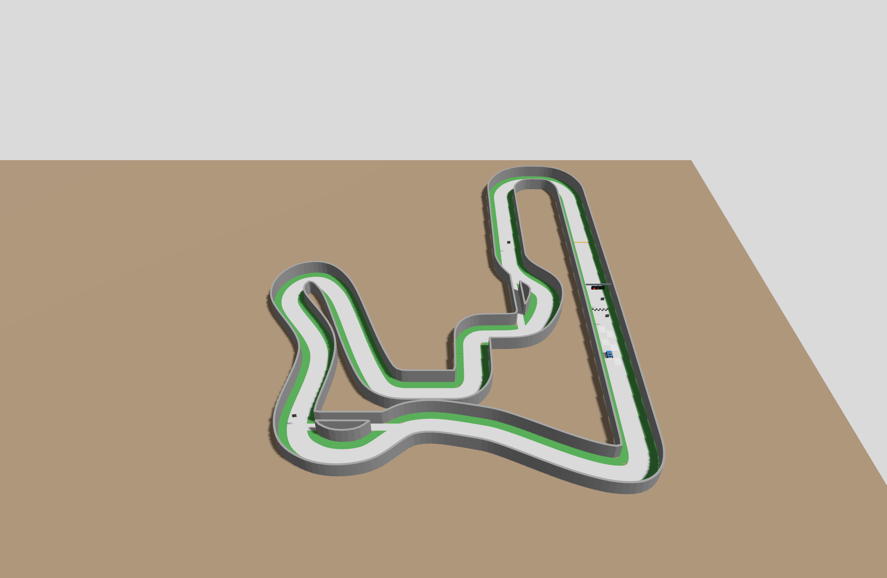
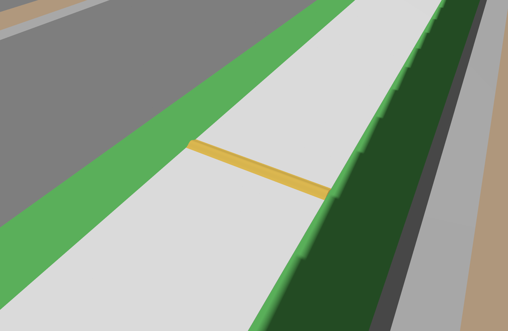

# 공식 10월 24일 트랙과 방지턱 모델 적용

2026-10-26 확인. 공식 최신 `v2026.10.24`를 팀 실행 월드에 적용했다. 도로는 백색, 벽은 회색, 홀 바닥은 목재색으로 바뀌었다. 방지턱은 현재 공개된 **폭 450 × 진행 방향 길이 50 × 높이 10 mm**의 주황색 2분할 STL을 사용한다. **길이 100/150 mm 완화안은 아직 미확정**이며, 자율주행 모드의 방지턱 비활성 설정은 유지한다.

## 출처와 보존

- [공식 릴리스 v2026.10.24](https://github.com/MOSW626/istech-it-arena/releases/tag/v2026.10.24), main `d8107de6ccff14ae17db7fb08732b55fed82b5b4`.
- [10/12 확인본 이후 비교](https://github.com/MOSW626/istech-it-arena/compare/b27f94730b869837a804a3088447103d6b35b87e...d8107de6ccff14ae17db7fb08732b55fed82b5b4): 1커밋, MANUAL·트랙 README·생성기·world.sdf 4경로. 경기 규칙·일정의 추가 변경은 이 비교에 없다.
- [보존 릴리스 ZIP](../../assets/track/official/v2026.10.24/it_arena_track_v2026.10.24.zip): 812,042 bytes, 23파일, SHA-256 `16b2f078609abea45ac3f351215df6576ced02bc6c40e933998ab91578de8a79`.
- [공식 저장소 스냅샷](../../assets/track/official/v2026.10.24/upstream_d8107de.zip): SHA-256 `50cbb2eb499005aca7976498a9f3578bf1a1e016e6dba546002da2d4da5ade50`. 선택한 원문·STL은 같은 폴더의 `upstream/`에도 보존한다.
- 변경 전 팀 실행본은 [previous_runtime.zip](../../artifacts/validation/2026-10-26/official_v2026_10_24_update/previous_runtime.zip), SHA-256 `728b63dd3acf3620b3a4a79f5645388297a1dfe041a22433c856869d81186262`로 보존했다. 기존 공식 ZIP·프로필·과거 실패는 덮어쓰지 않았다.

## 적용한 색과 기하

| 항목 | 공식 자료 | 팀 실행본 |
|---|---|---|
| 도로 | 백색 포맥스 3T, RGBA `0.90 0.90 0.90 1` | 공식값 적용 |
| 벽 | 직선 회색 포맥스 3T, 곡선 라이트그레이 EVA 10T | 공식 SDF처럼 벽 전체 `0.50 0.50 0.50 1` |
| 잔디 | 초록 인조잔디 6 mm | 기존 `0.13 0.55 0.13 1` 보존 |
| 홀 바닥 | 광택 목재 | 공식 목재색 `0.55 0.40 0.26 1`; 실제 광택·조도 재현은 아님 |
| 출발 그리드 | 흰색 채움 6칸 | 그대로 보존. 흰 도로와의 대비는 [공식 #16](https://github.com/MOSW626/istech-it-arena/issues/16)에서 질문 중 |
| 방지턱 | 주황 PLA, 반코사인 STL | 주황 `0.9 0.6 0.1 1`, 공개 225 mm 2분할 조립 시각 |

[공식 색·재질 설명](https://github.com/MOSW626/istech-it-arena/blob/d8107de6ccff14ae17db7fb08732b55fed82b5b4/track/README.md)에 따르면 회색은 실물 사진 전 추정치다. 재료 두께 3T/10T를 기존 충돌 벽 두께 50 mm에 대입하지 않았다. 주최 측도 이번 배포에서 색만 바꿨으며 실물 벽 배치·접촉면은 별도 확인이 필요하다. 도로가 벽보다 밝아졌으므로 추후 RGB 노면 인식을 도입할 때 옛 밝기 임계값을 재사용하지 않는다.

팀 실행 입력은 [`official_v2026.10.24.yaml`](../../config/tracks/official_v2026.10.24.yaml)이다. 이전 팀 입력은 9/14였으므로, 공식의 ‘직전 배포 대비 색만 변경’과 우리 팀의 갱신 범위는 다르다. 공식 9/14→10/24에는 신호등 배열 변경도 포함된다. 팀 실행본은 아래 임시 시설을 명시적으로 유지했으며, 변경 전후 **충돌 형상 3,730개는 링크 자세까지 동일**하다. 공식 설계, 코스 마커 0/20/30/45의 전체 링크·PNG도 같다. [기계 대조 결과](../../artifacts/validation/2026-10-26/official_v2026_10_24_update/geometry_audit.json).

## 방지턱 완화안의 상태

[공식 #2 마지막 운영진 댓글](https://github.com/MOSW626/istech-it-arena/issues/2#issuecomment-6127648353)은 현재 50 mm의 충격을 우려하며 길이 150 mm, 출력 부담이 크면 100 mm를 제안한다. 높이 10 mm·PLA 유지도 제안에 포함되며, 최종 합의 뒤 시뮬을 수정해 재배포하겠다고 적혀 있다. **10/26 조회에서 그 이후 댓글·완화 STL·완화 릴리스는 없었다.** 따라서 제안을 확정 규격으로 기록하거나 기존 모델을 임의로 늘리지 않았다. 댓글의 곡면 가속도 수치는 바퀴·접지·차체 동역학을 검증한 실측값이 아니다.

[공개 STL·제작 지침](https://github.com/MOSW626/istech-it-arena/tree/d8107de6ccff14ae17db7fb08732b55fed82b5b4/parts/speed_bump)은 시각에 그대로 사용한다. 원본 mm 좌표에 `0.001` 배율을 적용하고 턱과 홈을 조립했다. 충돌은 기존 반코사인 20구간 근사이며, 연결부의 0.2 mm 공차·접착·PLA 변형·충격 파손은 재현하지 않는다. 공식 배포 SDF의 직육면체 충돌과도 구분한다. 길이 100/150 mm 비교는 기존 [방지턱 기하 분석](../simulation/BUMP_GEOMETRY_2026_10_23.md)의 미확정 대안으로 남긴다.

## 유지한 팀 임시 설정

- 낮은 3등 신호등, 출발 기준에서 0.60 m 옮긴 위치와 결승 체크무늬를 유지한다. 공식 빨강 4세트→초록 시퀀스와 설치·시야 검증은 [B3 출발 작업](../autonomy/RACE_START_CONTRACT_2026_10_13.md)에서 별도로 진행한다. 이 데모 신호등을 공식 시설 구현 완료로 취급하지 않는다.
- 가정한 바닥 기둥·마커 철봉은 기본 코스에서 계속 제외한다. 공식 마커 자체의 각도·질감·크기는 수정하지 않는다.
- 지역 주행의 `speed_bump:=false`, 후보 기본 OFF, 센서 배치, 모터축 엔코더, 속도·마찰·보호 조건은 유지한다. 공개 벽 마찰계수 0.8만 보존하고 실제 도로·잔디 마찰을 새로 확정하지 않는다.

## 검증과 후속

공식 원본 해시·구조, 시각 색, STL 원본 동일성과 단위·조립 위치, 이전 릴리스 보존, 마커·그리드 보존, 생성 입력 변경 감지를 포함한 **관련 15회귀**와 SDF 검사가 통과했다. [생성·검사](../../artifacts/validation/2026-10-26/official_v2026_10_24_update/run1_build_verify/).

실제 Gazebo에서 전체 코스 2시점과 방지턱 근접 사진을 촬영했고, 시작·렌더링·프로세스 종료가 정상임을 확인했다. [촬영 결과](../../artifacts/validation/2026-10-26/official_v2026_10_24_update/run3_render/views/capture_report.json). 지상 기둥을 추가하지 않았고 공식 마커가 남아 있는 것도 사진으로 확인했다.

누적 저장소 전체 검사에서는 최초 27실패·5,640통과가 나왔다. 기록·재생 및 Jetson 이관의 명시 파일 목록에 새 M3·스캔·배열 모듈 7개가 빠져 있었고, 누적 수정의 후속 소스 출처 연결도 부족했다. 파일 목록을 보충하고 이전 계약을 덮어쓰지 않는 후속 계약을 추가했다. 이 과정에서 이미 등록된 변경을 중복 연결한 오류도 발견해 제거했으며 중간 4실패·1실패 기록을 보존했다. 수정 후 관련 242회귀가 통과했다. 상세 근거는 [게시 전 검사](../../artifacts/validation/2026-10-26/official_v2026_10_24_update/)에 있다.

최종 전체 회귀는 **5,668통과·실패/skip 0**, 검사 전후 소스 해시 동일이었다([run7](../../artifacts/validation/2026-10-26/official_v2026_10_24_update/run7_full_regression/)). 이후 launch 안내에 남은 구버전 이름과 시설 설명만 바꾸고 소스 출처 연결·관련 **242회귀**를 다시 통과했다([run8](../../artifacts/validation/2026-10-26/official_v2026_10_24_update/run8_display_regression/)). 소스 사본·로그는 Git에서도 줄바꿈을 정규화하지 않도록 보존한다.

이번 작업은 모델 적용과 누적 변경의 통합 검사이며 M1 전체 랩·M3 도로 내 병렬 주행·실물 방지턱 통과의 미해결 상태를 바꾸지 않는다.
