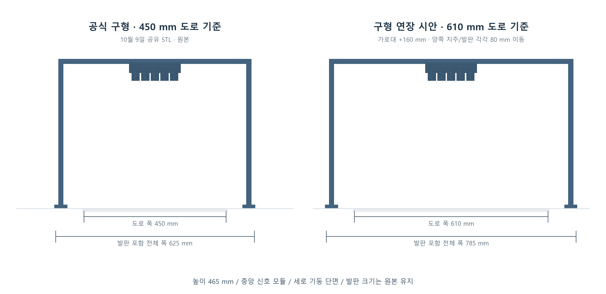

# 구형 직각 신호등의 610 mm 도로용 가로대 연장 시안

2026-11-13 사용자 요청으로 GPT가 공식 구형 STL에서 **가로대만 160 mm 연장**했다. 양쪽 세로 지주와 발판을 각각 바깥으로 80 mm 이동하며 중앙 신호 모듈·높이·지주 단면·발판 크기는 유지한다. 사용자 요청의 형상 시안이며 강도·3D 프린팅 적합성 검토나 실제 시설 채택은 범위에 포함하지 않았다. 운영 월드·시뮬레이션·공식 원본은 변경하지 않았다.

**후속 상태(11/13):** 사용자가 이 구형610 mm 연장 기둥을 확정안으로 전달했다. [시뮬 적용과 확인](../../artifacts/validation/2026-11-13/old_signal_610_r326_v1/README.md)을 진행했다. 아래 제작 시점의 시안/미검증 범위는 당시 기록이며, 실제 설치 좌표·강도·출력 적합성 검증으로 확대하지 않는다.

- **결과 STL:** [signal_610_old_style.stl](signal_610_old_style.stl)
- **정면 비교:** [comparison.png](comparison.png)
- **입체 미리보기:** [concept_isometric.png](concept_isometric.png)
- **생성 및 검증:** [build_concept.py](build_concept.py), [validation.json](validation.json)
- **공식 출처 확인:** [source_refs.json](source_refs.json)



## 공식 파일 이력

공식 저장소 `MOSW626/istech-it-arena`의 현재 main 트리, 이슈 댓글 전체 목록, 릴리스 첨부 목록을 조회했다. main은 `2e41f5674a4c8a611bb65e966ea8827d41611017`이다. 현재 main에는 실물 신호등 STL/STEP/F3D가 없으며, 제작 파일은 **공식 이슈 #3의 제작측 댓글 링크**로 배포됐다. 아래 시각은 한국 표준시다.

| 공개 시점 | 자료 | 판정 |
|---|---|---|
| 2026-10-09 18:06 | [제작측 구형 STL 공유 댓글](https://github.com/MOSW626/istech-it-arena/issues/3#issuecomment-6077879126), [Google Drive 원본](https://drive.google.com/file/d/1B-MHnh8RVSHMisNNaj1HAhhppH_msulI/view) | **공식 공개 이력에서 확인 가능한 가장 최근 구형 파일.** `STadium starting light.stl`, 358,084 bytes, 7,160삼각형. 지금 다시 받은 파일이 11/9 로컬 보관본과 바이트 일치 |
| 2026-10-29 03:38 | [제작측 치수·형상 이미지 설명](https://github.com/MOSW626/istech-it-arena/issues/3#issuecomment-6477451048) | 모듈 하단·광원 중심 높이·기울기 설명과 이미지. 별도 새 CAD 첨부는 없음 |
| 2026-11-02 00:40 | [공식 시뮬 반영 설명](https://github.com/MOSW626/istech-it-arena/issues/3#issuecomment-6560118169) | 시뮬 모델 반영 기록. 별도 실물 CAD 배포본은 아님 |
| 2026-11-12 22:06 | [제작측 신형 ZIP 공유 댓글](https://github.com/MOSW626/istech-it-arena/issues/3#issuecomment-6824443207), [ZIP](https://github.com/user-attachments/files/34749162/STardium.starting.light_new.zip) | 삼각형 보강·앞뒤 버팀대가 있는 새 형상. 구형 연장 시안의 기하 입력으로 쓰지 않음 |

조회한 공식 공개 자료에서 구형 공유 링크와 11/12 신형 사이의 별도 실물 CAD 파일은 찾지 못했다. 비공개 공유나 Google Drive 내부 과거 리비전을 조사한 결과는 아니다. 원 STL에는 길이 단위 메타데이터가 없으므로, 제작측 치수와 일치하는 **mm 해석**을 유지한다.

로컬 보관 원본:

- [구형 STL](../../artifacts/validation/2026-11-09/signal_post_source_v1/download/STadium_starting_light.stl)
- [11/12 신형 ZIP](../../artifacts/validation/2026-11-12/signal_post_revision_r291_v1/STardium.starting.light_new.zip)
- [11/12 신형 STL](../../artifacts/validation/2026-11-12/signal_post_revision_r291_v1/STardium_starting_light_new.stl)
- [앞선 구형 분석](../../artifacts/validation/2026-11-09/signal_post_source_v1/README.md), [신형 분석](../../artifacts/validation/2026-11-12/signal_post_revision_r291_v1/README.md)

## 수정 치수

도로 폭 증가분 `610−450=160 mm`를 더했다. 전체 모델을 `610/450` 비율로 확대하지 않았다. 도로 폭 610 mm와 구조물 전체 폭은 다른 값이다.

| 항목 | 구형 원본 | 연장 시안 |
|---|---:|---:|
| 대응 도로 폭 | 450 mm | 610 mm |
| 가로대 전체 길이 | 600 mm | 760 mm |
| 양쪽 지주 중심 간격 | 585 mm | 745 mm |
| 지주 안쪽 사이 공간 | 570 mm | 730 mm |
| 발판 포함 전체 폭 | 625 mm | 785 mm |
| 전체 높이 | 465 mm | 465 mm |
| 전체 앞뒤 깊이 | 약 57.319 mm | 약 57.319 mm |
| 세로 지주 단면 | 15 × 약 14.619 mm | 유지 |
| 각 발판 | 40 × 50 × 10 mm | 유지 |

양쪽 도로 끝에서 지주 안쪽까지 기존 60 mm 여유를 유지하는 시안이다. 실제 610 mm 코스의 설치 승인이나 시설 위치 확정이라는 뜻은 아니다.

## 확인 결과와 파일 사용

- 출력은 원본과 동일한 7,160삼각형 STL이다. 중앙 모듈 7,033면의 법선·정점·속성 레코드는 **바이트 단위로 동일**하다.
- X좌표만 `−80 / 0 / +80 mm` 이동했다. 모든 Y/Z좌표는 원본과 동일하다.
- 길이가 늘어난 18면은 바닥 기준 높이 450–465 mm의 수평 가로대에만 있다. 지주와 발판은 강체 이동이며 모서리 길이가 유지됐다.
- 위상·삼각형 방향·면적을 대조하고 STL 재로딩을 확인했다. 경계 변과 비다양체 변은 각각 0이며, 이는 강도나 출력 적합성 인증이 아니다.
- 원본 구형과 신형 파일의 SHA-256은 작업 전후 동일하다. 기존 공식 ZIP/STL과 실행 모델을 덮어쓰지 않았다.

STL은 원본 축 방향을 유지했다: **X=가로, Y=세로, Z=앞뒤**. 가져올 때 길이 단위는 mm로 사용한다. 입체 미리보기에서만 보기 편하게 Z가 위쪽인 좌표로 바꿨다. 결과물은 삼각망 STL이며 Fusion 편집 이력이 있는 F3D나 STEP 솔리드가 아니다. 이번 단순 연장은 NumPy로 직접 처리했으므로 Fusion 360·MCP·컴퓨터 UI 조작은 필요하지 않았다.

재생성은 저장소 루트에서 NumPy·Matplotlib가 설치된 Python으로 실행한다.

```powershell
py outputs/traffic_light_610_concept_2026_11_13/build_concept.py
```
